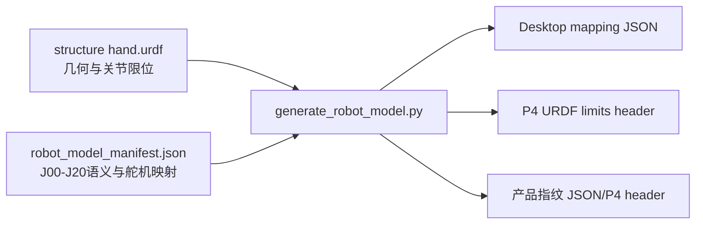

# P0：机器人模型单一数据源与产品指纹

最后核对：2026-08-01
状态：当前有效；文件名中的 20260731 表示阶段建立日期，不表示内容冻结。

当前总索引见 [`docs/README.md`](../../../docs/README.md)。模型发生冲突时，以当前 URDF、`robot_model_manifest.json` 和生成器校验结果为事实源，不以本文抄录值覆盖生成物。

## 1. 目标

P0 解决两个基础问题：

1. 更换 URDF 后，Desktop 与 P4 不再分别手工修改关节范围。
2. 每次实验数据都能确认实际使用的固件源码、控制参数、硬件映射和 URDF。

## 2. 单一数据源



- `hand.urdf` 是几何、mesh 引用和关节 `lower/upper` 的唯一来源。
- `robot_model_manifest.json` 是 J00-J20 顺序、显示名、CAD 名称、运行时名称、M00-M26 绑定和默认标定范围的唯一来源。
- 以下文件均为生成物，禁止手工编辑：
  - `desktop/resources/config/urdf_joint_mapping_v2.json`
  - `ESP32-P4/ServoBoardMain/src/generated/UrdfJointLimits.generated.h`
  - `desktop/resources/config/product_fingerprint.json`
  - `ESP32-P4/ServoBoardMain/src/generated/ProductFingerprint.generated.h`

Wuji 模型和契约采用独立维护流程；本生成器和 structure 更新脚本不会修改 `wuji_hand_ws`。

## 3. 更新 URDF

从 structure 仓库拉取并完成全链路更新：

```powershell
powershell.exe -NoProfile -ExecutionPolicy Bypass `
  -File tools\update_structure_urdf.ps1 `
  -StructureRepo "D:\mmhand structure"
```

只使用本地 structure，不执行 `git pull`：

```powershell
powershell.exe -NoProfile -ExecutionPolicy Bypass `
  -File tools\update_structure_urdf.ps1 `
  -StructureRepo "D:\mmhand structure" `
  -NoPull
```

该命令依次执行：URDF 适配、资源校验、跨端生成、生成物陈旧检查、P4 架构门禁、模型回归测试和 P4 Debug 固件编译。任一步失败都会返回非零退出码。开发阶段若只检查模型，可临时追加 `-SkipP4Build`。

仅重新生成当前模型产物：

```powershell
python tools\generate_robot_model.py
```

CI/提交前只检查是否有人改了源却忘记重新生成：

```powershell
python tools\generate_robot_model.py --check
```

## 4. 产品指纹

P4 通过上行包 `PACKET_TYPE_PRODUCT_FINGERPRINT (0x14)` 周期上报：

| 字段 | 说明 |
|---|---|
| `control_model_crc` | 21 关节控制限位和映射版本 |
| `visual_model_crc` | 当前 URDF 文件内容 |
| `hardware_map_crc` | Jxx、Mxx 和单双腱关系 |
| `parameter_crc` | P4 `src/config/*.h` 控制参数 |
| `firmware_source_crc` | P4 `.ino/.c/.cpp/.h` 源码快照 |
| `structure_commit_crc` | structure 源提交号 |

Desktop 开始 Save Data 时，在 `meta.json` 的 `product_fingerprint` 中同时保存：

- `desktop_expected`：当前电脑仓库生成的期望值。
- `p4_reported`：串口连接设备实际烧录固件上报值。
- `p4_report_received`：开始记录前是否已经收到指纹包。

两组 CRC 不一致通常表示烧错固件、换了 URDF 未重新生成，或控制参数修改后没有重新烧录。

## 5. 门禁

```powershell
python -m pytest tests\desktop -q
powershell.exe -NoProfile -ExecutionPolicy Bypass `
  -File tools\p4_architecture\check_p4_architecture.ps1
powershell.exe -NoProfile -ExecutionPolicy Bypass `
  -File tools\p4_debug\build_debug.ps1 -ReuseCache
```

生成器会拒绝以下问题：J00-J20 顺序错误、遗漏关节、M00-M26 重复绑定、URDF 缺少目标关节、非法或零长度关节限位。

不要在文档中固定记录“某次共有多少测试通过”或某次 firmware bytes；这类数字会随代码变化。每次发布应保存命令输出和产品指纹，以本次执行结果为准。
