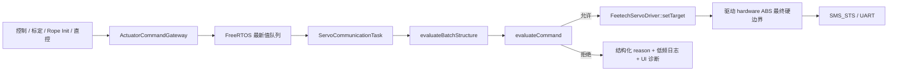
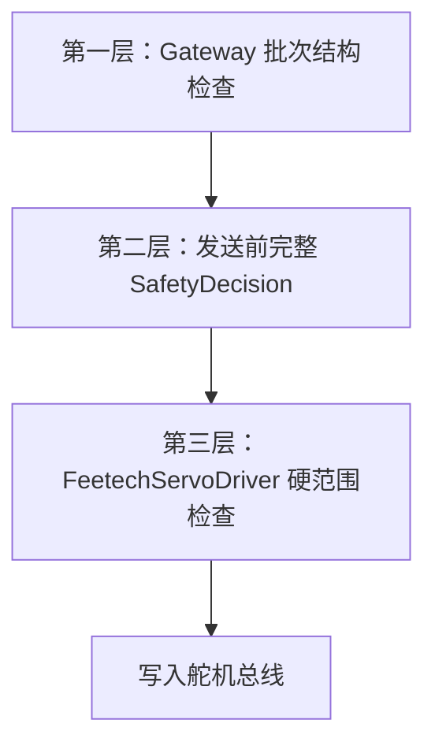
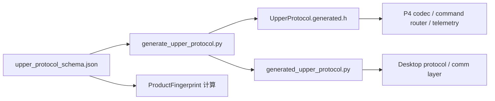

# P1：统一舵机安全决策与上下位机协议 Schema

建立日期：2026-07-31
最后核对：2026-08-01
状态：当前有效；总索引见 [`docs/README.md`](../../../docs/README.md)。

## 1. 本阶段目标

P1 完成两项高优先级改造：

1. 把舵机命令在真正进入飞特驱动前所需的安全检查集中到 `ServoSafetyPolicy`，返回可记录、
   可测试的 `ServoSafetyDecision`，不再只返回含义不明的 `bool`。
2. 以 `upper_protocol_schema.json` 作为上下位机协议的唯一数据源，自动生成 C++ 与 Python
   常量、固定 payload 长度表，避免两端手工维护后产生协议漂移。

本阶段不修改控制算法、标定顺序、PID 参数、协议编号及已有数据包字段。

## 2. 舵机最终安全决策

### 2.1 调用链



发布入口和消费端都会检查 batch 结构。消费端的再次检查不能省略，因为队列是跨任务边界，
只有消费端检查才能保证损坏的 `busIndex` 或 `servoId` 不会先被用于访问驱动数组。

### 2.2 判定顺序

单条命令依次检查：

| 顺序 | 条件 | 拒绝原因 | 说明 |
| ---: | --- | --- | --- |
| 1 | 命令索引、Mxx 映射无效 | `InvalidCommand` | 防止访问非法数组或总线 |
| 2 | batch source 与当前 owner 不一致 | `InvalidOwner` | 阻止旧任务或低优先级任务抢占 |
| 3 | 舵机不在线 | `Offline` | 不向失联舵机写目标 |
| 4 | 负反馈/Rope Init 下多圈未知 | `MultiTurnUnknown` | 这两种模式必须依赖可信 logical ABS |
| 5 | 舵机实际圈数越界 | `TurnOverflow` | 保持扭矩关闭，等待 Reset Zero |
| 6 | 目标超出本轮 logical 工作范围 | `LogicalRange` | 保护 LUT/标定形成的可控范围 |
| 7 | logical target 换算后超飞特硬范围 | `HardwareRange` | 使用 `logical - logicalOffset` 判断 |
| 8 | 全部通过 | `None` | 使用 `appliedAbs` 进入驱动 |

自动标定和人工直控允许在 Turn Unknown 条件下执行恢复动作，因此只在
`RUN_FEEDBACK` 和 `ROPE_INIT_RUNNING` 强制要求多圈可信。圈数溢出无论模式如何都拒绝。

### 2.3 三层防线



- 第一层尽早拒绝明显错误，避免无效命令占用队列。
- 第二层使用最新 owner、在线位图、多圈状态和 logical range，是主要安全策略。
- 第三层不依赖上层正确性，永远禁止向 SDK 发送超硬件范围的值。

拒绝日志按 Mxx 最多每 500 ms 输出一次，防止 10 ms 控制循环的重复目标淹没串口；
logical/hardware range 的 UI 诊断与日志使用同一限频节奏。

## 3. 上下位机协议单一数据源

### 3.1 生成链



唯一手工维护文件：

`desktop/resources/config/upper_protocol_schema.json`

自动生成文件：

- `ESP32-P4/ServoBoardMain/src/generated/UpperProtocol.generated.h`
- `desktop/core/generated_upper_protocol.py`

`UpperCommProtocol.h` 只保留稳定 include 入口，业务代码无需知道生成文件的真实路径。

### 3.2 Schema 内容

当前 schema 统一保存：

- 帧头、帧尾、断开哨兵和 P4 尾部时间戳长度；
- 21 个关节、27 个舵机和 16384 磁编模数；
- 上行 packet type；
- 下行 command 编号及固定 payload 长度；
- ACK、Manual Flash 保存状态；
- P4 串口缓冲区与 heartbeat 运行参数。

每个 packet、command 和 ACK 状态必须填写包含中文的 `description`。生成器会把说明同步写入
C++/Python 常量旁；缺少中文说明或说明包含不安全的换行/注释终止符时，生成直接失败，防止
后续协议编号重新退化为“只能靠名字猜用途”。

C++ 解码器和 Python 编码器都使用生成的 payload 长度表。Python 在构造串口帧时会立即拒绝
未知命令或长度不匹配的 payload，错误不会拖到 P4 端才暴露。

## 4. 修改协议的标准步骤

1. 只修改 `desktop/resources/config/upper_protocol_schema.json`。
2. 生成两端代码：

```powershell
python tools\generate_upper_protocol.py
```

3. 协议 schema 已纳入产品指纹，随后刷新产品清单：

```powershell
python tools\generate_robot_model.py
```

4. 检查生成物是否最新：

```powershell
python tools\generate_upper_protocol.py --check
python tools\generate_robot_model.py --check
```

5. 运行测试和 P4 编译。禁止直接编辑两个 `generated` 文件。

## 5. 关键修改位置

| 文件 | 修改内容 |
| --- | --- |
| `domain/SafetyTypes.h` | 扩展 `ServoRejectReason` 和 `ServoSafetyDecision` |
| `actuator/ServoSafetyPolicy.h/.cpp` | 新增批次与逐命令纯策略判断 |
| `actuator/ActuatorCommandGateway.cpp` | 发布入口使用结构化批次检查 |
| `communication/servo/ServoCommunicationTask.cpp` | 最终发送前构造安全上下文、执行决策、记录拒绝 |
| `resources/config/upper_protocol_schema.json` | 协议唯一数据源 |
| `tools/generate_upper_protocol.py` | 校验并生成 C++/Python 协议文件 |
| `UpperCommProtocol.h` | 改为稳定生成文件入口 |
| `UpperCommCodec.cpp` | 使用生成的命令 payload 长度表 |
| `desktop/core/protocol.py` | 导入生成常量，并在发包前校验 payload 长度 |
| `tools/p4_architecture/check_p4_architecture.ps1` | 增加生成物和最终安全门静态检查 |
| `tests/tools/test_generate_upper_protocol.py` | 检查两端编号、长度和维度一致性 |

## 6. 验证方法

本文不固化测试数量、Flash bytes 或 RAM 占比；这些快照在下一次代码更新后就会过期。每次
提交以本次命令输出为准：

```powershell
python tools\generate_upper_protocol.py --check
python tools\generate_robot_model.py --check
powershell.exe -NoProfile -ExecutionPolicy Bypass `
  -File tools\p4_architecture\check_p4_architecture.ps1
python -m pytest tests\desktop\core tests\tools
```

生成器支持 `--check`，架构门禁会拒绝过期生成物、业务层直写目标队列，以及绕过最终
安全决策或 driver 硬边界的修改。固件大小与动态内存占比应从当次 Arduino Debug 构建日志归档。

## 7. P1 后续补齐项与仍未处理内容

- `EmergencyStop`、owner/state 交叉准入和目标 freshness 已在后续补齐：E-STOP 使用仅 RESET
  清除的最终发送锁存；状态切换竞态中的旧 owner 批次会返回 `InvalidState`；超过 500 ms 的
  单槽目标会返回 `StaleTarget`。三项拒绝都发生在 ServoCommunicationTask 调用驱动之前。
- UI、ROS2 和 Replay 的 `CONTROL` owner 已增加 1000 ms 上位机租约。失联时状态机关闭普通
  控制、清目标邮箱，并通过带 token 的批次保持 active 电机当前 ABS；Servo 任务确认完整写入
  后才释放 owner，确认失败或超过 500 ms 则升级为 E-STOP。自动标定和 Rope Init 不依赖该租约。
- `TaskSharedData_t` 与 FreeRTOS 队列仍是跨平台耦合点，属于后续 Mailbox/Repository 改造。
- 自动标定与上位机通信大文件拆分不属于本阶段，避免把结构重构与行为重写混在一次验证中。

P1 的收益是把两类高风险“人工同步”变成可执行契约：舵机命令在唯一位置获得明确安全结论，
上下位机协议由唯一 schema 生成。以后新增规则或协议字段时，修改位置、生成步骤和失败原因都可追踪。
