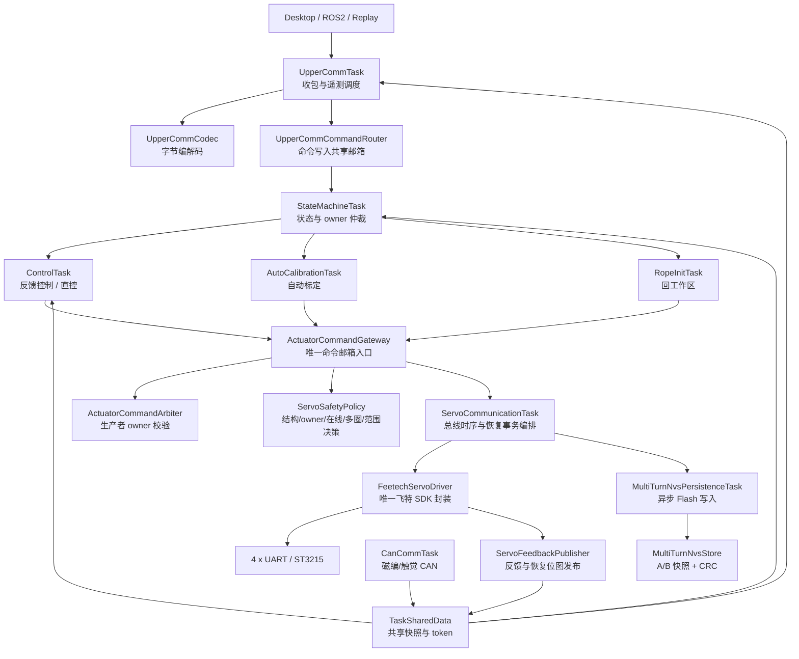
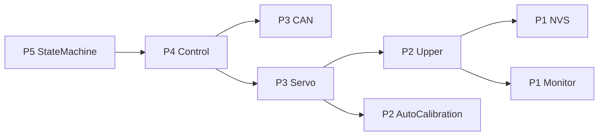
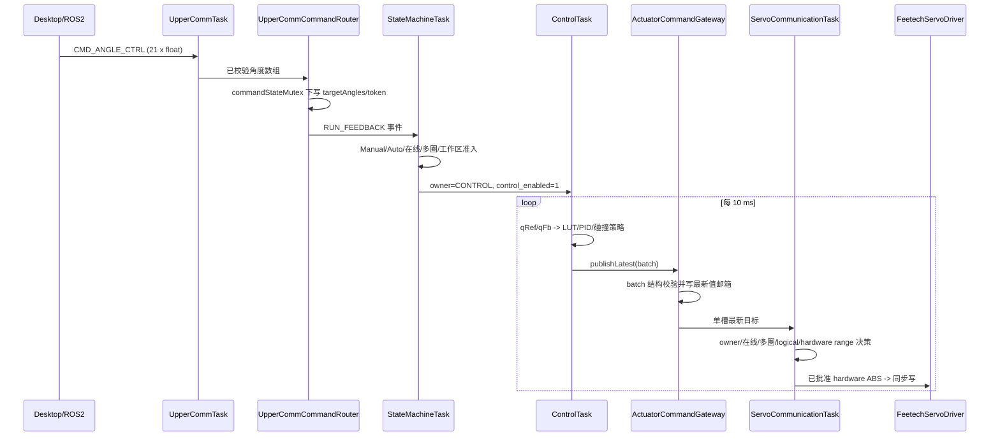
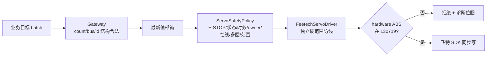
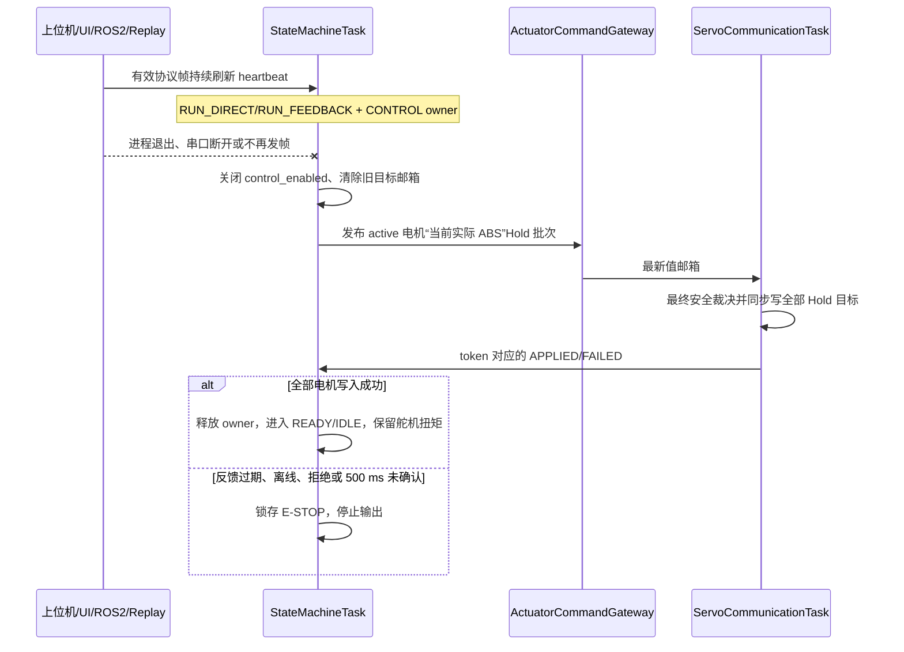
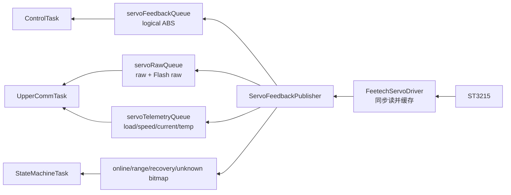
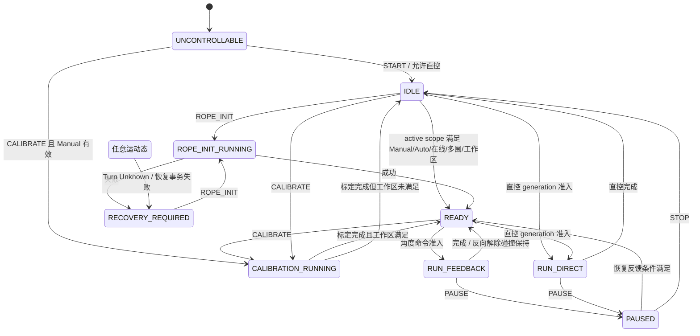
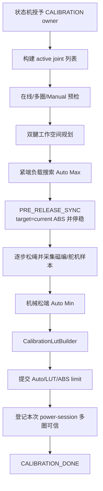
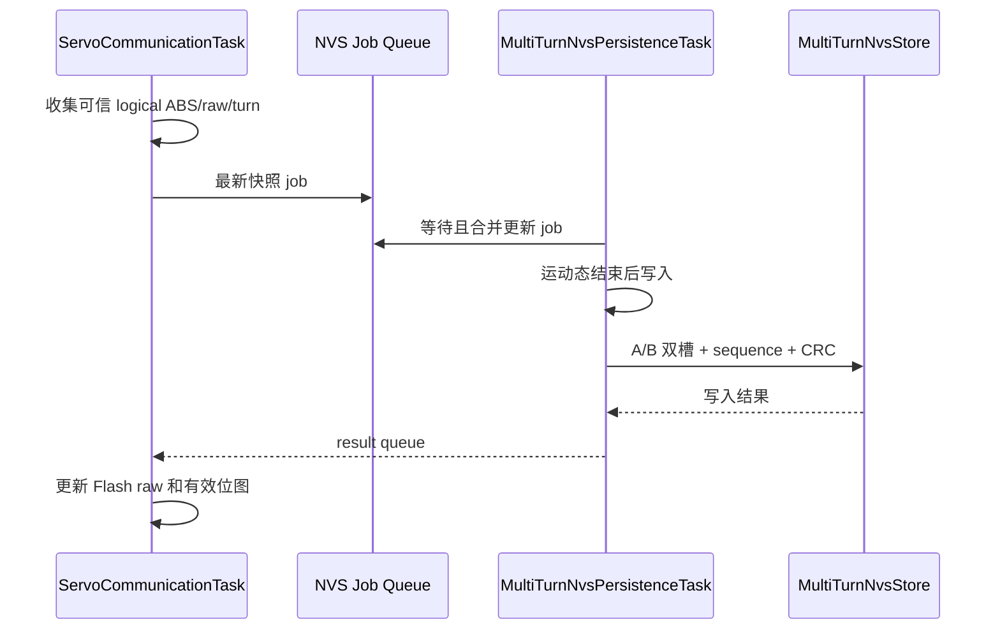
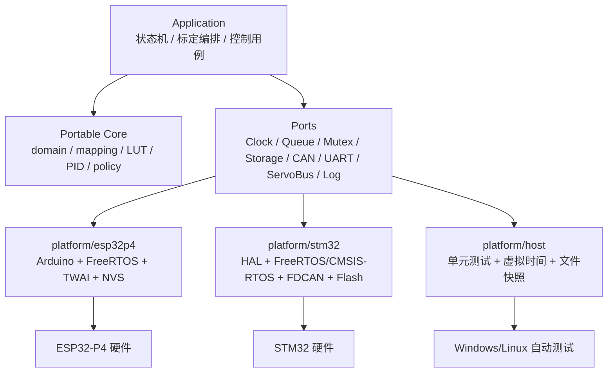

# ESP32-P4 固件架构重构说明

建立日期：2026-07-31

最后核对：2026-08-01
适用工程：`ESP32-P4/ServoBoardMain`  
本地重构分支：`codex/p4-architecture-refactor`

状态：当前有效。跨模块阅读入口见 [`docs/README.md`](../../../docs/README.md)；发生冲突时，
以当前源码、JSON schema/manifest 和生成器检查为事实源。

## 1. 文档目的

本文用于回答四个问题：

1. P4 固件现在由哪些层组成，每个文件负责什么。
2. 一条关节命令如何从上位机到达舵机，一帧反馈又如何返回。
3. 状态机、自动标定、多圈恢复、NVS 和安全检查之间如何协作。
4. 后续增加功能时应该修改哪里，哪些边界绝对不能绕过。

本轮重构坚持以下兼容约束：

- 不改变上位机串口协议的命令编号、包编号和字段字节布局。
- 不改变 Manual 标定、多圈快照的 NVS namespace、key、A/B 槽和 CRC 算法。
- 不改变 21 关节、27 舵机及硬件映射含义。
- 不改变 Arduino 入口和烧录方式。
- 每完成一个阶段都使用 `arduino-cli` 完整编译。

## 2. 重构目标

重构前主要问题：

- 参数散落在任务实现文件中，难以判断一个阈值是否仍在生效。
- `ServoCommunicationTask.cpp` 同时包含飞特 SDK、总线调度、反馈、热插拔和 NVS。
- 多个业务任务可以直接操作 `servoTargetQueue`，曾导致控制任务覆盖标定命令。
- 状态、命令、硬件数据类型集中在大型共享头文件中。
- 上位机协议编解码、命令语义和遥测发送混在同一文件。
- 大文件中存在重复的角度映射、反馈读取和 LUT 构建逻辑。

重构后的核心原则：

> 业务层只表达“希望哪个舵机到哪里”；统一执行层决定“当前谁有权控制、命令是否安全、最终怎样发送”。

## 3. 总体架构



## 4. 分层依赖规则

### 4.1 允许的依赖方向

```text
app/task orchestration
    -> system / calibration / control / communication
    -> actuator gateway / policy
    -> hardware abstraction
    -> Feetech SDK / Arduino HAL
```

### 4.2 强制边界

1. 飞特 `SMS_STS`、`SyncWritePosEx`、`FeedBack` 等 SDK API 只能出现在
   `hardware/servo/FeetechServoDriver.*`。
2. `servoTargetQueue` 的 `xQueueOverwrite/xQueueReceive/xQueueReset` 只能出现在
   `actuator/ActuatorCommandGateway.cpp`。
3. 业务任务不得直接写舵机 UART。
4. 状态切换和 `servo_target_owner` 由状态机管理，控制任务不得自行抢占 owner。
5. 固定参数放 `config/`，硬件映射放 `HardwareMap`，协议编号放
   `UpperCommProtocol`，三者不能混放。
6. 多字段共享快照使用互斥锁或 `SharedSafetyGuard`；单个 token/bitmap 使用
   `platform/AtomicValue.h`。

静态检查命令：

```powershell
powershell.exe -NoProfile -ExecutionPolicy Bypass `
  -File tools\p4_architecture\check_p4_architecture.ps1
```

## 5. 配置层

| 文件 | 负责内容 |
| --- | --- |
| `config/Config.h` | 配置聚合入口 |
| `config/DimensionsConfig.h` | 21 关节、27 舵机、4 总线、触觉维度 |
| `config/BoardConfig.h` | CAN/UART 引脚和波特率 |
| `config/ServoConfig.h` | 舵机默认速度、同步读、多圈 NVS 协调参数 |
| `config/ControlConfig.h` | 控制周期、PID、碰撞检测、完成判定 |
| `config/CalibrationConfig.h` | 标定负载、步长、停稳、工作空间参数 |
| `config/SafetyConfig.h` | ±30719 硬边界、Reset Zero 和反馈超时 |
| `config/DiagnosticsConfig.h` | 卡顿日志阈值与日志节流 |
| `config/TaskConfig.h` | FreeRTOS 任务优先级、栈大小 |

配置文件只保存编译期常量，不保存 Manual、Auto、LUT、PID 历史或在线状态。

## 6. 数据类型层

`domain/` 只定义稳定数据结构，不执行业务逻辑。

| 文件 | 主要类型 |
| --- | --- |
| `SystemTypes.h` | 系统状态、事件、准入结果 |
| `ActuatorTypes.h` | 舵机目标 batch、控制命令快照 |
| `ServoTypes.h` | 舵机角度、raw、遥测反馈 |
| `JointTypes.h` | 关节角、调试数据 |
| `CalibrationTypes.h` | Manual/Auto/LUT/标定诊断 |
| `RecoveryTypes.h` | 多圈 NVS job/result |
| `SafetyTypes.h` | 故障与安全决策数据 |
| `HardwareTypes.h` | 关节/舵机硬件映射结构 |
| `TelemetryTypes.h` | CAN、触觉和运行遥测 |

这些类型构成任务间内部 ABI。若修改字段宽度或数组长度，必须同步检查上下位机协议、
NVS 快照和所有队列元素大小。

## 7. FreeRTOS 任务

| 任务 | 优先级 | 栈 | 主要职责 |
| --- | ---: | ---: | --- |
| `stateMachineTask` | 5 | 4096 | 最高级业务仲裁，状态、故障和 owner |
| `controlTask` | 4 | 8192 | 10 ms 控制、PID、碰撞检测和目标生成 |
| `canCommunicationTask` | 3 | 4096 | 磁编码器与触觉 CAN 接收 |
| `servoCommunicationTask` | 3 | 6144 | 舵机 UART 读写时序、热插拔和恢复事务 |
| `upperCommunicationTask` | 2 | 8192 | 上位机协议和遥测 |
| `autoCalibrationTask` | 2 | 8192 | 仅在标定期间动态创建 |
| `ropeInitTask` | 2 | 任务定义值 | 50 ms 小步把 active scope 拉回工作区 |
| `multiTurnNvsPersist` | 1 | 4096 | 异步写多圈 Flash |
| `taskRuntimeMonitor` | 1 | 4096 | 周期、执行时间和栈余量统计 |



优先级只表达抢占关系，不表示数据所有权。数据所有权仍由 queue、mutex、owner 和 token
共同保证。

## 8. 命令链路

### 8.1 关节反馈控制



### 8.2 直控

直控命令先写入 `pendingMotorTargetRaw` 并携带 generation。状态机确认状态、在线和多圈
条件后，`DirectCommandCoordinator` 才将同一 generation 提升为 applied 命令。旧完成事件
无法释放新命令。

### 8.3 为什么使用单槽“最新值邮箱”

舵机位置控制关注最新目标，而不是补发全部历史帧。`xQueueOverwrite` 可以避免上位机或
PID 产生积压。模式切换时 `ActuatorCommandGateway::clearPending()` 清除旧目标。

## 9. 舵机执行与安全

舵机命令经过三层检查：



`logical ABS` 是 P4 连续坐标；`hardware ABS` 是舵机本次上电会话坐标：

```text
hardwareAbs = logicalAbs - logicalOffset
```

每台舵机独立维护 `logicalOffset`。一台舵机掉电不会改变其他舵机的逻辑行程。

`ServoSafetyPolicy` 返回结构化 `ServoSafetyDecision`，包含 requested/applied/hardware ABS、
Mxx、命令索引和拒绝 reason。执行层冻结一次安全上下文后，检查顺序为：E-STOP 锁存、
owner 与系统状态匹配、目标批次年龄、batch source 与当前 owner、在线、多圈可信、turn
overflow、会话 logical range，以及 offset 换算后的 hardware ABS `[-30719, 30719]`。
因此 `EmergencyStop/InvalidState/StaleTarget` 已经是实际最终门禁，而不是只供日志使用的枚举。
驱动仍保留 hardware range 复核，防止未来业务层或策略层回归时把越界值送入飞特 SDK。
拒绝日志按 Mxx 每 500 ms 节流。

自动标定和受控直控可以恢复 Turn Unknown，但圈数溢出在任何模式都拒绝。目标批次默认最多
存活 500 ms：正常 10 ms 控制帧不会受到影响，队列停顿后遗留的旧位置却不能重新驱动舵机。

### 9.1 上位机控制租约与失联 Hold

普通 UI、ROS2 和 Replay 共用 `CONTROL` owner，必须持续收到有效上位机协议帧；自动标定和
Rope Init 使用固件内部 `CALIBRATION` owner，不依赖上位机心跳。当前租约超时为 1000 ms：



Hold 使用事务 token，不能仅凭“队列写入成功”判断舵机已经收到命令。心跳后来恢复也不会自动
续跑旧目标，用户必须重新发起控制。这样既避免上位机崩溃后持续追踪最后目标，也不会让标定
或 Rope Init 因 UI 刷新暂时卡顿而被中断。

### 9.2 为什么安全检查不放进一个巨型文件

安全规则应当统一归属，但仍按职责分层：`ServoSafetyPolicy` 负责纯数据最终裁决；
`HostControlLeasePolicy` 负责 owner 租约规则；状态机负责 Hold/E-STOP 状态转换；
`FeetechServoDriver` 负责硬件绝对边界。配置阈值集中在 `SafetyConfig.h`。这种结构使每条规则
只有一个权威实现，同时保留执行前、状态机和驱动三层防线，后续移植 STM32 时只替换平台层。

## 10. 反馈链路



`ServoFeedbackPublisher` 不主动访问串口，只读取驱动已经完成的缓存，因此不会在发布阶段
插入额外的总线事务。

## 11. 顶层状态机



重要规则：

- Manual 缺失只禁止反馈和自动标定，不禁止安全直控。
- 反馈控制只能从 `READY` 进入。
- `RECOVERY_REQUIRED` 必须先完成 New Device Reset 或 Rope Init 对应恢复流程。
- `STOP/E-STOP` 使 owner 归零并清除待执行目标。

## 12. 自动标定

自动标定由四类模块协作：

| 模块 | 职责 |
| --- | --- |
| `AutoCalibrationTask` | 单腱/双腱状态机和工作空间编排 |
| `CalibrationFeedbackReader` | 读取并验证新鲜的舵机、磁编、遥测快照 |
| `CalibrationLutBuilder` | 整理样本、插值并生成标定 LUT |
| `CalibrationMath` | 环形磁编、Manual/Auto 和角度映射数学 |



标定任务只能通过 `ActuatorCommandGateway` 发布目标。标定运动开始后，舵机通信任务暂停
额外离线探测和热插拔事务，避免破坏双电机连续动作。

## 13. 多圈与 NVS 恢复

### 13.1 两类坐标

- `raw`：0..4095 单圈值。
- `hardware ABS`：舵机本次上电会话多圈值。
- `logical ABS`：P4 对外连续坐标，等于 `hardware ABS + logicalOffset`。

### 13.2 保存链路



### 13.3 热插拔

P4 持续供电而单台舵机掉电时，通信任务冻结该电机最后可信的 RAM 锚点。重新上线后：

1. 重新配置舵机多圈模式。
2. 比较当前 raw 与 RAM/NVS 锚点。
3. 在容差内恢复 `logicalOffset`。
4. 无法确认时仅该电机进入 Turn Unknown。
5. New Device Reset 只处理受影响 scope，并提示重新标定对应关节。

## 14. 上位机通信

`UpperCommTask` 仍是串口收发任务，但内部职责已拆分：

- `UpperCommCodec`：大端整数、float、CRC、长度和角度数组编解码。
- `UpperCommCommandRouter`：将已解析命令写入命令邮箱或 pending direct。
- `UpperCommProtocol`：稳定命令/包编号和固定长度。
- `UpperCommTask`：串口帧状态机、命令分派和遥测调度。

协议兼容红线：协议唯一事实源已改为
`desktop/resources/config/upper_protocol_schema.json`。任何编号或固定 payload 长度变化必须先
修改 schema，再运行 `tools/generate_upper_protocol.py` 生成 P4/Python 常量并增加往返测试；
禁止分别手改 `UpperCommProtocol.h` 和 `desktop/core/protocol.py`。当前上位机外层帧依靠帧头、
类型、定长 payload、帧尾和业务校验，尚无通用 CRC/sequence；特定快照使用 CRC helper 不等于
整帧均有 CRC。完整说明见 [`通信协议与数据校验.md`](../../../docs/通信协议与数据校验.md)。

## 15. 完整源码文件职责

### 15.1 `actuator/`

| 文件 | 职责 |
| --- | --- |
| `ActuatorCommandGateway.cpp/.h` | 舵机目标邮箱唯一收发入口 |
| `ActuatorCommandArbiter.cpp/.h` | 检查 batch 生产者是否拥有当前 owner |
| `ServoSafetyPolicy.cpp/.h` | E-STOP、状态、时效、owner、在线、多圈和 logical/hardware range 的最终决策 |

### 15.2 `calibration/`

| 文件 | 职责 |
| --- | --- |
| `AutoCalibrationTask.cpp/.h` | 单腱/双腱自动标定与工作空间主编排 |
| `CalibrationFeedbackReader.cpp/.h` | 标定专用反馈快照读取与新鲜度校验 |
| `CalibrationLutBuilder.cpp/.h` | 样本整理、插值和 Tendon LUT 构建 |
| `CalibrationMath.cpp/.h` | 环形 raw、Manual/Auto、动态角度映射 |
| `CalibrationTask.cpp/.h` | 标定 RAM 数据、结果查询与提交服务 |
| `RopeInitTask.cpp/.h` | 将工作区外关节安全拉回动态下边界 |

### 15.3 `communication/`

| 文件 | 职责 |
| --- | --- |
| `can/CanCommTask.cpp/.h` | CAN/TWAI、磁编、触觉和 S3 错误接收 |
| `servo/ServoCommunicationTask.cpp/.h` | 舵机总线周期和多圈事务编排 |
| `servo/ServoFeedbackPublisher.cpp/.h` | 舵机反馈与恢复/越界位图发布 |
| `servo/ServoPositionRange.h` | logical/hardware ABS 转换工具 |
| `upper/UpperCommCodec.cpp/.h` | 上位机协议基础编解码 |
| `upper/UpperCommCommandRouter.cpp/.h` | 上位机控制命令路由 |
| `upper/UpperCommProtocol.h` | 命令号、包号和协议常量 |
| `upper/UpperCommTask.cpp/.h` | 串口收发、命令分派和遥测调度 |

### 15.4 `config/`

| 文件 | 职责 |
| --- | --- |
| `BoardConfig.h` | 板级引脚和通信速率 |
| `CalibrationConfig.h` | 标定固定参数 |
| `Config.h` | 配置聚合 |
| `ControlConfig.h` | 控制/PID/碰撞参数 |
| `DiagnosticsConfig.h` | 诊断和日志节流 |
| `DimensionsConfig.h` | 固定数组维度 |
| `SafetyConfig.h` | 硬边界和反馈超时 |
| `ServoConfig.h` | 舵机和多圈协调参数 |
| `TaskConfig.h` | 任务优先级和栈 |

### 15.5 `control/`

| 文件 | 职责 |
| --- | --- |
| `ControlTask.cpp/.h` | 10 ms 控制主循环和模式编排 |
| `ControlRuntimePolicy.cpp/.h` | 命令快照、运行门禁和完成条件 |
| `JointAngleMapper.cpp/.h` | 磁编 raw 与动态关节角转换 |
| `SingleTendonWorkspace.cpp/.h` | 单腱 LUT 工作空间约束 |
| `ControlOutputBuilder.cpp/.h` | 关节执行器目标到舵机 batch |
| `ControlSafety.cpp/.h` | 控制期过载等保护 |
| `ControlSolver.cpp/.h` | 单腱标准离散 PID |
| `DualTendonControl.cpp/.h` | 双腱 LUT 坐标 PID |
| `FeedbackCollisionGuard.cpp/.h` | 碰撞检测子状态机 |
| `TendonCalibrationLut.cpp/.h` | LUT 查询与插值 |
| `pid.c/.h` | C 版 PID 数学实现 |

### 15.6 `domain/`、`generated/`、`hardware/`

| 文件 | 职责 |
| --- | --- |
| `domain/ActuatorTypes.h` | 舵机命令类型 |
| `domain/CalibrationTypes.h` | 标定类型 |
| `domain/HardwareTypes.h` | 硬件映射类型 |
| `domain/JointTypes.h` | 关节反馈类型 |
| `domain/RecoveryTypes.h` | 多圈恢复类型 |
| `domain/SafetyTypes.h` | 安全类型 |
| `domain/ServoTypes.h` | 舵机反馈类型 |
| `domain/SystemTypes.h` | 系统状态与事件 |
| `domain/TelemetryTypes.h` | CAN/触觉遥测类型 |
| `generated/UrdfJointLimits.generated.h` | 由桌面 URDF 映射生成的上下限 |
| `hardware/HardwareMap.cpp/.h` | J/M/bus/id 与收绳方向映射 |
| `hardware/servo/FeetechServoDriver.cpp/.h` | 唯一飞特 SDK 封装和单总线缓存 |
| `hardware/servo/ServoBusRegistry.cpp/.h` | 四条舵机总线实例和 ID 注册 |
| `hardware/servo/ServoValue.h` | raw 环距、负载符号等无状态工具 |

### 15.7 `persistence/`、`platform/`、`recovery/`、`shared/`、`system/`

| 文件 | 职责 |
| --- | --- |
| `persistence/ManualCalibrationNvsStore.cpp/.h` | Manual 端点 A/B NVS 快照 |
| `persistence/MultiTurnNvsStore.cpp/.h` | 多圈 A/B NVS 快照 |
| `persistence/MultiTurnNvsPersistenceTask.cpp/.h` | 异步保存任务 |
| `platform/AtomicValue.h` | 单字段原子读写、位操作和计数 |
| `platform/Clock.h` | 时间源抽象 |
| `platform/TaskFactory.cpp/.h` | FreeRTOS 任务创建封装 |
| `recovery/MultiTurnRecoveryPolicy.cpp/.h` | 保存原因和 raw 边界纯策略 |
| `shared/SharedSafetyState.cpp/.h` | 多字段安全快照临界区 |
| `shared/TaskSharedData.h` | 兼容阶段的跨任务句柄、快照和 token |
| `system/DirectCommandCoordinator.cpp/.h` | pending/applied 直控事务 |
| `system/FirmwareLog.cpp/.h` | 固件日志输出 |
| `system/HostControlLeasePolicy.cpp/.h` | CONTROL owner 的上位机心跳租约纯判断 |
| `system/StateMachineTask.cpp/.h` | 顶层状态机与故障管理 |
| `system/SystemStatePolicy.cpp/.h` | 状态准入纯函数 |
| `system/SystemTask.cpp/.h` | 初始化资源并创建任务 |
| `system/TaskRuntimeMonitor.cpp/.h` | 任务周期、执行时间、栈监控 |

## 16. 如何增加新功能

### 新增一种舵机动作

1. 在业务模块构造 `ServoTargetBatch_t`。
2. 使用正确 `source`。
3. 由状态机授予对应 owner。
4. 只调用 `ActuatorCommandGateway::publishLatest()`。
5. 不直接访问 queue、UART 或飞特 SDK。

### 新增一个安全规则

1. 参数放 `SafetyConfig.h` 或对应业务配置。
2. 纯判断放 `ServoSafetyPolicy`。
3. 依赖实时驱动状态的最终防线放 `FeetechServoDriver`。
4. 返回可诊断 reason，不要只返回无说明的 `false`。
5. 增加日志和上位机状态字段，再做实机故障注入。

### 修改 PID 或标定阈值

1. 只改 `ControlConfig.h` 或 `CalibrationConfig.h`。
2. 保存修改前后的日志和参数。
3. 编译后先单关节、再单指、最后全手回归。
4. 检查碰撞检测、LUT 边界和多圈恢复是否仍正常。

## 17. 构建与验证

完整调试编译：

```powershell
powershell.exe -NoProfile -ExecutionPolicy Bypass `
  -File tools\p4_debug\build_debug.ps1 -ReuseCache
```

URDF 生成表检查：

```powershell
python tools\generate_p4_urdf_limits.py --check
```

代码边界与文件头检查：

```powershell
powershell.exe -NoProfile -ExecutionPolicy Bypass `
  -File tools\p4_architecture\check_p4_architecture.ps1
```

Git 空白检查：

```powershell
git diff --check
```

## 18. 重构收益

- 参数有唯一来源，调整 PID/安全/标定阈值时不必全仓库寻找裸数字。
- 飞特 SDK 有唯一入口，协议细节不会泄漏到控制和标定。
- 命令队列有唯一入口，避免控制、标定和 Rope Init 相互覆盖。
- owner、generation 和 token 明确，旧完成事件不能释放新命令。
- 控制映射、标定反馈、LUT 构建和协议 codec 可独立测试。
- 新成员可按目录定位职责，不必先读数千行主任务。
- 静态脚本能阻止架构边界重新退化。

## 19. 仍保留的兼容性设计

`TaskSharedData_t` 仍然较大，这是有意保留的兼容层。一次性拆成多个仓库会同时影响全部
任务、队列初始化和协议遥测，风险高于收益。当前已通过以下方式限制风险：

- 多字段命令由 `commandStateMutex` 保护。
- 安全快照由 `SharedSafetyGuard` 保护。
- 单字段 token/bitmap 使用原子 API。
- 新模块只依赖需要的字段，不再直接操作底层 UART。

后续若继续拆分，应先引入 `CommandMailbox`、`FeedbackRepository` 和
`SystemRuntimeState` 三个结构，再逐任务迁移，不能直接删除现有字段。

## 20. 第二遍逐文件注释与旧逻辑审计

本轮在架构拆分完成后再次检查 `src/` 下全部 C/C++ 文件，目标不是机械增加
注释行数，而是让维护者能够回答“这个数据从哪里来、单位是什么、由谁写、何时有效”。

### 20.1 注释规则

- 每个 `.cpp/.h` 都必须有中文 `@file` 和 `@brief`。
- 对协议字段、位图、token、generation、时间戳和物理量说明单位及生命周期。
- 对跨圈、环形 raw、LUT 插值、状态提升和 NVS 异步事务说明算法意图。
- 优先使用结构字段行尾注释，避免为简单赋值增加大量空行。
- 不翻译显而易见的语句；注释解释“为什么”，不复述“做了什么”。
- 生成文件只说明来源和契约，不手工修改自动生成数值。

### 20.2 已删除的无效旧逻辑

| 删除项 | 判断依据 | 结果 |
| --- | --- | --- |
| `ControlSolver` 未参与计算的 zero/gear/direction/initialized 字段和 `init()` | 全树无有效读取，PID 只使用误差状态 | 缩小对象状态，避免误以为单腱控制仍使用旧齿比模型 |
| `ControlTask`、`AutoCalibrationTask` 的 `findMotorChannel()` 局部包装 | 仅转发 `HardwareMap`，没有策略和状态 | 调用点直接使用统一硬件映射 |
| `ServoCommunicationTask::getBusByIndex()` | 仅转发 `ServoBusRegistry::driver()` | 总线所有权路径更直接 |
| `clampServoAbsCommand()` | 函数原样返回输入，名称却暗示已经限幅 | 删除后明确由发送前安全层按每台舵机 `logicalOffset` 检查 |
| `communication/servo/INST.h` | 无 include、无符号引用；飞特 SDK 自带协议定义 | 防止业务层误用第二套舵机协议常量 |
| 旧硬件 profile 选择分支 | 当前产品只有唯一 V2 映射，分支无法通过正式入口启用 | 保留当前映射签名，不保留不可达配置 |

### 20.3 扫描后保留的兼容路径

以下代码带有“兼容”字样，但仍在运行链路中，不能按名称删除：

| 路径 | 当前用途 | 后续删除前提 |
| --- | --- | --- |
| `jointMap` 主执行器视图 | 单腱查询和若干上行诊断仍有调用 | 全部调用迁移到 `jointActuatorGroups` |
| `CMD_MOTOR_POS` | 上位机 Motor Channel 的 uint16 Sweep 直控仍使用 | UI、协议和固件同时升级并完成日志回放迁移 |
| V2 磁编窗口映射 | `ControlTask` 仍有显式分支读取该模型 | 确认现场不再存在 V2 Auto，并同步删除上下位机恢复入口 |
| Manual NVS V1 读取 | 首次启动时把旧 Flash 快照一次转换为当前布局 | 发布明确擦除 NVS 的固件版本或提供离线迁移工具 |
| `sharedAtomic*` 包装 | 全项目仍有大量并发状态调用 | 分模块迁移到 `platform/AtomicValue.h` 后再删除 |
| `TaskSharedData_t` 聚合结构 | 所有任务初始化和遥测协议的共享契约 | 完成 Mailbox/Repository/RuntimeState 分阶段迁移 |

### 20.4 自动检查

文件数、测试数、固件 bytes 和 RAM 占比属于构建快照，不在长期文档中固化。每次提交运行
第 17 节命令，并保存当次输出。架构门禁当前检查全部自研 C/C++ 文件的中文 `@file/@brief`、
飞特 SDK 边界、目标队列唯一入口、生成物新鲜度、最终 SafetyDecision 和 driver 硬边界。
静态检查通过后仍需 Arduino Debug 编译及实机故障注入。

## 21. 后续阅读顺序

第一次阅读 P4 时建议按以下顺序，而不是从 4000 行标定任务开始：

1. `config/Config.h`：先确认任务周期、阈值和硬件范围。
2. `domain/*.h`：理解跨模块数据结构和单位。
3. `hardware/HardwareMap.*`：确认 Jxx、Mxx、bus、ID 和执行器归属。
4. `system/SystemStatePolicy.*` 与 `StateMachineTask.*`：理解状态和 owner。
5. `actuator/*`：理解目标从业务层到总线的唯一入口。
6. `control/*`：理解角度映射、LUT、PID 和碰撞保持。
7. `calibration/*`：理解 Manual/Auto、工作空间和结果提交。
8. `communication/*`：最后阅读串口/CAN/舵机协议与异步恢复。
9. `persistence/*`：结合 token、validMask 和 A/B 快照理解断电恢复。

按此顺序可以先建立稳定边界，再进入具体状态机分支，减少把历史兼容字段误判为当前
控制模型的风险。

## 22. 代码规模

统计范围应为 `ServoBoardMain.ino` 和 `ServoBoardMain/src` 下自研 `.c/.cpp/.h`，排除飞特
第三方库、构建产物、测试与 Markdown。代码规模会随重构持续变化，旧版的固定行数和比例已
删除，避免被误当成当前结论。需要发布统计时应由脚本在同一 commit 生成，并连同 commit、
生成规则和构建产物保存；第三方库不能计入自研业务规模，也不应复制修改后用于 STM32 移植。

## 23. 面向 STM32 的下一阶段架构

### 23.1 当前可移植性判断

目前已经具备以下有利条件：

- `domain`、`config`、`generated` 和多数数学策略只依赖固定宽度数据类型。
- 飞特 SDK 已集中在 `FeetechServoDriver`，业务层不直接调用 SDK。
- 舵机目标经 `ActuatorCommandGateway` 汇合，owner 与 generation 语义清楚。
- 磁编映射、LUT、PID、碰撞判断和恢复策略已有相对独立的函数边界。
- 协议 codec 与串口调度已经分离，可以复用二进制协议算法。

仍然阻碍 STM32 直接编译的依赖：

| 依赖 | 迁移影响 |
| --- | --- |
| `Arduino.h` | 类型、时间、串口和入口形式仍渗入部分业务头文件 |
| FreeRTOS API/句柄 | 队列、互斥锁、任务生命周期与 ESP32 运行模型绑定 |
| Arduino `millis/micros/delay` | 部分状态机和标定仍难以在主机测试中注入虚拟时间 |
| ESP NVS | Manual/多圈快照需要 STM32 Flash/EEPROM adapter |
| TWAI/ESP GPIO/LDO | CAN 与板级供电控制是 ESP32-P4 专属实现 |
| Arduino `Serial/HardwareSerial` | 上位机串口和飞特 UART 仍需平台端口 |

因此当前状态可以概括为：**控制数学和映射大部分可复用，任务编排与硬件 I/O 仍需移植**。
不建议把整个 `src` 直接复制进 STM32CubeIDE 后逐个修编译错误，这会把平台差异重新扩散。

### 23.2 推荐目标结构



建议目录：

```text
src/
├── core/                    # 不允许包含 Arduino、FreeRTOS、ESP-IDF、STM32 HAL
│   ├── domain/
│   ├── control/
│   ├── calibration/
│   ├── recovery/
│   └── protocol/
├── application/             # 用例与可单步执行的状态机，不直接访问驱动
│   ├── ControlService.*
│   ├── CalibrationService.*
│   ├── RecoveryService.*
│   └── SystemStateService.*
├── ports/                   # 纯接口/函数表
│   ├── ClockPort.h
│   ├── RtosPort.h
│   ├── StoragePort.h
│   ├── CanPort.h
│   ├── ByteStreamPort.h
│   ├── ServoBusPort.h
│   └── LogPort.h
├── platform/
│   ├── esp32p4/
│   ├── stm32/
│   └── host/
├── config/
└── generated/
```

### 23.3 推荐改造顺序

1. **清理公共头文件。** 将能用 `<stdint.h>/<stddef.h>` 的 `Arduino.h` 移除，规定
   `core/` 不得出现 Arduino、ESP-IDF、STM32 HAL 或 RTOS 头文件。
2. **统一时间端口。** 把剩余 `millis/micros/delay` 改为 `ClockPort`；延时状态机改为
   “输入 nowMs，执行一步”，从而可使用虚拟时间测试。
3. **拆分 `TaskSharedData_t`。** 先形成 `CommandMailbox`、`FeedbackRepository`、
   `SystemRuntimeState`，再把 FreeRTOS queue/mutex 句柄移到平台层。
4. **提取字节流与日志端口。** `UpperCommTask` 依赖 `ByteStreamPort`，
   `FirmwareLog` 依赖 `LogPort`，不直接依赖 `Serial`。
5. **提取 CAN 解析器。** 把分帧、CRC、健康去抖变成纯 `CanFrameDecoder`；
   TWAI 与 STM32 FDCAN 只负责收发原始帧。
6. **提取存储端口。** A/B 槽、sequence、CRC 属于通用策略；ESP NVS 和 STM32
   Flash/EEPROM 仿真只实现 `StoragePort`。
7. **抽象舵机总线。** `FeetechServoDriver` 改依赖 UART/时间端口；飞特协议实现可以
   复用，但不得把 `HardwareSerial` 暴露给上层。
8. **拆分两个最大文件。** `AutoCalibrationTask.cpp` 按单腱、双腱、工作空间、结果提交
   拆成状态对象；`UpperCommTask.cpp` 按 parser、command handler、telemetry 拆分。
9. **增加 host 构建。** 用 CMake 在 Windows/Linux 编译 `core + application`，先覆盖
   映射、PID、碰撞、状态机、协议、NVS A/B 选择，再开始 STM32 板级移植。
10. **最后实现 STM32 adapter。** 根据具体型号选择 FDCAN、UART DMA、Flash 扇区和
    CMSIS-RTOS/FreeRTOS 映射，不修改 core 算法。

### 23.4 当前架构仍可改进之处

- `AutoCalibrationTask.cpp` 和 `UpperCommTask.cpp` 仍超过合理单文件规模，应由显式子状态机
  代替长 switch/if 链。
- `TaskSharedData_t` 同时保存业务数据和 RTOS 资源，是当前最大的跨平台耦合点。
- `ServoSafetyPolicy` 已扩展为结构化 `ServoSafetyDecision`，统一判断 E-STOP、owner/state、
  目标时效、在线、多圈可信、圈数溢出、logical range 和 hardware range；飞特驱动仍保留
  独立硬边界作为最后一层防线。上位机控制租约由独立纯策略模块和状态机 Hold 事务协作完成。
- `ActuatorCommandGateway` 已统一入口，但队列对象仍由 FreeRTOS 表示；应把“最新值邮箱”
  语义从具体 `QueueHandle_t` 中抽离。
- 上下位机协议在 P1 已改为单一 JSON schema，并自动生成 C++/Python 常量和定长 payload
  表；后续协议字段变化必须先修改 schema，禁止手工修改生成文件。
- P0 已生成产品配置指纹并上报 firmware source、URDF、mapping 和配置 CRC；后续仍可把
  编译器版本、构建类型和 Git commit 纳入正式发布清单。

P1 的完整设计、调用框图和维护步骤见
[`P1_统一舵机安全决策与协议Schema_20260731.md`](P1_统一舵机安全决策与协议Schema_20260731.md)。

完成上述改造后，STM32 移植应主要变成编写 `platform/stm32`，而不是修改标定、控制和
状态机业务代码。
