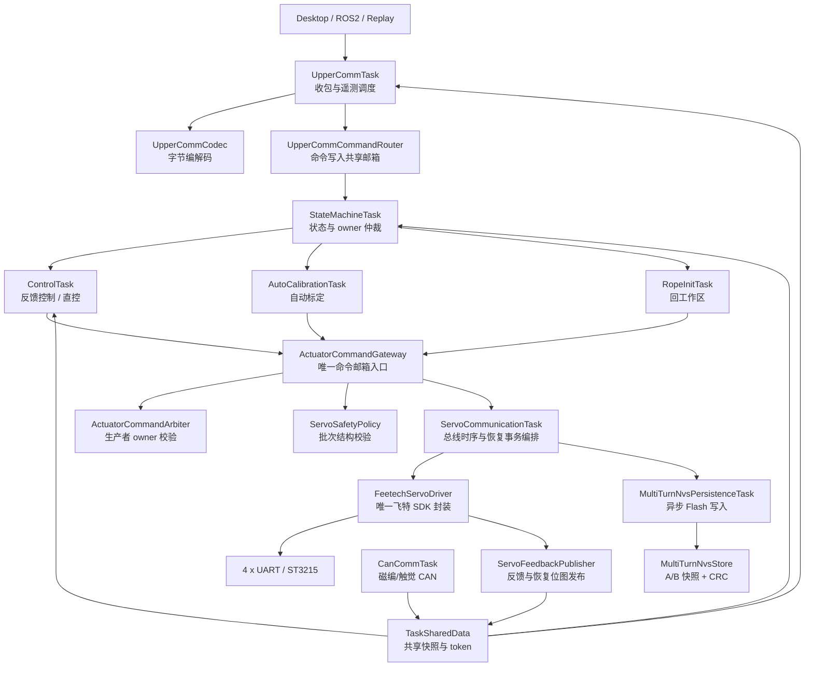
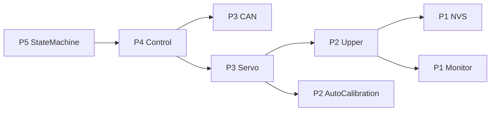
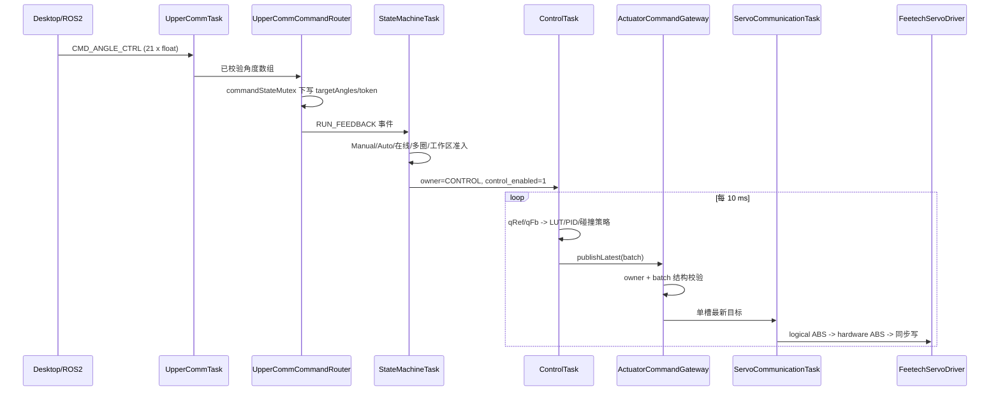
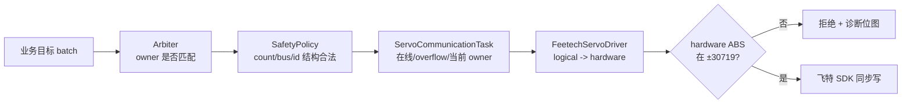
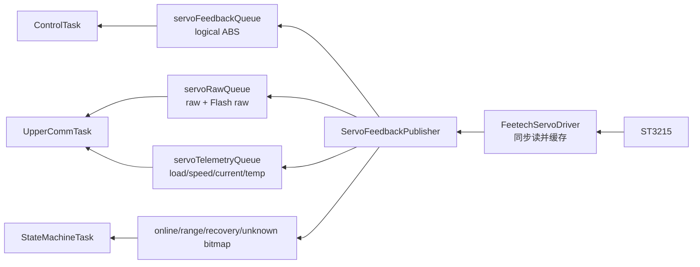
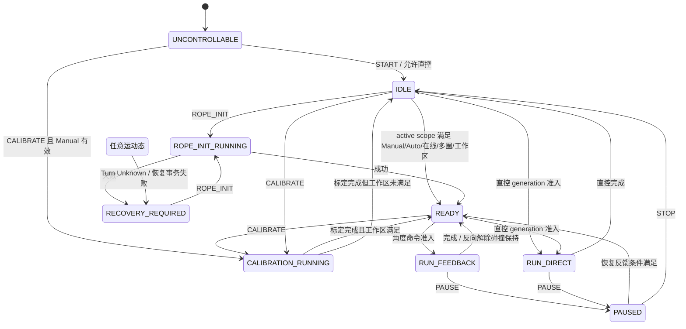
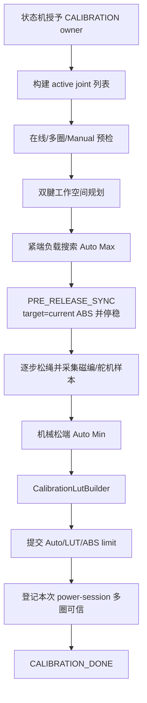
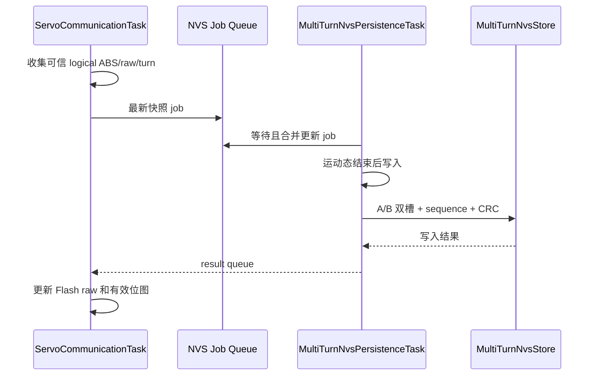

# ESP32-P4 固件架构重构说明

更新时间：2026-07-31  
适用工程：`ESP32-P4/ServoBoardMain`  
本地重构分支：`codex/p4-architecture-refactor`

## 1. 文档目的

本文用于回答四个问题：

1. P4 固件现在由哪些层组成，每个文件负责什么。
2. 一条关节命令如何从上位机到达舵机，一帧反馈又如何返回。
3. 状态机、自动标定、多圈恢复、NVS 和安全检查之间如何协作。
4. 后续增加功能时应该修改哪里，哪些边界绝对不能绕过。

本轮重构坚持以下兼容约束：

- 不改变上位机串口协议的命令编号、包编号和字段字节布局。
- 不改变 Manual 标定、多圈快照的 NVS namespace、key、A/B 槽和 CRC 算法。
- 不改变 21 关节、27 舵机及硬件映射含义。
- 不改变 Arduino 入口和烧录方式。
- 每完成一个阶段都使用 `arduino-cli` 完整编译。

## 2. 重构目标

重构前主要问题：

- 参数散落在任务实现文件中，难以判断一个阈值是否仍在生效。
- `ServoCommunicationTask.cpp` 同时包含飞特 SDK、总线调度、反馈、热插拔和 NVS。
- 多个业务任务可以直接操作 `servoTargetQueue`，曾导致控制任务覆盖标定命令。
- 状态、命令、硬件数据类型集中在大型共享头文件中。
- 上位机协议编解码、命令语义和遥测发送混在同一文件。
- 大文件中存在重复的角度映射、反馈读取和 LUT 构建逻辑。

重构后的核心原则：

> 业务层只表达“希望哪个舵机到哪里”；统一执行层决定“当前谁有权控制、命令是否安全、最终怎样发送”。

## 3. 总体架构



## 4. 分层依赖规则

### 4.1 允许的依赖方向

```text
app/task orchestration
    -> system / calibration / control / communication
    -> actuator gateway / policy
    -> hardware abstraction
    -> Feetech SDK / Arduino HAL
```

### 4.2 强制边界

1. 飞特 `SMS_STS`、`SyncWritePosEx`、`FeedBack` 等 SDK API 只能出现在
   `hardware/servo/FeetechServoDriver.*`。
2. `servoTargetQueue` 的 `xQueueOverwrite/xQueueReceive/xQueueReset` 只能出现在
   `actuator/ActuatorCommandGateway.cpp`。
3. 业务任务不得直接写舵机 UART。
4. 状态切换和 `servo_target_owner` 由状态机管理，控制任务不得自行抢占 owner。
5. 固定参数放 `config/`，硬件映射放 `HardwareMap`，协议编号放
   `UpperCommProtocol`，三者不能混放。
6. 多字段共享快照使用互斥锁或 `SharedSafetyGuard`；单个 token/bitmap 使用
   `platform/AtomicValue.h`。

静态检查命令：

```powershell
powershell.exe -NoProfile -ExecutionPolicy Bypass `
  -File tools\p4_architecture\check_p4_architecture.ps1
```

## 5. 配置层

| 文件 | 负责内容 |
| --- | --- |
| `config/Config.h` | 配置聚合入口 |
| `config/DimensionsConfig.h` | 21 关节、27 舵机、4 总线、触觉维度 |
| `config/BoardConfig.h` | CAN/UART 引脚和波特率 |
| `config/ServoConfig.h` | 舵机默认速度、同步读、多圈 NVS 协调参数 |
| `config/ControlConfig.h` | 控制周期、PID、碰撞检测、完成判定 |
| `config/CalibrationConfig.h` | 标定负载、步长、停稳、工作空间参数 |
| `config/SafetyConfig.h` | ±30719 硬边界、Reset Zero 和反馈超时 |
| `config/DiagnosticsConfig.h` | 卡顿日志阈值与日志节流 |
| `config/TaskConfig.h` | FreeRTOS 任务优先级、栈大小 |

配置文件只保存编译期常量，不保存 Manual、Auto、LUT、PID 历史或在线状态。

## 6. 数据类型层

`domain/` 只定义稳定数据结构，不执行业务逻辑。

| 文件 | 主要类型 |
| --- | --- |
| `SystemTypes.h` | 系统状态、事件、准入结果 |
| `ActuatorTypes.h` | 舵机目标 batch、控制命令快照 |
| `ServoTypes.h` | 舵机角度、raw、遥测反馈 |
| `JointTypes.h` | 关节角、调试数据 |
| `CalibrationTypes.h` | Manual/Auto/LUT/标定诊断 |
| `RecoveryTypes.h` | 多圈 NVS job/result |
| `SafetyTypes.h` | 故障与安全决策数据 |
| `HardwareTypes.h` | 关节/舵机硬件映射结构 |
| `TelemetryTypes.h` | CAN、触觉和运行遥测 |

这些类型构成任务间内部 ABI。若修改字段宽度或数组长度，必须同步检查上下位机协议、
NVS 快照和所有队列元素大小。

## 7. FreeRTOS 任务

| 任务 | 优先级 | 栈 | 主要职责 |
| --- | ---: | ---: | --- |
| `stateMachineTask` | 5 | 4096 | 最高级业务仲裁，状态、故障和 owner |
| `controlTask` | 4 | 8192 | 10 ms 控制、PID、碰撞检测和目标生成 |
| `canCommunicationTask` | 3 | 4096 | 磁编码器与触觉 CAN 接收 |
| `servoCommunicationTask` | 3 | 6144 | 舵机 UART 读写时序、热插拔和恢复事务 |
| `upperCommunicationTask` | 2 | 8192 | 上位机协议和遥测 |
| `autoCalibrationTask` | 2 | 8192 | 仅在标定期间动态创建 |
| `multiTurnNvsPersist` | 1 | 4096 | 异步写多圈 Flash |
| `taskRuntimeMonitor` | 1 | 4096 | 周期、执行时间和栈余量统计 |



优先级只表达抢占关系，不表示数据所有权。数据所有权仍由 queue、mutex、owner 和 token
共同保证。

## 8. 命令链路

### 8.1 关节反馈控制



### 8.2 直控

直控命令先写入 `pendingMotorTargetRaw` 并携带 generation。状态机确认状态、在线和多圈
条件后，`DirectCommandCoordinator` 才将同一 generation 提升为 applied 命令。旧完成事件
无法释放新命令。

### 8.3 为什么使用单槽“最新值邮箱”

舵机位置控制关注最新目标，而不是补发全部历史帧。`xQueueOverwrite` 可以避免上位机或
PID 产生积压。模式切换时 `ActuatorCommandGateway::clearPending()` 清除旧目标。

## 9. 舵机执行与安全

舵机命令经过三层检查：



`logical ABS` 是 P4 连续坐标；`hardware ABS` 是舵机本次上电会话坐标：

```text
hardwareAbs = logicalAbs - logicalOffset
```

每台舵机独立维护 `logicalOffset`。一台舵机掉电不会改变其他舵机的逻辑行程。

## 10. 反馈链路



`ServoFeedbackPublisher` 不主动访问串口，只读取驱动已经完成的缓存，因此不会在发布阶段
插入额外的总线事务。

## 11. 顶层状态机



重要规则：

- Manual 缺失只禁止反馈和自动标定，不禁止安全直控。
- 反馈控制只能从 `READY` 进入。
- `RECOVERY_REQUIRED` 必须先完成 New Device Reset 或 Rope Init 对应恢复流程。
- `STOP/E-STOP` 使 owner 归零并清除待执行目标。

## 12. 自动标定

自动标定由四类模块协作：

| 模块 | 职责 |
| --- | --- |
| `AutoCalibrationTask` | 单腱/双腱状态机和工作空间编排 |
| `CalibrationFeedbackReader` | 读取并验证新鲜的舵机、磁编、遥测快照 |
| `CalibrationLutBuilder` | 整理样本、插值并生成标定 LUT |
| `CalibrationMath` | 环形磁编、Manual/Auto 和角度映射数学 |



标定任务只能通过 `ActuatorCommandGateway` 发布目标。标定运动开始后，舵机通信任务暂停
额外离线探测和热插拔事务，避免破坏双电机连续动作。

## 13. 多圈与 NVS 恢复

### 13.1 两类坐标

- `raw`：0..4095 单圈值。
- `hardware ABS`：舵机本次上电会话多圈值。
- `logical ABS`：P4 对外连续坐标，等于 `hardware ABS + logicalOffset`。

### 13.2 保存链路



### 13.3 热插拔

P4 持续供电而单台舵机掉电时，通信任务冻结该电机最后可信的 RAM 锚点。重新上线后：

1. 重新配置舵机多圈模式。
2. 比较当前 raw 与 RAM/NVS 锚点。
3. 在容差内恢复 `logicalOffset`。
4. 无法确认时仅该电机进入 Turn Unknown。
5. New Device Reset 只处理受影响 scope，并提示重新标定对应关节。

## 14. 上位机通信

`UpperCommTask` 仍是串口收发任务，但内部职责已拆分：

- `UpperCommCodec`：大端整数、float、CRC、长度和角度数组编解码。
- `UpperCommCommandRouter`：将已解析命令写入命令邮箱或 pending direct。
- `UpperCommProtocol`：稳定命令/包编号和固定长度。
- `UpperCommTask`：串口帧状态机、命令分派和遥测调度。

协议兼容红线：任何协议字段调整必须同时修改 `desktop/core/protocol.py` 并增加上下位机
往返测试。本轮没有改变任何协议编号和字节布局。

## 15. 完整源码文件职责

### 15.1 `actuator/`

| 文件 | 职责 |
| --- | --- |
| `ActuatorCommandGateway.cpp/.h` | 舵机目标邮箱唯一收发入口 |
| `ActuatorCommandArbiter.cpp/.h` | 检查 batch 生产者是否拥有当前 owner |
| `ServoSafetyPolicy.cpp/.h` | 批次数量、bus、id 的纯结构安全检查 |

### 15.2 `calibration/`

| 文件 | 职责 |
| --- | --- |
| `AutoCalibrationTask.cpp/.h` | 单腱/双腱自动标定与工作空间主编排 |
| `CalibrationFeedbackReader.cpp/.h` | 标定专用反馈快照读取与新鲜度校验 |
| `CalibrationLutBuilder.cpp/.h` | 样本整理、插值和 Tendon LUT 构建 |
| `CalibrationMath.cpp/.h` | 环形 raw、Manual/Auto、动态角度映射 |
| `CalibrationTask.cpp/.h` | 标定 RAM 数据、结果查询与提交服务 |
| `RopeInitTask.cpp/.h` | 将工作区外关节安全拉回动态下边界 |

### 15.3 `communication/`

| 文件 | 职责 |
| --- | --- |
| `can/CanCommTask.cpp/.h` | CAN/TWAI、磁编、触觉和 S3 错误接收 |
| `servo/ServoCommunicationTask.cpp/.h` | 舵机总线周期和多圈事务编排 |
| `servo/ServoFeedbackPublisher.cpp/.h` | 舵机反馈与恢复/越界位图发布 |
| `servo/ServoPositionRange.h` | logical/hardware ABS 转换工具 |
| `upper/UpperCommCodec.cpp/.h` | 上位机协议基础编解码 |
| `upper/UpperCommCommandRouter.cpp/.h` | 上位机控制命令路由 |
| `upper/UpperCommProtocol.h` | 命令号、包号和协议常量 |
| `upper/UpperCommTask.cpp/.h` | 串口收发、命令分派和遥测调度 |

### 15.4 `config/`

| 文件 | 职责 |
| --- | --- |
| `BoardConfig.h` | 板级引脚和通信速率 |
| `CalibrationConfig.h` | 标定固定参数 |
| `Config.h` | 配置聚合 |
| `ControlConfig.h` | 控制/PID/碰撞参数 |
| `DiagnosticsConfig.h` | 诊断和日志节流 |
| `DimensionsConfig.h` | 固定数组维度 |
| `SafetyConfig.h` | 硬边界和反馈超时 |
| `ServoConfig.h` | 舵机和多圈协调参数 |
| `TaskConfig.h` | 任务优先级和栈 |

### 15.5 `control/`

| 文件 | 职责 |
| --- | --- |
| `ControlTask.cpp/.h` | 10 ms 控制主循环和模式编排 |
| `ControlRuntimePolicy.cpp/.h` | 命令快照、运行门禁和完成条件 |
| `JointAngleMapper.cpp/.h` | 磁编 raw 与动态关节角转换 |
| `SingleTendonWorkspace.cpp/.h` | 单腱 LUT 工作空间约束 |
| `ControlOutputBuilder.cpp/.h` | 关节执行器目标到舵机 batch |
| `ControlSafety.cpp/.h` | 控制期过载等保护 |
| `ControlSolver.cpp/.h` | 单腱标准离散 PID |
| `DualTendonControl.cpp/.h` | 双腱 LUT 坐标 PID |
| `FeedbackCollisionGuard.cpp/.h` | 碰撞检测子状态机 |
| `TendonCalibrationLut.cpp/.h` | LUT 查询与插值 |
| `pid.c/.h` | C 版 PID 数学实现 |

### 15.6 `domain/`、`generated/`、`hardware/`

| 文件 | 职责 |
| --- | --- |
| `domain/ActuatorTypes.h` | 舵机命令类型 |
| `domain/CalibrationTypes.h` | 标定类型 |
| `domain/HardwareTypes.h` | 硬件映射类型 |
| `domain/JointTypes.h` | 关节反馈类型 |
| `domain/RecoveryTypes.h` | 多圈恢复类型 |
| `domain/SafetyTypes.h` | 安全类型 |
| `domain/ServoTypes.h` | 舵机反馈类型 |
| `domain/SystemTypes.h` | 系统状态与事件 |
| `domain/TelemetryTypes.h` | CAN/触觉遥测类型 |
| `generated/UrdfJointLimits.generated.h` | 由桌面 URDF 映射生成的上下限 |
| `hardware/HardwareMap.cpp/.h` | J/M/bus/id 与收绳方向映射 |
| `hardware/servo/FeetechServoDriver.cpp/.h` | 唯一飞特 SDK 封装和单总线缓存 |
| `hardware/servo/ServoBusRegistry.cpp/.h` | 四条舵机总线实例和 ID 注册 |
| `hardware/servo/ServoValue.h` | raw 环距、负载符号等无状态工具 |

### 15.7 `persistence/`、`platform/`、`recovery/`、`shared/`、`system/`

| 文件 | 职责 |
| --- | --- |
| `persistence/ManualCalibrationNvsStore.cpp/.h` | Manual 端点 A/B NVS 快照 |
| `persistence/MultiTurnNvsStore.cpp/.h` | 多圈 A/B NVS 快照 |
| `persistence/MultiTurnNvsPersistenceTask.cpp/.h` | 异步保存任务 |
| `platform/AtomicValue.h` | 单字段原子读写、位操作和计数 |
| `platform/Clock.h` | 时间源抽象 |
| `platform/TaskFactory.cpp/.h` | FreeRTOS 任务创建封装 |
| `recovery/MultiTurnRecoveryPolicy.cpp/.h` | 保存原因和 raw 边界纯策略 |
| `shared/SharedSafetyState.cpp/.h` | 多字段安全快照临界区 |
| `shared/TaskSharedData.h` | 兼容阶段的跨任务句柄、快照和 token |
| `system/DirectCommandCoordinator.cpp/.h` | pending/applied 直控事务 |
| `system/FirmwareLog.cpp/.h` | 固件日志输出 |
| `system/StateMachineTask.cpp/.h` | 顶层状态机与故障管理 |
| `system/SystemStatePolicy.cpp/.h` | 状态准入纯函数 |
| `system/SystemTask.cpp/.h` | 初始化资源并创建任务 |
| `system/TaskRuntimeMonitor.cpp/.h` | 任务周期、执行时间、栈监控 |

## 16. 如何增加新功能

### 新增一种舵机动作

1. 在业务模块构造 `ServoTargetBatch_t`。
2. 使用正确 `source`。
3. 由状态机授予对应 owner。
4. 只调用 `ActuatorCommandGateway::publishLatest()`。
5. 不直接访问 queue、UART 或飞特 SDK。

### 新增一个安全规则

1. 参数放 `SafetyConfig.h` 或对应业务配置。
2. 纯判断放 `ServoSafetyPolicy`。
3. 依赖实时驱动状态的最终防线放 `FeetechServoDriver`。
4. 返回可诊断 reason，不要只返回无说明的 `false`。
5. 增加日志和上位机状态字段，再做实机故障注入。

### 修改 PID 或标定阈值

1. 只改 `ControlConfig.h` 或 `CalibrationConfig.h`。
2. 保存修改前后的日志和参数。
3. 编译后先单关节、再单指、最后全手回归。
4. 检查碰撞检测、LUT 边界和多圈恢复是否仍正常。

## 17. 构建与验证

完整调试编译：

```powershell
powershell.exe -NoProfile -ExecutionPolicy Bypass `
  -File tools\p4_debug\build_debug.ps1 -ReuseCache
```

URDF 生成表检查：

```powershell
python tools\generate_p4_urdf_limits.py --check
```

代码边界与文件头检查：

```powershell
powershell.exe -NoProfile -ExecutionPolicy Bypass `
  -File tools\p4_architecture\check_p4_architecture.ps1
```

Git 空白检查：

```powershell
git diff --check
```

## 18. 重构收益

- 参数有唯一来源，调整 PID/安全/标定阈值时不必全仓库寻找裸数字。
- 飞特 SDK 有唯一入口，协议细节不会泄漏到控制和标定。
- 命令队列有唯一入口，避免控制、标定和 Rope Init 相互覆盖。
- owner、generation 和 token 明确，旧完成事件不能释放新命令。
- 控制映射、标定反馈、LUT 构建和协议 codec 可独立测试。
- 新成员可按目录定位职责，不必先读数千行主任务。
- 静态脚本能阻止架构边界重新退化。

## 19. 仍保留的兼容性设计

`TaskSharedData_t` 仍然较大，这是有意保留的兼容层。一次性拆成多个仓库会同时影响全部
任务、队列初始化和协议遥测，风险高于收益。当前已通过以下方式限制风险：

- 多字段命令由 `commandStateMutex` 保护。
- 安全快照由 `SharedSafetyGuard` 保护。
- 单字段 token/bitmap 使用原子 API。
- 新模块只依赖需要的字段，不再直接操作底层 UART。

后续若继续拆分，应先引入 `CommandMailbox`、`FeedbackRepository` 和
`SystemRuntimeState` 三个结构，再逐任务迁移，不能直接删除现有字段。
