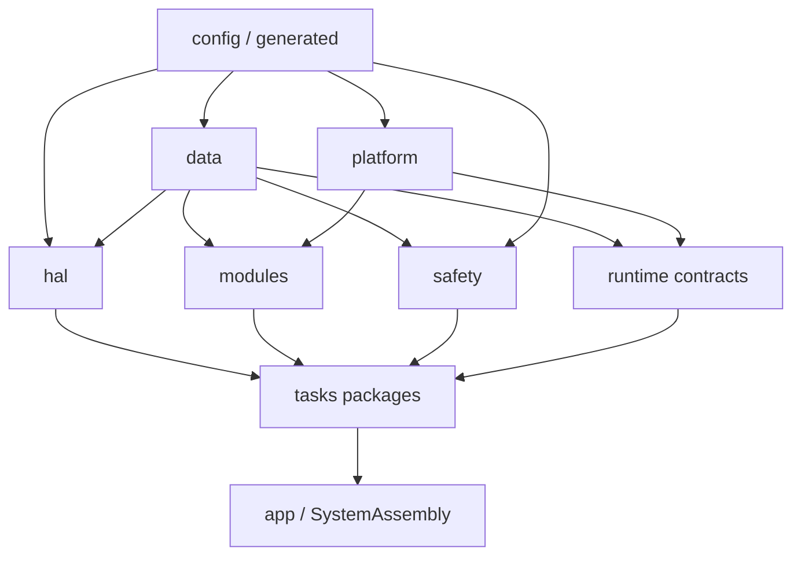
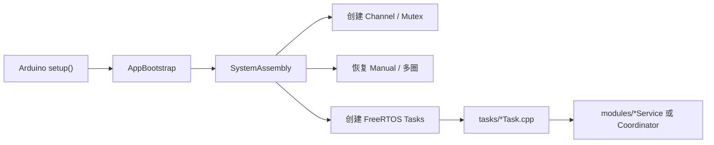
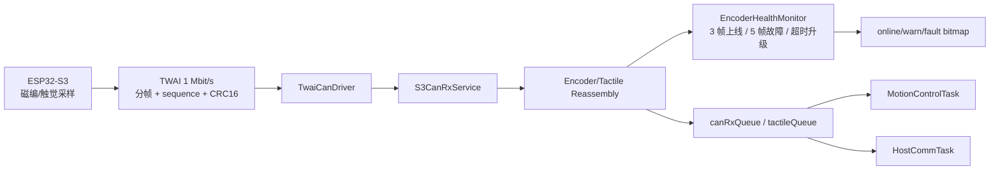
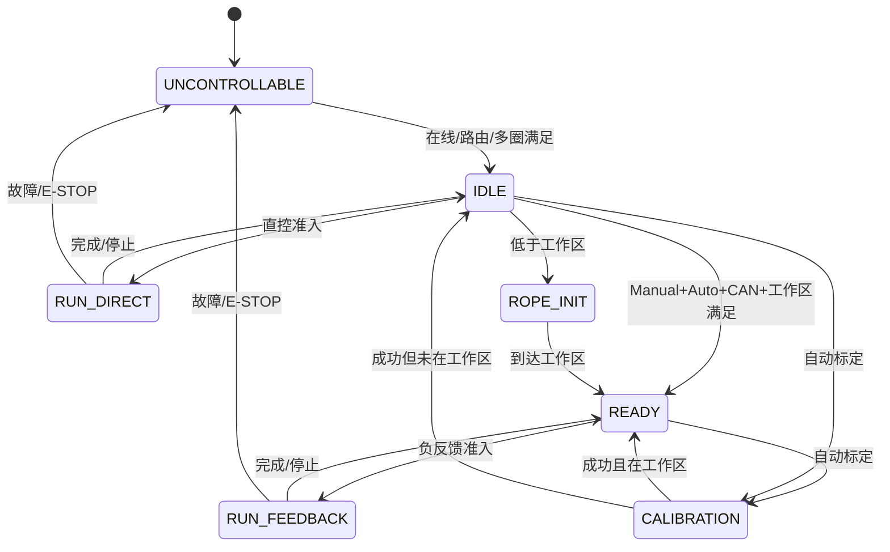
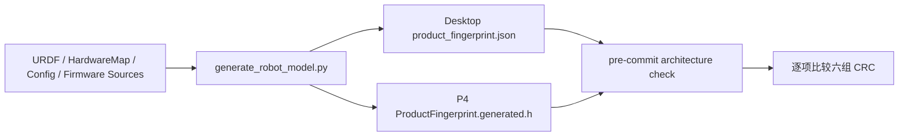
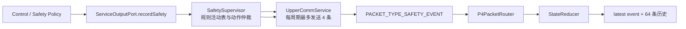
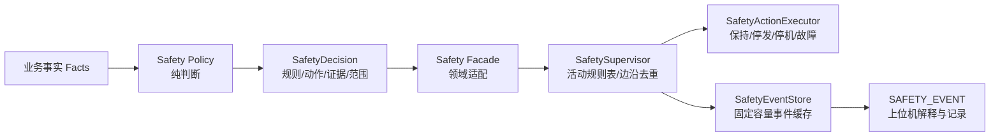

# P4 嵌入式软件架构与安全规则

## 1. 文档用途

本文是 `ServoBoardMain/src` 当前架构的唯一说明。旧的 `core`、`hal/rtos`、
`system` 业务目录、扁平 Task 文件和手工同步 Safety JSON 架构已经废止，
不应再作为新增代码参考。

2026-10-08：自动标定已迁至上位机。P4 的旧自动标定任务、机械搜索、LUT 构建
及其专属运行量已删除；保留普通直控、坐标归零、Manual/LUT 数据接收及回复。
本次清理不修改上位机代码、PID、机械方向或 URDF 关节范围。

## 2. 顶层目录

```text
src/
├── app/                     Arduino 启动入口与系统资源装配
├── config/                  编译期参数、CAN 协议、硬件拓扑、安全规则源
│   ├── protocol/            S3/P4 CAN 帧定义
│   ├── safety/              SafetyRuleCatalog.def 唯一规则目录
│   │   └── ServoPositionRange.h 舵机硬件/逻辑行程纯配置规则
│   └── topology/            Jxx/Mxx 机械拓扑，不保存运行时状态
├── data/                    纯值类型；不得依赖 Arduino/FreeRTOS
├── generated/               URDF、产品指纹等生成产物
├── hal/                     物理外设唯一入口
│   ├── can/                 TWAI 驱动
│   ├── serial/              上位机串口
│   ├── servo/               飞特 SDK、四路 BUS
│   └── storage/             NVS blob
├── platform/                RTOS、时钟与非阻塞日志适配
│   ├── rtos/                原子、任务、MessageChannel、跨核锁
│   ├── time/                单调时钟
│   └── log/                 协议串口共用的日志仲裁
├── runtime/                 跨任务通道、状态聚合、端口、适配器与指标
│   ├── channels/            MessageChannel 聚合
│   ├── state/               按所有权拆分的运行状态
│   ├── ports/               事件/安全证据输出端口
│   ├── adapters/            SystemRuntimeContext 到纯值快照的适配
│   └── metrics/             任务周期、栈余量与串口发送指标
├── modules/                 被两个以上任务复用的算法或领域设施
│   ├── actuator/            舵机目标唯一网关与 owner 仲裁
│   ├── calibration/         标定 RAM Store、数学与 LUT
│   ├── integrity/           CRC16/CRC32 唯一实现
│   ├── persistence/         Manual/多圈 NVS 格式与 A/B 槽算法
│   ├── protocol/            Host 线协议公共定义
│   └── runtime/             纯值服务周期一致性策略
├── safety/                  可执行 Safety Policy、注册表、最近事件缓存
└── tasks/                   运行任务包；入口、Service 和私有工具同目录
    ├── host_comm/           Host 收发、ACK、命令、遥测与维护事务
    ├── system_state/        总状态、READY、租约、Rope Init 与故障聚合
    ├── s3_can_rx/           TWAI 收包、分帧重组与磁编健康状态
    ├── servo_bus/           四 BUS 调度、路由、恢复与反馈发布
    ├── motion_control/      单/双腱控制、映射、碰撞与目标构建
    ├── nvs_persistence/     运行期唯一 Flash 写入者
    └── runtime_monitor/     周期、栈和发送诊断
```

## 3. 依赖方向



不支持 Mermaid 的阅读器可按下面顺序理解：

```text
config/data/generated -> platform/hal/modules/safety/runtime -> tasks -> app
```

硬性边界：

1. `data` 不得包含 Arduino、FreeRTOS、HAL 或业务模块。
2. `hal` 只知道物理外设，不得访问状态机、标定、控制或 UI 协议事务。
3. `platform` 只包装 RTOS/时间/日志；仅 `platform/log` 因共用协议物理串口允许依赖 `hal/serial`。
4. `modules`/`safety` 不得包含 `tasks/*.h`。
5. 每个 `*Task.cpp` 只允许初始化、固定周期和 `Service/Coordinator` 调用；业务状态机位于同任务包私有文件。
6. 飞特 SDK、TWAI、NVS 分别只能出现在对应 HAL 实现中。
7. FreeRTOS 原生头只能由 `platform/rtos/FreeRtosKernel.h` 引入，业务文件不得
   自行包含 `task.h`、`queue.h` 或 `semphr.h`。

`platform` 统一使用 `p4::platform::rtos` 命名空间；历史
`p4::hal::rtos` 命名空间已经删除。

## 4. 启动和任务调用



```text
setup()
  -> AppBootstrap
  -> SystemAssembly
       +-- 创建 MessageChannel / Mutex
       +-- 初始化 SystemRuntimeContext 聚合状态
       +-- 恢复 NVS
       `-- 创建 Task
             `-- 薄 Task 入口 -> 同目录 Service/Coordinator
```

`SystemAssembly` 是 RTOS 资源唯一装配点。业务服务可以使用传入资源，但不能私自
创建第二条全局命令队列。

## 5. 舵机命令链路


最终发送必须依次通过：命令结构校验、owner/state、多圈、在线和路由、logical
范围、hardware 范围。任何上层遗漏都不能绕过 `FeetechServoDriver` 最终硬限制。

## 6. 上位机自动标定与 P4 数据边界

```text
上位机自动标定
  -> F0：当前位置 logical ABS 归零，offset = -新 raw
  -> 普通 D3 直控：使用 CONTROL owner / RUN_DIRECT，绕过关节 PID
  -> F2：释放普通直控
  -> 已有 Manual / LUT 协议：P4 校验、保存运行数据、ACK 和快照回读
       `-> CalibrationRuntimeStore / TendonCalibrationLut：PID 和 Rope Init 消费数据
```

旧 `CMD_CALIBRATE` 的编号和帧长度保留，固件回复 `UNSUPPORTED_MODE`。
旧系统状态 4、事件 4/5/6、任务监控槽 5 和安全规则编号保留为空位或历史日志解释。
SYSTEM_STATUS 中旧标定状态字节固定为 0，旧标定诊断不再产生。
不存在独立 host-calibrate owner、专用运动准入或固件 LUT 构建流程。

RAW/ABS 遥测由同一位置快照编码为两个既有协议帧，以同一节奏、一次串口写发送。
控制追踪订阅期间两帧同时限频到 50 ms，避免仅 raw 更新破坏同戳锚点。

Rope Init 不再创建独立任务。`SystemStateCoordinator` 每个 10 ms 周期调用
`RopeInitController::step()`；控制器只计算需要正转进入工作区的 active 关节，
并通过 `ActuatorCommandGateway` 发布 `ROPE_INIT` owner 目标。取消、超时、反馈过期
和到位都在同一状态循环中收敛，因此没有第二套 Task 句柄或生命周期旧逻辑。

## 7. 上位机通信边界

```text
tasks/host_comm/HostCommTask
  -> HostCommService
       +-> HostFrameReader                 串口帧边界与校验
       +-> HostCommandDispatcher           长度、参数和状态门禁
       +-> HostAckPublisher                ACK FIFO 与串口忙重试
       +-> HostTelemetryPublisher          快照编码与遥测发送
       +-> HostCalibrationCommandHandler   Manual/Reset Zero 联动
       `-> HostPersistenceCommandHandler   NVS 控制异步请求与结果
```

当前版本不再在 P4 写入运行期 Flash。Host 协议接收桌面 JSON 的 Manual/Auto/LUT 和多圈锚点，
通过 RAM 提交和读回校验建立会话状态；跨重启恢复由桌面端文件完整性和身份校验负责。

### 7.1 S3 传感器数据链



编码器数据只有在分帧完整且 CRC16 通过后才进入 `canRxQueue`。某一路错误由有效
位图进行逐路去抖；整批 CRC 错误、分帧超时或 TWAI 重启会进入批次坏帧路径，不能
把上一次 raw 继续伪装成新数据。触觉摘要和全量帧分别重组，队列满时只丢最旧完整
快照，不在 P4 降低 S3 采样频率。

## 8. 状态机与 READY



`SystemStateCoordinator` 只读取事件队列并运行周期监督；`SystemEventDispatcher`
串行解释事件，`ReadinessEvaluator` 计算 READY，`SystemFaultAggregator` 汇总故障，
`HostLeaseSupervisor` 处理上位机租约和 Hold。状态写入仍是单线程，拆分不会引入
多个模块并发修改系统状态。

## 9. Safety 单一规则源

唯一规则源：

```text
config/safety/SafetyRuleCatalog.def
  +-> data/SafetyRuleTypes.h                     生成 enum
  `-> tools/generate_p4_safety_catalog.py
        +-> generated/SafetyRuleCatalog.generated.h
        +-> generated/SafetyRuleIndex.generated.json
        `-> desktop/resources/config/p4_safety_rules.json

`SafetyRuleIndex.generated.json` 覆盖全部规则的 Policy、业务调用、事件和恢复入口，
仅由静态审计工具读取，不占用 P4 固件 Flash。
`SafetyRuleRegistry.cpp` 只负责必要的业务枚举/故障位到 `SafetyRuleId` 映射，不是完整目录。
```

当前规则分组：

| 范围 | 说明 |
|---|---|
| `ACT-1001..1013` | 舵机命令、BUS、owner、多圈和行程 |
| `CTL-2001..2009` | CAN、映射、碰撞保持、LUT/目标边界与热插拔保持 |
| `SYS-3001..3005` | 上位机租约及顶层状态准入 |
| `DIR-3101..3106` | 直控事务拒绝 |
| `FBK-3201..3207` | 负反馈事务拒绝 |
| `RDY-3301..3311` | READY 详细门禁 |
| `ROP-3401..3409` | Rope Init |
| `FLT-3501..3505` | 顶层故障位 |
| `CAL-4001..4027` | 自动标定失败 |
| `CAW-4101..4103` | 标定装配警告 |

新增安全检查的固定步骤：

1. 在 `SafetyRuleCatalog.def` 登记稳定 ID、严重度、动作和恢复建议。
2. 在真正裁决点返回/引用该 `SafetyRuleId`，不能只增加枚举。
3. 通过对应 `Safety Facade` 提交 `SafetyDecision`，由 `SafetySupervisor` 去重并写入 `SafetyEventStore`。
4. 运行生成器更新 Desktop JSON。
5. 上位机只按规则 ID 解释，不复制第二份中文字典。

## 10. 共享上下文

`SystemRuntimeContext` 仅组合六个聚合结构：

| 聚合 | 主要所有者 |
|---|---|
| `InterTaskChannels` | `SystemAssembly` 创建、生产者/消费者按通道访问 |
| `CommandRuntimeState` | 命令入口/状态机 |
| `ControlRuntimeState` | 状态机/控制服务 |
| `ServoRuntimeState` | 舵机服务 |
| `PersistenceRuntimeState` | 持久化服务 |
| `CalibrationRuntimeState` | 标定服务 |

`SystemRuntimeContext` 自身没有业务字段，只以零额外存储的基类组合上述聚合。
新增跨任务数据必须先确定唯一写者，并选择“顺序事件队列”或“最新值邮箱”语义；
不得直接向顶层 Context 堆入无所有权字段。可独立计算的策略应接收纯值快照。

## 11. R0-R9 重构结果

| 阶段 | 当前结果 |
|---|---|
| R0 | 顶层目录固定为 `app/config/data/generated/hal/modules/platform/runtime/safety/tasks` |
| R1 | 源文件头统一说明职责；旧 `core/domain/hardware/shared` 路径已删除 |
| R2 | `data` 仅保存纯数据；标定告警位也已从业务模块迁入数据契约 |
| R3 | HAL 覆盖 CAN、Host Serial、Servo、NVS，且不再依赖系统日志或 Safety 业务实现 |
| R4 | FreeRTOS/时钟集中在 `platform`；FreeRTOS 包含顺序由单一适配头保证 |
| R5 | `SystemRuntimeContext` 拆成六个按所有权划分的聚合结构；资源由 `app/SystemAssembly` 创建 |
| R6 | Safety 规则使用单一 `.def` 注册表，并保留结构化最近事件缓存 |
| R7 | 运行 Task 均形成独立任务包；旧自动标定任务已删除；S3 健康、Host ACK、Servo 路由等逻辑已从主 Service 分离 |
| R8 | Desktop 通过生成 JSON 解释规则；本文件作为唯一 P4 架构说明 |
| R9 | 旧源码目录已清空；静态门禁验证目录、薄 Task、HAL 唯一入口、NVS 单写者、活动安全规则闭环和历史规则退役 |

`HostCommService` 与 `SystemStateCoordinator` 受行数预算
约束，只保留调度。较长的状态机或协议命令分发可以保留完整上下文，但必须属于
对应任务包，且不得同时创建任务、直接访问其他任务私有对象或绕过统一 HAL/Gateway。

## 12. 静态检查

```powershell
powershell -ExecutionPolicy Bypass `
  -File tools/p4_architecture/check_p4_architecture.ps1
```

脚本检查目录、文件头、依赖方向、薄任务、HAL 唯一入口、Gateway 唯一邮箱入口、
共享上下文聚合，以及协议/URDF/Safety 生成文件。它明确不编译固件。

仅修改固件且保留上位机版本时，生成器使用 `--firmware-only`，静态门禁使用
`-FirmwareOnly`。此模式仍检查 P4 源码和参数指纹，跨端核对稳定的模型及硬件契约；
默认模式继续要求两端所有生成物同步。

## 13. 实机回归

| 场景 | 验收标准 |
|---|---|
| 四 BUS 扫描 | M00-M26 唯一路由；每 BUS 超 10 台明确拒绝 |
| Motor Direct | ENABLE、正反向、E-STOP、重新 ENABLE 正常 |
| 自动标定 | 单/双腱流程、部分成功提交、诊断原因保持一致 |
| Rope Init | 只移动低于动态工作区的 active 关节 |
| Joint Feedback | 单/双腱 PID、LUT 边界、碰撞 Hold 和反向退出正常 |
| 热插拔 | 单舵机掉电、Turn Unknown、New Device、Reset Zero 正常 |
| 上位机退出 | 租约超时后保持当前 ABS，不继续推进 |
| NVS | Flash On/Off、Manual 和多圈掉电恢复正常 |
| 长稳测试 | 30 分钟无持续 overrun、无栈余量告警 |

未完成固件编译和上述实机回归前，只能认为“架构静态迁移完成”，不能标记为
“硬件验证完成”。

## 14. R0-R4 契约收敛（2026-08-09）

本轮不是继续搬目录，而是给已有分层补上可验证契约。各阶段完成度如下：

| 阶段 | 已落地内容 | 自动验收 |
|---|---|---|
| R0 | 重新生成产品指纹；提交前运行架构门禁；显式比较 Desktop JSON 与 P4 Header 的六组 CRC | 生成物无漂移，六组 CRC 完全一致 |
| R1 | 碰撞 Hold、LUT clamp 和缓存覆盖进入统一 `SafetySupervisor`；新增 `SAFETY_EVENT` 上行包 | 同一锁存周期只上报一次，Desktop 按 sequence 去重 |
| R2 | 删除 Auto 映射 V2 字段和运行函数；Control 只接受映射 V3；Manual NVS schema 版本独立描述 | 旧映射符号不能重新出现，Calib Load 固定为 189 字节 |
| R3 | 为 Control/Servo/Calibration/State 建立纯值输入快照和输出端口；建立依赖预算 | 快照和端口不得包含 RTOS 句柄；`SystemRuntimeContext*` 引用只能下降 |
| R4 | 周期循环留在 `tasks`；业务服务统一 `init()/step(now, snapshot)`；禁止 modules/safety 直接延时 | `modules/safety` 中不允许 `vTaskDelay`、`millis` 或任务创建 |

### 14.1 产品契约链



生成器的 `--check` 负责判断文件是否过期，架构门禁再逐项比较 CRC。两层检查分别防止
“忘记重新生成”和“上下位机生成结果不一致”。

### 14.2 安全事件证据链



事件使用单调 sequence。碰撞 Hold 和 LUT clamp 在状态边沿锁存，持续状态不会每 10 ms
重复写入。缓存首次覆盖时记录 `RUN-8001`，此后只累计 `overflow_count`，避免“记录溢出
本身又制造更多溢出”的日志风暴。

### 14.3 版本语义

以下三个版本不能混用：

| 版本 | 含义 | 当前值/策略 |
|---|---|---|
| Feedback mapping version | 角度反馈与 Control 使用的算法契约 | 只允许 V3 |
| Upper protocol schema | 上下位机二进制字段和长度 | 由唯一 JSON 生成 |
| Manual NVS schema | P4 Flash 中 Manual Min/Max 的物理布局 | schema 2；不等于“映射 V2” |

`JointCalibrationResult` 不再保存 `encoderMin/encoderMax/offset/encoderAtUrdfMin/
encoderAtUrdfMax`。Calib Load 下行负载由 209 字节收敛到 189 字节，上行带装配告警的
快照由 222 字节收敛到 202 字节。旧二进制快照不再兼容，必须使用当前上位机重新加载
或重新标定。

### 14.4 服务边界与当前真实完成度


R3 当前完成的是“共享状态按所有权聚合、顶层 Context 不再保存散字段、Control/Servo/
Calibration/State 建立纯值输入快照与输出端口”。`modules` 只保留跨任务复用设施；其中
Actuator Gateway 和 Calibration Runtime Store 因承担跨任务提交点仍接收 Context，其他
新增纯算法不得为了方便引入整个 `SystemRuntimeContext`。

R4 也需要区分两层：任务循环和周期延时完全留在各任务包的 `*Task.cpp`；单/双电机
标定由显式状态机文件保存机械上下文。耗时 UART 操作由 ServoBusTask 串行拥有，控制任务不直接执行阻塞外设事务。

## 15. 后续架构优先级

| 优先级 | 改造项 | 目的 |
|---|---|---|
| P0 | 为 Control/State/Calibration 增加主机仿真夹具，继续把纯计算入口改为 Snapshot/Port | 单测无需构造完整全局上下文 |
| P0 | 对 NVS 异步 Manual、多圈开关、Reset Zero 做断电与队列忙回归 | 验证 ACK 受理与最终落盘结果不会混淆 |
| P1 | 所有安全事件显式传入 `nowMs`，缓存不再自行读取时钟 | 让 safety 成为确定性纯逻辑 |
| P1 | Desktop 将结构化安全事件写入 CSV/HDF5，并关联规则中文解释 | 故障可回放、可训练、可统计 |
| P1 | 建立 Control/Calibration 主机仿真夹具 | 对边界、碰撞、LUT 和恢复流程做无硬件回归 |
| P2 | 继续按可独立测试的状态对象拆分 Servo 多圈协调器与 Host 遥测编码器 | 降低大文件变化影响面，不切断强内聚状态机 |
| P2 | 从 schema 生成协议 payload 结构与编解码测试向量 | 消除手工字节偏移和长度漂移 |
| P2 | 上报完整运行配置快照并写入数据会话 meta | 精确复现实验固件、URDF、参数和规则版本 |

## 16. P0-P8 安全裁决闭环（2026-08-11）

安全目录不再承担业务流程本身，而是把散落在控制、标定、状态机和通信中的判断统一成
同一种可审计结果。业务模块负责产生事实，Policy 负责判断，Facade 负责适配业务证据，
Supervisor 负责去重、动作分派与事件落盘。



### 16.1 文件职责

| 目录 | 职责 | 禁止事项 |
|---|---|---|
| `data/safety` | `Facts`、`Decision`、`Action` 和运行时槽位等纯数据 | 不访问 RTOS、硬件和全局 Context |
| `safety/policies` | 舵机准入、控制反馈、碰撞、状态准入和租约等判断 | 不写事件缓存，不直接驱动舵机 |
| `safety/facades` | 把业务参数转换为统一 `SafetyDecision` | 不复制机械流程和状态机 |
| `safety/SafetySupervisor.*` | 规则活动表、边沿去重、恢复清除和动作调度 | 不实现具体 PID、标定或协议 |
| `safety/SafetyEventStore.*` | 保存最近结构化证据并供上位机读取 | 业务模块不得直接调用写接口 |
| `safety/SafetyRuleCatalog.*` | 查询由 `SafetyRuleCatalog.def` 生成的规则元数据 | 不在源码中另建第二份规则表 |

### 16.2 调用约束

1. 业务代码不得构造 `SafetyEventRecord` 并直接写缓存。
2. 每次触发必须经对应 Facade 提交 `SafetyDecision`。
3. 连续命中同一规则和范围只产生一次事件；显式恢复或超过复发间隔后允许再次上报。
4. 业务动作在迁移期仍由原流程执行，`SafetyActionExecutor` 作为统一动作端口逐步接管；缺少
   回调不能改变现有控制行为。
5. `tools/p4_architecture/check_p4_architecture.ps1` 禁止新增绕过 Supervisor 的事件写入；
   `check_safety_rule_closure.py` 检查规则注册、执行、事件和恢复四项证据。

### 16.3 当前边界

当前已经统一事件入口和规则生命周期，但并未把全部业务判断搬进一个巨型文件。这样可以
保持机械状态机的上下文完整，同时让所有故障具有统一编号、证据和恢复语义。下一阶段应
优先把 `SafetyActionExecutor` 接入系统装配，让 E-STOP、保持 ABS、停发和进入 FAULT 的
执行动作也由依赖注入端口统一完成，并为每条会改变执行输出的规则增加主机侧恢复测试。
