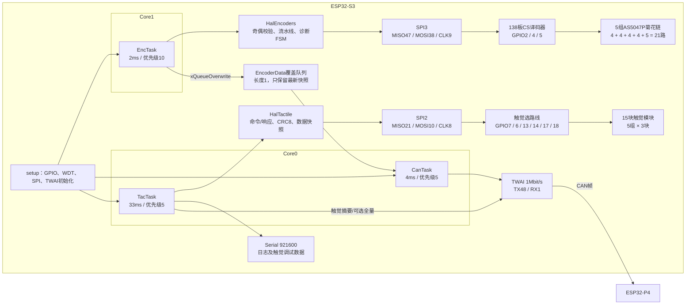
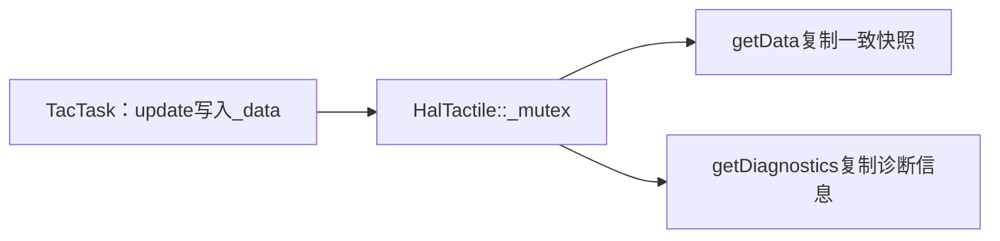
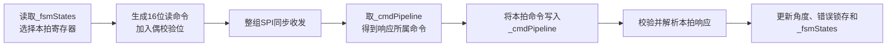
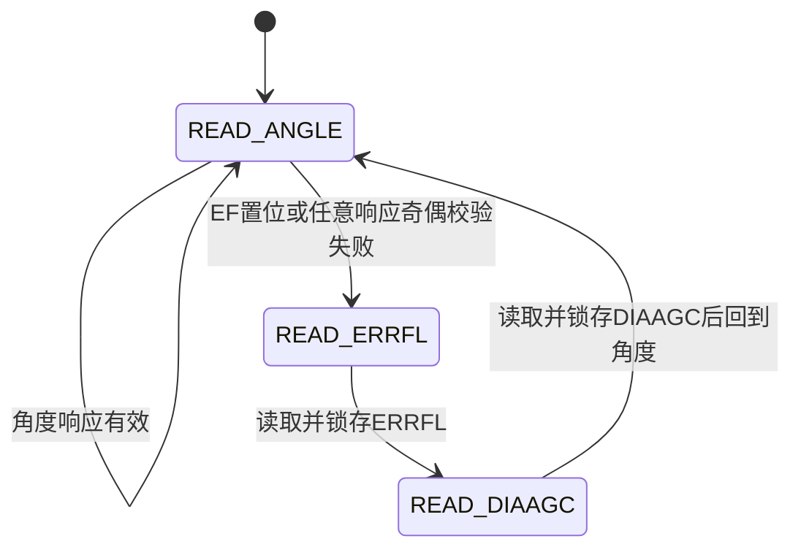
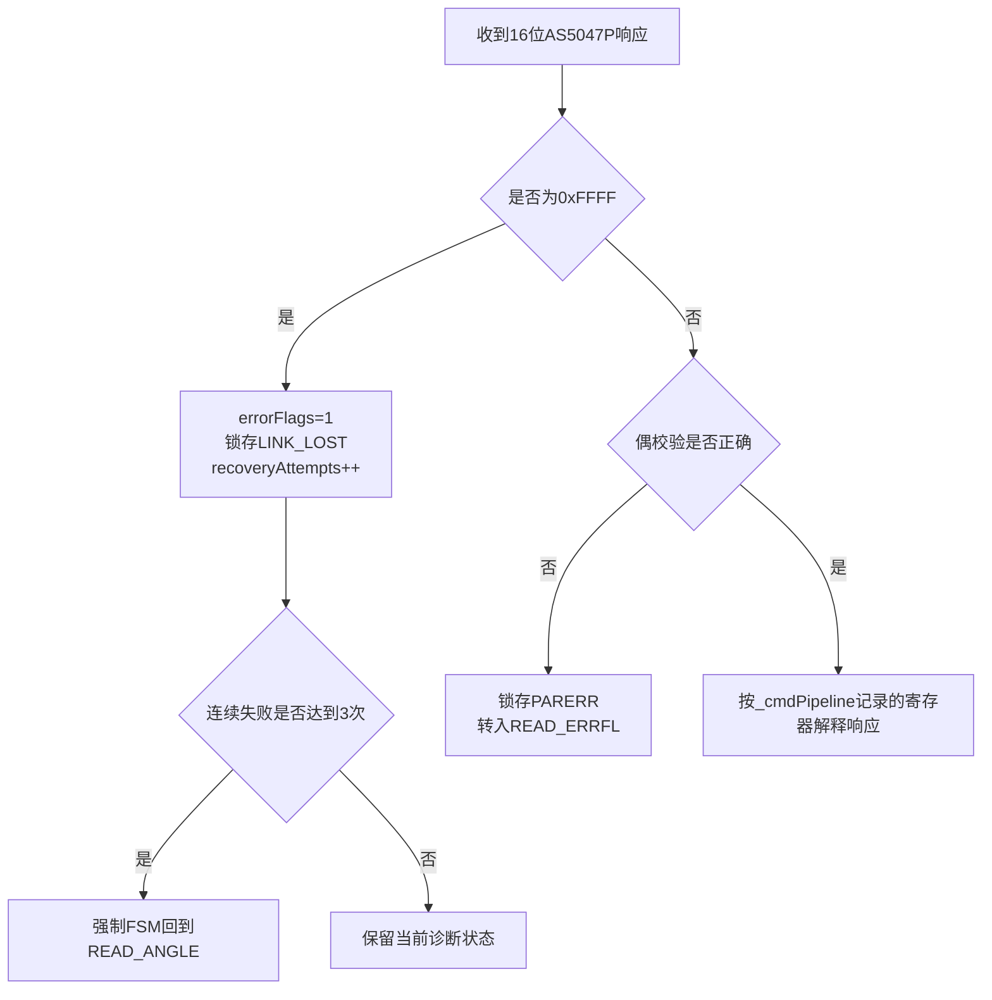
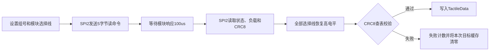
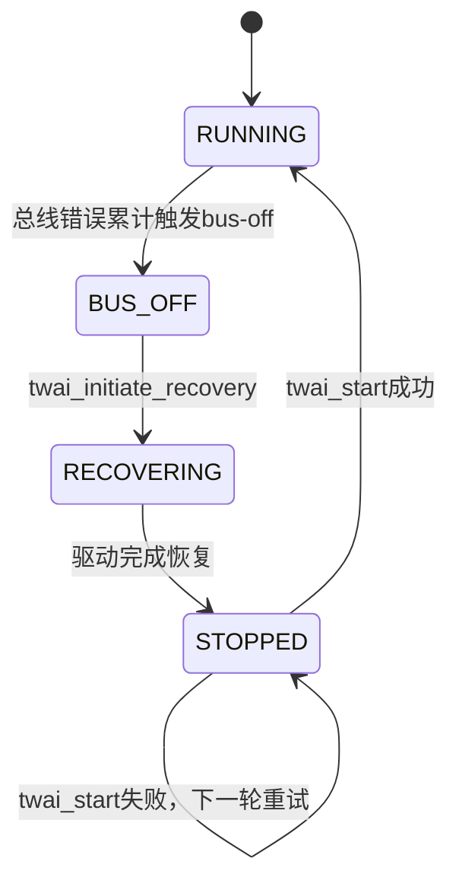

# ESP32-S3架构与状态机说明

## 1. 当前软件边界

当前固件只支持138板磁编拓扑，不再兼容151临时硬件。ESP32-S3负责：

- 通过SPI3采集21路AS5047P磁编。
- 通过SPI2采集5组、每组3块触觉模块。
- 通过TWAI/CAN向ESP32-P4发送磁编、错误详情和触觉摘要。
- 通过S3调试串口输出日志、触觉摘要和触觉全量数据。

磁编自动标定、参数保存和控制状态机由P4负责，S3不再保留旧版校准命令接收及ACK逻辑。

## 2. FreeRTOS任务配置

| 任务 | 周期 | 优先级 | CPU核 | 主要职责 |
|---|---:|---:|---:|---|
| `EncTask` | 2ms | 10 | Core1 | 扫描21路磁编，生成最新`EncoderData`快照 |
| `CanTask` | 4ms | 5 | Core0 | 维护TWAI状态并发送最新磁编快照与错误详情 |
| `TacTask` | 33ms | 5 | Core0 | 采集触觉摘要/全量数据，并经CAN和Serial上报 |

任务创建统一使用`Config.h`中的`TASK_*_PRIO`和`TASK_*_CORE`，不再在`SystemTasks.cpp`重复硬编码。

`EncTask`优先级最高，因为磁编采用2ms周期且AS5047P响应存在一拍流水线；采样抖动会直接影响角度刷新和诊断状态推进。`CanTask`和`TacTask`位于Core0，保持原有优先级和核分配，本次没有重新调整实时调度策略。

## 3. S3总体框图

## 4. SPI资源与互斥关系

| 项目 | 磁编 | 触觉 |
|---|---|---|
| SPI控制器 | SPI3 | SPI2 |
| 数据/时钟引脚 | GPIO47/38/9 | GPIO21/10/8 |
| 选路引脚 | GPIO2/4/5 | GPIO7/6/13/14/17/18 |
| 周期访问者 | `EncTask` | `TacTask` |

138硬件下两套SPI控制器、信号线和选路线均独立，因此已经删除跨HAL的`g_sensorSelectMutex`。这样可以避免触觉事务持锁时，2ms磁编任务等待20ms超时并将整组误判为`LINK_LOST`。

`HalTactile::_mutex`仍然保留。它保护的是触觉数据快照和诊断数据，不是SPI选路线：

## 5. 磁编采集与命令流水线

AS5047P本拍返回的是上一拍命令的响应，因此每路磁编同时保存两个状态：

- `_fsmStates[id]`：决定下一拍准备读取哪个寄存器。
- `_cmdPipeline[id]`：记录上一拍已经发出的寄存器命令，用来解释本拍响应。

### 5.1 单路磁编诊断状态机

| 状态 | 读取寄存器 | 处理结果 |
|---|---|---|
| `FSM_READ_ANGLE` | `ANGLECOM(0x3FFF)` | 成功时更新14位角度；EF置位时转入`ERRFL` |
| `FSM_READ_ERRFL` | `ERRFL(0x0001)` | 锁存帧错误、非法命令或奇偶错误，随后转入`DIAAGC` |
| `FSM_READ_DIAAGC` | `DIAAGC(0x3FFC)` | 保存磁场/增益诊断信息，随后回到`ANGLE` |

异常响应的公共处理如下：

注意：`0x0000`可能是机械零位的合法角度，不能单凭单路零值判断掉线；公共MISO短地造成的21路全零由上位机公共总线异常检测处理。

## 6. 触觉读取流程

每轮`TacTask`依次扫描5组、每组3块模块。每块模块分别读取3字节摘要和全量触元数据：

摘要与全量数据目前是两次独立寄存器读取。是否由全量触元数据推导摘要，仍属于需要实机确认的优化项。

## 7. TWAI恢复状态流程

`CanTask`每4ms调用`HalTWAI::maintain()`，只有TWAI处于`RUNNING`时才发送磁编数据：

在非`RUNNING`状态下，`CanTask`将轮询间隔降为50ms，避免恢复期间持续占用CPU和TWAI驱动。

## 8. 本轮架构调整

- 删除151硬件模式、公共磁编CS和两拍读取兼容分支。
- 固定使用138板CS译码映射`{4, 3, 2, 1, 0}`。
- 将通道7明确命名为`ENC_DEMUX_IDLE_CHANNEL`。
- 删除磁编/触觉之间不必要的跨HAL互斥锁。
- 保留`HalTactile::_mutex`，继续保护触觉数据快照。
- 任务优先级和核分配统一由`Config.h`配置。

