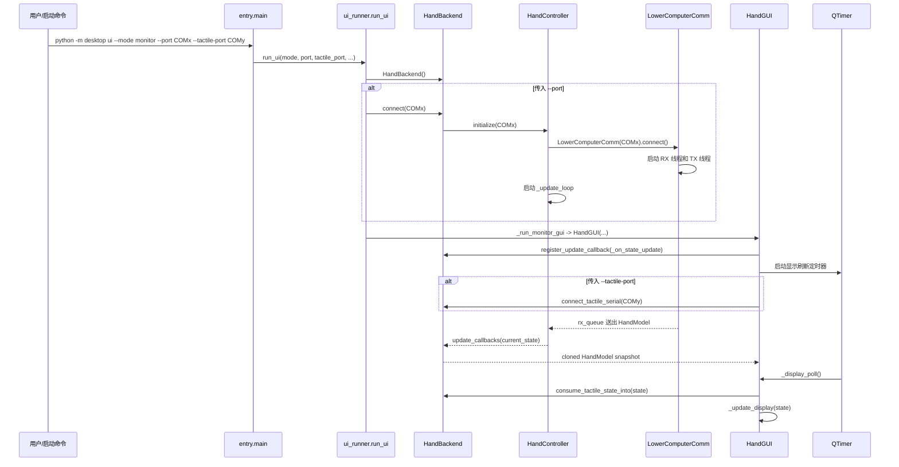
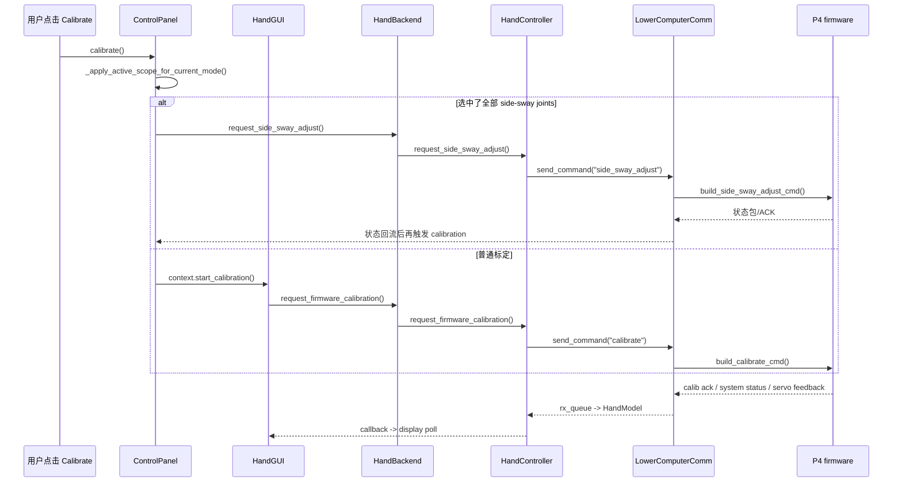
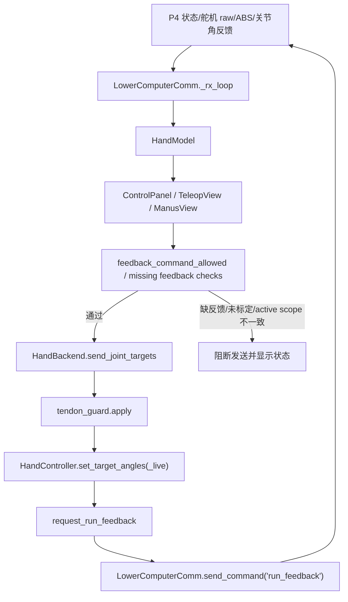
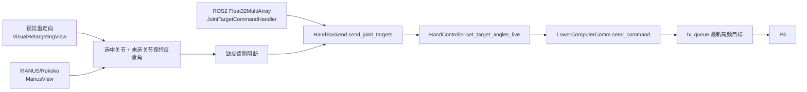

# 行为切片：打开 Monitor UI 并接入设备

这个切片只看一次具体行为：启动上位机界面，接入 P4 主控串口和可选的 S3 触觉串口，然后在这个运行场景里继续看标定、反馈闭环、遥操作如何接入。它不按文件关系读，而是按事件和数据如何流动来读。

## 一句话主线

命令行参数进入 `entry.main`，创建 `HandBackend`，主控串口由 `HandController -> LowerComputerComm` 接管，UI 只注册状态回调并用定时器消费最新状态；标定、反馈控制、遥操作都不绕过这条主干，最终都汇入 `HandBackend` 的命令接口，再通过 `LowerComputerComm.tx_queue` 发给 P4。

## 事件流

## 主控 P4 数据流

1. `LowerComputerComm.connect()` 打开串口，清空 `rx_queue/tx_queue`，启动 `_rx_loop` 和 `_tx_loop`。
2. `_rx_loop()` 从串口读 bytes，放入 `_rx_buffer`。
3. `_extract_packets_and_firmware_logs()` 从 buffer 中拆出协议包。
4. `_process_packets()` 把不同包类型写入新的 `HandModel`，例如编码器角度、舵机角度、系统状态、故障状态。
5. 生成的 `HandModel` 被放入 `LowerComputerComm.rx_queue`。
6. `HandController._update_loop()` 从 `rx_queue` 取出模型，复制到 `current_state`。
7. `HandController` 调用 `update_callbacks`。
8. `HandBackend._on_controller_state_update()` 克隆状态快照，再分发给 UI。
9. `HandGUI._on_state_update()` 不直接刷新界面，只把快照放入 `LatestStateBuffer`。
10. `HandGUI._display_poll()` 由 `QTimer` 定时触发，消费最新快照并调用 `_update_display()`。

关键点：串口线程可以很快，UI 刷新必须受控，所以中间用了 `rx_queue`、callback、`LatestStateBuffer` 和 `QTimer` 分层缓冲。

## S3 触觉数据流

1. 如果启动时传入 `--tactile-port COMy`，`HandGUI.__init__()` 调用 `_start_tactile_port()`。
2. `_start_tactile_port()` 调用 `HandBackend.connect_tactile_serial()`。
3. `HandBackend` 创建并连接 `TactileSerialComm`。
4. UI 每次 `_display_poll()` 时调用 `_consume_tactile_state()`。
5. `_consume_tactile_state()` 调用 `HandBackend.consume_tactile_state_into(self._state)`。
6. backend 从 `TactileSerialComm.get_latest_model()` 取最新触觉模型。
7. `merge_tactile_state(target, latest)` 把触觉数据合并进当前 UI 正在显示的 `HandModel`。

关键点：S3 不是通过 P4 主控串口进入 UI 的，而是一条独立串口数据流，最后才汇入同一个显示状态。

## 反向命令流

打开 UI 之后，如果用户再点击按钮或拖动滑条，数据会反向走：

```mermaid
flowchart LR
    UI["HandGUI / ControlPanel"] --> Backend["HandBackend.send_joint_targets/start/stop"]
    Backend --> Ctrl["HandController"]
    Ctrl --> Comm["LowerComputerComm.send_command"]
    Comm --> Queue["tx_queue"]
    Queue --> TX["_tx_loop"]
    TX --> Serial["serial.write(bytes)"]
    Serial --> P4["P4 firmware"]
```

其中高频命令，例如滑条 live 角度，会走 `_enqueue_latest_high_rate()`，队列里只保留最新目标，避免 UI 操作堆积成过期串口命令。

## 标定过程

标定不是 UI 直接改本地数据，而是 UI 发命令给 P4，P4 返回系统状态/标定状态，最后仍然通过主控状态流回到 UI。

标定支线的关键检查：

1. `ControlPanel.calibrate()` 先应用当前 active scope，防止 UI 选择的关节/电机范围和 P4 不一致。
2. 如果当前 active scope 包含全部侧摆关节，会先走 `side_sway_adjust`，成功后再进入标定。
3. `_start_calibration_now()` 会清掉当前关节目标初始化状态，再调用 `context.start_calibration()`。
4. `HandGUI.start_calibration()` 保证串口已连接，然后调用 `backend.request_firmware_calibration()`。
5. `HandController.request_firmware_calibration()` 只负责发送 `"calibrate"`，真正进度和结果来自后续 P4 状态包。

## 反馈闭环和保护

这里的“负反馈”可以按代码里的语义理解为：P4 持续回传关节/舵机真实状态，UI 和 backend 在发新目标前用这些反馈做同步、保持、阻断和运行状态切换。

反馈闭环里最重要的几件事：

1. Enable 前，`ControlPanel.start_controller()` 会先 `_apply_active_scope_for_current_mode()`，再 `_sync_motor_targets_to_feedback()`，把当前电机反馈同步成目标零点。
2. 如果 multi-turn 状态未知，Enable 不会继续，而是要求先做恢复流程。
3. 手动和遥操作模式发目标前都会调用 `feedback_command_allowed()`，检查 active motor、multi-turn、ABS limit、关节标定、active scope 是否匹配。
4. `HandGUI.send_joint_targets()` 先让 control panel 做反馈许可检查，再调用 `backend.send_joint_targets()`。
5. `HandBackend.send_joint_targets()` 先同步 tendon guard，再把目标送入 `HandController`。
6. 如果 source 不为空且没有被 tendon guard 阻断，backend 会调用 `request_run_feedback()`。
7. `HandController.request_run_feedback()` 只有在当前 P4 状态是 `READY` 时才发送 `"run_feedback"`；如果已经是 `RUN_FEEDBACK`，直接认为成功。
8. P4 后续返回 `SYSTEM_STATE_RUN_FEEDBACK`，上位机才把它当作真实运行状态。

这条线的核心不是“UI 认为已经开始”，而是 P4 的 `SYSTEM_STATUS` 才是事实来源。

## 遥操作行为

遥操作有多种来源，但最后都汇到同一个发送通道：

视觉遥操作：

1. `VisualRetargetingView.update_state()` 从普通 UI 状态流里保存当前关节反馈角。
2. 姿态识别线程产生一帧目标角后，进入 `_on_joints_ready()`。
3. `_targets_for_selected_joints()` 只替换被选中的关节，未选关节用反馈角或上一次发送目标保持。
4. 如果未选关节没有反馈可保持，则阻断发送。
5. 通过后调用 `context.send_joint_targets(..., source="Visual Retargeting", live=True)`。

MANUS/Rokoko 遥操作：

1. `ManusView._maybe_send_joint_targets()` 从手套帧和 retarget preview 生成目标角。
2. 如果是 raw skeleton 模式，会先检查选中关节是否有效。
3. `_targets_for_selected_joints()` 同样用“选中关节跟随、未选关节保持反馈”的策略。
4. 发送前设置 `ControlMode.JOINT_ANGLE` 和 PID 开启。
5. 最终调用 `context.send_joint_targets(..., live=True)`。

ROS2 遥操作：

1. `Ros2JointTargetBridge` 或 `RawIkTargetBridge` 订阅 `Float32MultiArray`。
2. `JointTargetCommandHandler.handle_values()` 校验长度必须等于 `ENCODER_COUNT`，且每个值必须是有限数字。
3. 通过校验后设置 `ControlMode.JOINT_ANGLE`。
4. 如果启用 `auto_start`，第一次消息会调用 `backend.start()`。
5. 最终调用 `backend.send_joint_targets(..., source="ROS2:<topic>", live=True)`。

遥操作的关键点：实时源只负责产生目标角，是否能安全发出去由反馈检查、tendon guard、RUN_FEEDBACK 状态切换共同决定。

## 这条线应该先读哪些函数

按这个顺序读，不要按文件列表读：

1. `desktop/app/entry.py::main`
2. `desktop/app/ui_runner.py::run_ui`
3. `desktop/app/ui_runner.py::_run_monitor_gui`
4. `desktop/core/hand_backend.py::HandBackend.connect`
5. `desktop/core/core_logic.py::HandController.initialize`
6. `desktop/core/comm_layer.py::LowerComputerComm.connect`
7. `desktop/core/comm_layer.py::LowerComputerComm._rx_loop`
8. `desktop/core/comm_layer.py::LowerComputerComm._process_packets`
9. `desktop/core/core_logic.py::HandController._update_loop`
10. `desktop/core/hand_backend.py::HandBackend._on_controller_state_update`
11. `desktop/ui/ui_app.py::HandGUI._on_state_update`
12. `desktop/ui/ui_app.py::HandGUI._display_poll`
13. `desktop/ui/ui_app.py::HandGUI._update_display`
14. `desktop/ui/ui_control_panels.py::ControlPanel.calibrate`
15. `desktop/ui/ui_app.py::HandGUI.start_calibration`
16. `desktop/core/core_logic.py::HandController.request_firmware_calibration`
17. `desktop/ui/ui_control_panels.py::ControlPanel.start_controller`
18. `desktop/ui/ui_control_panels.py::ControlPanel.feedback_command_allowed`
19. `desktop/ui/ui_app.py::HandGUI.send_joint_targets`
20. `desktop/core/hand_backend.py::HandBackend.send_joint_targets`
21. `desktop/core/core_logic.py::HandController.request_run_feedback`
22. `desktop/ui/ui_visual_retargeting_view.py::VisualRetargetingView._on_joints_ready`
23. `desktop/ui/ui_manus_view.py::ManusView._maybe_send_joint_targets`
24. `desktop/ros2/joint_targets.py::JointTargetCommandHandler.handle_values`

## 主线之外先不要看

这次行为切片里可以暂时跳过：

- `algorithm` 模式。
- 自动标定细节。
- 具体 UI 控件布局代码。
- 旧文档和 README。

这些不是没用，而是它们不是“打开 Monitor 并看到数据刷新”的主线。
