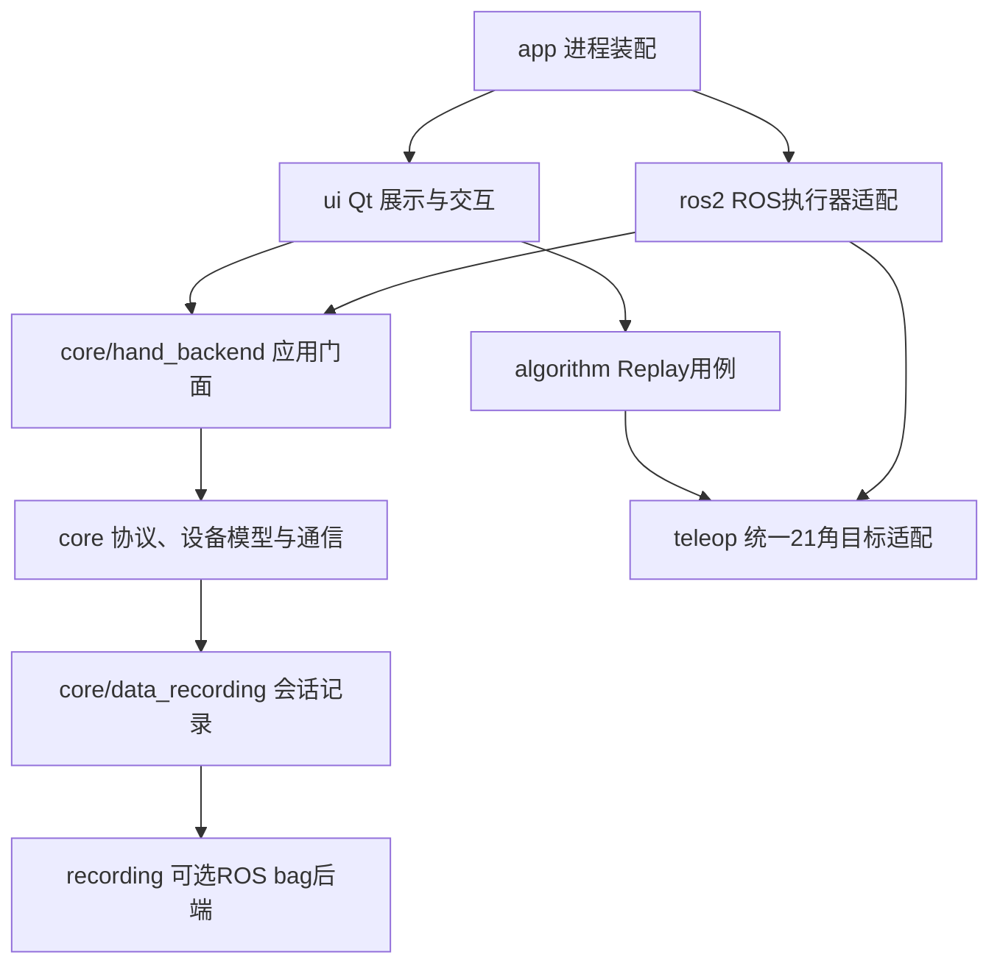
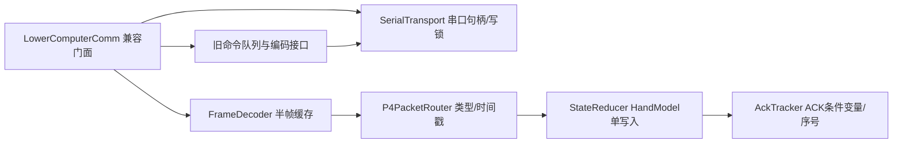

# Desktop P0 文件头与依赖规范

## 目标

P0 只建立可读性和静态边界基线，不改变串口、控制、标定、遥操、Replay 或 UI 行为。
正式运行模块的文件头必须回答六个问题：

1. `职责`：本文件解决什么问题。
2. `线程`：在哪个线程执行，是否允许阻塞。
3. `输入`：数据和命令从哪里来。
4. `输出`：向哪个边界交付什么结果。
5. `状态所有权`：谁能写状态，谁只能读快照。
6. `禁止依赖`：该层不能反向依赖哪些实现。

## 当前分层



## 强制边界

- `core`、`algorithm`、`recording`、`ros2` 和正式 `teleop` 模块不得导入 Qt、PySide、
  PyQt 或 pyqtgraph。
- `core` 不得反向依赖 `ui`、`app`、`ros2` 或 `algorithm`。
- `ui` 不得直接导入 `comm_layer` 和 `core_logic`；设备操作必须经过 `HandBackend`
  或控制面板服务。
- `recording` 只负责持久化，不参与控制决策。
- `example_teleop.py` 是人工示例装配入口，允许连接 UI；该例外不扩散到正式 teleop 模块。

## 检查命令

```powershell
python tools/check_desktop_architecture.py
python -m pytest tests/tools/test_desktop_architecture.py -q
```

新增正式模块时，缺少六项文件头或跨越上述依赖边界会直接失败。离线绘图和开发工具目录
暂不纳入 P0，后续按各自运行环境建立单独规范。

## P1 通信拆分

`desktop/core/comm_layer.py` 继续导出 `LowerComputerComm` 和
`TactileSerialComm`，因此 UI、HandBackend、CLI 及既有测试无需修改导入路径；内部状态已按
职责拆到 `desktop/core/communication/`：



当前兼容门面保留线程启动、命令编码、固件日志以及触觉全量包重组钩子。后续 P2 可以继续
拆分命令编码和触觉处理，但不得把串口句柄、半帧缓存、ACK 或最新 HandModel 状态重新放回
门面。架构检查还禁止 `desktop/core/communication/` 反向导入 `comm_layer`，以防兼容门面
重新成为新组件的隐式依赖。
