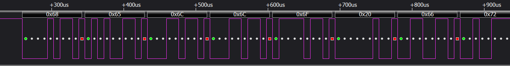
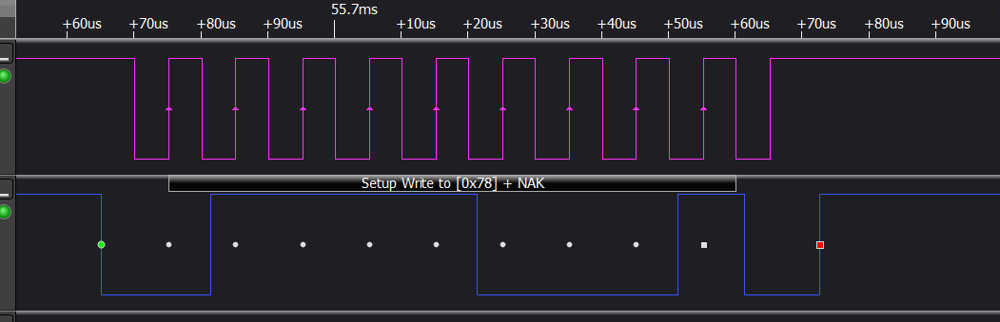
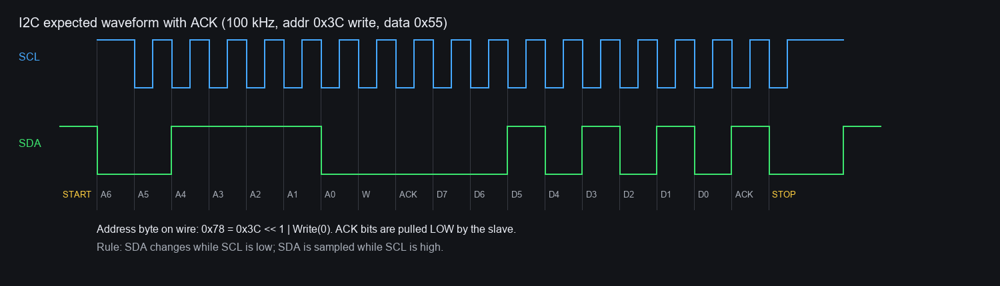
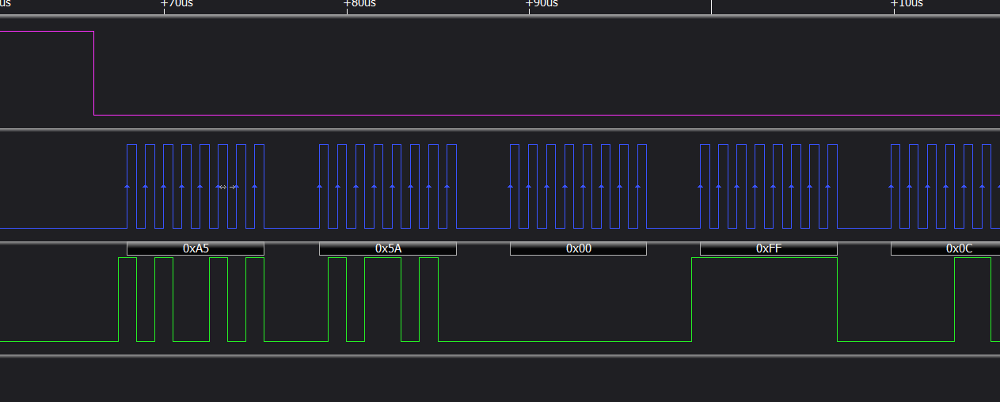
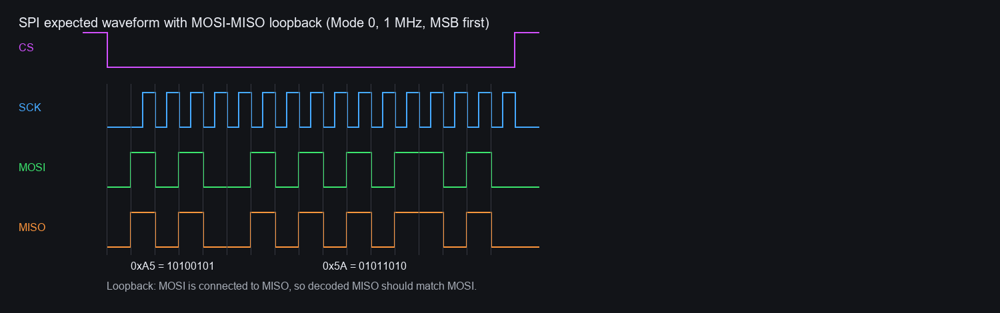
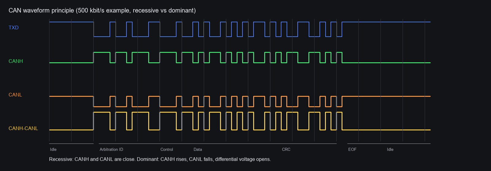

# UART、I2C、SPI、CAN 通信协议入门教程

本文结合本项目中 ESP32-P4 Arduino 测试代码和 Kingst 逻辑分析仪实测/示意波形，入门讲解四种常见硬件通信协议：UART、I2C、SPI、CAN。

配套测试代码位置：

| 协议 | Arduino sketch | 说明 |
| --- | --- | --- |
| UART | `ESP32-P4/UartLoopback/UartLoopback.ino` | GPIO31 TX、GPIO30 RX，115200 8N1 |
| I2C | `ESP32-P4/I2cWaveform/I2cWaveform.ino` | GPIO7 SDA、GPIO8 SCL，100 kHz |
| SPI | `ESP32-P4/SpiWaveform/SpiWaveform.ino` | GPIO50 CS、GPIO5 SCK、GPIO4 MOSI、GPIO49 MISO |
| CAN/TWAI | `ESP32-P4/CanWaveform/CanWaveform.ino` | GPIO47 TX、GPIO48 RX，500 kbit/s |

## 1. UART

UART 是异步串口通信。它没有时钟线，发送端和接收端必须提前约定波特率、数据位、校验位和停止位。本次测试使用最常见的 `115200 8N1`：

- `115200`：每秒 115200 bit。
- `8`：每帧 8 个数据位。
- `N`：无校验位。
- `1`：1 个停止位。

UART 空闲时通常为高电平。每发送一个字节，波形结构如下：

```text
空闲高电平 -> 起始位 0 -> 8 个数据位，低位先发 -> 停止位 1
```

`115200` 波特下，1 bit 的时间约为：

```text
1 / 115200 = 8.68 us
```

1 个 8N1 字节实际占用 10 bit：

```text
1 起始位 + 8 数据位 + 1 停止位 = 10 bit
10 * 8.68 us = 86.8 us
```

实测波形如下：



图中 Kingst 解码出：

```text
0x68 0x65 0x6C 0x6C 0x6F 0x20 0x66 0x72
```

这些字节对应 ASCII：

```text
h e l l o   f r
```

也就是测试程序发送字符串 `hello from...` 的开头。

以 `0x68` 为例：

```text
0x68 = 0110 1000
```

UART 数据位是低位先发，线上实际数据位顺序为：

```text
D0 D1 D2 D3 D4 D5 D6 D7
0  0  0  1  0  1  1  0
```

再加上起始位和停止位：

```text
Start D0 D1 D2 D3 D4 D5 D6 D7 Stop
  0   0  0  0  1  0  1  1  0   1
```

### UART 看波形要点

- 空闲线应为高电平。
- 每个字节以一个下降沿开始，这是起始位。
- 解码错误时，优先检查波特率是否一致。
- UART 不需要时钟线，也没有 ACK 机制。
- 如果时间轴拉得太长，整包 UART 数据会被压成一条细竖线，需要放大查看。

## 2. I2C

I2C 是同步、半双工、总线式通信协议。它只有两根信号线：

- `SCL`：时钟线，由主机产生。
- `SDA`：数据线，主机和从机共用。

I2C 是开漏/开集电极结构，设备只负责把线拉低，不主动输出高电平。高电平依靠上拉电阻拉到 `3.3 V` 或 `5 V`，本项目中按 `3.3 V` 使用。

I2C 空闲时：

```text
SCL = 高
SDA = 高
```

传输开始和停止的定义：

```text
START：SCL 为高时，SDA 从高变低
STOP： SCL 为高时，SDA 从低变高
```

传输规则：

- `SCL` 低电平期间，`SDA` 允许变化。
- `SCL` 高电平期间，`SDA` 必须稳定。
- 接收方在 `SCL` 高电平期间采样 SDA。
- 每 8 bit 后跟 1 bit ACK/NACK。

本次代码访问 7-bit 地址 `0x3C`。I2C 在线上传输地址时，会把 7-bit 地址左移 1 位，再加上读写位：

```text
0x3C << 1 | Write(0) = 0x78
```

### I2C 无外设实测：地址 NACK

因为实测时没有外接地址为 `0x3C` 的 I2C 从设备，所以 Kingst 解码为：

```text
Setup Write to [0x78] + NAK
```

实测波形如下：



这不是错误，而是正常现象：

```text
START -> 地址 0x3C + Write -> NACK -> STOP
```

第 9 个时钟是 ACK 位。若有从设备响应，从设备会在 ACK 位把 SDA 拉低；本图中 SDA 没有被从设备拉低，所以是 NACK。

### I2C 有外设 ACK 时的理想波形

下图是补充生成的 I2C 有设备响应示意图：



可以看到：

- 地址字节在线上显示为 `0x78`。
- 地址后第 9 位是 ACK，从设备拉低 SDA。
- 后续发送数据 `0x55`。
- 每个 8 bit 数据后也有 ACK 位。

### I2C 上拉电阻对波形的影响

I2C 必须有上拉。合适上拉时：

- 空闲时 SCL/SDA 都稳定为高。
- 下降沿通常很陡，因为由设备主动拉低。
- 上升沿比下降沿慢，因为由电阻和总线电容决定。
- 上升沿应在下一个采样点前回到可靠高电平。

没有上拉或上拉太弱时：

- 空闲电平可能不稳定。
- 上升沿很慢，像斜坡。
- 高电平可能达不到逻辑阈值。
- 解码器可能误判 START、STOP、ACK。

常用上拉：

```text
SDA -> 4.7k 到 3.3 V
SCL -> 4.7k 到 3.3 V
```

`100 kHz` 下 `4.7k` 到 `10k` 通常都能工作。很多 OLED、传感器模块已经自带上拉，不一定需要额外再加。

## 3. SPI

SPI 是同步、全双工、点对点或一主多从通信协议。典型信号线包括：

- `CS` / `SCS` / `SS`：片选，通常低电平有效。
- `SCK` / `SCLK`：时钟，由主机产生。
- `MOSI`：Master Out Slave In，主机发给从机。
- `MISO`：Master In Slave Out，从机发给主机。

本次测试使用：

```text
SPI_MODE0
MSB first
1 MHz
CS active low
```

`SPI_MODE0` 含义：

- `CPOL = 0`：空闲时 SCK 为低电平。
- `CPHA = 0`：第一个时钟沿采样，通常在上升沿采样。

SPI 传输过程：

```text
CS 拉低 -> SCK 输出时钟 -> MOSI/MISO 同步移位 -> CS 拉高
```

SPI 与 UART/I2C 不同：

- SPI 没有起始位和停止位。
- SPI 没有地址帧。
- SPI 没有 ACK/NACK。
- 一切字节边界由 CS 和 SCK 共同决定。

### SPI MOSI 实测波形

本次实测没有外接 SPI 从设备，因此主要看 `CS/SCK/MOSI`：



Kingst 解码出：

```text
0xA5 0x5A 0x00 0xFF 0x0C ...
```

这与测试代码发送内容一致：

```text
A5 5A 00 FF counter_low counter_high
```

以 `0xA5` 为例：

```text
0xA5 = 1010 0101
```

因为 SPI 设置为 `MSB first`，所以线上 MOSI 顺序就是：

```text
1 0 1 0 0 1 0 1
```

### MISO 应该是什么样

MISO 由从设备驱动。如果没有外接 SPI 从设备，MISO 可能表现为：

- 一直高。
- 一直低。
- 悬空乱跳。
- 受干扰产生无意义波形。

这些都不代表主机 SPI 发送失败。

如果把 `GPIO4/MOSI` 短接到 `GPIO49/MISO` 做回环，MISO 应该与 MOSI 几乎一致。补充生成的回环示意图如下：



回环时，Kingst 对 MOSI 和 MISO 解码应接近：

```text
MOSI: A5 5A ...
MISO: A5 5A ...
```

如果连接真实 SPI 设备，MISO 不一定和 MOSI 一样。常见读寄存器流程是：

```text
MOSI: READ_CMD REG_ADDR 00     00
MISO: 00       00       DATA_H DATA_L
```

前几个 MISO 字节可能是无效值，真正数据出现在后续 dummy byte 时钟期间。

## 4. CAN / TWAI

CAN 是多主、差分、抗干扰能力强的总线协议。ESP32 系列中的 CAN 控制器常称为 TWAI。它与 UART/I2C/SPI 的一个重要区别是：控制器引脚不是直接连接 CANH/CANL 总线，而是连接到 CAN 收发器。

典型连接：

```text
ESP32 TWAI TX -> CAN 收发器 TXD
ESP32 TWAI RX <- CAN 收发器 RXD
CAN 收发器 CANH/CANL -> CAN 总线
```

本次生成的测试代码使用：

```text
TWAI TX = GPIO47
TWAI RX = GPIO48
bitrate = 500 kbit/s
standard ID = 0x123
DLC = 8
data = A5 5A 00 FF counter_low counter_high 12 34
```

由于当前没有 `120 ohm` 终端电阻，也没有完整 CAN 收发器实测环境，因此本节使用生成的 CAN 原理波形图讲解。



### CAN 的隐性位和显性位

CAN 总线不是简单高低电平，而是差分信号：

- 隐性位 recessive：通常表示逻辑 `1`。
- 显性位 dominant：通常表示逻辑 `0`。

在 CANH/CANL 上：

```text
隐性位：CANH 和 CANL 电压接近，差分电压接近 0
显性位：CANH 升高，CANL 降低，形成明显差分电压
```

在控制器 TXD 上常见逻辑关系是：

```text
TXD 高：隐性位
TXD 低：显性位
```

实际收发器和模块可能有细节差异，但这个关系最常见。

### CAN 帧里有什么

一个标准 CAN 数据帧大致包含：

```text
SOF -> 仲裁 ID -> 控制位 -> 数据长度 -> 数据 -> CRC -> ACK -> EOF
```

其中：

- `SOF`：帧开始，显性位。
- `仲裁 ID`：多个节点同时发送时，ID 小的优先级更高。
- `DLC`：数据长度，经典 CAN 为 0 到 8 字节。
- `CRC`：校验。
- `ACK`：其它节点确认收到。
- `EOF`：帧结束。

CAN 有位填充机制：连续出现 5 个相同电平后，会插入一个相反电平的 stuff bit。用逻辑分析仪解 CAN 时，不要只按裸 bit 数手工数帧，优先看解码器结果。

### 为什么需要 120 ohm 终端电阻

CAN 是传输线总线。总线两端通常各有一个 `120 ohm` 终端电阻，用于匹配阻抗、减少反射。

没有合适终端时可能出现：

- 边沿反射。
- 振铃。
- 差分电压不稳定。
- 高速时解码失败。
- ACK、CRC 错误增多。

所以真实 CANH/CANL 波形建议在有收发器和终端电阻后再测。只接 `GPIO47/TX` 能看到控制器逻辑波形，但那不是 CANH/CANL 差分总线波形。

## 5. 四种协议快速对比

| 协议 | 是否需要时钟线 | 典型信号线 | 传输方向 | 是否有 ACK | 典型用途 |
| --- | --- | --- | --- | --- | --- |
| UART | 不需要 | TX、RX、GND | 全双工 | 无 | 调试串口、模块通信 |
| I2C | 需要 | SCL、SDA、GND | 半双工总线 | 有 | 传感器、EEPROM、OLED |
| SPI | 需要 | CS、SCK、MOSI、MISO、GND | 全双工 | 无 | Flash、屏幕、高速传感器 |
| CAN | 内部有位时序，无独立时钟线 | CANH、CANL，经收发器 | 多主总线 | 有 ACK 位 | 车载、工业控制、长线抗干扰 |

## 6. 实测排查顺序

### UART

1. 先看空闲是否高电平。
2. 检查波特率是否正确。
3. 检查是否 `8N1`。
4. 放大到单个字节，看起始位和停止位。

### I2C

1. 先看 SCL/SDA 空闲是否都为高。
2. 检查是否有上拉电阻。
3. 看 START 和 STOP 是否清楚。
4. 看地址是否为预期。
5. 没有设备时 NACK 正常；有设备时应出现 ACK。

### SPI

1. 先看 CS 是否拉低。
2. 看 SCK 是否只在 CS 有效期间跳变。
3. 检查 CPOL/CPHA 是否和代码一致。
4. 检查 MSB first / LSB first。
5. 没有从设备时，不要用 MISO 判断主机发送是否正常。

### CAN

1. 先区分测的是 TXD/RXD 逻辑脚，还是 CANH/CANL 差分总线。
2. 检查波特率是否一致。
3. 检查是否有 CAN 收发器。
4. 检查总线两端是否有 `120 ohm` 终端。
5. 真实总线至少需要另一个节点 ACK，否则正常模式下可能反复重发。

## 7. 本次教程图片来源

| 图片 | 来源 |
| --- | --- |
| `uart_actual_kingst.png` | Kingst 实测 UART |
| `i2c_actual_nack_kingst.png` | Kingst 实测 I2C 无外设 NACK |
| `spi_actual_mosi_kingst.png` | Kingst 实测 SPI MOSI |
| `i2c_expected_ack.png` | 生成的 I2C ACK 示意波形 |
| `spi_expected_miso_loopback.png` | 生成的 SPI MISO 回环示意波形 |
| `can_expected_txd_canh_canl.png` | 生成的 CAN TXD/CANH/CANL 原理波形 |
