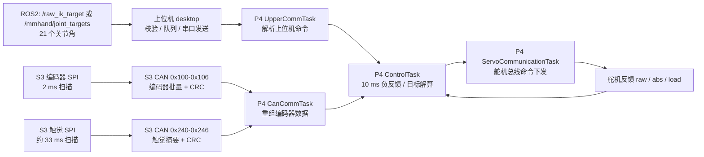

# 灵巧手危机 BUG 清除计划（S3 / P4 / 上位机 / ROS2 全链路版）

日期：2026-07-06  
目标：从 `ESP32-S3`、`ESP32-P4`、上位机、`ROS2` 四个角度重新梳理当前代码中可能导致“卡顿、标定失败、多圈恢复异常、负反馈不稳、链路难排查”的严重问题，并给出后续代码修改路线与 Kingst 逻辑分析仪实测方案。

> 本文替换旧文件 `docs/critical_bug_clearance_plan_20260705.md`。旧文档分析过浅，且没有把 S3、P4、上位机、ROS2 放到一条闭环里判断，容易漏掉“命令已经发出但反馈没有跟上”“ROS2 高频输入把下位机推到不可观测状态”“双电机防松绳参数没有真正来自标定”等关键问题。

---

## 0. 结论先行

当前最危险的问题不是某一个单点函数，而是四层链路里存在几个“闭环断点”：

1. **双电机负反馈的安全边界仍不够扎实**  
   `DualTendonControl.cpp` 里所有双关节共用一套 `joint16` 几何模型，并且共用 `motorZero = 2557 / 358`。这两个值目前不是从自动标定的“负载到达阈值后的预紧点”动态生成的。`450 counts` 防松绳逻辑虽然已经存在，但它是基于静态 `motorZero` 做 release clamp，不是严格基于每个关节、每个电机的标定预紧 ABS。

2. **命令下发速度、舵机反馈刷新、控制周期之间没有统一的“领先量限制”**  
   P4 控制周期约 10 ms，舵机通信任务每轮只刷新部分总线，全量反馈可能 20 ms 才完整刷新一次。ROS2 / 上位机 live 输入又可以连续覆盖最新目标。此时如果 target 变化过快，代码上可能没有积压，但物理舵机和 currentAbs 会滞后，表现为“cmd 走了，abs 长时间不跟”或运动中卡顿。

3. **S3 传感链路存在实时性和配置一致性风险**  
   S3 编码器 2 ms 采样、CAN 4 ms 发一批、触觉 33 ms 扫描。触觉任务和 CAN 任务同在 core0 且同优先级，编码器任务里默认打开 debug dump，可能引入不可忽略的时序抖动。`Config.h` 里还存在 encoder/tactile 引脚命名冲突风险，需要用逻辑分析仪确认实际硬件时序。

4. **上位机到 P4 的关键命令没有 CRC/seq/版本化保护**  
   当前上位机命令帧主要靠头、长度、尾判断，没有 CRC。对于 `ANGLE_CTRL`、`MOTOR_POS_ABS`、`CALIB_LOAD_JOINT`、`RESTORE_MULTITURN` 这类关键命令，串口干扰、丢字节、错帧后很难做到强校验和可追踪。

5. **ROS2 链路已经能发 21 个角度，但还缺少工程化输入保护**  
   `/mmhand/joint_targets` 和 `/raw_ik_target` 当前主要做 21 个 float、finite 校验，然后直接 `backend.send_joint_targets(... live=True)`。还缺少角度范围、速率限制、超时归零/保持、频率统计、消息时间戳/seq 诊断。

---

## 1. 当前链路总图

判断卡顿和控制异常时，必须同时看三件事：

- **上位机 / ROS2 是否持续下发目标**：目标频率、目标跃迁幅度、是否 live 高频覆盖。
- **P4 是否按周期输出舵机命令**：ControlTask 是否生成 target，ServoCommunicationTask 是否真正发到总线。
- **舵机反馈是否跟随**：RX 是否返回、abs 是否变化、load 是否变化、总线是否有长空窗。

---

## 2. 对旧审计文档的修正

### 2.1 `critical_bug_clearance_plan_20260705.md` 的问题

旧文档的问题主要是：

- 没有按 S3、P4、上位机、ROS2 四层拆开。
- 没有把“命令发出”和“反馈跟随”分离分析。
- 没有给出可用 Kingst 直接验证的波形清单。
- 没有把双电机 `450 counts` 防松绳和 `motorZero` 来源讲清楚。
- 没有指出 ROS2 live 输入缺少工程保护。

因此旧文档已经删除，并以本文替换。

### 2.2 已删除旧审计报告

旧审计报告已删除，原因是它大量引用旧架构和旧路径，容易把当前主固件审计带偏。本文保留其中仍然有价值的方向，例如：

- 上位机到 P4 命令帧缺少 CRC/seq，确实需要升级。
- 需要更强的 ACK、状态诊断和 watchdog。
- 需要对舵机通信总线做实测，而不是只看上位机 UI。

但所有判断都以当前 `ServoCommunicationTask.cpp`、`ControlTask.cpp`、`UpperCommTask.cpp`、`AutoCalibrationTask.cpp` 等主链路文件为准。

本文以当前仓库实际代码为准。

---

## 3. P0 危机 BUG 清单

### P0-01：双电机模型和零点仍是静态共用，防松绳不是严格标定闭环

代码证据：

- `ESP32-P4/ServoBoardMain/src/control/DualTendonControl.cpp`
- `getDualTendonConfig()` 对 J0、J4、J8、J12、J16、J20 都返回同一个模型。
- `motorZero[0] = 2557.0f`、`motorZero[1] = 358.0f` 对所有双关节生效。
- `tendonLengthChange()` 内部忽略 `jointIndex`，所有双关节都调用 `joint16Tendon1LengthChange()` / `joint16Tendon2LengthChange()`。
- `kDualTendonMaxReleaseFromCalibCounts = 450` 的 clamp 是基于静态 `motorZero` 计算。

风险：

- 现在的 `2557 / 358` 不像是每个关节 rope init 后的零点，也不是每个关节自动标定后负载到 190 时的 ABS。
- 如果某个双关节机械结构、绕绳方向、预紧点不同，静态 clamp 可能对这个关节有效，对另一个关节不够安全。
- 你实测“反复拉到最大最小角度没有松绳”只能说明当前机械和当前测试范围下这两个值没有立即出错，不能证明它们是严格正确的标定参数。

建议修改方向：

1. 新增每个双关节的 `DualTendonCalibAnchor`：
   - `primaryPreloadAbs`
   - `secondaryPreloadAbs`
   - `primaryMinAbs = primaryPreloadAbs - 450 * sign`
   - `secondaryMinAbs = secondaryPreloadAbs - 450 * sign`
2. 自动标定完成时保存该 anchor。
3. 负反馈时 release clamp 使用该关节自己的 anchor，不再使用所有关节共用的 `2557 / 358`。
4. 如果还需要 CAD 几何模型，至少要明确：
   - 哪些关节确实共用同一几何。
   - 哪些关节需要独立模型。
   - 当前模型参数是否只适合 J16。

---

### P0-02：命令领先 currentAbs 没有统一限制，可能造成“cmd 已走、abs 长时间不跟”

代码证据：

- `ESP32-P4/ServoBoardMain/src/control/ControlTask.cpp`
- `ESP32-P4/ServoBoardMain/src/communication/servo/ServoCommunicationTask.cpp`
- 控制周期约 10 ms。
- 舵机通信任务每轮只读部分总线，所有总线完整刷新约 20 ms。
- 目标队列使用 overwrite 语义，只保留最新目标。
- ROS2 / 上位机 live 输入也只保留最新高频命令。

风险：

- 代码层面没有积压，但舵机物理跟不上时 currentAbs 会滞后。
- target 如果连续跳变，P4 每次都基于滞后的反馈继续发更远目标，会表现为运动卡顿、突然追赶、或者某阶段长时间等待。
- 你之前看到的 `DUAL_PRELOAD_SECONDARY` 阶段“cmd 走了、abs 不跟”就属于必须重点排查的现象。

建议修改方向：

1. 在 P4 侧统一增加 `cmd-current 最大领先量限制`：
   - 单电机：建议先用 300 到 500 counts。
   - 双电机：对 primary / secondary 分别限制。
   - 限制应在最终下发舵机 target 前执行。
2. 控制日志必须记录：
   - `joint`
   - `motor`
   - `currentAbs`
   - `targetBeforeClamp`
   - `targetAfterClamp`
   - `lead`
   - `load`
   - `source`
3. 如果 clamp 频繁触发，说明上游目标太快或舵机响应慢，需要再调 ROS2 / 上位机速率。

Kingst 验证：

- 如果 TX 命令持续发出，但 RX abs 不变，是舵机或总线/供电/负载问题。
- 如果 TX 本身出现长空窗，是 P4 调度或代码阻塞问题。
- 如果 TX 过密且 abs 明显滞后，是目标节奏和舵机能力不匹配。

---

### P0-03：ROS2 21 角输入没有速率、范围、超时保护

代码证据：

- `desktop/ros2/joint_targets.py`
- `desktop/ros2/raw_ik_target.py`
- `JointTargetCommandHandler.handle_values()` 当前主要校验：
  - 数量必须为 21。
  - 每个值必须是 finite。
  - 然后调用 `backend.send_joint_targets(... live=True)`。

风险：

- `/raw_ik_target` 如果来自 MANUS/IK 外部节点，一旦发布频率过高、角度突变、单位错误、关节顺序错误，上位机仍会持续转发。
- 没有输入超时保护时，ROS2 端停止发布后，下位机可能继续保持最后一次目标。
- 没有频率统计和 seq，现场很难判断“卡顿是 ROS2 不发、上位机没发、P4 没发、还是舵机没动”。

建议修改方向：

1. ROS2 handler 增加输入保护：
   - 角度范围限制。
   - 每关节最大角速度限制。
   - 最大发布频率限制，例如先限制到 50 Hz 或 100 Hz。
   - 消息超时 watchdog，例如 200 到 500 ms 未收到新消息，自动进入 hold 或 stop live。
2. 日志增加：
   - topic 名称。
   - 输入频率。
   - 被 clamp 的关节索引和值。
   - 最近一次消息年龄。
3. `/mmhand/joint_targets` 保持最终控制输入。
4. `/raw_ik_target` 保持 MANUS/IK 外部节点输入，短期可直接调用 backend，长期建议增加可选 relay 模式用于调试。

---

### P0-04：上位机到 P4 关键命令没有 CRC/seq，错误帧难以可靠发现

代码证据：

- `desktop/core/protocol.py`
- `ESP32-P4/ServoBoardMain/src/communication/upper/UpperCommTask.cpp`
- 当前命令帧主要依赖：
  - header `0xFE`
  - length
  - command id
  - payload
  - tail `0xFF`
- P4 侧存在 CRC 函数，但主要用于其他上行数据，不用于当前所有关键下行命令。

风险：

- 921600 串口下，如果有噪声、丢字节、错位，靠头尾和长度不能强校验 payload 内容。
- `CMD_ANGLE_CTRL` 是 21 个 float，payload 较长，更需要 CRC。
- `CALIB_LOAD_JOINT`、`RESTORE_MULTITURN`、`MOTOR_POS_ABS` 属于高风险命令，不能只靠长度和尾字节。

建议修改方向：

1. 增加协议 V2：
   - magic。
   - version。
   - command。
   - sequence。
   - payload length。
   - payload。
   - CRC16/CRC32。
2. P4 支持 V1/V2 兼容期。
3. 上位机默认使用 V2。
4. 所有高风险命令要求 ACK 返回：
   - seq。
   - command。
   - result。
   - error reason。

---

### P0-05：标定 ABS 快照协议用 int16，和内部 int32 不一致

代码证据：

- `ESP32-P4/ServoBoardMain/src/calibration/AutoCalibrationTask.cpp`
  - 标定结果里 servo abs 字段是 int32 语义。
- `ESP32-P4/ServoBoardMain/src/communication/upper/UpperCommTask.cpp`
  - 发送标定快照时使用 int16 clamp。
- `desktop/core/protocol.py`
  - 解析和构造 calib load joint 时也按 int16。

风险：

- 如果后续要把自动标定获得的 `tightServoAbs / zeroServoAbs / preloadAbs` 用作双电机安全边界，int16 clamp 会变成隐患。
- 当前多圈 ABS 或未来更大行程下，超过 int16 范围会被静默截断或 clamp。

建议修改方向：

1. 新增 `CALIB_SNAPSHOT_V2`，ABS 字段全部 int32。
2. `CALIB_LOAD_JOINT_V2` 同样使用 int32。
3. V1 只作为兼容读取，UI 明确显示“旧协议快照可能丢失多圈信息”。
4. 当 ABS 超出 int16 而走 V1 时，应返回错误，不应静默 clamp。

---

### P0-06：S3 编码器 / 触觉 / CAN 的实时性需要重新验证

代码证据：

- `ESP32-S3/System/src/tasks/EncodersTask.cpp`
  - 编码器任务 2 ms 周期。
  - `kEnableEncoderDebugDump = true`。
- `ESP32-S3/System/src/tasks/CanTask.cpp`
  - CAN 任务 4 ms 周期。
  - 编码器批量发送 0x100 到 0x106，共 7 帧。
- `ESP32-S3/System/src/tasks/TactileTask.cpp`
  - 触觉任务约 33 ms 周期。
- `ESP32-S3/System/src/hal/HalTactile.cpp`
  - 每次 update 会读取多个触觉传感器摘要和 full forces。
- `ESP32-S3/System/src/system/SystemTasks.cpp`
  - 触觉任务和 CAN 任务都在 core0，优先级同为 5。

风险：

- 编码器任务里串口 debug 默认开启，会影响实时性。
- 触觉 SPI 扫描时间如果过长，可能影响 CAN 任务调度。
- CAN 发送使用短超时，异常情况下 7 帧批量发送可能引起长耗时。
- 如果 S3 输出编码器数据抖动，P4 控制层看到的角度反馈也会抖动。

建议修改方向：

1. 编码器 debug dump 默认关闭，只通过编译宏或运行命令开启。
2. S3 增加任务耗时统计：
   - encoder scan us。
   - tactile update us。
   - CAN batch send us。
   - CAN fail count / bus recovery count。
3. 触觉 full forces 改为按需采样或降频，默认只发 summary。
4. 必须用 Kingst 测一次：
   - encoder SPI 周期。
   - tactile SPI 一轮扫描耗时。
   - CAN 0x100-0x106 周期稳定性。

---

### P0-07：S3 引脚配置存在潜在冲突和注释失真

代码证据：

- `ESP32-S3/System/src/config/Config.h`
  - `PIN_ENC_CS = 7`
  - `PIN_TAC_CS_A = 7`
  - `ENC_HW_MODE` 默认是 `ENC_HW_MODE_138_CS_DEMUX`
- `ESP32-S3/System/src/hal/HalEncoders.cpp`
  - 默认 138 模式下没有直接使用 `PIN_ENC_CS` 去拉片选。
  - 151 模式下会使用 `PIN_ENC_CS`。

风险：

- 当前默认 138 模式可能不直接冲突，但配置表里同一个 GPIO 同时被命名为 encoder CS 和 tactile CS，很容易在切换硬件模式或维护代码时引入真实冲突。
- 文档和代码读起来会让人误判“编码器和触觉共用 CS”。

建议修改方向：

1. 按硬件版本拆分清楚：
   - 138 模式下 encoder CS demux 的真实片选线。
   - 151 模式下 `PIN_ENC_CS` 的真实用途。
   - tactile `CS_A / CS_B` 的真实用途。
2. 对不同 `ENC_HW_MODE` 做编译期检查，禁止冲突引脚组合。
3. 用 Kingst 同时测 GPIO7 和触觉 SPI，确认默认模式下 GPIO7 只按触觉 CS 行为动作。

---

### P0-08：多圈恢复已经实现，但恢复边界和用户可理解性还不够

代码证据：

- `ESP32-P4/ServoBoardMain/src/persistence/MultiTurnNvsStore.cpp`
  - A/B slot。
  - magic/version/CRC。
  - mapping signature。
  - validMask。
- `ESP32-P4/ServoBoardMain/src/communication/servo/ServoCommunicationTask.cpp`
  - 负责 boot restore / host restore / unknown 标记 / NVS 保存触发。

风险：

- 现在不能说“多圈恢复没实现”，它已经实现了。
- 但恢复逻辑仍依赖 snapshot 有效、mapping 一致、当前 raw 与 snapshot raw 在容差内。
- 如果舵机断电后 raw 跨过 0/4096 边界，或者断电期间实际转动，恢复会被拒绝，这是正常保护。
- 当前 UI 报错容易让用户误解为“必须 New Device 才能恢复”，实际应该区分：
  - 没有有效 NVS。
  - mapping 不一致。
  - raw 偏差超容差。
  - 电机离线。
  - firmware 不支持保存状态回报。

建议修改方向：

1. P4 上报每个电机恢复失败 reason。
2. UI 按电机显示：
   - snapshot valid。
   - raw delta。
   - tolerance。
   - turn restored / unknown。
3. New Device Reset 必须明确：
   - 它是在确认机械安全后建立新基准。
   - 不是普通断电恢复的必需步骤。
4. NVS 保存触发要继续保留：
   - turn 变化。
   - raw 接近 0/4096 边界。
   - RUN_START / RUN_DONE。
   - CALIB_DONE。
   - heartbeat 超时。

---

### P0-09：反向保护宏默认关闭，UI 可能给出过强安全感

代码证据：

- `ESP32-P4/ServoBoardMain/src/control/ControlTask.cpp`
  - `REVERSE_GUARD_ENABLE` 默认值为 0。

风险：

- 如果 UI 或文档提示用户有反向保护，但固件编译时关闭，会造成安全能力误判。
- 对自动标定方向错误、M/J 映射错误、收放绳方向错误的诊断会变弱。

建议修改方向：

1. 固件状态包上报 `reverse_guard_enabled`。
2. UI 显示“方向保护 ON/OFF”。
3. 如果默认关闭，弹框不能写成已经启用。
4. 标定失败时应明确区分：
   - 方向一致性错误。
   - 负载未到阈值。
   - abs 未跟随 cmd。
   - 电机离线。

---

## 4. P1 高优先级 BUG / 改进项

| 编号 | 层级 | 问题 | 风险 | 修改思路 |
|---|---|---|---|---|
| P1-01 | P4 | ServoCommunicationTask 每轮只刷新部分总线 | control 用到的 currentAbs 可能滞后 10-20 ms | 在状态包里加入每个 motor 的 `feedback_age_ms` |
| P1-02 | P4 | 离线扫描可能拉长舵机通信周期 | 某个电机掉线时拖慢其他电机 | 离线扫描降频、分摊、记录 scan cost |
| P1-03 | P4 | `CMD_ANGLE_CTRL` 无 ACK | ROS2/上位机不知道 P4 是否接受了最新目标 | 增加低频 ACK 或状态回显 last_seq |
| P1-04 | P4 | `g_jointCalibResult` 由多个任务读写，缺少明确 generation/mutex | 标定加载和控制读取边界不清晰 | 增加 calib generation 和原子快照 |
| P1-05 | P4 | 触觉 full dump CAN 分包缺少 CRC | 大包数据错帧难发现 | full dump 增加 CRC 或默认关闭 |
| P1-06 | Desktop | 高频命令队列只保留最新，没有物理速率约束 | 表面不卡队列，实际可能让舵机跟不上 | 上位机增加 rate limiter / slew limiter |
| P1-07 | Desktop | UI 对故障原因解释不够具体 | 用户不知道该检查方向、映射、负载还是通信 | 弹框按 failure code 给具体建议 |
| P1-08 | ROS2 | `/raw_ik_target` 与 `/mmhand/joint_targets` 语义还需文档固定 | 外部节点容易发错 topic 或单位 | README 明确 topic、单位、顺序、示例命令 |
| P1-09 | S3 | `Config.h` 中 task core 宏和实际创建代码不一致 | 后续维护误判任务调度 | 删除无效宏或让创建代码使用宏 |

---

## 5. 后续代码修改路线

### 第一阶段：先让问题可观测、可复现、可证明

优先修改：

1. **P4 目标领先量日志与 clamp**
   - 在单电机、双电机最终发 target 前记录 `currentAbs / targetBefore / targetAfter / lead / load`。
   - 先把最大领先量限制设成 300 到 500 counts 可配置。
   - 卡顿问题先通过日志和 Kingst 判断“P4 没发、舵机没回、还是 abs 慢”。

2. **S3 关闭默认 encoder debug**
   - `kEnableEncoderDebugDump` 默认改为 false。
   - 增加任务耗时计数，不用高频 `Serial.printf` 干扰控制。

3. **ROS2 输入保护**
   - `/raw_ik_target` 和 `/mmhand/joint_targets` 都经过统一 validator。
   - 增加最大频率、最大角速度、范围限制、超时策略。

4. **上位机 UI 故障原因细化**
   - 自动标定失败时明确显示：
     - 方向一致性错误。
     - abs 未跟随 cmd。
     - 负载未达阈值。
     - 某个 joint 失败，不代表全部 joint 失败。

### 第二阶段：把双电机防松绳改成真正标定闭环

优先修改：

1. 自动标定输出双电机 anchor：
   - 主电机预紧 ABS。
   - 副电机预紧 ABS。
   - 对应 load 阈值。
   - 对应方向 sign。

2. 控制层使用每关节 anchor：
   - `J0/J4/J8/J12/J16/J20` 各自使用自己的 anchor。
   - 没有 anchor 时禁止进入 READY/负反馈，或者进入降级保护。

3. 协议升级：
   - 标定快照 V2 使用 int32 ABS。
   - 上位机保存/加载完整多圈标定数据。

### 第三阶段：协议和状态机工程化

优先修改：

1. 上位机下行协议 V2：
   - CRC。
   - seq。
   - version。
   - ACK。

2. P4 状态包扩展：
   - last command seq。
   - command reject reason。
   - feedback age。
   - reverse guard enabled。
   - multi-turn restore reason。

3. ROS2 工程文档：
   - topic。
   - 消息类型。
   - 单位。
   - 21 关节顺序。
   - CLI 示例。
   - 故障判断。

---

## 6. Kingst 逻辑分析仪实测计划

### 6.1 最值得优先测的波形

优先级从高到低：

1. **P4 到舵机总线 UART / 半双工总线**
   - 目的：判断卡顿到底是 P4 没发、总线没回、还是舵机 abs 不跟。
   - 最适合排查 side adjust、自动标定、负反馈 target 追踪。

2. **S3 到 P4 的 CAN/TWAI**
   - 目的：确认编码器和触觉数据是否稳定到达 P4。
   - 最适合排查“角度反馈突然没更新”“P4 误以为传感器离线”。

3. **S3 编码器 SPI**
   - 目的：确认编码器采样周期、SPI 模式、MUX 切换、数据稳定性。
   - 最适合验证 S3 传感链路本身。

4. **S3 触觉 SPI**
   - 目的：确认触觉扫描是否拖慢系统，GPIO7 是否存在复用冲突风险。

5. **上位机到 P4 串口**
   - 目的：确认 ROS2 / UI 下发频率和真实串口命令是否一致。
   - 如果 USB 串口线不好接，可先用软件日志替代。

6. **临时 GPIO 打点**
   - 目的：跨 S3/P4 任务测端到端时延。
   - 需要临时代码配合，但最能定位“任务调度卡在哪里”。

---

### 6.2 P4 舵机总线测量方法

推荐采样：

- 如果舵机串口是 1 Mbps：采样率选 **20 MSa/s 到 50 MSa/s**。
- 如果不确定波特率：先选 **50 MSa/s** 捕获，再用 Kingst 解码器尝试常见 UART 波特率。
- 采样深度：
  - 看单次命令：1 Mpts 即可。
  - 看卡顿：建议 10 Mpts 以上，捕获 200 ms 到 1 s。

接线：

- GND 必须共地。
- 如果能接 TTL UART：
  - CH0 接 TX。
  - CH1 接 RX。
  - 如有方向控制脚，CH2 接 DE/RE。
- 如果是半双工单线：
  - CH0 接总线逻辑侧。
  - 如有方向控制脚，CH1 接 DE/RE。

Kingst 设置：

- 解析器选择 UART。
- 常见设置：8 data bits、no parity、1 stop bit。
- 触发：TX 下降沿，或手动点击开始后马上执行 side adjust / 标定。

重点观察：

- P4 是否每 10 ms 左右有命令帧。
- 卡顿时 TX 是否停止。
- TX 后是否有 RX。
- RX 返回间隔是否异常变长。
- 同一总线上是否出现重叠波形或冲突。

判定：

| 现象 | 最可能原因 |
|---|---|
| 卡顿时 TX 有长空窗 | P4 任务阻塞、队列没出、代码调度问题 |
| TX 正常但 RX 没有 | 舵机掉线、总线硬件、供电、半双工方向控制问题 |
| TX/RX 都正常但 abs 不变 | 机械卡住、负载过大、舵机未执行、目标不合理 |
| TX 过密且 RX/abs 滞后 | 命令节奏超过舵机响应能力，需要 lead clamp/rate limit |

---

### 6.3 S3-P4 CAN/TWAI 测量方法

推荐采样：

- CAN 1 Mbps：采样率选 **10 MSa/s 到 20 MSa/s**。
- 如果只看有无和周期：10 MSa/s 足够。
- 如果要看边沿质量：20 MSa/s 更稳。

接线：

- 优先接 CAN 收发器逻辑侧：
  - TXD。
  - RXD。
  - GND。
- 不建议直接用普通逻辑分析仪接 CANH/CANL 做差分判断，除非有差分探头或确认输入保护。

Kingst 设置：

- 解析器选择 CAN。
- 波特率 1 Mbps。
- 触发可选：
  - 帧 ID `0x100`。
  - 错误帧。
  - 总线长时间空闲。

重点观察：

- 编码器帧 `0x100` 到 `0x106` 是否约每 4 ms 成组出现。
- `0x106` CRC 帧是否稳定出现。
- 触觉摘要帧 `0x240` 到 `0x246` 是否约 33 ms 出现。
- 是否有 error frame、bus off、长时间无帧。

判定：

| 现象 | 最可能原因 |
|---|---|
| `0x100-0x106` 周期抖动很大 | S3 encoder/CAN 任务被阻塞 |
| 触觉发送时编码器 CAN 出现明显空窗 | tactile SPI 或 CAN 发送占用过长 |
| CAN 错误帧多 | 终端电阻、线缆、收发器、波特率、接地问题 |
| CAN 正常但 P4 仍报传感离线 | P4 CanCommTask 重组/CRC/超时逻辑需要查 |

---

### 6.4 S3 编码器 SPI 测量方法

推荐采样：

- 编码器 SPI 10 MHz：采样率选 **50 MSa/s 到 100 MSa/s**。
- 低于 5 倍 SCLK 容易解码不稳定，建议优先 100 MSa/s。

接线：

- CH0：SCLK。
- CH1：MOSI。
- CH2：MISO。
- CH3：MUX A。
- CH4：MUX B。
- CH5：MUX C。
- 如果当前硬件模式使用 CS，再接 CS。
- GND 共地。

Kingst 设置：

- SPI 解析器。
- 根据代码默认配置，先试 `Mode 1`。
- MSB first。

重点观察：

- 是否每约 2 ms 有一轮编码器扫描。
- MUX 切换后到 SPI 开始之间是否有稳定间隔。
- MISO 是否有明显毛刺、悬空、全 0、全 1。
- 某一路异常时是否和物理通道对应。

判定：

| 现象 | 最可能原因 |
|---|---|
| SPI 周期不稳 | S3 任务调度或 debug 输出影响 |
| MUX 刚切换就开始 SPI | MUX settle 时间不足 |
| MISO 偶发错位 | SPI mode、线长、时钟过高、接地问题 |
| 单通道固定异常 | 编码器、MUX 通道或接线问题 |

---

### 6.5 S3 触觉 SPI 测量方法

推荐采样：

- 触觉 SPI 1 MHz：采样率选 **10 MSa/s 到 20 MSa/s**。

接线：

- CH0：SCLK。
- CH1：MOSI。
- CH2：MISO。
- CH3：CS_A。
- CH4：CS_B。
- CH5：GROUP_A。
- CH6：GROUP_B。
- CH7：GROUP_C。
- GND 共地。

重点观察：

- 一轮 5 组 x 3 传感器扫描需要多长时间。
- 触觉任务是否约 33 ms 一轮。
- GPIO7 是否只作为触觉 CS 动作。
- 触觉扫描期间 CAN 是否出现明显空窗。

判定：

| 现象 | 最可能原因 |
|---|---|
| 触觉一轮扫描太长 | full forces 读取过重，需要降频或按需读取 |
| GPIO7 同时出现 encoder/tactile 行为 | 引脚复用配置有真实冲突 |
| MISO 经常 CRC 错 | SPI mode、线缆、传感器供电或时序问题 |

---

### 6.6 上位机到 P4 串口测量方法

推荐采样：

- 串口 921600：采样率选 **20 MSa/s 到 50 MSa/s**。

接线：

- 如果 USB 转串口 TTL 信号可接：
  - CH0：PC -> P4 TX。
  - CH1：P4 -> PC RX。
  - GND 共地。
- 如果没有可接测试点，先用上位机软件日志替代。

重点观察：

- ROS2 发布 21 角时，上位机是否真的以预期频率发串口命令。
- `ANGLE_CTRL` 命令之间是否被 heartbeat/status 请求挤占。
- 是否出现明显突发发送。
- 卡顿时上位机串口是否仍在持续发。

判定：

| 现象 | 最可能原因 |
|---|---|
| ROS2 在发但串口没发 | 上位机队列、UI/ROS bridge、backend 问题 |
| 串口高频突发 | 需要上位机 rate limiter |
| P4 有回包但 UI 不更新 | 上位机解析或 UI 刷新问题 |

---

### 6.7 临时 GPIO 打点方案

这个方案需要临时代码，但定位效率最高。

建议打点：

| GPIO 点 | 含义 |
|---|---|
| S3_GPIO_A | EncodersTask 开始 / 结束 |
| S3_GPIO_B | CAN 发送 0x100 批次开始 / 结束 |
| P4_GPIO_A | CanCommTask 完成一组 encoder snapshot |
| P4_GPIO_B | ControlTask 开始 / 结束 |
| P4_GPIO_C | ServoCommunicationTask 发送 target batch |

推荐采样：

- 1 MSa/s 到 5 MSa/s 足够。
- 捕获 1 秒左右。

能回答的问题：

- S3 encoder 到 P4 control 端到端延迟是多少。
- ControlTask 是否稳定 10 ms。
- ServoCommunicationTask 是否稳定 10 ms。
- 卡顿时到底哪一个 GPIO 周期被拉长。

---

## 7. 推荐实测顺序

第一次实测建议按这个顺序，不要一上来测太多线：

1. **只测 P4 舵机总线**
   - 复现 side adjust 卡顿。
   - 先判断 TX 有没有长空窗。

2. **同时测 P4 舵机总线 + 软件日志**
   - 日志记录 target/currentAbs/lead/load。
   - Kingst 记录 TX/RX。
   - 对齐时间，判断是代码没发还是舵机没跟。

3. **测 S3-P4 CAN**
   - 确认 encoder 帧周期和 CRC 帧稳定。
   - 看触觉发送是否影响 encoder。

4. **测 S3 encoder SPI**
   - 如果 CAN 数据异常，再向前查 SPI。

5. **测触觉 SPI**
   - 如果发现 CAN 抖动和触觉时刻相关，再测触觉。

6. **最后测上位机串口 / ROS2 频率**
   - 用于验证 live input 是否过快。

---

## 8. 后续测试用例建议

### 8.1 桌面端 / ROS2

需要补充：

- 21 个角数量错误时必须拒绝。
- NaN / inf 必须拒绝。
- 超范围角度必须 clamp 或拒绝，并记录 joint index。
- 高频输入时必须限频。
- 输入超时后必须 hold 或停止 live。
- `/raw_ik_target` 和 `/mmhand/joint_targets` 的行为必须一致可测。

### 8.2 P4 控制层

需要补充：

- 单电机 target lead clamp 测试。
- 双电机 primary / secondary lead clamp 测试。
- 450 release clamp 使用 per-joint anchor 的测试。
- 无 anchor 时禁止进入 READY / RUN_FEEDBACK。
- 标定失败只标记失败 joint，不污染其他 joint。

### 8.3 P4 通信层

需要补充：

- 命令协议 V2 CRC 错误必须拒绝。
- seq 重复/乱序诊断。
- `CALIB_LOAD_JOINT_V2` int32 ABS 往返测试。
- multi-turn restore reason 上报测试。

### 8.4 S3 传感层

需要补充：

- encoder scan 周期统计。
- tactile update 周期统计。
- CAN batch 发送耗时统计。
- bus recovery count。
- tactile full dump 是否影响 encoder CAN 周期。

---

## 9. 最小可执行修改清单

短期最值得马上做的修改：

1. P4：单/双电机统一 target lead clamp，并打印 clamp 诊断。
2. P4：状态包增加 `feedback_age_ms`。
3. P4：双电机标定结果中保存 per-joint preload anchor。
4. P4：双电机 450 clamp 改为使用 per-joint anchor。
5. Desktop：ROS2 输入增加 rate limit、range limit、stale timeout。
6. Desktop：标定和故障弹框显示更具体 reason。
7. S3：默认关闭 encoder debug dump。
8. S3：增加 encoder/tactile/CAN 任务耗时统计。
9. Protocol：新增带 CRC/seq 的 V2 下行命令。
10. Protocol：新增 int32 calib snapshot/load V2。

---

## 10. 最终判断标准

修改后不能只看“界面不报错”，至少要满足：

- 自动标定失败能准确指出是哪个 joint、哪个 motor、哪个阶段、什么原因。
- side adjust 或负反馈卡顿时，能从日志判断：
  - 上位机是否发了。
  - P4 是否收了。
  - P4 是否发舵机命令。
  - 舵机是否回了。
  - abs 是否跟了。
- ROS2 连续发布 21 角时：
  - 不会无限制高频冲击 P4。
  - 停止发布后有明确超时行为。
  - topic、单位、关节顺序明确。
- 双电机 450 防松绳：
  - 来自每个关节自己的标定 anchor。
  - 不再依赖所有关节共用的 `2557 / 358`。
  - J0/J4/J8/J12/J16/J20 都能单独验证。
- 多圈恢复：
  - 能说清楚为什么恢复成功或失败。
  - 不把所有失败都简化成“必须 New Device Reset”。

---

## 11. 当前最推荐先做的实操

下一步建议先做两件事：

1. **用 Kingst 测 P4 舵机总线，复现 side adjust 卡顿**
   - 这是最快判断代码/总线/舵机的办法。
   - 如果 TX 有空窗，先查 P4 任务。
   - 如果 TX 正常 RX 不跟，先查舵机总线和负载。

2. **在 P4 加 target/currentAbs/lead/load 日志**
   - 和 Kingst 波形对齐。
   - 一次就能判断“cmd 走了 abs 不跟”的真实原因。

这两项完成后，再动双电机 per-joint anchor 和 ROS2 rate limit，风险会小很多。
