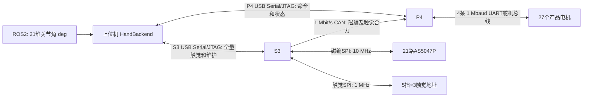

# 当前系统代码、协议与验收边界

2026-10-25 原生ABS改动见[电机坐标与恢复](native-motor-abs.zh.md)。下文历史实机证据仍对应当时固件；新协议为6，需要配套更新上位机和P4。

核对日期：2026-10-16。根目录：`C:/Users/73547/mmhand`。
依据当前工作区源码和 `docs/debug/control-tuning.md` 的最新结果；不是根据旧版 AI README 推断。本次只做代码检查与统计，没有新增硬件运动测试，也没有修改生成的 AI README/HTML。

## 1. 哪些已经验证，哪些还没有

**当前不能宣称整套重构已完成全部实机验收。1354 项自动回归通过，不等于 1354 项实物测试。** 自动回归含 Python 测试、原生编译的固件算法及协议/状态机测试。

已取得的实机证据：

- P4 与 S3 原生 USB Serial/JTAG 烧录校验通过，当前 P4 COM12、S3 COM14 是最近测试时的枚举结果，端口号不作为永久设备身份。
- P4 协议版本4握手，参数整组设置、修订号和 CRC 独立查询通过。
- 食指 J12–J15 的 Manual、Auto/LUT、ABS 限位恢复并回读：Manual/Auto=0xF000，限位=0xF8000。
- J13/M17 实测 Feedback 保持→Direct 保持→Feedback 保持，117个监测点；最大角度读数偏差约0.11°，实际电机位置变化0 counts。最后 READY、disabled、ownerNONE。
- 三次正常后端重连，共30秒300/300新鲜状态，食指在线、触觉掩码0x2003、无默认选择、未自动使能。
- S3 USB关闭/打开/关闭共约42秒，419/419采样点触觉有效、J08–J15在线。P4接收约250批磁编/秒；该区间CAN CRC、接收溢出和当前错误计数为0。
- 最新S3 USB触觉采集约17秒：3321有效帧、685601字节，CRC/序号/分片丢失计数均为0。
- 实物扫描15个触觉地址，得到Little ID1/IP25、Little ID2/DP52、Thumb ID1/IP25三个已登记安装。登记型号结合有效长度/CRC验证，不是读取到了独立硬件型号身份证。
- 此前在一只IP传感器完成2→1改号和新旧地址核验；用户完全断电后，该位置仍可扫描到ID1。
- 电机124地址快扫已实测；BUS0原先找到的15–19五台电机，84/85/86=254/254/0已写入并独立读回，**没有实际改过这些电机的ID**。
- SVG已用52+25+25=102个真实测点输出验证。尚未完成逐点按压定位实物对照。

| 尚未完成/覆盖不完整的验收 | 需要实际验证的内容 |
|---|---|
| 全手控制覆盖 | 21关节/27电机逐一验证；目前使能保持实测只有J13/M17，不能推广为所有单绳/双绳都通过。部分非食指编码器仍间歇有效/报错。 |
| 单绳动态PI | 不同幅度阶跃、连续轨迹、正反向、跟踪误差、超调、稳态误差、输出限速和边界附近行为。 |
| 慢积分 | 非零Ki下的条件积分、噪声门槛、同向误差确认、饱和回退、换向/失联时清除。当前默认单绳和双绳Ki均为0，保持试验不能证明I项有效。 |
| 双绳控制 | 两电机同时实物闭环，正交恢复量对张力/姿态的影响，以及局部LUT斜率与统一输出限幅的联合作用。 |
| 快速换向 | flexion/extension、连续反复换向、锚点补偿、达到位移退出、冷却、无响应超时后保持，不反复累计补偿。 |
| 实物碰撞 | 500ms武装和500ms检测窗口、q_slow速度、PID持续推进、两个方向阈值、换向重建、碰撞标签、后退解除。尚未以实际阻挡试验测触发时延与误报率。 |
| 运动中故障注入 | 运动时拔P4 USB、断CAN、丢编码器、断舵机、制造超载、STOP到总线执行的延迟，以及恢复后不自动运动。现有软件测试不能代替这些实测。 |
| 电机实际改号 | 多台旧→253→新、交换/循环、目标冲突、253占用、跨BUS同ID、改号中取消/断电/断线后恢复。已有算法测试；没有实物完整批次改号验收。 |
| 触觉全覆盖改号 | 两种型号、5根手指、0/1/2各方向、两台交换、无空位三循环拒绝、批次中断与路由恢复、每种型号改后完全断电保存。仅上述单只IP已取得改号/保存证据。 |
| 同ID硬件场景 | 同一BUS重复地址无法独立识别、不能承诺总能检测出重复；界面已有明确提示，尚未人为接入重复地址做实物试验。 |
| 触觉图物理对应 | 两型号逐点压触验证测点索引、X/Y朝向、左右手安装旋转/镜像；P4摘要/直连S3全量切换、断开消失的交互组合。 |
| Joint/Motor Calibration完整重做 | 当前参数恢复通过，但最新完整固件还没有重新跑全手标定、逐关节Set Min/Max及每个故障/取消分支。不能以软件回归替代实测。 |
| ROS2整链遥操 | 实际发布/mmhand/joint_angle_deg，经One Euro与静止锚点、串口、机械跟随；长时间静止抖动、起动、掉帧/断流、STOP后不能重新武装。 |
| Replay/录制 | 当前CSV录制→导入→选择范围→实际回放、结束释放、STOP中断、文件与实机轨迹比对、长录制完整性。 |
| 参数页面 | 正常连接整组应用已通过；逐个边界值、GUI修改/恢复默认、断线重连、忙状态拒绝等尚未逐项实机操作验收。 |
| 最新固件同线断点 | JTAG检查和此前断点证据已有，但最新USB FIFO修正版尚未完整重测命中断点→恢复→USB重新通信→控制不自动恢复的整个场景。OpenOCD期间与串口工具的排他限制仍适用。 |
| 长稳与电源异常 | 目前是秒级/分钟级测试，尚未数小时满负荷、反复断电/欠压、全15触觉模块接入及全手同时动作压力测试。 |
| 文档发布 | AI生成脚本已调整；基于已提交源码的prepare→annotate→validate→publish正式中英文发布尚未完成，现有旧AI README不能当作本轮最新实机证明。 |

建议下一轮顺序：单绳小阶跃→双绳小阶跃/配对恢复→换向→非零Ki→低速碰撞/退让→运动中故障注入→批量改号/断电恢复→ROS2和Replay→长稳。改号试验会真实改变安装地址，应保留当前清单与恢复记录。

## 2. 代码规模与统计口径

统计当前工作区中 `rg --files --hidden` 能看到的非忽略文件，包含尚未提交的新代码。扩展名：`.py .c .cpp .h .hpp .ino .ps1 .js .ts .css .sh .bat .cmd`。行数是物理行数，含注释/空行，不是执行语句数。

不计外部Arduino/ESP-IDF SDK、`.git`、`.debug`构建和临时脚本、缓存、`.zcode`、日志、录制、Markdown/HTML文档、JSON配置与URDF。仓库内HAL驱动仍计入固件代码。生成的C++/Python协议文件已计入，同时单列生成行数。

| 范围 | 文件数 | 物理行数 | 其中生成代码行数 |
|---|---:|---:|---:|
| ESP32-P4 | 216 | 23,962 | 538 |
| ESP32-S3 | 22 | 2,818 | 0 |
| desktop | 80 | 21,939 | 184 |
| docs/ai/build | 12 | 3,194 | 0 |
| tests | 91 | 17,125 | 0 |
| tools | 21 | 3,304 | 0 |
| 合计 | 442 | 72,342 | 722 |

P4+S3+上位机业务代码共48,719行；其余是测试、工具和AI文档构建程序。全部合计442文件、72,342行。生成代码722行已包含在合计中，不要重复相加。

## 3. 文件结构和职责

```text
C:/Users/73547/mmhand/
├─ ESP32-P4/
│  ├─ ESP32-P4.ino                   Arduino入口
│  └─ src/
│     ├─ config/                    GPIO、实时周期、保护常量、拓扑和协议定义
│     ├─ control/                   参数RAM、滑动窗口、单/双绳PI与换向
│     ├─ data/                      任务间传输对象和运行状态类型
│     ├─ generated/                 生成的协议、参数、指纹、安全索引
│     ├─ hal/                       CAN、USB、UART/飞特驱动硬件适配
│     ├─ safety/                    状态准入、碰撞、故障及安全事件策略
│     ├─ system/                    装配、共享状态、队列、RTOS/时间/日志/标定RAM
│     └─ tasks/
│        ├─ host_comm/              解帧、命令分发、ACK和遥测
│        ├─ s3_can_rx/              CAN重组、CRC、编码器健康
│        ├─ system_state/           状态机、Direct准入、Rope Init、故障仲裁
│        ├─ motion_control/         控制调度、LUT/反馈读取、批次输出
│        ├─ servo_bus/              四路UART唯一执行者、反馈、维护改号
│        └─ runtime_monitor/        任务耗时、周期、栈与负载统计
├─ ESP32-S3/
│  ├─ ESP32-S3.ino                   启动、USB非阻塞配置、外围初始化
│  └─ src/
│     ├─ config/Config.h            GPIO、SPI/CAN、数据规模、任务核/优先级
│     ├─ hal/                       HalEncoders、HalTactile、HalTWAI、CRC
│     ├─ maintenance/               触觉USB维护解码/去重/改号/路由核验
│     ├─ system/                    任务创建、磁编覆盖队列、日志
│     └─ tasks/                     EncodersTask、TactileTask、CanTask
├─ desktop/
│  ├─ __main__.py                   python -m desktop入口
│  ├─ app/                          启动、端口、NiceGUI及ROS2装配
│  ├─ core/
│  │  ├─ hand_backend.py            GUI/ROS2/Replay共同后端门面
│  │  ├─ application_actions.py     用户操作事务、授权、模式切换、STOP
│  │  ├─ core_logic.py              标定/坐标/目标/状态同步等底层业务
│  │  ├─ comm_layer.py              P4与S3串口会话、RX/TX线程
│  │  ├─ protocol.py               当前协议打包/解包
│  │  ├─ communication/            字节传输、解帧、状态归并、ACK/历史
│  │  ├─ host_calibration/          自动标定算法和采样运行时
│  │  ├─ calibration_workflow.py    标定/导入串行执行器及事件
│  │  ├─ calibration_snapshot.py    当前整包校准与设备绑定
│  │  ├─ control_parameters.py      默认/当前JSON、校验、修订和CRC
│  │  ├─ teleop_input.py            One Euro与静止锚点滞回
│  │  ├─ id_actions.py              电机批量改号会话/日志/恢复
│  │  ├─ tactile_id_actions.py      五指触觉批量改号与恢复
│  │  ├─ id_protocol.py             电机维护协议和规划器
│  │  ├─ tactile_maintenance.py     S3维护协议和规划器
│  │  ├─ tactile_geometry.py        厂商坐标→平面手形SVG
│  │  ├─ console_snapshot.py        生成GUI只读快照和标签
│  │  └─ data_recording/            分主题录制、包记录和写盘
│  ├─ ui/browser_view.py            总布局、导航、状态条、可拖动System Log
│  ├─ ui/web/                       11个叶子视图和公共控件
│  ├─ ros2/                         /mmhand/joint_angle_deg订阅桥
│  ├─ replay/                       当前CSV加载、时间调度和回放状态
│  ├─ examples/                     ROS2发送示例
│  └─ resources/
│     ├─ config/                    运行参数、schema、模型/协议、测点几何
│     ├─ images/                    关节—电机ID示意图
│     └─ hku_hand_v2_urdf/           机械模型资源
├─ tests/                           desktop/firmware/tools回归
├─ tools/                           模型/协议/参数/安全生成和架构检查
│  └─ debug/                        编译、上传、OpenOCD、GDB及P4 FIFO修补
├─ docs/debug/                      实机记录和调试说明，本报告
├─ docs/ai/build/                   AI指南提取、渲染、校验程序
├─ .debug/                          忽略目录：ELF/BIN、调试脚本、测试证据
├─ run_data/、log/                  仓库内已有数据/日志目录
└─ AI_README.zh.md / .en.md         工作流生成产物，不应手改
```

最新运行数据默认在仓库外：`C:/Users/73547/mmhand_data`，可由`MMHAND_DATA_DIR`覆盖。标定/多圈记录在设备身份与产品指纹绑定的`device_state`下；录制在`recordings`、日志在`logs`。运行控制配置则按要求位于仓库内`desktop/resources/config`，两类数据不能混为一谈。

当前整包校准为V6；单关节Auto/LUT内部仍使用v4布局，两者是不同层级的版本，不是两套旧整包格式兼容。

### 各子目录行数

| 子目录 | 文件 | 行数 |
|---|---:|---:|
| ESP32-P4/src/config | 19 | 724 |
| ESP32-P4/src/control | 6 | 359 |
| ESP32-P4/src/data | 18 | 738 |
| ESP32-P4/src/generated | 6 | 538 |
| ESP32-P4/src/hal | 21 | 3,363 |
| ESP32-P4/src/safety | 36 | 3,090 |
| ESP32-P4/src/system | 39 | 2,719 |
| ESP32-P4/src/tasks | 70 | 12,415 |
| ESP32-S3/src/config | 1 | 150 |
| ESP32-S3/src/hal | 9 | 1,816 |
| ESP32-S3/src/maintenance | 2 | 165 |
| ESP32-S3/src/system | 3 | 90 |
| ESP32-S3/src/tasks | 6 | 525 |
| desktop/app | 3 | 119 |
| desktop/core | 50 | 19,294 |
| desktop/examples | 2 | 64 |
| desktop/replay | 5 | 1,243 |
| desktop/resources | 0 | 0 |
| desktop/ros2 | 2 | 215 |
| desktop/ui | 15 | 947 |


### 当前结构仍有的集中点

入口和任务调度层已拆开，但并非所有业务都拆成小文件。较大的文件包括：

| 文件 | 行数 |
|---|---:|
| desktop/core/core_logic.py | 2,977 |
| desktop/core/comm_layer.py | 1,845 |
| desktop/core/application_actions.py | 1,418 |
| ESP32-P4/src/tasks/servo_bus/ServoBusService.cpp | 1,402 |
| desktop/core/protocol.py | 1,343 |
| ESP32-P4/src/hal/servo/FeetechServoDriver.h | 1,173 |
| ESP32-P4/src/tasks/host_comm/HostCommandDispatcher.cpp | 1,112 |
| desktop/core/communication/state_reducer.py | 1,093 |


上位机不是Qt界面：当前可用入口是Python/NiceGUI本地网页；部分模块注释仍有Qt旧措辞。P4 `SystemAssembly.cpp`有“默认J08–J11”的过期注释，实际赋值是两个mask均为0。`TaskConfig.h`有栈单位word的过期注释，ESP-IDF任务创建接口按字节解释，此处表格按实际传入字节值列出。不能仅凭这些旧注释判断运行行为。

## 4. 三端通信总览



P4负责实时控制和执行安全；S3负责传感器采集和SPI触觉维护；上位机负责标定流程、输入过滤、改号规划、配置/记录和交互。P4不转发触觉改号请求，也没有一条“P4给S3下发控制参数”的当前业务通路。

### 4.1 上位机 ↔ P4 USB

运行口固定原生USB Serial/JTAG（扩展板接口，P4GPIO24/25），不是CH343；CDC线编码921600，不能把它理解为原生USB物理线速。Arduino选项`USBMode=hwcdc, CDCOnBoot=cdc, UploadMode=default, JTAGAdapter=builtin`。

帧封装：`FE | LEN(1字节) | TYPE/CMD | PAYLOAD | FF`。`LEN=1字节类型+负载+1字节尾`，全帧=`LEN+2`。通用外层没有统一CRC；参数、校准或传感器内部校验各按具体包定义。混合文本日志由解帧器跳过，不能把日志当作协议成功依据。

协议版本4；HELLO负载9字节，包含版本和两个32位模型/拓扑契约值。握手只授权使用协议，不自动选择范围或授权运动。固定业务规模21关节、27电机。大多数P4上行包在业务负载尾追加大端uint32的P4毫秒时间戳；维护结果/诊断等并非全部采用相同尾字段，不能统一盲剥4字节。

关键字节序：目标关节角21个float32为小端；掩码/多圈int32/事务标识等按各编码器明确处理，多数为大端；F8参数的39个float32为大端。不要用一个全局“小端/大端”概括整条协议。

ACK负载含原命令、执行时模式/状态、结果码；0=同步成功，2=已排队，1=当前模式拒绝，3=缺Manual，4=非法数据，6=Manual CRC不符，7=缺Auto，8=契约不符。**QUEUED不等于已经ENABLED，也不等于舵机机械到位。** 状态和执行结果包承担最终确认。普通ACK没有事务ID，因此同类确认事务必须串行；维护与Direct目标另有token。

完整下行/上行编号表见附录A/B。主要流程：

- 连接：F3握手→ED静态状态同步→F8参数→F9独立查询；标定和多圈根据本机设备记录恢复。
- Feedback使能：准备/释放旧owner→D7设活动范围→CC就绪→EA目标与D8运行打成一次队列事务→等待P4状态为RUN_FEEDBACK且ownerCONTROL且control_enabled。
- Direct使能：同样先交接，再设范围，D3发送当前ABS保持；1A确认总线执行结果，状态包确认Direct owner。
- CD全局STOP撤销输出并锁存；CE明确Clear Faults。切换模式内部用F6释放普通owner，不增加Pause或Exit Control按钮。
- 自动标定算法在上位机执行，P4提供Direct、反馈、归零和结果装载等原语。旧0xCA固件自动标定命令已删除；CC START仍是当前流程需要的就绪命令。
- 参数F8载荷165字节=`version1+revision4+39×float32+CRC32(4)`；整组仅空闲时应用。39字段中ROS2输入的8字段在主机执行，当前仍作为整组revision/CRC的一部分发给P4，不能因此说P4也运行了One Euro。
- 电机维护F4载荷12字节：token4、session4、op/bus/old/new各1。op0能力、1开始、2结束、3探测、4改号；1B结果负载16字节，版本3，带stage/status/present。253中转；84/85/86由每次上线检查配置。
- 电机普通扫描0–30共124地址；253和中断日志中的地址另作核对，超过30的目标也会被专门探测以拒绝冲突。普通快扫不代表遍历所有0–252设备。

### 4.2 S3 → P4 CAN

经典CAN，标准11位ID、单帧最多8字节、1Mbit/s。当前业务为S3向P4传感器上报，不存在本轮触觉改号经CAN转发。

| CAN ID | 内容 | 一批及校验 |
|---|---|---|
| 0x100–0x105 | 21个uint16磁编raw，大端，每帧最多4路 | 42字节真实负载，尾部空位填充不计入CRC |
| 0x106 | 编码器批次序号、CRC16及尺寸元数据 | 6数据帧+1元数据帧；P4重组超时20ms；0xFFFF表示该路无效 |
| 0x1F0–0x1F2 | 编码器错误详情 | 3帧，每帧seq+7路错误码；重组100ms，旧错误表清除超时300ms |
| 0x240–0x246 | 五指三模块三轴合力摘要 | 45字节力+2字节15位有效mask+2字节CRC16=49字节；每帧seq+7字节；重组80ms |
| 0x3F0 | 稀疏原始触觉诊断 | 调试分支，常规控制不用它 |
| 0x400–0x4DA | 全量触觉调试分片 | 1530字节分219帧，重组400ms；当前S3默认关闭全量CAN发送，接收/调试代码仍存在 |

CAN编码器数据帧自身没有每帧序号，使用末尾元数据及整批CRC16拒绝混批。P4只发布重组成功的快照，而不是逐个分帧修改21路状态。

当前默认CAN只传触觉合力；全阵列走S3直连USB，避免219帧的全量CAN批次挤占磁编反馈。

### 4.3 上位机 ↔ S3 USB

这是独立协议会话：不能把P4解析器直接套在S3上。外层同为FE/LEN/TYPE/PAYLOAD/FF，但S3当前全量触觉TYPE=0x0E，P4的0x0E却是Auto/LUT快照；S3由专门`TactileSerialComm`解析。

| S3类型 | 用途 |
|---|---|
| 0x0A | 45字节合力、序号、15位有效mask |
| 0x0E | 当前T2全触觉分片，1530字节阵列按约240字节切块，整帧CRC16/序号防混拼 |
| 0x10 | SPI采集/CRC/失败等触觉诊断 |
| 0x31 | 主机维护请求，负载12字节、版本2、token、op、selector、model、newID、保留及CRC16 |
| 0x32 | S3维护结果，负载22字节、版本2、token、stage/status、新旧selector、型号/点数/有效性、写出标志、语义位置、S3时间、CRC16 |

selector=`finger_bus×3+pageID`，共0–14；手指顺序Little/Ring/Middle/Index/Thumb。op0扫描、op1改号、op2核对中断事务并恢复已知语义/型号映射，op2不写传感器EEPROM。同一已缓存请求不会重复EEPROM写入；主机超时后先探测实际地址，不盲重写。

当前片选号=页面ID+1，即0/1/2→1/2/3。同一指BUS内ID必须唯一，不同指允许重复；两地址交换需要第三个空地址；三个都占用的三循环会拒绝，不能从软件绕过物理地址限制。同一BUS有同ID多个器件时，扫描到有效响应也不能证明只有一个器件。

注册的型号及Fingertip/Distal/Proximal语义独立保存，改号不会依据新ID猜型号。S3 NVS路由命名空间`pax-route-v2`；主机中断日志协助路由核对。

### 4.4 S3 ↔ 传感器、P4 ↔ 舵机

- 磁编AS5047P：独立SPI，10MHz、14位角度0–16383，21路按五指译码/链路组织；校验与诊断状态机在HalEncoders。S3在raw源头统一方向：DIP（J03/J07/J11/J15/J19，掩码`0x88888`）透传，其余关节（含AA/CMC）取`(16384 - payload) & 0x3FFF`；P4/上位机看到的raw均随URDF正方向递增。左右手末端板均按此掩码验证。采样无效在CAN中编码成0xFFFF。
- PaXini触觉：独立SPI，1MHz，功能码/两字节小端寄存器地址/两字节小端长度/数据/CRC8，厂商CRC初值FF。解锁`7A 01 00 01 00 A1 CE`，改号`7E 23 00 01 00 dest_id CRC8`。目标片选号1/2/3对应尾部`01 22`、`02 23`、`03 E3`。采集和改号在同一触觉任务两轮之间串行执行。
- 两型号：DP-S2015-Elite PXSR-STDDP03G为指尖52测点；IP-S1610-Elite PXSR-STDIP03B为指腹25测点。满配5×(52+25+25)×3=1530字节，当前实物只读到3个模块，不是15个满配验收。
- P4飞特总线：四路1Mbaud UART，RX={21,23,27,33}、TX={20,22,26,32}。由FeetechServoDriver封装飞特寄存器读写、同步读/写、校验、EEPROM解锁/重锁；不是把上位机FE帧直接透传到舵机。
- 电机当前位置只使用原生有符号ABS，不再由P4或上位机展开圈数；标定包保存原生ABS恢复记录，圈内相位仅在需要时取模计算。

### 4.5 ROS2 → 上位机

唯一运行输入话题`/mmhand/joint_angle_deg`，类型`std_msgs/msg/Float32MultiArray`，`data=[J00_deg, J01_deg, ..., J20_deg]`，严格21个有限值、单位度；订阅队列深度1。它不是弧度输入，也不是`JointState`消息。收到话题不自动使能；须用户选择关节并开启ROS2 INPUT，随后经上位机One Euro/静止锚点和同一控制授权边界。

## 5. 单片机任务与通信

### P4：6个常驻业务Task

| 任务 | 名义周期 | 优先级 | 栈传入值，字节 | 主要职责 |
|---|---|---:|---:|---|
| hostCommTask | RX事件唤醒，5ms兜底；常规遥测最多100Hz | 2 | 8192 | 串口解码、派发、ACK与上行 |
| systemStateTask | 10ms并可事件提前唤醒 | 5 | 4096 | 安全状态机、owner、STOP、Direct/Feedback准入、Rope Init |
| s3CanRxTask | 1ms循环 | 3 | 4096 | CAN读包、CRC重组、健康、最新快照 |
| servoBusTask | 10ms服务，加约3ms反馈收集点和通知唤醒 | 3 | 6144 | 四总线唯一I/O拥有者、目标执行、反馈、维护会话 |
| motionControlTask | 约10ms；目标/授权变化可提前唤醒 | 4 | 8192 | 快慢均值、PI/换向/配对恢复、输出约束和批次发布 |
| taskRuntimeMonitor | 1000ms统计窗 | 1 | 4096 | 周期、耗时分布、超限、栈余量和负载 |

P4通过xTaskCreate创建，**没有在TaskFactory固定核**；诊断中显示某次运行核不等于代码永久绑定该核。任务循环有事件提前唤醒，所以名义100Hz不等于永远严格每10ms一次。

除了业务Task，Arduino/FreeRTOS/USB还会创建loop、Idle、IPC、定时器、USB事件等内部任务。诊断里AutoCalibration保留槽位不代表现在有一个活动自动标定Task。

| P4通信对象 | 容量 | 生产→消费 |
|---|---:|---|
| stateEventQueue | 8 | Host/业务请求→状态机，顺序事件 |
| canRxQueue | 1 | CAN接收→控制/状态/遥测，最新覆盖快照 |
| servoTargetQueue | 1 | 获得owner的控制/初始化流程→ServoBus，唯一目标邮箱 |
| servoFeedbackQueue | 1 | ServoBus→控制/状态/上行，logical ABS |
| servoTelemetryQueue | 1 | ServoBus→控制/保护/上行，在线、负载等 |
| mappedAngleQueue | 1 | 控制侧映射/滤波→上行等，21路关节角 |
| controlTraceQueue | 32 | 控制→HostComm，订阅时保存顺序诊断记录 |
| tactileQueue | 3 | CAN触觉→HostComm，顺序触觉快照 |

任务通知hostCommWake/systemStateWake/motionControlWake/servoBusWake只传唤醒原因，不传业务载荷。目标与Direct命令成组读写由commandStateMutex保护；安全位图/token用原子接口。STOP另走单调token，不依赖8格普通事件队列是否已满。Servo维护还有独立请求/结果状态，Host提交，ServoBus执行，Host上报，不在Host线程抢占四路UART。

### S3：3个常驻业务Task

| 任务 | 周期/速率 | 优先级 | 核 | 栈，字节 | 职责 |
|---|---|---:|---:|---:|---|
| EncTask | 2ms名义采集，约500Hz | 10 | 1 | 4096 | 21路磁编采样、错误检测、无效编码、覆盖队列 |
| CanTask | 4ms，约250Hz磁编批次 | 5 | 0 | 4096 | 接收最新磁编、CAN发送、总线恢复/健康 |
| TacTask | 约33ms名义周期；满轮SPI实际耗时可超过它 | 5 | 0 | 8192 | 触觉SPI、USB维护、CAN合力、USB摘要与全量 |

EncTask→CanTask使用长度1的xQueueEncoderData，Overwrite/Receive保留最新整批，避免积压旧角度。触觉改号没有新增Task，在TacTask轮次之间调用维护处理，保持SPI/片选线单一拥有者；触觉快照与诊断读取有HAL互斥保护。CanTask和TacTask都可调用同一个TWAI驱动发送不同CAN ID。

最新S3已删除周期性21路raw打印，USB写等待设0，TX环形缓冲4096，未打开S3 USB接收也不应阻塞CAN采集。满缓冲可丢USB输出，不能为完整输出而阻塞实时采集。

## 6. 上位机线程与数据流

```text
NiceGUI控件/ROS2/Replay
        ↓ 类型化请求
HandBackend + ApplicationActions（操作/授权/STOP门禁）
        ↓                             ↑ 只读Console Snapshot
HandController/Core Logic        主机状态归并
        ↓                             ↑
P4 TX队列→SerialTransport    P4 RX→FrameDecoder→StateReducer
S3维护等待者→独立USB发送      S3 RX→触觉解析/维护token匹配
```

- NiceGUI负责控件和草稿，不直接写串口、不自行判定电机已经ENABLED。
- P4会话有RX/TX线程，写锁保证字节不交叉，高频目标在队列里只保留最新并按约100Hz节流。
- S3有独立接收会话和维护等待通道，P4中继不能刷新S3直连Rx age。
- 用户操作、校准导入和主机自动标定通过工作线程/串行执行器推进；标定执行器max_workers=1。
- ROS2 executor、Replay调度和录制/写盘是独立后台工作，均经同一个后端授权边界；STOP撤销旧输入授权和待执行目标，不自动恢复。
- q_fast/q_slow在P4按有效样本时间戳做20ms/500ms滑动窗口均值。ROS2的One Euro+静止锚点只在上位机输入链执行，GUI/Replay不重复套该滤波。
- 当前默认五组 Kp（按关节类型）：AA=1.3、MCP=1.3、PIP=1.0、DIP=1.3、CMC=1.0；Kd AA=0.08、MCP=0.02，其余 0；Ki 按 AA/MCP/PIP/DIP/CMC 五组，默认全 0。积分限幅/噪声/确认时间统一放在 Ki 组，单双腱共用一个限幅。目标基底为实测电机位置，不是LUT名义目标位置。双绳额外使用k_pair×正交偏差；D 项使用测量速度（20 ms 快窗差分，25 ms 一阶低通、±400°/s 限幅，仅在 Tracking 相位生效），没有目标速度前馈、旧误差分段Kp或积分泄露。

## 7. 当前GUI：5主页面，11个叶子视图

顺序与启动默认：Calibration→Control→Replay→Plot→Settings，默认Calibration/Joint Calibration。子页工具栏位于子页导航下面。

公共连接条：独立P4/S3设备选择、Connect/Disconnect、各自Rx age、Save Data、全局STOP。公共状态块为System、Calibration、Overload、Collision、Motor multi-turn position；背景按未知灰/正常绿/运行蓝/告警黄/故障红变化，文字不依赖彩色表达。底部System Log通过分隔条拖动高度。

| 主页面/子页 | 布局、按钮与功能 |
|---|---|
| Calibration / Joint Calibration | 五指卡片、手指/关节复选框、原始磁编、Manual Min/Max、Span与URDF差值、Auto端点和RAM/JSON状态。Load Joint & Motor Calibration、Clear Manual Selected、Release Selected Tendons，每行Set Min/Set Max；采集/保存/验证状态显示。清除/释放操作有现存确认交互。 |
| Calibration / Motor Calibration | 选择关节，展开相关电机表，电机反馈表只显示Motor、ABS、Load，并保留标定操作及结果。Load、Calibrate Selected；当前运行关节CALIBRATING，后续PENDING，完成后显示质量标签。自动标定算法由上位机执行。 |
| Control / Feedback Control | 五指关节卡片、角度输入/滑条、单行Send、Manual允许范围、当前角、ROS2目标、raw和相关电机ABS。ENABLE Selected、Clear Faults、Send Selected、ROS2 INPUT。每个关节以P4状态确认ENABLED/DISABLED；仅该关节实际碰撞时追加红色COLLISION DETECTED。 |
| Control / Direct Control | 按关节归组的电机卡片、ABS、load、关联关节角、ABS范围和输入/滑条/±1/Send。ENABLE Selected、Clear Faults、Send Selected、Reset Motor Multi-turn Position；设零按实际执行回读，并使有关标定/锚点失效。 |
| Replay | Import CSV、Play、五指/关节复选框、文件名/帧数/时长/频率、警告、逐关节当前角/目标/误差表、回放状态与进度；取消用全局STOP，无Pause。只读当前支持的CSV字段，不保留旧格式猜测。 |
| Plot / Curves & Recordings | 最多5个不同关节曲线，实测/目标角；Clear Plot。另选一电机查看P/I/换向/配对恢复counts分量。记录状态、目录、时长、Full tactile data选项；保存总开关在顶栏，不在此重复设置。 |
| Plot / Tactile | 平面手形、15个安装位置、X/Y/Z/Magnitude切换、手指/模块详情、Fx/Fy/Fz与新鲜度。S3直连FULL按厂商XY显示52或25测点；P4-only SUMMARY显示Σ合力；无新鲜传感器数据不伪造测点，位置灰/无有效数据。数值仍是设备raw单位，不是已标定的N或Pa。 |
| Settings / Renumber Motor | Scan All Buses、Renumber All、BUS/Current ID/New ID输入表、完整等比电机ID示意图。P4有效连接门禁；文字说明同BUS同ID无法区分，上线检查统一配置84/85/86=254/254/0，改号流程不再操作这些参数。无逐行改号按钮，无新增Reset ID上层。 |
| Settings / Renumber Tactile | Scan All Fingers、Renumber All，Thumb/Index/Middle/Ring/Little分组，每个传感器Current ID/New ID和已登记型号/点数；空输入不改，0/1/2，扫描与上次改号结果分别显示。必须直连S3，P4数据不能代替连接门禁。 |
| Settings / Control Parameters | Save Parameters、Restore Defaults、revision/CRC/P4应用状态；Kp config/Ki config/Kd config（AA/MCP/PIP/DIP/CMC五组）、Ki组内共享积分限幅/噪声/确认时间、双腱恢复增益、编码器快慢窗、快速换向、碰撞阈值、最终输出约束、ROS2滤波分组折叠面板。Kp/Ki/Kd按关节类型共用，无每关节覆盖；恢复默认读本机默认JSON。 |
| Settings / Diagnostics | Clear Faults、在线电机/编码器数量、owner和状态age；问题列表和详情、Operation History；可展开Task Runtime、Routes、Fingerprint、Raw Snapshot，任务统计按需订阅。 |

所有控制、标定、Replay范围初始为空；连接/重连清选择，不以UI旧勾选自动授权。Plot曲线选择也初始None。Tactile详情选择某一模块只是查看，不是运动选择。

标签大致分层：Joint Calibration是PENDING/READY/OFFSET/FAILED/UNKNOWN；Motor Calibration是PENDING/CALIBRATING/READY/HIGH FRICTION/WEAK RETURN/FAILED/UNKNOWN等；Feedback是ENABLED/DISABLED/UNKNOWN再按需追加COLLISION DETECTED；Direct按电机ENABLED/DISABLED/UNKNOWN。离线/磁编错误、原始故障、路由和多圈另有数据字段或Diagnostics，不是所有内容都拼成同一个质量标签。

## 8. 保留的内部机制和当前限制

- 没有Pause、resume或Exit Control按钮；F6普通owner释放、F2特定Direct事务释放、CC就绪、E9 Rope Init仍是当前流程的内部原语，不是旧Pause功能改名。
- CAN全量触觉调试代码仍在，默认关；不是已删除的历史触觉USB分片格式兼容。
- `.debug`保留过往恢复/试验脚本和日志，不属于运行入口或源代码规模；这些旧脚本不应当作最新固件的规范用法。
- 当前P4 USB可靠性还依赖所用SDK的FIFO直接写修补。`tools/debug/build_debug.ps1`自动校验/应用；通过Arduino IDE编译也需先执行相同前置步骤。原始SDK头文件已有旁路备份。此依赖已写入`docs/debug/esp32-jtag-debugging.md`。
- USB CDC与JTAG共用一根线，不等于当前OpenOCD工具与pyserial/esptool可无条件并发独占设备；调试时按仓库规则先释放串口，删除断点再detach，恢复后不自动运动。
- 同BUS同ID多设备不可分辨；CRC有效不证明只有一台，也不证明具体型号身份。重编号与物理安装模型关联需要保持原始清单。
- 开始/排队ACK、总线写完成、机械到位是不同层次。目前没有把全手动态性能或真实碰撞当作已通过的结果。

## 附录A：上位机→P4全部31类命令

负载字节数不包含FE/LEN/CMD/FF。名称与长度取自当前生成协议，语义说明按当前实现阅读。

| 命令 | 标识 | 负载字节 | 含义 |
|---|---|---:|---|
| 0xF4 | CMD_SERVO_MAINTENANCE | 12 | 舵机维护会话、探测及单步改号 |
| 0xCB | CMD_ANGLE_CTRL | 84 | 下发完整 21 路关节目标角，单位 degree |
| 0xCC | CMD_START | 0 | 申请当前活动范围的就绪状态，供上位机标定流程使用 |
| 0xCD | CMD_STOP | 0 | 停止当前运行并撤销待执行目标 |
| 0xCE | CMD_RESET | 0 | 清除允许恢复的系统故障锁存 |
| 0xD3 | CMD_MOTOR_POS_ABS | 119 | 通用logical ABS直控：token、实际电机位图、27路int32 counts、速度和加速度；token=0不跟踪，位图=0用当前scope |
| 0xD7 | CMD_ACTIVE_SCOPE | 9 | 同步 active joint/motor mask 与 control enable |
| 0xD8 | CMD_RUN_FEEDBACK | 0 | 申请状态机进入负反馈运行 |
| 0xE1 | CMD_TRUST_MULTITURN | 4 | 按电机位图把当前原生ABS认作标定坐标系（不写电机），P4清除对应多圈未知位 |
| 0xDC | CMD_HOST_HEARTBEAT | 0 | 刷新上位机在线计时器，不携带业务数据 |
| 0xDE | CMD_MOTOR_POS_ABS_ONE | 5 | 单台 Mxx logical ABS 直控，Mxx 加 int32 counts |
| 0xDF | CMD_CALIB_LOAD_JOINT | 189 | 恢复单关节唯一 Auto/LUT v4 标定快照 |
| 0xE0 | CMD_CALIB_LOAD_LIMITS | 224 | 批量恢复 27 路 ABS 标定范围与有效位图 |
| 0xE5 | CMD_CLEAR_CALIBRATION | 0 | 清除全部 Auto/LUT 标定结果，保留 Manual |
| 0xE6 | CMD_MANUAL_ENCODER_REFERENCE | 85 | 写入或清除 21 组 Manual Min/Max 原始磁编值 |
| 0xE7 | CMD_MANUAL_ENCODER_QUERY | 0 | 请求 P4 立即回传 Manual 标定表 |
| 0xE8 | CMD_MANUAL_ENCODER_SINGLE | 5 | 写入单个 Jxx 的 Manual Min/Max |
| 0xE9 | CMD_ROPE_INIT | 4 | 按 21 位关节掩码启动 P4 Rope Init |
| 0xEA | CMD_ANGLE_CTRL_MASKED | 88 | 按关节掩码下发稀疏关节目标角 |
| 0xEB | CMD_CLEAR_CALIBRATION_SCOPE | 4 | 按电机位图清除关联关节 Auto/LUT |
| 0xED | CMD_STATE_SYNC_REQUEST | 4 | 按位请求静态状态、标定快照、路由和产品指纹 |
| 0xEE | CMD_TASK_DIAG_SUBSCRIBE | 1 | 打开或关闭 RTOS 任务诊断按需上报 |
| 0xFA | CMD_CONTROL_DIAGNOSTICS | 2 | 控制诊断订阅：启用字节和1至100控制周期采样分频 |
| 0xF0 | CMD_SERVO_REBASE_ZERO | 4 | 按电机位图用0x0B校正舵机实际ABS为0，读回确认后P4 ABS同步为0 |
| 0xF1 | CMD_MOTOR_ABS_ZERO | 4 | Direct电机页按非空电机位图将当前位置设为ABS零点；复用硬件0x0B归零事务及0x19最终结果 |
| 0xF2 | CMD_MOTOR_DIRECT_RELEASE | 4 | 结束当前普通直控并保留扭矩和故障；非零token匹配已执行事务，零匹配当前直控代际 |
| 0xF3 | CMD_PROTOCOL_HELLO | 9 | 双向版本及控制模型与反馈拓扑契约握手，不授权运动 |
| 0xF6 | CMD_CONTROL_RELEASE | 0 | 释放普通控制权，不锁存急停，不恢复旧目标 |
| 0xF8 | CMD_CONTROL_PARAMETERS_SET | 177 | 原子设置42个控制与输入滤波参数，版本4、修订、浮点数组、CRC32 |
| 0xF9 | CMD_CONTROL_PARAMETERS_QUERY | 0 | 读回P4当前控制参数修订、CRC和已配置状态 |


## 附录B：P4→上位机全部26类包

| 类型 | 标识 | 含义 |
|---|---|---|
| 0x1B | PACKET_TYPE_SERVO_MAINTENANCE | 舵机维护事务结果 |
| 0x01 | PACKET_TYPE_SENSOR | 21 关节映射角 |
| 0x20 | PACKET_TYPE_SERVO_ONLINE_STATUS | 每路上线代次、固件版本、配置检查结果 |
| 0x03 | PACKET_TYPE_SERVO_POSITION | 27路原生有符号ABS与时间戳，完整帧116字节 |
| 0x05 | PACKET_TYPE_SERVO_TELEM | 舵机遥测 |
| 0x06 | PACKET_TYPE_PROTO_ACK | 命令 ACK |
| 0x07 | PACKET_TYPE_FAULT_STATUS | 故障与在线位图 |
| 0x0A | PACKET_TYPE_TACTILE | 五指触觉摘要 |
| 0x0B | PACKET_TYPE_ENCODER_RAW | 21 路磁编 raw |
| 0x0C | PACKET_TYPE_SYSTEM_STATUS | 状态机与 owner |
| 0x0D | PACKET_TYPE_MOTOR_ABS_LIMIT | 标定 ABS 边界 |
| 0x0E | PACKET_TYPE_JOINT_CALIB_SNAPSHOT | Auto/LUT 快照 |
| 0x0F | PACKET_TYPE_TACTILE_FULL | 全量触觉阵列 |
| 0x10 | PACKET_TYPE_CALIB_DIAG | 结构化标定诊断 |
| 0x11 | PACKET_TYPE_TASK_DIAG | RTOS 任务诊断 |
| 0x12 | PACKET_TYPE_MANUAL_ENCODER_REFERENCE | 21 路 Manual Min/Max |
| 0x13 | PACKET_TYPE_SERVO_LOGICAL_RANGE | 27 路会话 logical range |
| 0x14 | PACKET_TYPE_PRODUCT_FINGERPRINT | 产品配置指纹 |
| 0x15 | PACKET_TYPE_SERVO_ROUTE_STATUS | 动态舵机 BUS 路由、冲突、容量和扫描状态 |
| 0x16 | PACKET_TYPE_SAFETY_EVENT | 去重后的结构化安全规则事件 |
| 0x18 | PACKET_TYPE_CONTROL_TRACE | 同一控制周期的目标角、反馈角、舵机CMD和下位机时间 |
| 0x19 | PACKET_TYPE_SERVO_REBASE_ZERO_RESULT | 硬件ABS设零事务的最终token、成功失败位图；尾108字节保留区固定为0 |
| 0x1A | PACKET_TYPE_DIRECT_TARGET_RESULT | 通用直控目标完成总线同步写后的事务结果，与机械到位独立 |
| 0x1C | PACKET_TYPE_CONTROL_PARAMETERS | 控制参数整组应用结果及实际修订和CRC读回 |
| 0x1D | PACKET_TYPE_CONTROL_COMPONENTS | 同周期PI、换向和慢反馈分量及采样分频 |


## 附录C：主要源码和验收依据

- UI真实页面树：`desktop/ui/browser_view.py`及`desktop/ui/web/`。
- 上位机协议唯一schema：`desktop/resources/config/upper_protocol_schema.json`，生成器`tools/generate_upper_protocol.py`。
- 上位机协议实现：`desktop/core/protocol.py`、`generated_upper_protocol.py`、`comm_layer.py`。
- 主机参数：`desktop/resources/config/control_parameters.default.json`、`control_parameters.json`和schema；`desktop/core/control_parameters.py`。
- P4任务装配：`ESP32-P4/src/system/SystemAssembly.cpp`、`system/rtos/TaskFactory.cpp`和`config/TaskConfig.h`。
- P4队列：`ESP32-P4/src/system/channels/InterTaskChannels.h`。
- P4控制：`ESP32-P4/src/control/`、`tasks/motion_control/`、`safety/policies/CollisionSafetyPolicy.cpp`。
- S3任务装配：`ESP32-S3/src/system/SystemTasks.cpp`和`src/config/Config.h`。
- S3维护：`ESP32-S3/src/maintenance/TactileMaintenance.cpp`、`hal/HalTactile.cpp`及主机`tactile_maintenance.py`。
- CAN：`ESP32-P4/src/config/protocol/S3SensorCanProtocol.h`与`ESP32-S3/src/hal/HalTWAI.h/.cpp`。
- 本轮实测记录：`docs/debug/control-tuning.md`；对应原始证据在`.debug`，文内旧记录按时间保留，结论应以最新段落为准。
