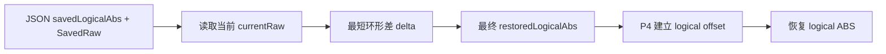

# 多圈与标定数据的上位机 JSON 持久化

> 当前实现，最后核对：2026-08-20。P4 Flash/NVS 业务持久化由
> `P4_FLASH_PERSISTENCE_ENABLE=0` 暂停启用；多圈运行锚点由上位机 JSON 管理。

## 1. 数据文件

| 文件 | 内容 | 更新时机 |
|---|---|---|
| `desktop/resources/config/calibration_bundle.mmcal.json` | 21 路 Manual、Auto/LUT 和 27 路 ABS Limit | Manual 写入、自动标定成功、Calib Load |
| `desktop/resources/config/device_state/multiturn_runtime.json` | 27 路 logical ABS、同帧 SavedRaw、有效掩码、设备身份和 SHA-256 | 运动时 20 Hz，静止时 2 Hz |

运行锚点按电机独立有效。某一台舵机重新标定或恢复失败，不会擦除其它电机的可信锚点。

## 2. 最近圈恢复

上位机不再使用固定 400 counts 容差。对每台 Turn Unknown 舵机，使用最后一组
`savedLogicalAbs + SavedRaw` 和当前 `currentRaw` 计算最近的相邻圈：

```text
delta = ((currentRaw - SavedRaw + 2048) mod 4096) - 2048
restoredLogicalAbs = savedLogicalAbs + delta
```

`delta` 位于 `[-2048, 2048)`，因此能够正确处理 `4095 -> 0` 和 `0 -> 4095`。
上位机已经算出最终 logical ABS，P4 收到后只建立 logical offset，不能再次按 raw 展开，
否则在 logical offset 非零时会把相位差重复计算。



## 3. Calibrate 统一重建

界面不再提供独立的 `New Device Reset` 或 `Reset Zero` 按钮。`Calibrate` 是唯一人工重建入口：

```text
勾选关节
  -> 校验该关节 Manual 已存在
  -> 对所选关节对应舵机下发硬件圈数归零
  -> 清除这些舵机的 JSON 多圈锚点
  -> 仅失效对应关节的 Auto/LUT/ABS Limit 快照
  -> 重新下发 active scope
  -> 启动自动标定
  -> 标定成功后建立新的 turn0、Auto/LUT 和运行锚点
```

辅助工作空间舵机由自动标定规划器按在线状态动态使用，但不属于标定前归零 mask，避免
只标一个关节时清掉其它手指的多圈基准。

## 4. 身份与完整性门禁

JSON 恢复还要求：

- 产品指纹一致：协议、映射、硬件拓扑、参数、固件和 structure CRC。
- 当前 V6 标定快照摘要一致。
- JSON 自身 SHA-256 完整。
- 电机在线且该条目仍在 `valid_motor_mask` 中。

任一条件不满足时保持 `Turn Unknown`，不能把其它设备或旧机械配置的圈数回灌到当前手。

## 5. P4 RAM/NVS 锚点与上位机锚点的区别

- 上位机下发的是已经计算完成的最终 logical ABS，P4 直接绑定。
- P4 热插拔恢复若使用同一运行周期内的 RAM/NVS 锚点，锚点同时包含 logical ABS 和 raw，
  可由 `restoreAbsolutePositionNearAnchor()` 在 P4 内执行相同的最近圈展开。

两条接口不可混用，否则 logical offset 非零时可能重复叠加 raw 差值。

## 6. 实机验收

1. `SavedRaw=4090`、重新上电 `currentRaw=6`，应按 `+12 counts` 连续恢复。
2. `SavedRaw=6`、重新上电 `currentRaw=4090`，应按 `-12 counts` 连续恢复。
3. 只让 M24 掉电，M24 可独立恢复，其它电机锚点和 Auto 不变。
4. 恢复后正向命令、实际同向运动，待验证标志被清除。
5. 恢复后正向命令、实际反向运动，Mxx 进入 Turn Unknown、力矩关闭并提示重新标定。
6. 勾选单关节执行 Calibrate，只归零该关节对应舵机；辅助工作空间舵机不归零。
7. 删除、截断或篡改 JSON，系统保持 Turn Unknown，不静默生成可信圈数。

核心代码：

- `desktop/core/device_state_store.py`
- `desktop/core/core_logic.py`
- `desktop/ui/ui_control_calibration.py`
- `ESP32-P4/ServoBoardMain/src/hal/servo/FeetechServoDriver.h`
- `ESP32-P4/ServoBoardMain/src/tasks/servo_bus/ServoBusService.cpp`
- `ESP32-P4/ServoBoardMain/src/tasks/host_comm/HostCalibrationCommandHandler.cpp`
