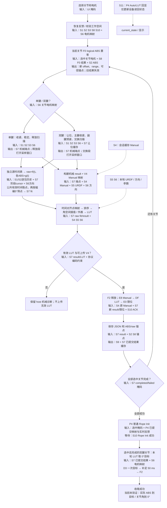
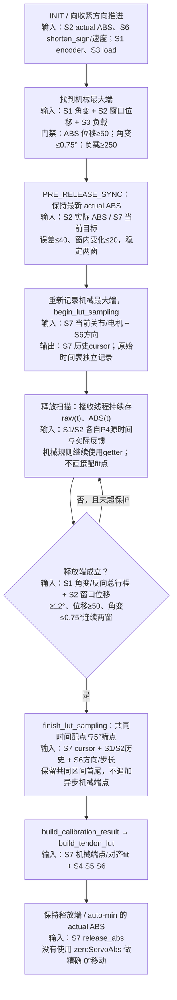
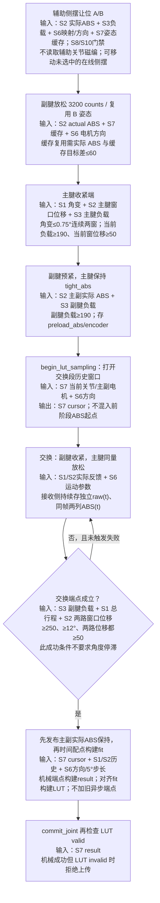
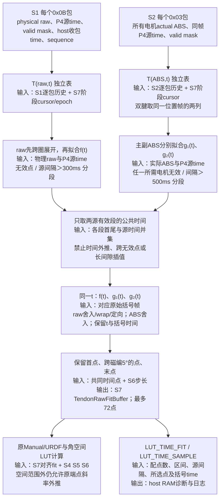
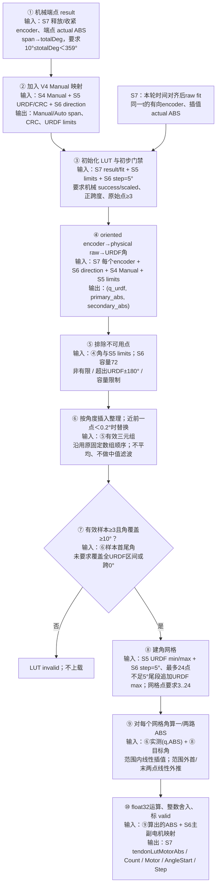
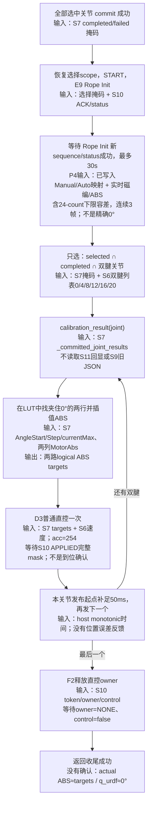

# 上位机 LUT 计算与归零：流程和数据来源

核对日期：2026-10-09；源码基线：`7f895ba` 加当前工作区，含本次上位机时间对齐采样修改。配套[离线交互流程图](上位机LUT计算与归零_数据来源.html)。机械规则、Manual/URDF 映射、空间 LUT 插值和归位行为保持原样。

## 1. 先回答：LUT 是否只由 P4 快照决定？

**不是。当前 LUT 先用 P4 磁编 raw 和舵机实际 logical ABS 的独立时间表拟合 `raw=f(t)`、`ABS=g(t)`，在同一个 P4 时间取点，再结合缓存的 Manual、本地 URDF、安装方向和电机映射计算。P4 的 Auto/LUT 回显不是本轮构建或正常归零的数据源。**

要区分两种“快照”：

- `HostCalibrationIO._state()` 是上位机对最新 `current_state` 的拷贝。其中不同字段由不同 P4 数据包更新，不代表同一个采样时刻。
- 生产 LUT 的点集来自接收线程逐包保存的 `feedback_history`，经时间拟合配点生成，**不再把独立 getter 的最新值直接组成三元组**。getter 继续参与机械状态机和安全判断。
- P4 `0x0E JOINT_CALIB_SNAPSHOT` 是设备保存的 Auto/LUT 结果回显，写入 `current_state.joint_calib_results`。本轮拟合不使用它；生产 IO 的归零使用私有 `_committed_joint_results`。

**目前“LUT valid / 标定收尾成功”不能证明实际手指到了准确 0°。** LUT 允许实测覆盖之外的外推；收尾没有等待或验证真实角度到 0°。是否构成这次实机偏差的根因，需要本轮反馈和样本才能判断。

## 2. 输入数据字典

下面的编号同时用于全部流程图和 HTML。

| 编号 | 数据及真实来源 | 接收 / 读取位置 | 在流程中的用途 |
|---|---|---|---|
| S1 | P4 `0x0B`：关节实际磁编 raw，原始物理传感器计数 `0..16383`，带 P4 源时间戳 | [state_reducer.py](../desktop/core/communication/state_reducer.py#L215) → `encoders[j].raw_sensor` 与逐帧 `feedback_history`；[runtime.py](../desktop/core/host_calibration/runtime.py#L186) `encoder_raw/encoder` | getter 判断转角/机械端点；历史 raw 先解圈、拟合 `f(t)`，用于 LUT 横坐标。拟合后才乘本地方向并 wrap |
| S2 | P4 `0x03`：舵机**实际反馈 logical ABS**，连续有符号 counts，带 P4 源时间戳 | [state_reducer.py](../desktop/core/communication/state_reducer.py#L243) → `servo_angles[m]` 与逐帧 `feedback_history`；[runtime.py](../desktop/core/host_calibration/runtime.py#L201) `servo_abs()` | getter 判断端点/位移；历史拟合主副腱 `g(t)`，用于 LUT 纵坐标。两路 ABS 从同一原始位置帧取列，不使用发送目标 |
| S3 | P4 `0x05`：舵机负载、在线状态与遥测时间 | `servo_load[m]`；[runtime.py](../desktop/core/host_calibration/runtime.py#L217) `servo_load()` | 收紧、预紧、交换端点和过载判据。负载幅值是 `abs(raw) & 0x03FF`；负载不进入 LUT 插值公式 |
| S4 | P4 `0x12` 回传的 Manual Min/Max、valid 等；可能先由手动设置或 JSON 恢复写入 P4 | [state_reducer.py](../desktop/core/communication/state_reducer.py#L635) → `manual_reference_*`；[runtime.py](../desktop/core/host_calibration/runtime.py#L313) `manual_reference()` | 第一次访问时缓存整份 `_state()`，随后本会话固定使用其中 Manual。它定义 LUT 角度比例和零点；本轮 Auto 不重新测量 Manual |
| S5 | 本地 `desktop/resources/config/urdf_joint_mapping.json` 的 `urdf_limit_deg` | [angle_mapping.py](../desktop/core/angle_mapping.py#L138) 导入时生成 `JOINT_SPECS`；`get_spec()`；[runtime.py](../desktop/core/host_calibration/runtime.py#L321) | LUT 角轴上下限和 URDF 0°含义；CRC 用该文件的版本及 21 关节 float32 limits 计算 |
| S6 | 本地 `config.py` 与 `motor_mapping.py` | [config.py](../desktop/core/host_calibration/config.py#L70) 默认方向、参数；`joint_motors/primary_motor/shorten_sign` | 方向、主副电机、收紧符号、5°采样步长和各种阈值。当前方向取安装默认数组，**不读取 P4 Manual 回传的 `encoder_directions`** |
| S7 | 本轮上位机 RAM：独立时间表/阶段 cursor、时间对齐点及括号时间戳、`TendonRawFitBuffer`、机械端点、V4 result、LUT、限位、已提交结果、让位姿态缓存 | [feedback_history.py](../desktop/core/communication/feedback_history.py#L38)、[time_alignment.py](../desktop/core/host_calibration/time_alignment.py#L132)、[runtime.py](../desktop/core/host_calibration/runtime.py#L244)、[math.py](../desktop/core/host_calibration/math.py#L171) | S1/S2 经时间配点和 5°筛点后形成 fit；本轮归零取已提交结果。时间表和诊断仍为 RAM/日志，不加入 P4 协议或标定 JSON |
| S8 | P4 `0x09` 舵机单圈 raw、`0x13` logical range、`0x19` F0 结果及 offsets；与 S2 配合 | `servo_raw_positions`、`servo_logical_range_*`；[runtime.py](../desktop/core/host_calibration/runtime.py#L400) | F0 重建 logical 原点、硬件范围、ABS/raw 锚点与多圈可信。舵机单圈 raw **不作为 LUT 样本列** |
| S9 | 本地 `calibration_bundle.mmcal.json` / `device_state/multiturn_runtime.json` | [paths.py](../desktop/paths.py#L24)；snapshot store / anchor persistence | 启动恢复与本轮结果持久化。旧 JSON 可能间接影响已恢复的 Manual/锚点；本轮构建和归零不从旧 JSON LUT 取值 |
| S10 | P4 状态 / 故障 / owner / scope、ACK、`0x1A` D3 总线执行结果、Rope Init 结果 | `current_state`；[runtime.py](../desktop/core/host_calibration/runtime.py#L708) `publish()`；`finish_session()` | 控制准入与事务结果；APPLIED 证明目标完成总线写入，不证明机械到位 |
| S11 | P4 `0x0E` Auto/LUT 结果回显 | [state_reducer.py](../desktop/core/communication/state_reducer.py#L661) → `joint_calib_results[j]` | 设备状态、读回、显示；本轮 LUT 构建不读取，正常收尾不读取 |

S5 的映射文件由 `robot_model_manifest.json` 与活动 `hand.urdf` 生成；校准运行时读取的是已生成的映射文件，没有现场重新解析 URDF 原文件。

### 机械 getter 与 LUT 时间表是两条读取链

`runtime._state()` 每次在 `state_lock` 下拷贝状态。磁编要求年龄 ≤300 ms，ABS 和负载要求 ≤500 ms，并检查相应在线/故障条件。这些独立 getter 仍服务于原机械搜索规则；其最新值不会直接进入生产 LUT fit。

接收线程逐包保存 `0x0B` / `0x03` 的 P4 时间、位置 tuple、valid mask、host 接收时间和 sequence；同源、同时间、同值、同有效性的重复重传去重。即使上位机状态合并了多个包，采样历史也保留其中不同的源帧。标定在指定机械阶段 mark，结束时读取 mark 的两个源种子帧及之后的数据，独立做分段线性拟合，取公共时间点。具体步骤见 4.3。

F0 锚点检查 ABS 与**舵机单圈 raw**同戳；LUT 时间对齐处理的是**关节磁编 raw**和 ABS，两者含义不同。P4 `0x05` 遥测不含 ABS；ABS 来自 `0x03`，负载来自 `0x05`。

## 3. 总流程



入口和顺序：`flow.run()`，机械结果成功后每关节立即 `commit_joint()`；全部选择项成功后才在 `finish_session()` 做 Rope Init 和双腱归零。**不是每个关节刚写完 LUT 就立即去 0°。**失败/取消走 STOP 收口，成功关节数据保留。

## 4. 单腱与双腱的实际样本从哪里来

### 4.1 单腱



实现：[single_motor.py](../desktop/core/host_calibration/single_motor.py#L277)。释放保护上限 8192 servo counts。`zeroServoAbs` 是 `release_abs + shorten_sign × 500` 的元数据；结束时 `ctx.target_abs=actual`，不是这个值。

### 4.2 双腱



实现：[dual_motor.py](../desktop/core/host_calibration/dual_motor.py#L566)，交换采样在 `_find_exchange()`。交换的高负载、行程不足、角度卡滞失败规则独立于上述成功条件。

当前侧摆 J00/J04/J08/J12/J16 校准速度 200、加速度 20、窗口 400 ms、ABS 位移门禁 50 counts。J20 CMC 与其他默认速度 400、窗口 200 ms。**辅助让位仍为速度 400、窗口 200 ms、门禁 50**。

### 4.3 新增的时间函数与配点流程



入口：[comm_layer.feedback_history](../desktop/core/comm_layer.py#L1104)、[feedback_history.py](../desktop/core/communication/feedback_history.py#L38)、[time_alignment.align_feedback](../desktop/core/host_calibration/time_alignment.py#L132)、[runtime.begin_lut_sampling](../desktop/core/host_calibration/runtime.py#L225)、[runtime.finish_lut_sampling](../desktop/core/host_calibration/runtime.py#L244)。

对相邻有效源点 `(t₀,x₀)`、`(t₁,x₁)`，只在 `t₀≤t≤t₁` 求分段线性值：

```text
x(t) = x₀ + (x₁ - x₀) × (t - t₀) / (t₁ - t₀)
T(raw, ABS) = {(f(t), g₁(t), g₂(t)) | t 在有效共同覆盖区间}
```

这里是局部分段线性拟合，不是全局高次曲线、平滑或离群点过滤。物理 raw 先按 16384 的最短差展开，避免 `16383→0` 被插成跨整个磁编圈的直线；插值后按半值远离零舍入，再 wrap、应用 host 方向。ABS 为连续 logical counts，无需按 4096 解圈。

- 时间轴使用包内 P4 源毫秒；host 收包时间仅留作证据，不拿它作为拟合自变量。uint32 源时间相对展开处理时钟正常回卷；晚到帧按 P4 时间排序。
- 同时戳有效重复取最后 sequence；若同戳出现任意无效事件，该点保守作为断点。不存在用后到有效重复“抹掉”无效记录的情况。
- 原始帧 valid mask 从当前 CAN 在线、磁编错误位及已知健康故障位，或舵机在线/多圈可信计算；尚无在线状态的帧记无效断点，不凭位置值存在就假定可用。
- 每个源至少要有两个有效不同时间；只在有效段相交的区间取两源时间戳的并集。缺失共同覆盖、阶段历史丢失、F0/连接/RESET epoch 变化或不足 3 个 fit 点都明确失败，生产不退回旧 getter 配对。
- 新的成功 F0 坐标事务清历史；相同 token、mask、offsets 的同步重发只是结果回显，不再次撤销正在进行的采样窗口。
- 串口没有断开但 P4 自主重启时，成功解析的连续 `SYSTEM_STATUS` 当前时钟若出现 signed uint32 差小于 0，接收侧也清 history epoch。正常 uint32 自然回卷保持；raw/ABS 两源错峰或乱序、历史诊断旧时间不会触发该重启判据。
- history 最多保存 32768 帧；阶段 mark 带两源最新种子帧及之后帧，种子为开始处提供插值括号。覆盖被环形缓冲淘汰时拒绝读取完整阶段，避免默默拟合残缺数据。
- `finish_lut_sampling()` 只处理已收到的历史，不新增 sleep/等包。单腱最后 hold 仍由外层正常发布；双腱终点已先发布主副 hold。

**时间外推和角空间外推不同：**新时间配点禁止延伸到实测时间之外；后续原 `build_tendon_lut()` 仍允许向实测角区间之外生成 LUT，两者不能混为同一门禁。

### 4.4 raw fit 与时间诊断

`TendonRawFitSample` 仍只存 `(encoder, primary_abs, secondary_abs)`，但生产输入已经来自上述同一时间的曲线值。主副 ABS 值是实际反馈的插值，可能没有任何原始包恰好等于该整数；不是 command target。

- 最多 72 点；5°阈值按第一共同时间点的原始磁编行程，保留原 0.1°容差；跨多个阈值只保留当前共同时间点。
- 首末点取共同有效时间覆盖的首末样本；**不追加旧最大端/释放端或前阶段 preload 的异步组合**。
- `_lut_sampling_diagnostics[joint]` 保留点数、共同首尾时间、实际使用的最大插值括号间隔、被选点的 `timestamp_ms/raw_bracket_ms/abs_bracket_ms`，并逐点发 `LUT_TIME_SAMPLE` 日志。
- 缺少采样接口的纯机械测试 FakeIO 仍保留原路径；生产 `HostCalibrationIO` 总是提供新接口，新路径失败不以原样本兜底。

### 4.5 时间对齐的物理边界

P4 的磁编包时间来自完整 CAN 快照接收时的 `nowMs`（[S3CanRxService.cpp](../ESP32-P4/ServoBoardMain/src/tasks/s3_can_rx/S3CanRxService.cpp#L378)），舵机位置时间来自汇总反馈发布时的 `monotonicMillis()`（[ServoFeedbackPublisher.cpp](../ESP32-P4/ServoBoardMain/src/tasks/servo_bus/ServoFeedbackPublisher.cpp#L166)）。它们不是传感器硬件触发的共同采集时间。

本次处理消除了“取各源最新值直接拼点”的软件错配，使用 P4 时间插值抵消源包错峰及 host 接收/调度延迟造成的取样偏差。**CAN/S3 采集延迟、舵机各通道轮询延迟和非线性运动在源间隔内的插值误差仍需实机验证**，不能仅凭同一个拟合时间保证物理瞬时完全同步。

## 5. LUT 构建：每一步的输入和输出



实现：[math.py](../desktop/core/host_calibration/math.py#L213) `build_calibration_result()`；[math.py](../desktop/core/host_calibration/math.py#L267) `build_tendon_lut()`；[math.py](../desktop/core/host_calibration/math.py#L242) `_interpolate_abs()`。

### Manual → URDF 公式

令 `d` 为本地 encoderDirection，`N=16384`：

```text
sample.encoder = (physical_raw × d) mod N
physical_raw   = (sample.encoder × d) mod N
manualSpan     = ((manualMaxRaw - manualMinRaw) × d) mod N
coordinate     = ((physical_raw - manualMinRaw) × d) mod N
```

在 Manual 范围内：

```text
q_urdf = URDF_min + coordinate × (URDF_max - URDF_min) / manualSpan
```

超出 Manual 范围时先选择靠近 Manual 上侧或下侧的坐标分支；下侧得到负 coordinate。外侧按物理磁编比例 `360/16384 °/count` 延伸，不继续用 Manual 范围内的缩放比例。

Auto 释放/收紧端点决定机械跨度、有效性和元数据；**它们不取代 Manual 来定义 LUT 的角轴比例**。当前原点公式没有使用旧 LUT、P4 `0x01` 已映射关节角或旧 JSON 结果来拟合。

### 角网格插值与外推

相邻有效实测点为 `(q_left, ABS_left)`、`(q_right, ABS_right)`：

```text
ABS(q) ≈ round(ABS_left + (q - q_left) × (ABS_right - ABS_left) / (q_right - q_left))
```

实现逐次使用 float32 并按半值远离零的方式舍入。区间外仍使用首/末两个点的斜率，并有不同的 float32 运算顺序；以上公式用于说明，不能替代源码中的精确数值计算。

例如本轮实际样本只覆盖 `8°..20°`，其间已有 ≥3 点，仍可能通过 10°覆盖门禁。构建完整 URDF LUT 时，`0°` 相关网格点可以由低端样本**外推**得到。之后 `finish._zero_targets()` 在完整 LUT 中插值，并不能反推出这个 0°有真实测量支撑。

近角点整理沿用原固定数组移动后再检查前一点的规则，不等价于一般 `sorted + 全局去重`。当前没有平均/中值/离群值滤波、ABS 单调性或最大斜率门禁。

## 6. 写回与保存：源头仍是本轮结果

| 步骤 | 具体输入来源 | 输出 / 等待 | 代码 |
|---|---|---|---|
| 校验可提交 | S7 `success/scaled/tendonLutValid/count`、V4 字段、协议 int16 差值等编码约束 | invalid 机械结果仅保留诊断；不发送无效 LUT | `runtime.commit_joint:851`，`protocol.build_calib_load_joint_cmd:1169` |
| 释放直控 | S10 当前 token/owner/control | F2，等待 owner=NONE、control=false | `runtime._release_motion:385` |
| E8 单关节 Manual | **S4 缓存的原 Min/Max**，本轮没有重新测它 | P4 Manual commit 回应 | `runtime.commit_joint:862` |
| DF 单关节 LUT | **S7 本轮 result/LUT** 深拷贝 payload | P4 ACK | `runtime.commit_joint:868` |
| E0 ABS 限位 | S7 本轮机械限位 + S10 当前 state 里其他电机限位 | 按当前关节电机 mask 写入，P4 ACK | `runtime.commit_joint:870` |
| 保存结果 | S7 新 payload、S4/S5 契约、S2/S8 新 ABS/raw 锚点 | S9 标定 JSON 与运行期锚点；锚点信任/新鲜检查 | `runtime.commit_joint:897` |
| 标为已提交 | 上述全部成功的 **S7 payload** | `_committed_joint_results[joint]` | `runtime:930` |
| P4 结果回显 | S11 `0x0E`，可能异步到达 | 更新 `current_state.joint_calib_results[j]`；**收尾不依赖它** | `state_reducer:661` |

当前标定 JSON 保存最终 result、LUT、Manual、限位和锚点；**不保存独立原始时间表及配点括号**。这些信息在本会话 RAM 和新增采样日志里；只检查最终 JSON 仍不能完整复盘时间配点和拟合前角覆盖范围。

新增 `LUT_TIME_FIT` 记录 raw/ABS 源点数、公共配点数、fit 点数、共同时间范围和最大源括号间隔；`LUT_TIME_SAMPLE` 逐个记录入选点 `t/encoder/primary_abs/secondary_abs/raw_t/abs_t`。可据此核对同时间配点与 5°筛选，原来的 `SINGLE_LUT/DUAL_RESULT/RESULT` 继续提供机械和最终结果。普通 session 日志每行仍有限长；完整原始帧可结合通用 `packet_frames` 记录或运行中的 `feedback_history`，不把最终 JSON 当原始采样档案。

## 7. 三种“零”与实际收尾

| 名称 | 怎么得到 | 对物理姿态的含义 | 是否用于双腱收尾目标 |
|---|---|---|---|
| F0 logical ABS=0 | P4 将当前位置 logical ABS 设零，`offset=-新raw` | 舵机坐标重新锚定；不代表关节标准姿态 | 否；它只是后续 actual ABS 的坐标基础 |
| Auto 元数据零 | `zeroEncoder` 按 Auto 释放端 `-5°` 和机械 span 重算；单腱 `zeroServoAbs=release_abs+sign×500`，双腱该字段为 `tight_abs` | 保留原算法元数据，和 Manual/URDF 零点不是同一套定义 | 否；`finish._zero_targets()` 不读这两个字段 |
| LUT / URDF 0° | S4 Manual 端点 → S5 URDF 范围，得到 `q_urdf=0`；本轮 LUT 反查 ABS | 只有 Manual 端点与 URDF 含义正确且拟合可靠时，才对应预期姿态 | **是** |

当前双腱 URDF 配置如下，0°在 Manual 有向行程中的比例为 `-URDF_min/(URDF_max-URDF_min)`：

| 关节 | 电机 | URDF 范围 | 0°位于 Manual 行程的比例 |
|---|---|---|---|
| J00 小指侧摆 | M00 / M01 | −70°..21° | 76.92% |
| J04 无名指侧摆 | M05 / M06 | −46°..26° | 63.89% |
| J08 中指侧摆 | M10 / M11 | −32°..30° | 51.61% |
| J12 食指侧摆 | M15 / M16 | −28°..36° | 43.75% |
| J16 拇指侧摆 | M20 / M21 | −75°..25° | 75.00% |
| J20 拇指 CMC | M25 / M26 | 0°..54° | 0.00%（Manual Min） |

来源：[urdf_joint_mapping.json](../desktop/resources/config/urdf_joint_mapping.json)。**URDF 0°不普遍等于 Manual 两端的中点。**



实现：[runtime.finish_session](../desktop/core/host_calibration/runtime.py#L937)、[finish._zero_targets](../desktop/core/host_calibration/finish.py#L24)、[finish.finish_dual_zero](../desktop/core/host_calibration/finish.py#L77)。侧摆归零速度 200，J20 为 400，加速度 254；50 ms 是逐关节的发布节拍，发布耗时已超过 50 ms 时不额外等待。它不是到位时间。

### 到位和 F2 的准确边界

- `publish()` 等 token 对应的 `0x1A` 完整 applied mask。P4 完成同步写即可报 APPLIED，未等机械运动结束。
- P4 通用直控有 ABS 误差 ≤40 counts、连续 5 控制周期的自动完成判据，但 host 收尾没有等这个完成判据再释放。
- F2 经 `upperReleaseMotorDirect → 投递 RUN_DIRECT_DONE → 状态机 retireDirectCommand → 清队列/静止态` 清 owner/control/目标队列，**该路径不发送当前位置 hold，也不关闭舵机扭矩**。舵机内部已接收的定位目标可能继续执行，不能断言“50 ms 后必然截断运动”。准确结论是：当前 host 的成功状态缺少真实到位证据。
- 普通直控的舵机内部定位与关节磁编码器闭环不是同一件事。这里没有用关节磁编反馈对 LUT(0°)目标做 PID 修正。

P4 证据：[MotionCompletionEvaluator.cpp](../ESP32-P4/ServoBoardMain/src/tasks/motion_control/MotionCompletionEvaluator.cpp#L18)、[ControlConfig.h](../ESP32-P4/ServoBoardMain/src/config/ControlConfig.h#L38)、[HostCommandRouter.cpp](../ESP32-P4/ServoBoardMain/src/tasks/host_comm/HostCommandRouter.cpp#L187)、[DirectCommandCoordinator.cpp](../ESP32-P4/ServoBoardMain/src/tasks/system_state/DirectCommandCoordinator.cpp#L218)、[SystemEventDispatcher.cpp](../ESP32-P4/ServoBoardMain/src/tasks/system_state/SystemEventDispatcher.cpp#L828)。

### 哪些手指不会去精确 0°

- **单腱关节**：机械流程结束保持释放端，后续 Rope Init 只检查/拉回可进入反馈的下限侧范围；没有最终精确 LUT(0°)目标。
- **未选择的让位侧摆关节**：允许在校准别的侧摆关节时被移动至 A/B，但它们不在 `selected ∩ completed` 中，不会被收尾恢复 LUT0。
- **失败或取消会话**：不执行整套成功收尾。已保存的关节结果仍保留。

Rope Init 的“inside”实际判定是 `outsideCounts >= -24`，不是对 URDF 上下限做完整夹紧，更不是验证 0°。对应 [RopeInitController.cpp](../ESP32-P4/ServoBoardMain/src/tasks/system_state/RopeInitController.cpp#L146)。

## 8. 对“回 0 位置不对”的检查顺序

以下前两列为源码确定事实，最后一列是需要实机验证的候选影响，不能仅凭代码认定根因。

| 检查项 | 当前行为 | 要拿什么数据判断 |
|---|---|---|
| 看的是哪个关节 / 何时看 | 单腱、未选让位关节没有统一精确归零；UI 收尾成功不等于双腱到位 | 本轮 selected/completed masks、归零 plan、稍后稳定位置与立即完成时的位置 |
| 零点定义是否正确 | Manual → URDF 定义 0°，不是 F0、Auto zero 字段或两端中点 | 使用的 Manual Min/Max、direction、URDF范围；把实际标准姿态 raw 代入公式看是否为0 |
| 0°是否被可靠实测覆盖 | 完整 LUT 可能包含外推值；valid 只要求≥3点和≥10°覆盖 | 每个拟合前有效 `(q, primary_abs, secondary_abs)`；0°及其两侧LUT网格点是否位于实测区间 |
| 磁编与ABS是否时序匹配 | 接收侧独立源表，P4源时间分段拟合后共同时间取点；最大源间隔300/500 ms；硬件采集戳仍不统一 | `LUT_TIME_FIT/SAMPLE` 的时间范围、点数、两源括号与gap；必要时原始包、CAN/舵机实际采集延迟 |
| Manual与安装方向是否一致 | host 用默认方向；P4回包方向字段未用于本轮计算 | 默认方向、Manual回包方向、物理动作时 raw 正负变化；检查跨圈分支 |
| 舵机到目标后关节是否仍偏 | 收尾仅普通直控；没有磁编闭环修正；负载端点规则不自动消除回差 | 稳定后 target vs actual ABS，以及 Manual映射q；ABS未到目标与ABS已到但q偏离须分别判断 |
| 本轮来源是否混淆 | 正常归零取本轮 `_committed_joint_results`，不取异步 `joint_calib_results` | 本轮payload/目标日志与设备回显对比。不能仅因旧回显晚到就认定归零用了旧LUT |

建议下一次对单个双腱关节记录：Manual/URDF/direction、`LUT_TIME_FIT/SAMPLE`、必要时独立原始时间表、映射后覆盖范围、LUT0所用两行和最终两ABS目标、D3结果、完成时及稳定后的ABS与磁编角。**当前 JSON 并不包含这些完整采样证据**；仅凭最终结果不能确认噪声、源时间误差、空间外推或绳索回差中的哪一项导致误差。

## 9. 代码索引

| 文件 | 重点入口 |
|---|---|
| [workflow.py](../desktop/core/host_calibration/workflow.py) | 继承旧 workflow、UI 对接的新 host 流程 |
| [flow.py](../desktop/core/host_calibration/flow.py#L91) | 总流程、逐关节 prepare/机械校准/commit、最后 finish |
| [runtime.py](../desktop/core/host_calibration/runtime.py#L106) | 状态读取、Manual冻结、F0、D3、提交、JSON、finish_session |
| [single_motor.py](../desktop/core/host_calibration/single_motor.py#L186) | 单腱端点、fit及结束位置 |
| [dual_motor.py](../desktop/core/host_calibration/dual_motor.py#L509) | 双腱交换采样、让位缓存、LUT/限位 |
| [math.py](../desktop/core/host_calibration/math.py#L98) | Manual映射、raw fit、机械result、插值/外推与LUT |
| [feedback_history.py](../desktop/core/communication/feedback_history.py#L38) / [comm_layer.py](../desktop/core/comm_layer.py#L1104) | 逐包历史、阶段mark/read、epoch与环形容量；接收侧不会因状态合并丢源点 |
| [time_alignment.py](../desktop/core/host_calibration/time_alignment.py#L132) | raw先解圈、两源分段线性时间函数、公共时间配对及括号证据 |
| [finish.py](../desktop/core/host_calibration/finish.py#L24) | 本轮LUT0目标计算与普通直控收尾 |
| [config.py](../desktop/core/host_calibration/config.py#L83) | 当前50-count门禁、侧摆200/400ms、让位400参数 |
| [angle_mapping.py](../desktop/core/angle_mapping.py#L138) / [urdf_joint_mapping.json](../desktop/resources/config/urdf_joint_mapping.json) | 本地URDF limits和CRC来源 |
| [state_reducer.py](../desktop/core/communication/state_reducer.py#L199) | P4各上行包如何写入 current_state |

文档中的行号用于核对本次基线，后续源码变更后可能移动。
