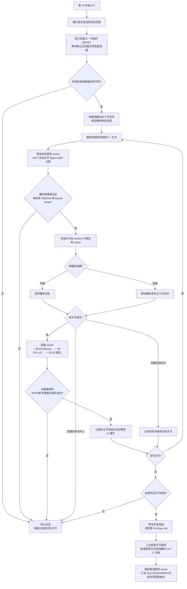

# 上位机自动校准实现与 P4 原逻辑对照

核对日期：2026-10-08。本次将机械搜索、工作空间处理和 LUT 计算放入 `desktop/core/host_calibration/`，UI 原有校准入口转向新流程；P4 的 `src/tasks/auto_calibration/` 原任务继续保留。本文说明当前实现；原任务的完整接口分析见 [迁移前流程与接口梳理](自动校准迁移上位机_流程与接口梳理.md)。

每个关节开始搜索前，通过已有 **0xF0** 将相关电机当前位置的 logical ABS 置 0，并保存 `offset=-resetRaw`；每个关节成功后，通过已有 **Manual 0xE8、LUT 0xDF、ABS 限位 0xE0** 各提交一次，再保存 JSON 和新的多圈锚点。Manual 仍是用户原先保存的磁编端点，不用自动搜索端点覆盖它。

## 入口与模块分工

UI 布局、控件和 `ui_control_calibration.py` 未改。`ui_app.py` 只增加归零事务中短暂 UNKNOWN 的故障桥接判断；现有调用链在 core 内切换：

```text
UI 校准按钮
  → CalibrationWorkflowController.calibrate()
    → HandBackend.begin_calibration_workflow()
      → HostCalibrationWorkflowService.begin_calibration()（覆写原接口）
        → 原工作执行器的单工作线程
          → HandController.create_host_calibration_io()
          → host_calibration.flow.run()
            → run_single() / run_dual()
            → HostCalibrationIO.commit_joint()
```

`HostCalibrationWorkflowService` 直接继承原 `CalibrationWorkflowService`。基类的 `begin_calibration()` 保留原来请求 P4 自动校准的流程；子类覆写同名入口、状态观察和宿主活动查询，并通过 `super()` 复用线程、事务锁、事件、取消、启动恢复和快照导入。子类仅增加 `_host_worker_active` 逻辑标志，直到旧 worker 取消收口结束才解除控制门。显式使用 `HostCalibrationWorkflowService.begin_firmware_calibration()` 仍可调用基类旧流程；MCU 的 `CMD_CALIBRATE`、任务创建入口及机械算法仍在。

| Python 文件 | 职责 | P4 对照来源 |
| --- | --- | --- |
| [flow.py](../desktop/core/host_calibration/flow.py) | 会话预检、机械顺序、失败策略、逐关节提交和收尾 | `CalibrationSessionController.cpp`、`AutoCalibrationCoordinator.cpp`、`CalibrationSequencePlanner.cpp` |
| [single_motor.py](../desktop/core/host_calibration/single_motor.py) | 单腱状态机、拉紧、松绳前同步、反向搜索与两圈保护 | `single_motor/SingleMotorCalibrationMachine.cpp` |
| [dual_motor.py](../desktop/core/host_calibration/dual_motor.py) | 双腱搜索、动态工作空间、A/B 姿态与 cache | `dual_motor/DualMotorCalibrationMachine.cpp` |
| [math.py](../desktop/core/host_calibration/math.py) | 磁编环绕、结果映射、原始样本、插值、LUT 与 CRC | `CalibrationLutBuilder.cpp` 及原映射辅助函数 |
| [finish.py](../desktop/core/host_calibration/finish.py) | 普通 Rope Init 后，按关节顺序发送双腱 LUT(0°) 直控目标 | 原 `CalibrationSequencePlanner` 的双腱零度收尾，迁到上位机执行 |
| [config.py](../desktop/core/host_calibration/config.py) | 原参数和安装方向的逐值镜像 | `CalibrationConfig.h`、`defaultAutoCalibrationParams()` |
| [runtime.py](../desktop/core/host_calibration/runtime.py) | 反馈可信检查、通信、执行确认、取消和持久化 | 原 runtime/feedback/motion/result 端口，由上位机设备适配替代 |
| [workflow.py](../desktop/core/host_calibration/workflow.py) | 继承原工作流，覆写 UI 绑定入口与状态观察，增加宿主逻辑标志 | 原 `CalibrationWorkflowService`；新入口不再按双腱/单腱拆成两个 MCU 会话 |
| [calibration_workflow.py](../desktop/core/calibration_workflow.py) | 保留原 P4 入口、线程、事务锁、事件、取消和快照设施 | 子类通过 `super()` 复用原上位机工作流 |

机械模块不依赖 Qt 或串口对象，通过 IO 端口访问反馈、目标发布和诊断。`HostCalibrationIO` 读取真实 P4 状态；UI 的 `calib_status` 等校准展示字段由宿主流程维护，P4 的实际系统状态、owner 和故障位仍由下位机负责。

## 总体流程



所选关节按 P4 的排序函数执行：**J00～J15 → J20 → J16～J19**，仅保留本轮选中的项。单腱机械步骤普通失败可继续；失去控制、目标发布失败、归零失败或提交失败会中止。双腱失败直接结束会话。已成功提交的关节不会因后续关节失败而回滚。

准备范围先取原 UI 传入的 `reset_motor_mask`，core 再按新鲜状态复查侧摆让位所需辅助电机对：完整在线且任一电机 UNKNOWN 时，将整对加入初始归零范围；部分在线在归零前失败，非目标辅助对全部离线时沿原策略跳过。首次反馈准备先执行原入口的一次维护 RESET、等待 300 ms 和新的静止状态，再归零准备范围；此外，每个当前关节搜索前都单独调用 0xF0。RESET 直接走通信端口，避免控制器的用户 RESET 接口取消当前宿主会话。workspace 复检和逐关节交接不重复维护 RESET。辅助电机加入反馈/运动范围，不作为本轮完成关节提交 Manual 或 LUT。

## 保留的机械判据与计算

| 项目 | 当前 Python 与原固件对应行为 |
| --- | --- |
| 增量目标 | 普通关节 `tightenSpeedCountsPerSec=400`；侧摆 J00/J04/J08/J12/J16 使用 200；按实际经过时间累加整数 counts，并保留小数余量；`loopMs=20` |
| 舵机写参数 | 普通关节 `servoSpeed=400`，侧摆校准目标关节为 200；`servoAcc=20`；目标是 logical ABS，执行层转换到硬件坐标 |
| 端点观察窗口 | 普通关节 200 ms，侧摆校准 400 ms；窗口舵机变化至少 50 counts；磁编停滞角度不超过 0.75° |
| 单腱首次拉紧 | 负载幅值至少 250，同时满足舵机变化和角度停滞；该判据不额外增加两个窗口要求 |
| 单腱松绳前同步 | 回写当前实际 ABS；目标误差不超过 40 counts、窗口变化不超过 20 counts，连续两个稳定窗口后开始反向搜索 |
| 单腱反向终点 | 反向行程至少 12°，角度停滞连续两个窗口，同时舵机窗口变化至少 50 counts |
| 单腱两圈保护 | 实际松绳量或下一目标松绳量超过 `4096×2` counts 即失败，不把越界目标截断后继续 |
| 双腱首次拉紧 | 主电机负载至少 190，配合原舵机变化与连续两个角度停滞窗口判据 |
| 双腱预紧 | 从电机负载至少 190，保留原预紧与主腱保持策略 |
| 双腱交换终点 | 从电机负载至少 250、关节行程至少 12°、主从电机窗口变化各至少 50 counts；成功判据沿用原实现，不额外要求角度停滞 |
| 双腱工作空间 | 按目标关节生成辅助姿态步骤；辅助手指让位沿用原目标递增速度 400 counts/s 和舵机速度 400；保留 A/B cache、反馈过期、双电机全部离线跳过、部分在线失败等原分支 |
| 负载处理 | 上位机按 `abs(raw)&0x03FF` 比较幅值；每个实际请求电机的反馈达到 800 即拒绝发布，并沿用过载诊断；P4 不增加校准专用瞬时负载门禁 |
| 初始反馈 | 机械状态机初始等待 1200 ms；磁编可信年龄 300 ms，舵机反馈年龄 500 ms；恢复等待与三个稳定采样要求沿用配置 |
| 结果与 LUT | 原始磁编环绕、方向、Manual 缩放 URDF V4、Manual entry CRC、URDF CRC、装配 warning；5° LUT 网格包含最后不足 5° 的终点 |
| 数值语义 | `math.py` 在原 C++ float 运算边界使用 float32，并保留正负对称舍入和原样本排序/去重顺序 |

单腱结果建立仍包含 `-5°` 起点、零点、收紧端点、LUT 覆盖和单电机 ABS 行程生成。双腱交换完成后沿用原结果构建、READY 映射判断、ABS 限位生成和 cache 更新分支；没有在交换后另加一次主电机拉紧。

2026-10-09：侧摆校准目标递增速度与舵机速度保持 200，以减少通信和反馈延迟期间的位移；此前降到 25 counts 的运动门禁恢复为原 50 counts。200 counts/s 在 200 ms 内仅移动约 40 counts，因此侧摆观察窗口扩大为 400 ms（理论约 80 counts），保留原运动证据门槛。稳定样本数及负载/角度判据保持原值；主腱找紧仍需两个稳定窗口，现在对应 800 ms。降速覆盖当前侧摆关节的初始松绳、搜索、预紧、对拉和 LUT 零度收尾，辅助手指让位使用独立原速参数（400 counts/s、200 ms、50 counts）。J20 拇指 CMC 与单腱校准保持原速。参数选择仅在上位机 core 完成。

原双腱还有一个异常分支：机械端点和映射成功，但 LUT 构建失败时仍提交机械结果，最终 Rope Init 因 LUT 无效返回 WARN。上位机保留这一机械分支及其结果记录，但普通 DF 协议要求有效 LUT，因此不能复制原固件内部的无效 LUT 提交行为：构建失败只保留宿主会话机械记录和诊断，不上传空 LUT，也不把设备关节标为成功。本分支在写回阶段结束会话；普通 DF 校验和 P4 原自动校准任务均保留。

原机械算法对应的主要实现仍在 [P4 auto_calibration 目录](../ESP32-P4/ServoBoardMain/src/tasks/auto_calibration/)。更详细的旧分支和跨任务接口见 [迁移前分析](自动校准迁移上位机_流程与接口梳理.md)。

## 校准运动与协议衔接

校准继续使用**舵机位置直控**：Python 根据磁编、ABS 和负载反馈决定下一目标，P4 将指定目标写入舵机总线。这条路径不经过关节 PID。P4 仍负责活动范围、输出 owner、反馈新鲜度、逻辑坐标到硬件坐标转换、总线写入和故障保护。

P4 将上位机校准视作普通直控。目标统一使用 **D3 `CMD_MOTOR_POS_ABS`**，其 payload 扩展为通用事务 token、本批电机 mask、27 路 logical ABS、speed 和 acc。P4 不新增宿主校准状态、专用目标命令或标定准入；机械搜索、磁编/Manual 检查和 LUT 构建全部在上位机。Manual/LUT 数据协议继续复用。

| 方向/协议 | 内容与用途 |
| --- | --- |
| 下行 **0xF0** `CMD_SERVO_REBASE_ZERO` | 已有 4 字节电机 mask，当前关节归零；结果为已有 **0x19** |
| 下行 **0xD3** `CMD_MOTOR_POS_ABS` | 固定 119 字节：`token:u32 + requestedMask:u32 + logicalAbs[27]:i32 + speed:u16 + acc:u8`，大端；全部普通批量直控使用同一格式 |
| 上行 **0x1A** `PACKET_TYPE_DIRECT_TARGET_RESULT` | 通用直控执行结果；17 字节业务数据：`token/requestedMask/appliedMask/rejectedMask` 四个 u32 加状态 u8，另附标准 P4 时间戳 |
| 下行 **0xF2** `CMD_MOTOR_DIRECT_RELEASE` | 通用直控释放，4 字节 token；0 匹配当前普通直控代次，非 0 匹配已成功执行的事务 token；保留扭矩与故障状态 |
| 下行 **0xE8** `CMD_MANUAL_ENCODER_SINGLE` | 该关节原用户 Manual 端点，一次 |
| 下行 **0xDF** `CMD_CALIB_LOAD_JOINT` | 该关节 V4 映射、CRC 和 LUT 数据，一次 |
| 下行 **0xE0** `CMD_CALIB_LOAD_LIMITS` | 该关节电机 ABS 限位，一次；其他关节数据保留 |

普通批量直控 builder 的默认值为 `token=0 / mask=0 / speed=400 / acc=254`；mask=0 使用当前 active scope，token=0 仍有通用结果，只是默认客户端不按 token 关联等待。校准只选择非 0 token、本批实际电机 mask、普通关节 `speed=400 / acc=20`，侧摆目标关节 `speed=200 / acc=20`（辅助让位保持 400）。active scope 是最大授权范围，本批输出 mask 是此次实际写入范围，两者分开；稀疏目标不得扩大授权范围。原单电机 DE 命令继续走同一普通直控执行链。

0x1A 状态为 `IDLE=0 / PENDING=1 / APPLIED=2 / REJECTED=3`。上位机只在状态 APPLIED、本次 token 匹配、appliedMask 完整覆盖 requestedMask 且 rejectedMask 为 0 时推进。协议支持执行层给出的部分 applied/rejected 位图，整体状态为 REJECTED；解析器按上报位图处理，部分执行不能推进校准。当前 producer 先预校验整批，再调用 SDK；正常调用后报告完整 applied mask，这不保证检测所有 BUS 物理故障。QUEUED ACK 和 PENDING 表示受理；APPLIED 表示执行层完成该批提交/同步写调用，不代表逐台确认接收或机械到位。宿主最终回执和 owner 可见性等待预算均为 **1000 ms**，原机械内部的 **100 ms** 执行预算不改。超时会查询状态并保留 token、状态和 mask 诊断，不自动重发运动指令。`STATE_SYNC_MULTITURN_STATE=64` 可查询最新通用直控结果。

执行确认的边界是总线执行层完成该批提交及同步写调用。底层 `FeetechServoDriver::syncWriteAll()` 返回 void，SDK 广播没有逐台舵机 ACK，APPLIED 不能证明每台舵机确认接收，也不能检测每种 UART 物理丢帧；实际位置与机械运动仍由反馈和机械状态机验证。

所有上位机直控都使用 `RUN_DIRECT / owner=CONTROL`。每个普通直控代次在总线同步写完成后，才允许累计机械到位样本并产生自动 DONE；上位机校准没有特殊常驻或结束规则。F2 通过普通直控结束事件释放 owner；不替代 STOP，也不清急停或故障。归零和数据写回要求静止，先释放当前普通直控，随后仍由 P4 原有状态准入与执行层安全策略裁决。P4 不给宿主校准增加 CAN、Manual、瞬时负载准入或 LUT 提交证明。

协议字段事实源为 [upper_protocol_schema.json](../desktop/resources/config/upper_protocol_schema.json)；Python 编码在 [protocol.py](../desktop/core/protocol.py)，实际总线执行在 [ServoBusService.cpp](../ESP32-P4/ServoBoardMain/src/tasks/servo_bus/ServoBusService.cpp)。此前临时 F1 标定目标协议已移除；当前 D3 的长度从 108 变为 119 字节，上下位机必须同时更新。这些通用直控改动不修改保留的 P4 自动校准算法。

## 逐关节写回与多圈坐标

当前关节归零完成后，上位机最多等待 **3000 ms**，要求 **0x19 最终结果之后**的新同帧 ABS/raw，以及新 logical range；不会用归零前仍在接收缓存里的坐标开始搜索。P4 HostComm 从同一份 `ServoAngleData_t` 快照相邻发送 raw 和 ABS，使用相同设备 timestamp，避免两次独立取队列跨越采样周期。归零导致旧 Auto、LUT、ABS 限位和旧恢复锚点失效是本流程的预期准备步骤，范围只覆盖对应电机关联的关节。

一个关节机械步骤成功后，`commit_joint()` 执行：

1. 预校验完整 V4 结果，释放本轮直控 owner。
2. 发送一次 0xE8；若 ACK 为 QUEUED，继续等待 Manual 最终提交结果，再发送依赖其 entry CRC 的 LUT；内容是原 Manual。
3. 发送一次 0xDF，等待设备接收；内容是新 LUT 与结果。
4. 发送一次 0xE0，等待设备接收；仅更新该关节电机限位。
5. 合并该关节结果到标定 JSON，保存可信同帧 ABS/raw 到运行时多圈文件和标定快照锚点。
6. 发出原 `snapshot_saved`、`phase_complete` 事件；最终发出 `calibration_complete`，UI 沿用原处理接口。

这三个设备命令有先后依赖，不是一个原子打包协议。任一步失败会停止后续提交并保留明确失败结果；JSON/锚点保存未成功时也不会把该关节计为完成。后面的关节开始前重新归零自己的电机，不重复上传已完成关节的 Manual 或 LUT。

offset 保存在 P4 驱动 RAM，跨 P4 掉电仍由现有上位机 JSON 锚点恢复。协议细节和 Known/Unknown 准入见 [标定前 logical ABS 归零协议](标定前逻辑ABS归零协议.md)。

## 对外接口和收尾

| 外部交接 | 宿主流程接口 | 责任归属 |
| --- | --- | --- |
| UI/后端发起 | `begin_calibration()`，参数保持 joint/motor/reset mask 和 baseline state | 原 UI/后端、core 工作流 |
| 外部运动源交接 | 入口撤销 ROS2 授权、Replay token；宿主工作线程及取消清理结束前禁止重新授权和外部目标 | `HandBackend`、工作流事务锁；完成后不自动恢复外部授权 |
| 取消和停止 | 会话 epoch、`HostCalibrationIO.cancel()`、控制器 STOP/RESET 等取消钩子 | 原工作流取消；P4 急停和故障保护仍生效 |
| 舵机/磁编输入 | `snapshot()/servo_abs()/servo_raw()/servo_load()/encoder_raw()/encoder()` | P4/S3 采集，Python 只读可信快照 |
| Manual/URDF 输入 | `manual_reference()/urdf_limits()/urdf_config_crc()` | 现有 Manual 与机器人模型事实源 |
| 工作空间与范围 | `set_workspace_read_mask()/set_active_scope()`、A/B cache | Python 规划，P4 验证和执行 |
| 运动输出 | `publish()` → 普通 D3 → 通用 0x1A | Python 决策，P4 普通直控总线执行确认 |
| 静止与归零 | `_release_motion()` → 通用 F2；`prepare_joint()` → F0 | P4 普通直控 owner 和 offset 事务 |
| 结果提交 | `commit_joint()` → E8/DF/E0 + JSON/锚点 | P4 RAM 运行数据与上位机持久化 |
| 进度/诊断 | `session_state()/diag()/trace()` + 原工作流事件 | 上位机状态展示和日志 |
| 成功收尾 | `finish_session()` → 普通 P4 Rope Init → `finish_dual_zero()` | P4 原初始化任务；双腱 LUT 零度收尾由上位机普通直控完成 |

全部关节成功后，恢复所选活动范围并调用普通 P4 Rope Init，然后由上位机执行双腱零度收尾；收尾结果和装配 warning 决定宿主展示 `SUCCESS` 或 `WARN`。失败/取消时停止运动，恢复曾扩大到辅助电机的活动范围，保留已经成功提交的关节。用户发起新一轮校准时，沿用旧入口的维护 RESET 解除可复位锁存；本轮运动中和关节间释放 owner 使用通用 F2，实际故障保护和输出准入仍由 P4 控制。结果、LUT 和限位交回 P4 遥测维护，不用宿主永久整表覆盖之后的 Manual 修改或归零失效。

P4 不识别宿主校准提交记录，也不为宿主置 `calibration_rope_init_pending`。普通 Rope Init 成功后，`finish.py` 对本轮选中且已完成的双腱关节按 J 编号升序插值 LUT(0°)，沿用 C++ 单精度和半值远离零舍入；每次发送一对电机的普通 D3，侧摆 `speed=200`、J20 `speed=400`，均为 `acc=254`，按原 50 ms 步长调度，最后通用释放。宿主的 30 s 等待只是普通 Rope Init 通信结果预算；其原机械超时仍由 P4 的 8 s 策略控制。

宿主展示状态和故障桥接不改变 P4 真值。新 PENDING 会话清理宿主诊断 overlay，避免上一轮失败诊断在 RESET 后继续污染本轮。UI 只排除当前 IO 发起的 F0 范围内、无其他故障、输出静止且 owner=NONE 的短暂 UNKNOWN 中间帧；成功后延迟送达的历史帧按事务时间范围处理。归零失败、事务之后仍 UNKNOWN、运动中 UNKNOWN 或其他真实故障继续触发原保护。

## 2026-10-08 实录反馈恢复故障修复

用户实录目录为 `run_data/数据记录_20261008_173403/`。五次校准入口的 F0 最终结果均为 `success=0x0000001F / failed=0`；首轮归零后已经回到 IDLE，约 5 秒后才因 `selected servo feedback recovery failed` 结束。因此此轮不是 UNCONTROLLABLE 拒绝归零。

| 问题 | 原始帧证据 | 修正 |
| --- | --- | --- |
| 历史诊断时间造成年龄下溢 | `17:40:41.706` ABS 时间 `398986`；随后 TaskRuntime 包时间 `398488`。全局最近包时间倒退后，unsigned 差被误判为约 49.7 天 | 使用 SYSTEM_STATUS 的当前设备时间及其接收时刻估计年龄，处理 32 位回绕；真实陈旧反馈仍拒绝 |
| 恢复检查额外要求 ABS/raw 同戳 | raw `399124`、ABS `399135`，两种独立上行快照有 11 ms 差异 | 对齐原 P4 恢复任务，按新鲜可信 ABS 的三个不同快照累计稳定帧；同戳要求保留在 F0 后锚点检查及保存 |
| 入口遗漏维护 RESET | 首轮失败 STOP 后，后续归零成功仍停在 UNCONTROLLABLE，当时临时 F1 被急停锁存拒绝 | 补回旧入口的一次 RESET；当前统一为 START / 普通 D3 获取运动 owner |

失败事件增加实际恢复阶段或 `ABS age / stable / offline / unknown / unroutable / missing_range / state / owner`，用于区分能力缺失、归零失败、反馈超时和控制交接失败。

该阶段修复验证：相关 runtime/flow、后端交接、F0 协议及 Device Check 状态测试 **141 passed**。按实录原交付顺序每 20 ms 复演 `17:40:41.600～46.700`：旧判定 5.1 秒无法通过，新判定 260 ms 达到三个不同 ABS 快照，样本年龄为 4～169 ms。该复演只验证恢复判定；此阶段仅改上位机 Python。后续通用直控与同戳发布修复见下一节，需要更新 P4 固件。

## 2026-10-08 目标发布超时与统一普通直控修复

实录 `run_data/运行日志/auto_calib/auto_calib_20261008_180009_COM13.log` 证明归零已经发送并生效，首次辅助电机目标也收到了执行层 APPLIED 回执。

| 交接 | 证据 | 结论与修正 |
| --- | --- | --- |
| F0 logical ABS 归零 | `18:00:19.383` token=6、success=`0x1F`；`19.523` 同戳 raw=`[199,2105,3014,2182,3054]`，对应 logical ABS 全为 0 | 初始 5 个电机已归零；当前等待新 ABS/raw 对与 range，并约束短暂 UNKNOWN 的 UI 桥接范围 |
| 首次让位目标 | 当时临时 F1 请求 M15/M16；ACK=`21.787`，APPLIED=`21.918`，相差 **131 ms**；旧 worker 已在 `21.891` 开始 cleanup，STOP ACK=`21.937` | 误把原内部 100 ms 预算用于完整串口往返，过早停止；当前通用 D3 等待最终结果预算 1 s |
| 第二次目标拒绝 | STOP 发生在最终 REJECTED 之前 | 后到的 REJECTED 不能当作最初失败原因；先保留本次发布失败的 token、状态和 mask |
| 校准失败数字 16 | 原诊断为 `TARGET_PUBLISH_FAILED` | 显示具体发布阶段；更明确的 ACK 拒绝或执行超时诊断不被机械层的通用 16 覆盖 |

其他手指的 logical ABS 未知确实会阻止侧摆让位，core 已补完整辅助电机对的初始归零检查；但本次首次 M15/M16 通过了执行层提交，并未因 unknown 被拒，旧 100 ms 等待提前结束才是这次首个发布失败的原因。当前 P4 路径统一为普通直控，所有宿主机械与 LUT 逻辑留在 Python，原 MCU 自动校准任务保留。

当前统一普通直控版本的验证结果：

- 桌面 core/UI/tools 完整回归：**532 passed、8 failed、1 skipped**。本轮新增测试全部通过，覆盖延迟回执、QUEUED/拒绝/超时、部分执行结果解析、归零新帧、辅助电机范围、故障桥接、失败后重试和双腱零度收尾。8 个失败为既有基线：7 个旧 Manual/NVS 解析断言，1 个架构约束测试（两处旧文件头及原 UI 对 snapshot 的依赖）。新增 `finish.py` 文件头检查已通过。
- upper protocol 与 robot model 生成物 `--check` 均通过；`git diff --check` 通过。固件源码指纹为 **`89313E52`**；P4 原 `src/tasks/auto_calibration/` 无改动。
- ESP32-P4 完整编译成功：Arduino ESP32 core **3.3.8**、`ChipVariant=prev3`，程序 **491212 bytes（37%）**，静态全局数据 **92804 bytes（28%）**。警告来自上游 Arduino/ESP-IDF 的 SPI volatile 和字符串定义。固件输出：[ServoBoardMain.ino.bin](../.debug/host_calibration_direct_p4_build_20261008_01/ServoBoardMain.ino.bin)。

未由代理烧录或驱动实机，完整机械运动和实际 LUT 标定结果尚未验证。当前 D3 payload 已从 108 改为 119 bytes，须同时重新烧录 P4 并重启更新后的上位机。

## 迁移完成时的验证记录（上述实录修复前）

该阶段新增测试位于 `tests/desktop/core/test_host_calibration_{single,dual,math,flow,runtime,transport,backend_handoff}.py`，覆盖机械分支、LUT 数学、调度策略、执行确认、逐关节提交、取消衔接和普通 UI/ROS2/Replay 输出隔离；本轮另补 `test_host_calibration_finish.py`，最终结果以前一节为准。

- 桌面 core/UI、多圈身份及生成器/架构回归：**466 passed、8 failed、1 skipped**。本次校准相关测试全部通过，包含子类覆写入口、显式旧 P4 入口、继承事务设施和线程提交失败回滚；8 个失败为已确认的原基线问题：7 个旧 Manual/NVS 解析断言，1 个既有架构约束测试（两处文件头、原 UI 对 snapshot 的依赖）。
- 新 MCU 生产安全 policy 的原生 C++ 运行测试因未安装 Windows 原生 g++/clang++ 而跳过；实际 policy 已随完整 P4 固件成功编译。
- ESP32-P4，Arduino ESP32 core **3.3.8**、`ChipVariant=prev3`：完整编译通过，程序 493450 bytes，静态全局数据 92804 bytes；编译警告来自 Arduino core/ESP-IDF 头文件。
- Upper protocol 与 robot model 生成物 `--check` 均通过；`git diff --check` 通过；`src/tasks/auto_calibration/` 和 `desktop/ui/` 无改动。

该阶段未由代理烧录或连接硬件；后续用户实录定位和修复见前两节，完整机械运动和实际 LUT 标定结果仍需实机复测。该阶段使用过临时 F1/F2 专用桥，现已统一为扩展 D3、通用 F2 和 0x1A；使用当前宿主流程须更新到相同协议的 P4 与上位机。

## 2026-10-09 校准运行期间 UI 原生访问冲突

实机输出为 `Windows fatal exception: access violation`。致命线程是 `_update_loop`，栈标记 `Garbage-collecting`，当时经 `ui_app._on_state_update()` 调用 `clone_hand_model()`；GUI 线程同时在 `_refresh_motor_route_item()` 刷新表格。校准 worker 仍在 `publish() -> _wait()` 等待直控回执，因此这份栈显示程序在回执等待期间崩溃，尚未进入超时失败弹窗。

本地 PySide6 实验确认：GUI 创建的、带循环引用的 `QObject`，若由后台线程调用循环垃圾回收，其 `destroyed` 信号会在该后台线程发出。结合实机栈，后台自动 GC 回收 Qt 对象是此次访问冲突的主要判断；现有输出不能确定具体被析构的控件。

修复由 `ui_gc.py` 统一管理：在启动串口和校准等后台线程前关闭自动循环 GC，`QApplication` 持有唯一收集器，由 GUI 定时器每 1000 ms 显式收集。普通引用计数释放继续正常执行；不是永久停止内存回收。窗口退出时仍由 GUI 做最后收集，不在 `aboutToQuit` 中重新开启自动 GC，因为取消与带超时的线程 join 不保证所有后台线程已经结束。补齐旧页面清理时 `motor_bus_items` 和 `motor_route_items` 的引用清空，防止继续保留已销毁表格项。

回归覆盖：后台大量分配不会回收 Qt 循环对象，GUI 定时器负责析构、重复安装幂等、后台显式收集被拒绝、原 GC 开关正确保留，以及旧页面销毁后的路由项清理。原校准速度与让位参数保持本页已有配置。

线程与回收依据见 [Qt 的线程及 QObject 规则](https://doc.qt.io/qtforpython-6.10/overviews/qtdoc-threads-qobject.html) 和 [Python GC 接口](https://docs.python.org/3.14/library/gc.html)。

验证环境为 Python 3.14.4 / PySide6 6.11.2，桌面 UI、app 和宿主校准/协议回归共 **417 passed**；未连接实机。包括真实 Qt 对象回收线程的 12 项测试，以及启动顺序和旧表格引用清理回归。实机上的具体访问冲突消失与否，需重启上位机后复测。
