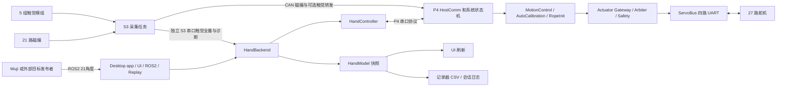
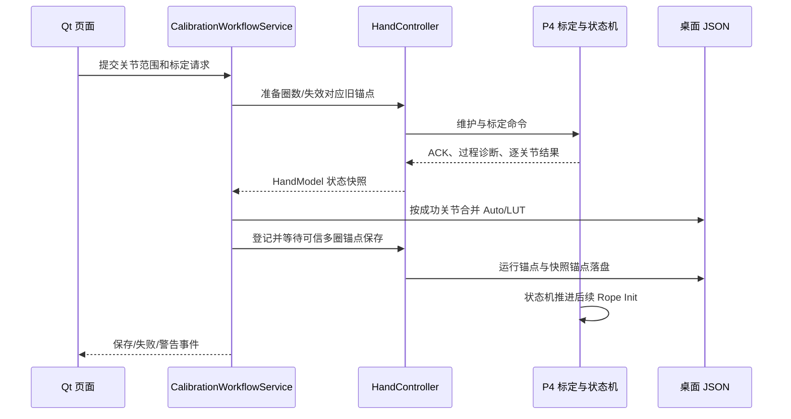

# MMHand 项目接手总览

整理日期：2026-09-05。依据本机当前源码整理，包含未提交修改。版本基线、文件覆盖范围见 [索引覆盖说明](07_索引覆盖说明.md)。本文是源码交接说明；用户按钮操作见 [上位机使用说明](../上位机使用说明.md)。

接手人：________　交接人：________　最后实机验证日期：________　交付 commit/tag：________

## 1. 先读什么

1. 阅读本文第 2～5 节，认识设备、入口、代码边界和坐标。
2. 按第 6 节跑通上位机启动，识别 P4 和 S3 两个串口；先观察状态。
3. 按第 7～9 节跟一次连接恢复、自动标定和反馈控制的源码链路。
4. 根据工作内容进入逐文件索引，点击文件名直接打开源码。
5. 与交接人一起完成 [现场交接与验证清单](08_现场交接与验证清单.md)，保存真实设备的配置和日志。

| 索引 | 内容 |
| --- | --- |
| [上位机逐文件](01_上位机逐文件.md) | app、core、communication、data_recording、UI、ROS2、Replay、绘图 |
| [P4 逐文件](02_P4逐文件.md) | app、config、data、HAL、modules、runtime、RTOS、safety、tasks |
| [S3 逐文件](03_S3逐文件.md) | 启动、引脚配置、磁编/触觉 HAL、采集和 CAN 任务 |
| [工具与遥操逐文件](04_工具与遥操逐文件.md) | 代码生成、架构检查、烧录调试、MANUS/Wuji、实验固件 |
| [资源与第三方文件](05_资源与第三方文件.md) | JSON、URDF、mesh、厂商库、IDE 工程、历史文档 |
| [测试文件](06_测试文件.md) | 测试目的、测试函数及依赖 |
| [覆盖说明](07_索引覆盖说明.md) | 收录规则、Git/本机文件区别和再生成命令 |

逐文件索引中的“主要符号”是静态阅读入口，不能代替运行时调用分析；第三方库和图像/二进制以资产用途说明为主。

逐文件索引排除当前 Git 忽略规则命中的文件。正文涉及运行配置和备份时，仅解释其业务用途，不将这些本机数据作为源码交付条目。

## 2. 项目做什么

本项目控制 21 个关节、27 个舵机的腱绳驱动灵巧手。电脑负责交互、目标输入、记录和标定数据持久化；P4 负责实时控制、标定动作、系统状态和舵机总线；S3 负责磁编码器及触觉采集。

| 部分 | 当前正式入口 | 主要责任 | 交接时要实测 |
| --- | --- | --- | --- |
| Windows/Linux 上位机 | `desktop/__main__.py` → `desktop/app/entry.py` | GUI/CLI、设备后端、串口、标定恢复、ROS2 和 Replay | 环境、串口、UI 刷新、日志写入 |
| ESP32-P4 | `ESP32-P4/ServoBoardMain/ServoBoardMain.ino` | FreeRTOS 实时控制和四路舵机 UART | 板型/FQBN、构建、烧录、舵机路由 |
| ESP32-S3 | `ESP32-S3/System/System.ino` | AS5047P 磁编、Paxini 触觉、CAN/串口上报 | SPI 映射、CAN、触觉全量帧 |
| Wuji 遥操工作区 | `wuji_hand_ws/.../nodes/sender.py`、`ui/teleop_ui.py` | 手套采集、姿态标定、重定向、ROS2 发布 | Linux SDK 与 ROS2 环境、URDF 契约 |
| MANUS 工具 | `manus/manus_bridge_test`、`manus/mmhand_manus_sdk` | MANUS Core/SDK 桥接和 C ABI 包装 | SDK 授权、DLL、实际消费者是否存在 |

`ESP32-P4ID`、`ESP32-P4Test*`、P4 的波形测试草图及 `playground` 是独立维护/实验程序，不能与正式 P4/S3 固件的状态机混为一套入口。

## 3. 整体数据流



P4 主串口打开只证明端口句柄可用，不证明状态同步、圈数恢复和 READY 完成。S3 触觉端口是另一条通信连接，P4 在线也不保证触觉在线。

## 4. 模块边界与状态所有权

### 4.1 上位机

| 模块 | 负责什么 | 修改时沿哪条边界走 |
| --- | --- | --- |
| `desktop/app` | 参数解析、GUI/CLI 和 ROS2 生命周期装配 | 新启动方式复用 entry/run_ui |
| `desktop/ui` | Qt 控件、显示、操作意图、界面定时刷新 | 按钮经 HandBackend 调用业务；后台回调通过 Qt 信号切回主线程 |
| `core/hand_backend.py` | UI、ROS2、Replay 的公共设备门面；状态分发、独立触觉连接和目标授权 | 新业务先确认这里是否已有接口 |
| `core/core_logic.py` | HandController；设备连接、命令事务、ACK/结果等待、多圈锚点保存与恢复 | 共享 HandModel 按 state_lock 读取；避免从页面直接操作 comm |
| `core/calibration_workflow.py` | 单工作线程串行编排准备/恢复/保存；epoch 取消过期事务 | 页面只提交操作并显示事件，不能另起 JSON 保存链 |
| `core/comm_layer.py` | 编排 RX/TX、心跳、协议组件和 S3 触觉解析 | 保留正式公共通信接口；新解帧和归并工作放对应组件 |
| `core/communication` | 原始字节传输、解帧、路由、状态归并和 ACK 事件 | transport 不懂协议；router 不改状态；reducer 发布快照 |
| `core/data_recording` | 样本/事件到 CSV 的记录 | 记录不得反向改变控制；注意时钟和缺失数据 |
| `desktop/replay` | CSV 加载、时间推进、ReplayService | 输出仍走后端准入和停止流程 |
| `desktop/ros2` | ROS2 订阅、输入格式和有效性检查 | 收到消息不等于获得电机输出授权 |
| `desktop/visualize` | 离线 Plotly 图、LUT 和控制诊断分析 | 先核对 CSV schema 和时间轴 |

接收路径：`SerialTransport → FrameDecoder → P4PacketRouter → StateReducer → HandModel → HandController/HandBackend → UI`。

`FrameDecoder` 处理串口分包、粘包与日志字节；`P4PacketRouter` 剥离公共 P4 时间戳并确定包类型；`StateReducer` 按包语义合并状态。连续状态允许 latest-value 覆盖，ACK/安全事件通过独立通道保序，不能为减少代码量把两者并成一个丢旧值的邮箱。

### 4.2 P4

| 目录 | 责任与阅读要点 |
| --- | --- |
| `app` | Arduino 薄入口、共享对象创建和任务装配 |
| `config` | 硬件、维度、周期、算法参数、标定阈值和安全目录 |
| `data` | 跨模块纯数据结构、枚举、状态位和字段单位 |
| `hal` | TWAI、上位串口、飞特驱动与 UART 注册 |
| `modules/actuator` | 命令 gateway 和 owner 仲裁，约束谁能下发舵机目标 |
| `modules/calibration` | LUT 插值、标定数学、RAM 标定和 Manual 参考存储 |
| `runtime` | SystemRuntimeContext、分区运行态、端口、队列和统计适配 |
| `platform` | FreeRTOS/原子值/周期调度/时钟和日志薄封装 |
| `safety` | 安全规则判定、规则注册、事件上报和策略；详见第 10 节 |
| `tasks` | 将控制、通信、恢复、标定等业务接入周期任务 |
| `generated` | 协议、URDF、产品指纹、安全目录生成物 |

`SystemAssembly` 创建唯一共享运行态和快照队列。`servoTargetQueue` 等容量为 1 的队列存最新值，`stateEventQueue` 等事件通道承担顺序状态转换。命令成组更新由互斥保护；跨模块优先使用已有端口和快照适配接口。

当前 P4 任务优先级在 `TaskConfig.h`：SystemState=5、MotionControl=4、ServoBus/S3CanRx=3、HostComm/AutoCalib=2、Monitor=1。HostComm 的周期兜底为 5 ms，RX 可提前唤醒；MotionControl 为 10 ms。ServoBus 周期与两阶段反馈收集由 ServoConfig 和任务截止时间逻辑共同决定，不能只靠任务优先级推算延迟。

### 4.3 S3

`System.ino → startSystemTasks()` 启动三个任务：磁编采集、触觉采集、CAN 发送。磁编任务通过长度 1 的覆盖队列给 CAN 任务提供最新数据。触觉全量串口输出与 CAN 转发有独立编译开关，具体由 `src/config/Config.h` 决定。

当前任务源码周期为磁编 2 ms、CAN 4 ms、触觉 33 ms；这是调度目标，不是承诺所有样本都严格等间隔到达电脑。核绑定、SPI 事务、CAN 重试和串口传输都会影响实际到达时间。

AS5047P 读响应存在流水线，不能把当前 SPI 命令与同一传输收到的数据直接当作同一请求。触觉又有自己的读头、等待、数据段和 CRC 规则，应分别读 `HalEncoders` 与 `HalTactile`。

## 5. 硬件身份、单位与坐标

### 5.1 Jxx 与 Mxx

当前映射源为 `ESP32-P4/ServoBoardMain/src/config/topology/HardwareMap.cpp`；上位机对应 `desktop/core/motor_mapping.py`。

| 关节 | 舵机 | 关节 | 舵机 |
| --- | --- | --- | --- |
| J00 | M00/M01 | J01/J02/J03 | M02/M03/M04 |
| J04 | M05/M06 | J05/J06/J07 | M07/M08/M09 |
| J08 | M10/M11 | J09/J10/J11 | M12/M13/M14 |
| J12 | M15/M16 | J13/J14/J15 | M17/M18/M19 |
| J16 | M20/M21 | J17/J18/J19 | M22/M23/M24 |
| J20 | M25/M26 | 合计 | 21 关节、27 舵机 |

逻辑电机身份与物理 BUS 分开：全手舵机 ID 必须按身份表唯一，BUS 由发现/路由表管理。不能因为某个舵机过去接在 BUS1，就把 BUS1 写进某页面或算法。

| 数据 | 单位/语义 | 常见误解 |
| --- | --- | --- |
| 关节目标/反馈 | 通常为 URDF 度，ROS2 raw_ik 可显式选择 rad | deg 与 rad 混用、额外取反 |
| 磁编 raw | AS5047P 14 bit，0～16383 | 与舵机 raw 4096 模数混用 |
| 舵机 raw | 单圈原始位置，相关恢复逻辑按 4096 展开 | raw 单圈相同就认为多圈绝对位置相同 |
| hardware ABS | 舵机硬件多圈坐标 | Reset Zero 后还沿用旧硬件零点 |
| logical ABS | P4 维护的逻辑多圈坐标，是 LUT/控制的参照 | 只清 Unknown 位就当作恢复成功 |
| tendon counts | 由收绳方向符号变换后的控制坐标 | 把 ABS 增减方向硬编码进算法 |
| load | 舵机遥测负载值及符号 | 未标定就当成牛顿或精确绳张力 |

硬件 Reset Zero 与保持 logical 坐标可通过恢复锚点及偏移配合实现，但缺少可信锚点时不能凭单圈反馈保证旧 LUT 坐标仍正确。恢复完成要看结果 token、成功掩码与新反馈，而不仅是 ACK。

### 5.2 本次查看到的配置快照

以下仅记录 2026-09-05 工作区值，交接实机前必须与实际烧录版本比对。

| 项目 | 当前源码值 | 源文件 |
| --- | --- | --- |
| P4 闭环周期 | 0.010 s | `ControlConfig.h` |
| 单腱速度前馈 | `false`，参数保留 | `ControlConfig.h` |
| 单腱换向连续补绳 | `false`，参数保留 | `ControlConfig.h` |
| 单腱近目标 Kp | 20.0 | `ControlConfig.h` |
| 单腱动态/大误差 LUT 倍率 | 0.9 / 0.41 | `ControlConfig.h` |
| 单腱 Kd | 0.0 | `ControlConfig.h` |
| 双腱 Kp | 0.60 | `ControlConfig.h` |
| LUT 放绳/收绳运行裕量 | 500 / 1000 counts | `ControlConfig.h` |
| P4 上位串口/舵机总线 | 921600 / 1000000 baud | `BoardConfig.h` |
| S3 启动稳定等待 | 5000 ms | `System.ino` |
| S3 磁编/触觉 SPI | 10 MHz / 1 MHz | S3 `Config.h` |

“代码中存在算法”与“当前启用算法”必须区分；旧正弦实验报告不能替代上述开关核验。LUT 样本范围、加运行裕量的控制范围、会话 logical 硬范围也是三个不同概念。

## 6. 环境、启动与构建

### 6.1 上位机

Windows 用户可双击仓库根目录 `start_mmhand.cmd` 或已生成的 MMHand 桌面图标。脚本按显式解释器配置、项目虚拟环境、激活虚拟环境、Windows py、PATH 查找 Python。部署细节见 [使用说明](../上位机使用说明.md)。

在仓库根目录、已安装依赖的 Python 环境中：

```powershell
python -m pip install -r desktop/requirements.txt
python -m desktop ui --no-ros2
python -m desktop ui
python -m desktop cli --no-ros2
```

ROS2 默认开启的是接收桥。GUI 打开后仍需用户进行 ENABLE 和 ROS2 INPUT 授权。Python/Qt 可用不代表 rclpy 可用；ROS2 依赖必须与解释器、发行版和平台匹配。启动器不自动安装 ROS2。

当前 CLI `--mode` 只接受 `monitor` 和 `replay`。Wuji 旧 README 中的 `--mode teleop` 不适用于当前 entry.py。当前 raw_ik 接收命令为：

```powershell
python -m desktop ui --mode monitor --ros2 --ros2-input raw_ik --ros2-raw-ik-topic /raw_ik_target --ros2-raw-ik-space urdf_deg
```

发送端的消息长度、J00～J20 顺序、单位和 URDF 契约必须匹配；连同 ROS_DOMAIN_ID、网络发现条件、源节点版本一并交接。

### 6.2 P4/S3

P4 打开 `ESP32-P4/ServoBoardMain/ServoBoardMain.ino`；S3 打开 `ESP32-S3/System/System.ino`。记录 Arduino IDE、ESP32 board package、板型选项、库版本、端口和最近一次成功编译日志。

仓库已有 `tools/p4_debug/build_debug.ps1`、`upload_debug.ps1`、`start_openocd.ps1`。它们引用 `p4_debug_env.ps1` 中的本机路径及 FQBN；迁移电脑时先修改环境配置。不可把交接人的 `C:\Users\...` 和盘符当成通用安装路径。

```powershell
powershell -NoProfile -ExecutionPolicy Bypass -File tools/p4_debug/verify_debug_env.ps1
powershell -NoProfile -ExecutionPolicy Bypass -File tools/p4_debug/build_debug.ps1 -ReuseCache
```

编译通过与实机可用是不同验收项。本文整理没有重新烧录设备，也没有宣称当前整个脏工作区已完整通过固件编译。

## 7. 连接与掉电恢复链路

阅读顺序：`ui_control_device.py / ui_control_calibration.py → HandBackend → CalibrationWorkflowService.begin_startup_restore → HandController → ServoBusService / FeetechServoDriver`。

1. 建立主串口，启动通信/状态更新，请求 `STATE_SYNC_ALL`。
2. 获取系统、舵机路由、产品指纹和 Manual 状态；UI 可以显示连接，但恢复仍在继续。
3. 工作流读取 V6 JSON，先恢复 Manual 端点并核对读回结果。
4. 根据设备身份和锚点等待多圈恢复；逐舵机确认可信状态。
5. 校验 Auto/LUT 的模型、Manual CRC、工作范围和样本完整性，再加载限位与逐关节结果。
6. 将工作流事件返回 UI；失败信息区分 Manual、圈数、LUT 和状态准入。

P4 当前 `SystemAssembly` 上电先将有效舵机标为 Turn Unknown。`ServoBusService` 存在带锚点的 `resetTurnCounterAndRestoreNearAnchor()`，也有维护事务中的 Reset Zero。不要把“存在 Reset Zero 调用”解释成“所有关节重启后必然恢复成功”。

要追查 J14/J15 重烧录后需要重标，先核对 J14=M18、J15=M19 的锚点有效位、产品身份、raw/logical 同帧反馈、恢复结果和 JSON 加载失败原因。正常 UI 图标颜色只是这些状态的展示结果。

## 8. 标定、Rope Init 与落盘



图中 JSON 保存与固件 Rope Init 是各自推进的异步流程，不表示二者严格串行。不能用 GUI 保存成功代替固件 READY，也不能用固件 SUCCESS 代替桌面数据已落盘。

| 业务环节 | 文件与关键责任 |
| --- | --- |
| 人工磁编端点 | `ui_control_manual.py`、`core_logic.py`、`ManualEncoderReferenceStore`；建立关节角映射参考 |
| 标定序列 | `CalibrationSequencePlanner`、`AutoCalibrationCoordinator`；安排范围及关节步骤 |
| 单腱标定 | `single_motor/SingleMotorCalibrationMachine`；单电机动作、采样、失败原因 |
| 双腱标定 | `dual_motor/DualMotorCalibrationMachine`；主副腱预载、交换、采样及停滞检查 |
| LUT 生成/提交 | `CalibrationLutBuilder`、`CalibrationResultCommitter`、`TendonCalibrationLut` |
| 诊断 | `CalibrationDiagnostics` 和 `CalibrationTypes` → 桌面 `calibration_diagnostics.py` |
| 后续回工作区 | `SystemEventDispatcher`、`RopeInitController`；由系统任务推进 |
| 持久化 | `CalibrationWorkflowService`、`CalibrationSnapshotStore`、HandController 锚点服务 |

工作流通过单 worker 和 epoch 避免断开重连后旧事务继续更新当前界面。标定 JSON 按成功关节增量合并，失败或取消的关节不能被默认值伪装成成功。多圈锚点在准备归零阶段屏蔽保存，待成功结果与有效反馈出现后登记保存。

Release Rope 是重新建立绳路的维护操作，可能清除旧标定适用性；接手前先备份真实配置。旧上位机可能仍发送手动 Rope Init 命令，删除按钮不能随意删除下位机兼容命令。

## 9. 反馈控制与调参入口

目标从手动页面、测试、Replay 或 ROS2 进入 HandBackend，经合法性/范围检查和串口命令到 P4。系统状态机决定准入；工作区未准备好且符合自动恢复条件时，先 Rope Init，再进入反馈控制。

阅读主链：`MotionControlService → ControlSolver / DualTendonControl → ServoTargetBuilder → ActuatorCommandGateway / Arbiter → ServoBusService`。具体安全判定分布在对应策略和输出关口。

- 单腱：以关节误差和 LUT 调度增益计算修正；`pid.c` 管理 PID 历史，速度前馈/换向补绳运行态在 motion_control 中。改参数前确认当前开关。
- 速度前馈：目标差分与滤波估计速度，预测角度经 LUT 转成额外 counts；静止、换向、边界和反馈失效都需检查。它不是任意动作的精确未来预测。
- 双腱：两台电机按各自 LUT 位置和反馈做协调控制，查看 `DualTendonControl` 的输入/输出坐标，不能直接套用单腱角度 Kp 的数值含义。
- 限位：LUT 范围、运行松紧裕量、logical 会话行程与碰撞/过载准入都会影响最后发出的目标。
- 完成判定：`MotionCompletionEvaluator`；持续遥操与一次目标到位的状态收尾不能混淆。

正弦/阶跃记录应同时看 Target、Actual、舵机 ABS、舵机 CMD。先确认 Target 本身没有平台、丢帧或跳变，再比较平均误差、RMSE、幅值增益与中位延迟。绘图脚本的估计相位受波形失真影响，不能单独当作控制带宽结论。

## 10. 状态机、安全与 owner

`SystemStateCoordinator` 和 `SystemEventDispatcher` 是状态转换主线；`DirectCommandCoordinator` 处理直控命令准入；`HostLeaseSupervisor` 处理主机租约丢失后的保持事务。

| 状态 | 接手时的理解 |
| --- | --- |
| UNCONTROLLABLE | 当前无普通输出权限，需查看故障/准备条件 |
| IDLE | 已启用但尚不代表当前范围已完成反馈准备 |
| READY | 当前反馈工作区准备完成，可申请反馈控制 |
| RUN_FEEDBACK | 关节负反馈正在执行 |
| RUN_DIRECT | 舵机位置直控正在执行 |
| CALIBRATION_RUNNING | 自动标定正在执行 |
| ROPE_INIT_RUNNING | 回工作区/绳路准备流程正在执行 |
| PAUSED | 暂停状态，缓存目标和恢复策略由状态机管理 |
| RECOVERY_REQUIRED | 需要恢复流程或维护处理，查看原因和作用范围 |

系统状态、输出 owner、active scope 和 fault bitmap 是不同维度。拥有正确状态仍需通过命令和反馈门禁。急停使用独立 token，避免普通事件队列满时丢失；不能删成普通排队按钮命令。

安全规则目录在 `config/safety/SafetyRuleCatalog.def`。`SafetyRuleRegistry`/策略返回规则或判定，`SafetyEventReporter` 上报；上位机读取规则解释。新增规则必须保持编号、字段和生成目录一致。

## 11. 舵机总线与离线排查

`ServoDiscoveryManager` 负责扫描；`ServoRouteTable` 维护路由；`ParallelServoFeedbackCycle` 组织多 BUS 周期反馈；`FeetechServoDriver` 负责具体协议读写。单舵机无响应、地址冲突、BUS 级故障分别查看对应诊断，不能只看到 offline 就判断整条 UART 已坏。

排查记录至少包括逻辑 Mxx、物理 ID、BUS、成功/失败计数、最近反馈时间、恢复次数和 Unknown 位。拆掉一台舵机后，实测同 BUS 其他舵机是否继续反馈，是接手验证的重要用例。

## 12. 触觉与磁编排查

| 现象 | 第一批检查文件/数据 |
| --- | --- |
| 所有关节角不更新 | S3 `EncodersTask`、`HalEncoders`；P4 `S3CanRxService`、CAN 错误/时间戳 |
| 单手指组磁编错误 | S3 `ENC_GROUP_CHANNEL_MAP`、译码片选、AS5047P 错误状态 |
| S3 串口连接但无触觉 | `TactileTask` 输出开关、`TactileSerialComm` 解帧、序号/CRC/新鲜度 |
| 一个 SPI 接口持续失败 | `HalTactile` 失败类别和换接口对照实验；记录是否故障随模组移动 |
| 摘要有值但触点缺失 | full frame 是否到达、full CRC、sensor 尺寸和布局映射 |
| 力图位置/方向不对 | `official_tactile_layout.py`、`data_models.py`、S3 group/sensor 配置 |

`Demo Data` 是界面模拟能力，不能作为硬件验收。Raw/Full 阵列与三轴摘要也不是同一数据层级；重建真实触点阵列需逐 taxel 的 finger/sensor/row/col/Fx/Fy/Fz 及同帧标识。

## 13. 持久化与必须备份的文件

路径事实源为 `desktop/paths.py`。

| 文件/目录 | 用途 | 交接要求 |
| --- | --- | --- |
| `desktop/resources/config/calibration_bundle.mmcal.json` | 当前 V6 标定、LUT、参考和快照锚点 | 与对应设备身份、标定日期一起备份 |
| `desktop/resources/config/device_state/multiturn_runtime.json` | 最近可信多圈运行锚点 | 与上面文件配套备份，说明上次保存时机械状态 |
| `robot_model_manifest.json`、活动 URDF | 关节语义、模型和限位来源 | 记录来源仓库/提交及生成方式 |
| `product_fingerprint.json`、`urdf_joint_mapping.json` | 模型生成结果 | 与 P4 固件生成头保持一致 |
| `upper_protocol_schema.json` | 两端协议定义 | 随代码版本交付 |
| `p4_safety_rules.json` | 上位机规则目录 | 从对应 .def 生成 |
| `run_data` | 波形 CSV、会话/标定诊断和分析依据 | 选择有代表性的成功/失败会话归档 |

`.gitignore` 中的忽略规则不会自动停止跟踪已经入库的文件；因此每个配置文件是否随 Git 交付应实际查看 `git ls-files`。不要仅凭忽略规则推断当前 JSON 一定未提交，也不要认为 clone 能恢复本机运行锚点。

### 13.1 当前本机的外部模型依赖

2026-09-05 文件系统检查确认如下 Junction：

| 仓库中的逻辑路径 | 本机实际目标 |
| --- | --- |
| `desktop/resources/hku_hand_v2_urdf` | `D:\mmhand structure\desktop_urdf_adapter` |
| 上述目录下的 `meshes` | `C:\浏览器下周\structure-main\structure-main\mmhand_description\meshes` |

因此仅复制本仓库或保留 Junction 本身不足以完成模型交接。必须交付适配后的 `urdf/hand.urdf`、`structure_urdf_adapter.json` 和 meshes 的实际内容，或者交付结构仓库及明确的生成步骤，并在新机器重建联接。`tools/validate_urdf.py` 用于验证模型，`tools/link_urdf.ps1` 用于建立资源联接；调用前先读参数，不照搬旧盘符。

## 14. 时间戳和 Save Data

`topic_schema.py` 规定表结构，`recorder.py` 管理会话，`motion_sampler.py` 处理运动采样，`csv_exporter.py` 落盘。CSV 暴露 sample_index、host_time、p4_time_ms；主机时钟与 P4 上电时间不是同一时钟。

Control trace 用于同控制周期的目标和反馈分析。普通状态包、独立 S3 串口触觉可能有不同到达时刻，不能因为 CSV 行都有时间字段就假定所有传感器物理采样完全同步。P4 重启和 uint32 回绕要区分；拼接多次会话前先检查时间轴。

触觉重建应按一次采样分组，再按 finger_index/sensor_index 建阵列，利用 row/col 填回三个分量。缺行与未在线模组保留缺失标记，不用 0 冒充有效无受力样本。

## 15. 修改一项功能，应改哪里

| 需求 | 主要入口 | 必须一起核对 |
| --- | --- | --- |
| 改按钮、列宽、状态文字 | `desktop/ui/ui_control_*`、`ui_app.py` | 状态字段来源、UI 回归 |
| 新增命令或遥测包 | upper_protocol_schema + 生成器；host_comm + desktop protocol/reducer | 编号、长度、时间戳、ACK、两端兼容 |
| 新增标定失败原因 | CalibrationTypes + 内层产生原因处 + calibration_diagnostics | valueA/B/C/bitmap 语义、旧编号兼容、弹窗测试 |
| 修改标定动作 | 单/双电机 machine、CalibrationConfig | 终止条件、取消、结果提交、Rope Init、JSON/锚点 |
| 修改闭环参数 | ControlConfig、对应 motion_control 算法 | 单位、真实 dt、限幅、正弦/阶跃/遥操记录 |
| 修改舵机身份/接线 | HardwareMap、BoardConfig、ServoConfig、路由模块 | 桌面 M/J 映射、产品配置、旧标定适用性 |
| 修改磁编/触觉引脚 | S3 Config/HAL | P4 CAN 协议、组序、桌面阵列布局 |
| 修复重启恢复 | core_logic、device_state_store、calibration_workflow、ServoBusService | 锚点落盘、身份、未知位、结果 token |
| 修改 URDF | manifest/URDF/adapter + generate_robot_model | 桌面、P4 和 Wuji 的模型契约与 CRC |

## 16. 生成物维护

| 人工事实源 | 生成器 | 主要产物 |
| --- | --- | --- |
| `upper_protocol_schema.json` | `tools/generate_upper_protocol.py` | P4 UpperProtocol.generated.h、桌面 generated_upper_protocol.py |
| `robot_model_manifest.json` + 活动 URDF/adapter | `tools/generate_robot_model.py` | 桌面映射/指纹、P4 URDF 范围/指纹 |
| `SafetyRuleCatalog.def` | `tools/generate_p4_safety_catalog.py` | 固件规则头、桌面解释目录、离线索引 |

先读生成器 `--help` 及输出路径；审查生成后的 diff，确认哪些产物需随两端一起发布。直接编辑生成文件会在下次生成时被覆盖。

## 17. 验证方式与当前交接缺口

```powershell
python -m pytest tests/desktop/app -q
python -m pytest tests desktop/tests -q
python tools/check_desktop_architecture.py
powershell -NoProfile -ExecutionPolicy Bypass -File tools/p4_architecture/check_p4_architecture.ps1
```

第一条只覆盖入口；第二条同时覆盖根 tests 与 desktop/tests，后者不在根 pytest 默认 testpaths 中。Wuji 的测试需在其工作区环境另跑。架构检查是静态门禁，不能替代固件编译与机械验证。

本文整理过程中未运行完整测试套件或实机验证，不能据此给工作区盖“已验收”结论。上次会话完成的启动相关测试和 HardwareMap 单文件语法检查也不能覆盖此后全部修改。

已确认需要交接双方核对的事项：

- 当前工作区存在多处未提交修改及本机新增文件；离职前建立一个可追溯、可构建的交付版本。
- 多篇旧 README/索引引用已经不存在的文件或旧入口。例如 MANUS README 的 `docs/manus_teleop_chain.md` 未在当前 docs 中找到，旧 `--mode teleop` 已不在 CLI choices。
- 速度前馈/换向补绳当前关闭，实际要交付的算法配置需由实机结果确认。
- Reset Zero、多圈恢复、两轮标定增量保存、Rope Init 收尾是历史反复出现问题的流程，必须保留成功及失败验证记录。
- `tools/p4_debug/p4_debug_env.ps1` 含本机绝对路径；新电脑要重新建立环境。
- 当前 URDF 与 mesh 依赖仓库外两级 Junction；外部内容和模型来源版本必须配套交付。
- Wuji `_vendor` 中存在 Linux 编译产物，不能当作 Windows 原生依赖使用。
- 静态表/结构体清理要同步初始化宏；最近的 HardwareMap 编译错误即来自删除字段后仍保留多余初始化值。

## 18. 给接手人的一周安排

| 阶段 | 工作 | 应产出的证据 |
| --- | --- | --- |
| 第 1 天 | 环境、三套入口、硬件编号和备份 | 启动截图、端口表、源码版本和备份清单 |
| 第 2 天 | 跟读串口收发、HandModel、UI 刷新 | 能解释一条反馈从设备到界面的路径 |
| 第 3 天 | 标定/多圈/Rope Init 的完整闭环 | 一次标定与重启恢复日志，逐关节结果 |
| 第 4 天 | 控制、限位、碰撞/过载和停止 | 小范围正弦/阶跃与停止验证记录 |
| 第 5 天 | 触觉、ROS2、Replay、生成器和回归 | 数据录制/重建样例，一项小修改及其测试 |

完成标准是接手人能独立启动、定位关键状态、复现一次标定恢复，并解释一次失败的源头；逐文件索引用于随时定位实现。
