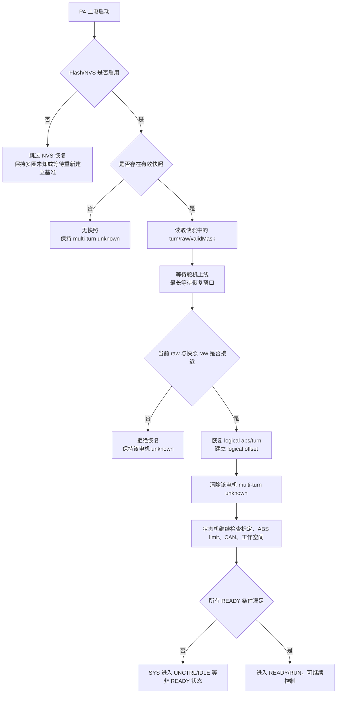
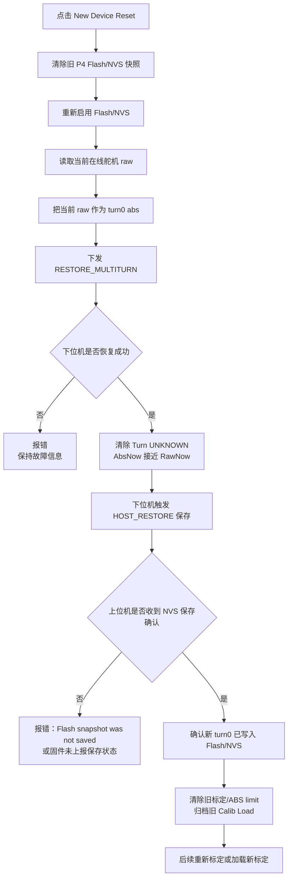

# 多圈断电恢复闭环修改说明

> 当前专项文档，最后核对：2026-08-01。当前多圈持久化已经采用异步 NVS job、A/B 双槽和 mappingSignature；文中按“本次修改”描述的部分保留为演进背景，当前操作边界见[持久化与掉电恢复](持久化与掉电恢复.md)。

本文说明本版针对“舵机断电后多圈圈数丢失、重新上电后无法确认是否恢复”的问题，做了哪些修改，以及最终形成的逻辑闭环。

## 1. 问题背景

飞特舵机在多圈模式下，断电后舵机内部不会可靠保存多圈圈数。重新上电时，舵机通常只能提供当前单圈 `raw` 位置。

因此，如果舵机断电前在第 2 圈：

```text
断电前：turn=1, raw=904, abs=5000
重新上电后舵机自身可能变成：turn=0, raw=904, abs=904
```

仅凭 `raw=904` 无法判断它原来是在第 0 圈还是第 1 圈，因为每一圈 raw 都会重复。要恢复第二圈，必须依赖下位机在断电前保存过的可信快照。

旧逻辑的问题是：

- 有 NVS/Flash 快照机制，但上位机不能确认“这一次 New Device Reset 后的新快照是否真的写入成功”。
- 上位机可能看到 `Turn` 从 unknown 变成 0，就误以为恢复闭环已经完成。
- 如果固件没有上报 NVS 保存状态，上位机无法区分“已经保存成功”和“只是临时恢复成功”。

本次修改的目标是把链路补成闭环：

```text
恢复多圈/建立新 turn0
  -> 下位机写入 Flash/NVS 快照
  -> 下位机上报保存结果
  -> 上位机等待并校验保存结果
  -> 成功后才认为 New Device Reset 真正完成
```

## 2. 修改点总览

### 2.1 下位机增加 NVS 保存结果上报

相关文件：

- `ESP32-P4/ServoBoardMain/src/communication/upper/UpperCommTask.cpp`
- `ESP32-P4/ServoBoardMain/src/shared/TaskSharedData.h`
- `ESP32-P4/ServoBoardMain/src/system/SystemTask.cpp`
- `ESP32-P4/ServoBoardMain/src/persistence/MultiTurnNvsPersistenceTask.cpp`

核心变化：

`SYSTEM_STATUS` 状态帧新增了 NVS 保存状态字段：

```text
multiturn_nvs_save_request_token
multiturn_nvs_save_result_token
multiturn_nvs_save_valid_mask
multiturn_nvs_save_fail_count
```

这些字段的作用是：

| 字段 | 作用 |
|---|---|
| `request_token` | 本次请求保存 NVS 的序号 |
| `result_token` | 已完成保存的请求序号 |
| `valid_mask` | 本次快照中哪些电机数据有效 |
| `fail_count` | NVS 保存失败累计次数 |

上位机现在不再只看 `Turn` 是否恢复，而是要求看到：

```text
request_token 增加
result_token >= request_token
valid_mask 覆盖本次要求恢复的电机
fail_count 没有增加
snapshot_valid = true
```

满足这些条件，才认为 Flash/NVS 快照真的保存成功。

### 2.2 New Device Reset 后强制触发 NVS 保存

相关文件：

- `ESP32-P4/ServoBoardMain/src/communication/servo/ServoCommunicationTask.cpp`

关键逻辑：

上位机执行 `RESTORE_MULTITURN` 后，下位机会尝试把当前在线电机恢复到指定的多圈 ABS。如果恢复成功：

```text
清除 multi_turn_unknown_bitmap
触发 MULTITURN_NVS_SAVE_REASON_HOST_RESTORE
请求保存新的 NVS 快照
```

这一步解决的问题是：

```text
New Device Reset 不能只在 RAM 里把 turn 改成 0
还必须把新的 turn0 基准写进 Flash/NVS
```

否则重新断电后，系统仍然可能读到旧快照或没有快照。

### 2.3 上位机解析并保存新的 NVS 状态字段

相关文件：

- `desktop/core/protocol.py`
- `desktop/core/comm_layer.py`
- `desktop/core/data_models.py`

修改内容：

1. `parse_system_status_packet()` 支持解析新长度的 `SYSTEM_STATUS`。
2. 旧固件仍可兼容解析，但会标记：

   ```text
   has_multiturn_nvs_status = false
   ```

3. `HandModel` 新增 NVS 保存状态字段，UI 和核心逻辑都能读取当前保存状态。

这样上位机可以明确判断：

- 当前固件是否支持 NVS 保存结果上报。
- 本次保存是否真正完成。
- 本次保存覆盖了哪些电机。
- 是否发生过 NVS 写入失败。

### 2.4 上位机 New Device Reset 改成“等待保存确认”

相关文件：

- `desktop/core/core_logic.py`
- `desktop/ui/ui_control_panels.py`

新的 New Device Reset 流程：

```text
1. 检查串口连接、控制状态、raw 反馈
2. 关闭并清除旧 P4 Flash/NVS 快照
3. 如果之前 Flash ON，则重新启用 Flash/NVS
4. 用当前 raw 构造 turn0 的 abs
5. 下发 RESTORE_MULTITURN
6. 等待下位机 ACK
7. 等待 Turn UNKNOWN 清除
8. 校验 AbsNow 是否接近 RawNow
9. 等待 NVS 保存结果上报
10. 保存确认成功后，才清除旧标定/ABS limit 并归档 Calib Load 快照
```

其中第 9 步是本次闭环的关键。

如果下位机固件没有上报新字段，上位机会报：

```text
firmware does not report NVS save status; update P4 firmware
```

这个错误表示：

```text
turn0 reset 可能已经临时成功
但上位机无法确认 Flash/NVS 是否已经保存
所以不能认为闭环完成
```

### 2.5 禁用上位机本地多圈缓存作为可信来源

相关文件：

- `desktop/core/core_logic.py`

当前配置：

```python
HOST_MULTITURN_CACHE_ENABLE = False
```

含义：

```text
P4 NVS 是唯一可信的跨断电多圈恢复来源
上位机本地 multiturn_cache.json 不再作为可信恢复依据
```

这样可以避免一种危险情况：

```text
上位机缓存还在
但机械或舵机已经被换过/动过
上位机误把旧缓存恢复给新机械
```

## 3. 最终逻辑闭环

### 3.1 正常运行中保存快照

下位机在这些时机请求保存 NVS 快照：

| 触发原因 | 说明 |
|---|---|
| `RUN_START` | 进入运行前保存一次当前可信多圈状态 |
| `RUN_DONE` | 运行结束后保存一次 |
| `CALIB_DONE` | 标定完成后保存一次 |
| `HOST_RESTORE` | 上位机执行 New Device Reset/恢复多圈成功后保存 |
| `HOST_OFFLINE` | 上位机心跳丢失时保存 |
| `OFFLINE_MOVE` | 上位机离线期间检测到运动后周期保存 |
| `OFFLINE_TURN_EDGE` | 上位机离线期间检测到跨圈/接近跨圈边界时保存 |

保存前会过滤不可信数据：

- `multi_turn_unknown_bitmap` 里仍 unknown 的电机不会保存。
- 离线或没有反馈的电机不会用错误数据覆盖旧快照。
- 只保存当前可信的 `turn + raw`。

### 3.2 重新上电时自动恢复

下位机启动后流程：



重点：

```text
从 multi-turn unknown 变成 UNCTRL，不代表恢复失败。
它通常表示多圈未知已解除，但标定、ABS limit、CAN 或工作空间条件还没满足 READY。
```

### 3.3 New Device Reset 建立新基准

当更换舵机、重装机械、快照不可信，或者用户确认当前机械姿态就是新的基准时，执行 `New Device Reset`：



这个流程保证：

```text
只有 turn0 reset 成功 + Flash/NVS 保存确认成功
才认为 New Device Reset 完整成功
```

## 4. 第二圈断电再上电能否恢复

可以恢复，但必须满足条件。

### 可以恢复的情况

```text
1. 舵机断电前，P4 已经保存过第二圈快照
2. 断电后机械没有被外力转动
3. 重新上电时当前 raw 与快照 raw 差距在容差内
4. P4 Flash/NVS 开关为 ON
5. 快照 CRC 和 validMask 有效
```

例子：

```text
断电前保存：
turn=1, raw=904, abs=5000

重新上电舵机自身：
turn=0, raw=904, abs=904

P4 读取快照后：
raw 校验通过
恢复 logical abs=5000
控制层继续按 logical abs 控制
```

### 不能保证恢复的情况

```text
1. 舵机转到第二圈后还没来得及保存快照就突然断电
2. 舵机断电后被手动转动
3. 更换舵机但没有先清旧快照
4. raw 与快照 raw 差距过大
5. 固件没有烧录支持 NVS 保存状态上报的新版本
```

因此当前闭环的准确描述是：

```text
有可信快照时，可以恢复跨断电多圈位置。
但它不是任意时刻突然掉电都 100% 恢复到掉电瞬间。
```

如果后续要继续增强“运行中任意舵机突然断电”的能力，可以进一步增加上位机在线运行时的跨圈保存策略，例如检测到 `turn` 变化或接近跨圈边界时立即请求保存。

## 5. 测试验收方法

### 5.1 确认固件版本匹配

烧录 P4 后，连接上位机，执行 `New Device Reset`。

成功时，状态信息应该包含类似：

```text
NVS snapshot saved token=... mask=0x...
```

如果出现：

```text
firmware does not report NVS save status; update P4 firmware
```

说明：

```text
上位机是新代码
但 P4 固件不是包含 NVS 保存状态上报的新版本
```

需要重新烧录 P4。

### 5.2 验证 turn0 基准闭环

1. 舵机在线，上位机连接。
2. 点击 `New Device Reset`。
3. 确认 `Turn=0`，`AbsNow` 接近 `RawNow`。
4. 确认弹窗或状态栏不再报 NVS 保存失败。
5. 断电重启 P4 和舵机。
6. 重新连接后确认不再出现 active 电机 `Turn UNKNOWN`。

### 5.3 验证第二圈恢复

1. 让某个舵机进入第二圈附近。
2. 触发一次会保存 NVS 的流程，例如运行结束、标定完成，或后续专门加保存按钮/保存命令。
3. 确认上位机看到 NVS 保存成功。
4. 保持机械不动，断电。
5. 重新上电。
6. 观察该电机是否恢复到原 logical abs/turn，而不是退回 `turn=0`。

## 6. 代码位置索引

| 模块 | 文件 | 作用 |
|---|---|---|
| 上位通信协议 | `desktop/core/protocol.py` | 解析扩展后的 `SYSTEM_STATUS`，构造 `RESTORE_MULTITURN` 和 `MULTITURN_NVS_CONTROL` |
| 上位通信层 | `desktop/core/comm_layer.py` | 把 NVS 保存状态写入 `HandModel` |
| 上位数据模型 | `desktop/core/data_models.py` | 保存 `request_token/result_token/valid_mask/fail_count` 等字段 |
| 上位核心逻辑 | `desktop/core/core_logic.py` | `New Device Reset` 等待 NVS 保存确认，禁用本地多圈缓存作为可信来源 |
| 上位 UI | `desktop/ui/ui_control_panels.py` | New Device Reset 操作入口、错误提示、成功提示 |
| P4 上位通信 | `ESP32-P4/ServoBoardMain/src/communication/upper/UpperCommTask.cpp` | 状态帧上报 NVS 保存状态，接收 `RESTORE_MULTITURN`/`MULTITURN_NVS_CONTROL` |
| P4 舵机通信 | `ESP32-P4/ServoBoardMain/src/communication/servo/ServoCommunicationTask.cpp` | 开机 NVS 恢复、热插拔恢复、HOST_RESTORE 后触发保存 |
| P4 状态机 | `ESP32-P4/ServoBoardMain/src/system/StateMachineTask.cpp` | RUN/CALIB 节点触发 NVS 保存 |
| P4 共享数据 | `ESP32-P4/ServoBoardMain/src/shared/TaskSharedData.h` | 定义 NVS 开关、保存原因、保存结果字段 |
| P4 NVS 存储 | `ESP32-P4/ServoBoardMain/src/persistence/MultiTurnNvsStore.cpp` | 快照 A/B slot、CRC、读取和写入 |
| P4 NVS 任务 | `ESP32-P4/ServoBoardMain/src/persistence/MultiTurnNvsPersistenceTask.cpp` | 异步保存结果回填到共享状态 |

## 7. 最终结论

本次修改后，系统的目标不是让舵机自己记住多圈圈数，而是让 P4 作为可信恢复源：

```text
舵机只提供当前 raw
P4 保存并恢复 logical turn/abs
上位机确认 P4 已经把恢复结果写入 Flash/NVS
状态机只允许多圈可信的电机进入后续控制
```

所以完整闭环是：

```text
可信位置 -> 保存快照 -> 断电 -> 上电读取快照 -> raw 校验 -> 恢复 logical abs/turn
-> 清除 unknown -> 上位机/状态机确认 -> 继续控制
```

只有走完这个闭环，才能认为“断电再上电后的多圈恢复”真正实现。
