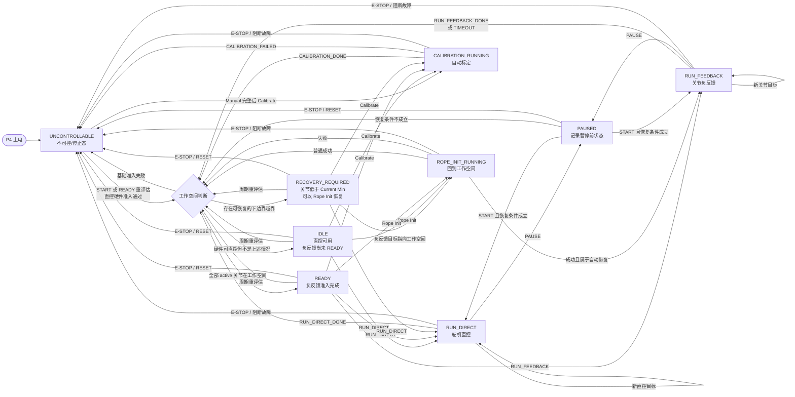
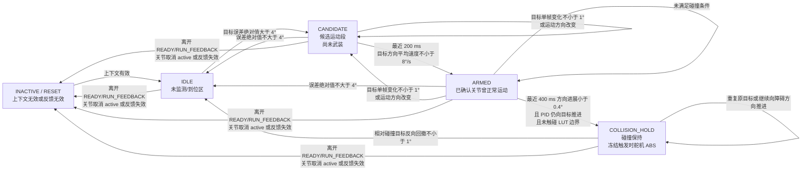

# 当前系统与碰撞检测状态机

本文依据当前 P4 源码整理：

- 总状态机：[StateMachineTask.cpp](../ESP32-P4/ServoBoardMain/src/system/StateMachineTask.cpp)
- 状态定义：[TaskSharedData.h](../ESP32-P4/ServoBoardMain/src/shared/TaskSharedData.h)
- 碰撞小状态机：[FeedbackCollisionGuard.cpp](../ESP32-P4/ServoBoardMain/src/control/FeedbackCollisionGuard.cpp)

## 1. P4 总状态机

### READY 判断

`READY` 不是由一个按钮直接设置，而是由 `idleOrReadyState()` 综合决定：

1. active 电机在线、反馈新鲜且多圈可信。
2. active scope 不为空。
3. Manual、Auto、ABS limit、映射版本和 CRC 均有效。
4. CAN、磁编码器和映射角有效。
5. active 关节进入标定工作空间。
6. 进入下边界容差为 `24 counts`，退出容差为 `48 counts`，连续满足
   `3` 个新磁编样本才改变工作空间锁存状态。

当前没有独立 `FAULT` 状态。运行期间发生阻断故障时，状态机会关闭控制权、
请求舵机急停并进入 `UNCONTROLLABLE`，故障原因保存在 fault bitmap 中。

## 2. 碰撞检测小状态机

该状态机为每个关节各维护一份状态，只在 active 关节且系统处于
`READY/RUN_FEEDBACK`、磁编反馈有效时运行。

### 碰撞状态说明

- `CANDIDATE`：误差已经超过 `4°`，开始保存磁编时间窗，但尚不能判定碰撞。
- `ARMED`：最近 `200 ms` 的目标方向平均速度达到 `8°/s`，证明关节本次确实
  正常运动过，之后才允许判断停滞。
- `COLLISION_HOLD`：武装后最近 `400 ms` 方向进展不足 `0.4°`，同时 PID 仍在
  推进且没有被 LUT 边界钳位。进入时保存相关舵机实际 ABS，此后持续发送该快照。
- 解除 HOLD 必须把目标相对触发碰撞时的目标反向撤回至少 `1°`；重复原目标不会解除。
- 碰撞小状态机不会把总状态改成 FAULT、IDLE 或 READY。正常情况下总状态仍为
  `RUN_FEEDBACK`，上位机通过 `feedback_collision_armed_bitmap` 和
  `feedback_collision_hold_bitmap` 显示关节级状态。
