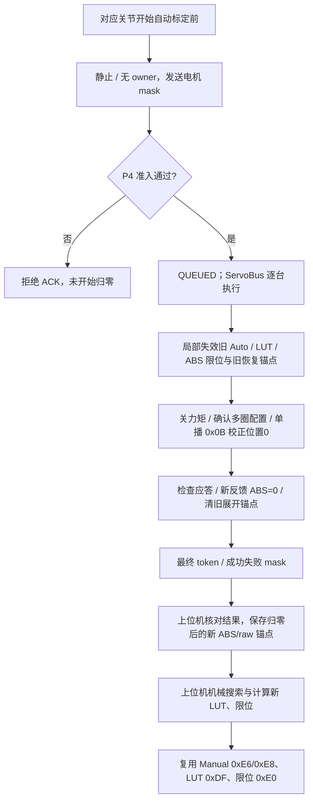

# 标定前硬件与 logical ABS 归零协议

当前状态对照（2026-10-10）：上位机 `desktop/core/host_calibration/` 已使用本协议，在每个当前关节搜索前归零；UI 原 core 入口转向新流程，P4 原自动校准任务保留。完整入口和逐关节写回见 [上位机自动校准实现与对照](上位机自动校准实现与对照.md)。本页分别记录当前自定义位置校正实现与原 RESET 实现的验证。

本协议为自动标定提供归零准备。在对应关节开始机械搜索前，对其电机调用 `FeetechServoDriver::calibrateHardwareAbsolutePosition(id, 0, ...)`：关闭力矩，以 `0x0B` 自定义位置校正指令把舵机实际 **ABS 设为 0**，检查单播应答并读回新反馈，P4 控制与标定直接使用该实际坐标。

2026-10-10 起，标定归零改为直接校正舵机位置，软件坐标平移字段与换算已删除。对外 `logical ABS = hardware ABS`；跨 P4 掉电恢复仍使用现有 JSON 锚点及 `0xDA` 恢复流程。

Direct Control 页使用新增 `0xF1 CMD_MOTOR_ABS_ZERO`。勾选需要处理的电机后点击 **Zero Selected ABS**，仅为这些电机设置当前位置为 ABS 零点，电机位图不扩展到同关节的其他电机。上位机先停止当前输出并等待 P4 静止，再发送请求；P4 复用下面的 `0xF0` 执行事务，以 `0x0B` 校正舵机并验证实际 ABS=0，回传同一 `0x19` 最终结果。上位机等待结果后的新同帧 ABS/raw 反馈及 JSON 锚点保存后报告完成，并刷新对应目标草稿。相关旧 Auto/LUT 和限位失效，Manual 保留。

`0xF1` 请求的业务 payload 同样为非空 27 位电机掩码，不包含目标位置：`FE 06 F1 [motorMask:u32 BE] FF`，例如仅勾选 M09 时为 `FE 06 F1 00 00 02 00 FF`。ACK 中的命令号为 `0xF1`；准入、最终结果、部分失败和超时不自动重发置数的规则与 `0xF0` 一致。这里设置的是当前位置的坐标零点，不发送运动到旧坐标 0 的目标。

事务绑定提交时有效的 P4 设备身份，结果序号必须向前，成功与失败位图的并集必须精确匹配请求。其他设备或未知身份的结果不会完成原事务。超时或取消后，后台仍可在同设备的新反馈保存成功时确认坐标变化；Direct 目标草稿仅根据同设备、同连接会话的已保存反馈刷新，避免混用旧设备或旧时间轴的结果。

首次握手后的 JSON 恢复沿用上位机已有的 `0xDA`：加载对应设备保存的 ABS/raw，在电机在线且坐标 Unknown 时下发最近圈计算后的 ABS。P4 接收执行函数以同一 `0x0B` 指令将目标 ABS 写入舵机，确认应答和新反馈一致后，令 hardware ABS=logical ABS=目标值，再发布原 `0x17` 恢复结果。没有新增上位机/P4 指令或字段；没有保存锚点时不会置数。超出当前舵机硬件可写范围（-30719～30719）或验证失败的电机报告 rejected，保持未恢复。P4 会话内 RAM 热插拔也使用 `0x0B` 实际置数，保留原 LUT 和工作限位。

位置校正可能已生效而应答丢失。为兼容旧 JSON 的 ABS/raw 坐标差异，P4 在实际尝试 `0x0B` 后失败时保留首次目标 ABS，后续同一在线会话的恢复请求继续使用该目标，成功后清除。最多允许三次失败的恢复请求；舵机掉线重连或路由改变后拒绝续接，避免使用已经漂移的 raw 重新计算目标。显式归零等操作建立新的可信坐标后，可重新开始恢复；关力矩或配置阶段失败而尚未尝试校正时，不冻结目标。热插拔存在未确认的置数时拒绝主机恢复；主机接管恢复后撤销旧 RAM 锚点，防止另一恢复路径绕过未决事务。

舵机指令适用于 STS 固件版本 >= 3.10，格式为 `FF FF ID 04 0B POS_LOW POS_HIGH CHECKSUM`，校验码为 ID 到位置高字节之和的低 8 位取反。例如 ID=1、位置=200：`FF FF 01 04 0B C8 00 27`；归零为 `FF FF 01 04 0B 00 00 EF`。HAL 只允许单台在线电机，不使用广播校正。SDK 的 `CalibratePosition(id, position)` 保留指定位置入口；负数沿用当前 STS SDK 的符号位加幅值编码，HAL 仍须读回确认。

## 下行命令：0xF0 CMD_SERVO_REBASE_ZERO

payload 固定 4 字节，不含命令字。电机位图使用大端 `uint32`，bit 0～26 对应 M00～M26。

```text
FE 06 F0 [motorMask:u32 BE] FF
例：仅 M00 → FE 06 F0 00 00 00 01 FF
```

请求必须非空，不允许 M27～M31 高位；所选电机全部在线、路由可控，自动恢复未忙。Known 和 Unknown 电机均可请求。

仅在 `control_enabled=0`、`owner=NONE`，且状态为 `UNCONTROLLABLE / IDLE / READY / RECOVERY_REQUIRED` 时受理。另一设零事务、原有多圈恢复 0xDA 或 Reset Zero 0xEC 未完成时拒绝竞争。P4 接收端和执行端均核验准入；进行中不能进入运动或加载旧标定坐标。

协议 ACK 使用原有 0x06：`QUEUED=2` 仅表示受理；`INVALID_DATA=4` 表示字段或电机范围非法；`UNSUPPORTED_MODE=1` 表示状态或事务冲突。收到 QUEUED 后必须等待最终结果，不能立刻搜索或认为归零成功。

## 上行结果：0x19 PACKET_TYPE_SERVO_REBASE_ZERO_RESULT

业务 payload 固定 120 字节，所有整数为大端。末尾另附标准 4 字节 P4 时间戳；完整帧 128 字节。

| 业务 payload 偏移 | 字段 | 类型 / 含义 |
| ---: | --- | --- |
| 0 | resultToken | u32，本次已完成事务代次 |
| 4 | successMask | u32，0x0B 应答及新反馈确认实际 ABS=0 的电机 |
| 8 | failedMask | u32，请求中未成功的电机 |
| 12～119 | reserved | 108 字节，固定全零，保持既有帧长度；不再保存业务字段 |
| 120～123 | P4 timestamp | u32，标准包尾时间戳，不属于业务 payload |

```text
FE 7E 19 [token:u32] [success:u32] [failed:u32]
         [reserved:108 zero bytes] [timestamp:u32] FF
```

结果独立于 JSON 恢复的 0x17，供 `0xF0` 和 Direct `0xF1` 共用。允许部分电机成功，调用者必须检查掩码。P4 串口发送失败会保留待发送结果；`STATE_SYNC_MULTITURN_STATE=64` 可重发最新结果，包括初始 token=0 的能力报告。丢 ACK 或结果时先查询结果，不能盲目重发位置校正。

## 执行与后续标定



旧坐标失效仅覆盖实际尝试电机关联的关节，Manual 和其他关节保留。校正半成功也不能继续使用旧 LUT。成功电机重新建立可信、清 unknown/overflow；实际尝试后失败的电机置 unknown，等待重试或恢复。不支持该舵机指令或读回不符时报告失败，不以 RESET 降级。执行前门禁拒绝、未尝试的电机保持原坐标。

Python 底层入口为 `comm.send_command(("servo_rebase_zero", motor_mask))`，编码函数为 `build_servo_rebase_zero_cmd()`。业务调用使用 `HandController.rebase_servo_abs_zero(motor_mask)`，它等待 ACK 与独立最终结果，返回 `ServoRebaseZeroResult`：`ok/message/result_token/success_motor_mask/failed_motor_mask`。结果解析器要求保留区全零，拒绝混用旧固件的软件平移结果。

业务入口在命令前阻止旧锚点保存和恢复，在坐标改变后使旧 JSON 坐标失效，再等待新的同帧 ABS/raw 捕获新锚点。该入口不主动发送维护 RESET；调用者应先停止当前运动，使 P4 处于上述静止状态。

新锚点写盘失败时保留捕获任务和恢复阻止位，等待后续反馈重试保存；重连保留未决归零事务及待落盘范围。重试保存或查询结果不会再次发送舵机位置校正。

```python
result = controller.rebase_servo_abs_zero(motor_mask)
if not result.ok:
    raise RuntimeError(result.message)
# 对应关节从新 logical ABS 原点开始机械搜索。
```

此协议补全阶段只新增准备协议与 Python 调用入口；其后的上位机迁移已接入 `HostCalibrationIO.prepare_joint()`，每个关节搜索前调用本协议，随后等待归零结果之后的新 ABS/raw 与 logical range。现有 MCU 自动标定任务仍保留，UI 布局和控件未改。

## 与原协议的区别

| 协议 | 用途 | 当前 logical ABS |
| --- | --- | --- |
| 0xDA RESTORE_MULTITURN | 仅 Unknown 电机以0x0B载入上位机给定ABS，读回确认 | 实际 ABS=上位机给定值 |
| 0xEC SERVO_RESET_ZERO | 维护 RESET 并读取新反馈 | 等于 RESET 后真实读回的 ABS |
| **0xF0 SERVO_REBASE_ZERO** | **对应关节标定前，以0x0B把舵机实际ABS校正为0** | **实际 ABS=0** |
| **0xF1 MOTOR_ABS_ZERO** | **Direct 页面勾选电机，将当前位置设为零点，复用0xF0事务** | **舵机、P4与上位机实际 ABS=0** |

唯一协议编号和长度事实源：[upper_protocol_schema.json](../desktop/resources/config/upper_protocol_schema.json)。执行函数：[FeetechServoDriver.h](../ESP32-P4/ServoBoardMain/src/hal/servo/FeetechServoDriver.h)。

## 自定义位置校正实现的验证（2026-10-10）

全软件检查 951 项通过，无跳过；其中 132 个 native 场景编译生产 SDK、HAL、主机恢复执行函数、Direct 归零接收与执行分支、热插拔恢复及安全策略，并直接包含拓扑生成表，覆盖指定报文、应答异常、实际位置新反馈、旧锚点清除、掉线后的连续在线确认及失败禁运动，也覆盖 JSON 恢复、失败续接保持首次目标、重试上限、恢复路径竞争、路由变化、掉线重上线、RESET 反馈与越界输入。Direct 归零回归另覆盖精确勾选范围、停止确认、取消及部分成功、迟到结果与保存、目标草稿刷新和设备/连接身份隔离。Arduino ESP32 core 3.3.8、ChipVariant=prev3 完整 P4 编译通过；程序占用 445766 字节，静态内存 93660 字节。协议生成文件、产品指纹及架构检查通过。未烧录，真实舵机校正与机械标定仍待真机验证。

## 原 RESET 实现的历史验证记录

ESP32-P4（Arduino ESP32 core 3.3.8、ChipVariant=prev3）完整编译通过。新协议及相关多圈/快照回归 97 项通过，包含新协议 21 项用例；协议生成文件与产品指纹一致性检查通过。

先前全量桌面核心回归为 199 项通过、8 项失败；8 项均已核对为原基线问题，涉及旧 Manual/NVS 状态协议断言及既有桌面架构约束。未烧录硬件，尚未验证真实 RESET、断电恢复与机械搜索。
