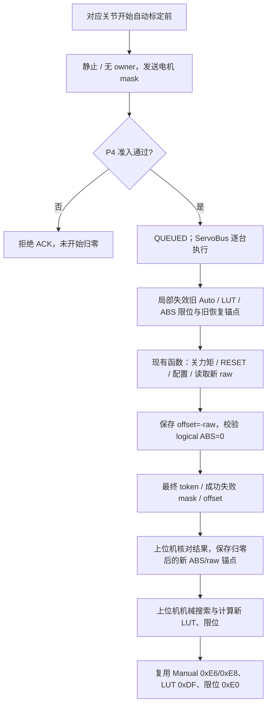

# 标定前 logical ABS 归零与 offset 通信协议

当前状态对照（2026-10-08）：上位机 `desktop/core/host_calibration/` 已使用本协议，在每个当前关节搜索前归零；UI 原 core 入口转向新流程，P4 原自动校准任务保留。完整入口和逐关节写回见 [上位机自动校准实现与对照](上位机自动校准实现与对照.md)。本页后面的验证记录对应之前单独补全归零协议的阶段。

本协议为自动标定迁移到 Python 提供归零准备。在对应关节开始机械搜索前，对其电机调用一次：RESET 硬件圈数，读取新反馈，将当前位置的 **logical ABS 设为 0**，并保存 `logicalOffset = -resetRaw`。复用现有 `FeetechServoDriver::resetTurnCounterAndRestoreLogical(id, 0, ...)`，驱动算法不变。

硬件圈数归零后，hardware ABS 仍等于单圈 raw（0～4095），并非数值 0。对外 logical ABS 为 `hardware ABS + logicalOffset`。offset 保存在 P4 驱动 RAM；跨 P4 掉电仍使用现有上位机 JSON 的 logical ABS/raw 锚点恢复。

## 下行命令：0xF0 CMD_SERVO_REBASE_ZERO

payload 固定 4 字节，不含命令字。电机位图使用大端 `uint32`，bit 0～26 对应 M00～M26。

```text
FE 06 F0 [motorMask:u32 BE] FF
例：仅 M00 → FE 06 F0 00 00 00 01 FF
```

请求必须非空，不允许 M27～M31 高位；所选电机全部在线、路由可控，自动恢复未忙。Known 和 Unknown 电机均可请求。

仅在 `control_enabled=0`、`owner=NONE`，且状态为 `UNCONTROLLABLE / IDLE / READY / RECOVERY_REQUIRED` 时受理。另一设零事务、原有多圈恢复 0xDA 或 Reset Zero 0xEC 未完成时拒绝竞争。P4 接收端和执行端均核验准入；进行中不能进入运动或加载旧标定坐标。

协议 ACK 使用原有 0x06：`QUEUED=2` 仅表示受理；`INVALID_DATA=4` 表示字段或电机范围非法；`UNSUPPORTED_MODE=1` 表示状态或事务冲突。收到 QUEUED 后必须等待最终结果，不能立刻搜索或认为归零成功。

## 上行结果：0x19 PACKET_TYPE_SERVO_REBASE_ZERO_RESULT

业务 payload 固定 120 字节，所有整数为大端。末尾另附标准 4 字节 P4 时间戳；完整帧 128 字节。

| 业务 payload 偏移 | 字段 | 类型 / 含义 |
| ---: | --- | --- |
| 0 | resultToken | u32，本次已完成事务代次 |
| 4 | successMask | u32，RESET、offset 与 logical ABS 校验成功电机 |
| 8 | failedMask | u32，请求中未成功的电机 |
| 12～119 | logicalOffset[27] | 27 个 i32，M00～M26 顺序；仅 successMask 置位项有效 |
| 120～123 | P4 timestamp | u32，标准包尾时间戳，不属于业务 payload |

```text
FE 7E 19 [token:u32] [success:u32] [failed:u32]
         [offset[27]:i32] [timestamp:u32] FF
```

结果独立于 JSON 恢复的 0x17。允许部分电机成功，调用者必须检查掩码。P4 串口发送失败会保留待发送结果；`STATE_SYNC_MULTITURN_STATE=64` 可重发最新结果，包括初始 token=0 的能力报告。丢 ACK 或结果时先查询结果，不能盲目重发硬件 RESET。

## 执行与后续标定



旧坐标失效仅覆盖实际尝试电机关联的关节，Manual 和其他关节保留。RESET 半成功也不能继续使用旧 LUT。成功电机重新建立可信、清 unknown/overflow；实际尝试后失败的电机置 unknown，等待重试或恢复。执行前门禁拒绝、未尝试的电机保持原坐标。

Python 底层入口为 `comm.send_command(("servo_rebase_zero", motor_mask))`，编码函数为 `build_servo_rebase_zero_cmd()`。业务调用使用 `HandController.rebase_servo_abs_zero(motor_mask)`，它等待 ACK 与独立最终结果，返回 `ServoRebaseZeroResult`：`ok/message/result_token/success_motor_mask/failed_motor_mask/logical_offsets`。未成功电机的 offset 为 `None`。

业务入口在命令前阻止旧锚点保存和恢复，在坐标改变后使旧 JSON 坐标失效，再等待新的同帧 ABS/raw 捕获新锚点。该入口不主动发送维护 RESET；调用者应先停止当前运动，使 P4 处于上述静止状态。

新锚点写盘失败时保留捕获任务和恢复阻止位，等待后续反馈重试保存；重连保留未决归零事务及待落盘范围。重试保存或查询结果不会再次发送硬件 RESET。

```python
result = controller.rebase_servo_abs_zero(motor_mask)
if not result.ok:
    raise RuntimeError(result.message)
# 对应关节从新 logical ABS 原点开始机械搜索。
```

此协议补全阶段只新增准备协议与 Python 调用入口；其后的上位机迁移已接入 `HostCalibrationIO.prepare_joint()`，每个关节搜索前调用本协议，随后等待归零结果之后的新 ABS/raw 与 logical range。现有 MCU 自动标定任务仍保留，UI 布局和控件未改。

## 与原协议的区别

| 协议 | 用途 | 当前 logical ABS |
| --- | --- | --- |
| 0xDA RESTORE_MULTITURN | 仅 Unknown 电机恢复保存的 logical ABS；同会话可免重复 RESET | 恢复上位机给定值 |
| 0xEC SERVO_RESET_ZERO | 清硬件圈数，offset 清 0 | 等于 RESET 后 raw |
| **0xF0 SERVO_REBASE_ZERO** | **对应关节标定前设零，始终执行 RESET 并保存 offset** | **当前值为 0，offset=-raw** |

唯一协议编号和长度事实源：[upper_protocol_schema.json](../desktop/resources/config/upper_protocol_schema.json)。执行函数：[FeetechServoDriver.h](../ESP32-P4/ServoBoardMain/src/hal/servo/FeetechServoDriver.h)。

## 验证记录

ESP32-P4（Arduino ESP32 core 3.3.8、ChipVariant=prev3）完整编译通过。新协议及相关多圈/快照回归 97 项通过，包含新协议 21 项用例；协议生成文件与产品指纹一致性检查通过。

先前全量桌面核心回归为 199 项通过、8 项失败；8 项均已核对为原基线问题，涉及旧 Manual/NVS 状态协议断言及既有桌面架构约束。未烧录硬件，尚未验证真实 RESET、断电恢复与机械搜索。
