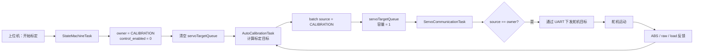
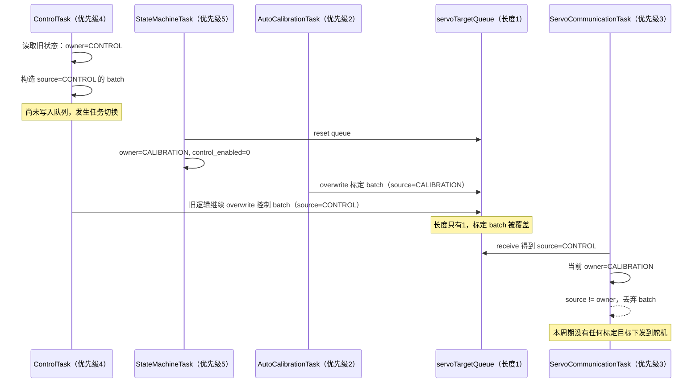
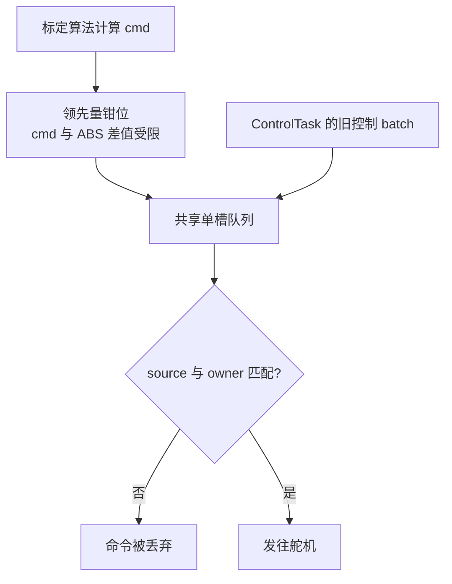
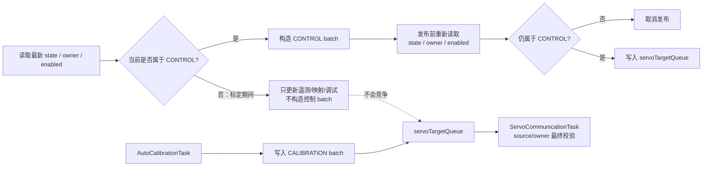

# 自动标定卡顿根因说明：ControlTask 抢占标定舵机目标队列

> 文档状态（2026-08-01）：保留为并发故障复盘。当前架构已通过状态机 owner、命令 generation、ActuatorCommandGateway 唯一入口和容量 1 latest-value 邮箱消除原始抢占路径；正文旧调用链用于解释为何要这样重构，不代表现在仍允许 ControlTask 直写队列。

> 日期：2026-07-12
> 对应修复提交：`5cd297f Fix calibration queue ownership and restore runtime`
> 结论状态：实机验证通过，双电机标定未再出现原先的长时间卡顿

## 1. 一句话结论

这次卡顿的根因不是舵机速度、绳路空程、ABS 跟随能力或 NVS 保存，而是 **`ControlTask` 和自动标定任务同时使用一个长度为 1 的 `servoTargetQueue`，旧版 `ControlTask` 在控制权已经切换给标定任务后，仍可能把 `source=CONTROL` 的 batch 覆盖到队列中，顶掉刚写入的标定命令**。

`ServoCommunicationTask` 发现该 batch 的来源与当前 owner 不一致后会将其丢弃。因此上层日志中的 `cmd` 可以继续变化，但真正送到舵机总线的标定目标发生中断，表现为舵机突然静止数秒，然后又继续运动。

## 2. 相关模块和职责

| 模块 | 任务优先级 | 职责 | 对 `servoTargetQueue` 的操作 |
|---|---:|---|---|
| `StateMachineTask` | 5 | 切换系统状态、`control_enabled` 和目标 owner | 状态切换时清空队列 |
| `ControlTask` | 4 | 负反馈、直控模式下生成普通控制目标 | 写入 `source=CONTROL` batch |
| `ServoCommunicationTask` | 3 | 消费目标并通过舵机总线下发 | 读取 batch，校验 source/owner 后执行 |
| `AutoCalibrationTask` | 2 | 单/双电机自动标定、Side Adjust 等 | 写入 `source=CALIBRATION` batch |

关键代码事实：

1. `servoTargetQueue` 由 `xQueueCreate(1, ...)` 创建，**容量只有一个 batch**。
2. 普通控制和标定都调用 `xQueueOverwrite()`，后写入者会直接覆盖前一个尚未消费的 batch。
3. owner 定义为：`NONE=0`、`CONTROL=1`、`CALIBRATION=2`。
4. 标定开始时，状态机将 owner 设为 `CALIBRATION`，并把 `control_enabled` 清零。
5. 消费端只执行 `batch.source == servo_target_owner` 的 batch，否则丢弃。

## 3. 正常命令链路



正常情况下，队列中的 batch 来源为 `CALIBRATION`，当前 owner 也为 `CALIBRATION`，因此目标会被真正下发。

## 4. 故障是如何产生的

### 4.1 本质：检查与发布之间存在时间窗

旧版 `ControlTask` 在循环前半段读取 `control_enabled`、`system_state` 和 `servo_target_owner`，根据这个快照构造 `source=CONTROL` 的目标；但在循环结尾写队列前，没有再次确认 owner 是否仍然属于 CONTROL。

这属于典型的 TOCTOU 问题：

- Time Of Check：检查时 owner 还是 CONTROL；
- Time Of Use：真正调用 `xQueueOverwrite()` 时，owner 已经变成 CALIBRATION。

### 4.2 一次完整的错误时序



### 4.3 为什么日志里 `cmd` 增长，ABS 却不动

`cmd` 是标定状态机内部计算出的“期望目标”，它增长只能证明 **生产者计算过目标**，不能证明目标已经：

1. 成功进入队列；
2. 没被其他生产者覆盖；
3. 被 `ServoCommunicationTask` 取出；
4. 通过 source/owner 校验；
5. 真正发到 UART；
6. 被舵机执行。

因此原先看到的现象并不是“P4 已经发出目标而舵机不跟”，更准确的说法是：

> 标定算法生成了 cmd，但 cmd 在 P4 内部的共享队列链路中被覆盖或丢弃，没有稳定到达舵机发送端。

双电机标定包含副电机松绳、主电机拉紧、副电机预紧、双电机交换等多个阶段。每个阶段都依赖连续的目标流以及 ABS、load、磁编码器窗口重新建立。一旦关键 batch 被覆盖，状态机就可能等待下一次有效目标和稳定窗口，所以肉眼看到的是数秒级停顿，而不是只有一个 10 ms 周期的抖动。

### 4.4 根因的证据闭环

| 观测或实验 | 能说明什么 | 结论 |
|---|---|---|
| 相同硬件烧录 CUI-dev 固件后双电机标定连续 | 舵机、供电和绳路不是稳定复现卡顿的必要条件 | 优先检查当前 P4 固件独有后台逻辑 |
| 暂停/延后 NVS 保存后仍然卡顿 | Flash 写入不是主要阻塞源 | 排除 NVS 根因 |
| 增加 ABS 领先量钳位后仍然卡顿 | cmd 距离不是决定因素 | 钳位只能保护目标幅度 |
| 标定日志中 cmd 持续增长而 ABS 不跟 | 标定生产者仍在计算 | 故障位于生产者之后，但尚不能直接断言硬件不跟随 |
| 消费端出现 `source=CONTROL`、`owner=CALIBRATION` 的 queue drop | 标定期间存在错误来源 batch，且消费者实际将其丢弃 | 锁定共享队列所有权竞争 |
| 为 ControlTask 增加构造门控和发布前二次校验后，实机卡顿消失 | 修改点与故障结果具有直接因果关系 | 根因闭环成立 |

## 5. 为什么单电机不明显，双电机特别明显

这不代表单电机链路绝对没有竞争，而是双电机更容易把竞争放大成可见故障：

| 对比项 | 单电机 | 双电机 |
|---|---|---|
| 每个 batch 的目标数 | 通常 1 个运动目标 | 常包含运动电机和保持电机 |
| 阶段数量 | 相对少 | 松绳、主拉紧、副预紧、交换等多阶段 |
| 同步条件 | 单路 ABS/load/角度 | 两路 ABS、保持关系、load 和关节角共同判断 |
| 丢失目标后的表现 | 后续目标可能较快接续 | 可能破坏预紧/交换阶段的连续性和稳定窗口 |
| 用户感知 | 短暂停顿不易察觉 | 副电机正转预紧时出现明显长停顿 |

所以 J12、J16、J20 等双电机关节反复暴露问题，是并发问题在复杂阶段中的高概率表现，不是这些关节的舵机硬件恰好同时异常。

## 6. 原来的 ABS 领先量钳位为什么没有解决根因

此前采用的“cmd 最多领先 currentAbs 约 400 counts”解决的是另一个问题：**防止算法目标无限跑在真实位置前方**。



钳位位于“命令内容”层，而本次 BUG 位于“命令所有权和传输仲裁”层。即使 cmd 被完美钳位，只要对应 batch 被覆盖，舵机仍然收不到它。

钳位的实际价值是：

- 限制失联或跟随异常时的目标累积；
- 避免恢复后一次性追赶过远目标；
- 提升机械安全性。

它不能保证：

- batch 一定进入队列；
- batch 不被覆盖；
- 消费者一定执行该 batch。

因此钳位可以保留为安全措施，但不能再被当成队列卡顿的根因修复。

## 7. 最终修复做了什么

### 7.1 构造前阻断

当前 `ControlTask` 只有在以下条件全部成立时才构造普通控制舵机目标：

- `control_enabled != 0`；
- `servo_target_owner == CONTROL`；
- 系统处于 `RUN_FEEDBACK` 或 `RUN_DIRECT`；
- 控制模式与系统运行状态匹配。

标定期间仍允许 ControlTask 更新角度映射、遥测和调试数据，但不允许它成为 `servoTargetQueue` 的生产者。

### 7.2 发布前二次校验

即使循环开始时允许构造目标，写队列前仍重新读取：

- `servo_target_owner`；
- `system_state`；
- `control_enabled`。

只有发布瞬间仍属于 CONTROL，才允许调用 `xQueueOverwrite()`。这关闭了“检查后发生状态切换”的竞争时间窗。

### 7.3 消费端继续做最后防线

`ServoCommunicationTask` 继续检查 `batch.source == owner`。不匹配时不执行目标，并输出低频的 `[SERVO QUEUE DROP]` 日志。

这项检查不是根因修复本身，而是安全防线：宁可丢弃来源错误的命令，也不能在标定期间执行普通控制目标。

### 7.4 修复后的链路



## 8. 不修复会对系统造成什么影响

### 8.1 直接影响

1. **双电机自动标定随机卡顿**：副电机预紧、双电机交换阶段最明显。
2. **标定时间不可预测**：同一硬件、同一关节，有时顺畅，有时停顿数秒。
3. **产生误导性日志**：cmd 在增长而 ABS 不动，容易误判为舵机、UART 或绳路问题。
4. **触发错误的失败条件**：ABS、load、关节角稳定窗口无法按预期建立，可能产生超时、跟随失败或负载未达到。
5. **标定结果重复性下降**：关键阶段不连续会改变负载建立点和采样窗口，影响零点、极限值及 LUT 数据质量。

### 8.2 间接安全风险

消费者的 source/owner 校验阻止了错误控制 batch 被直接执行，所以当前设计更倾向于“停住”而不是“乱转”。但如果为了掩盖卡顿而不断放宽超时、提高步长或删除保护，会引入新的风险：

- 恢复发送后突然追赶较远目标；
- 绳张力建立过快；
- 电机堵转或机构冲击；
- 标定数据在非连续运动下被错误采样。

### 8.3 对正常负反馈的影响边界

在稳定的 `RUN_FEEDBACK + owner=CONTROL` 状态下，普通负反馈本身不会因为此次竞争持续失效。风险主要集中在 **CONTROL 与 CALIBRATION/NONE 之间的模式切换窗口**，以及所有复用标定 owner 和该队列的流程，例如自动标定和 Side Adjust。

## 9. 为什么这么久才发现根因

这部分需要明确复盘：之前的排查确实过多聚焦在“舵机为什么不跟随 cmd”，没有先证明“cmd 是否完整走到了舵机发送端”。

### 9.1 当时为什么容易误判

1. **现象很像机械或舵机跟随问题**：cmd 增长、ABS 不动，直观上会怀疑速度、负载、空程或舵机通信。
2. **早期日志只覆盖生产端**：能看到标定状态机的 cmd、ABS 和 load，但看不到队列中 batch 的 `source`、当前 `owner`、是否被覆盖以及消费者是否真正 apply。
3. **问题具有时序随机性**：同一固件有时卡、有时不卡，且双电机更明显，容易被归因于绳张力差异。
4. **系统中确实还存在其他真实问题**：预紧参数、ABS 领先、NVS 保存、读取范围和串口负担都曾有优化空间，它们干扰了根因判断。
5. **对 CUI 版本的比较起初偏向算法参数**：先比较了速度、步长、阈值和渐进命令，没有第一时间比较“谁有权写目标队列”这一控制面差异。

### 9.2 我在排查方法上的不足

我先使用了 ABS 领先量钳位、PRE_RELEASE_SYNC、发送频率和 NVS 隔离等手段。这些措施分别能提升安全性、阶段同步和诊断能力，但都没有回答最关键的问题：

> 标定任务产生的每一个 batch，是否由同一个 source 原样到达 ServoCommunicationTask 并被执行？

直到加入消费者侧日志、观察到标定期间存在 `source=CONTROL` / `owner=CALIBRATION` 的不一致，并通过 CUI 隔离测试缩小到“当前工程独有的后台生产者”，才把问题定位到 ControlTask 对单槽队列的覆盖。

换句话说，之前是在调整“车速和跟车距离”，但真正的问题是“岔路口有另一辆车把轨道上的车厢替换了”。钳位不是错误措施，但排查顺序应该更早转向命令所有权和端到端交付。

## 10. 以后应该如何引导我更快发现这类 BUG

遇到“上层 cmd 正常、执行端不动作”时，可以直接要求按下面顺序排查，而不是先调参数。

### 10.1 推荐排查指令

可以直接这样描述任务：

> 不要先修改速度、阈值和 ABS 钳位。请从命令生产者到硬件执行端逐级证明链路：列出所有写同一队列的生产者、队列长度和覆盖语义；给 batch 增加或打印 source、owner、sequence、timestamp；在入队、出队、校验、UART apply 四个位置对同一条命令做关联；检查状态切换前后是否存在 TOCTOU；再与已知无故障版本比较任务、队列和所有权逻辑。

### 10.2 必须回答的七个问题

1. 谁生成了 cmd？
2. 有多少个任务能写同一个目标通道？
3. 队列是 FIFO、单槽 mailbox，还是 overwrite 语义？
4. 写入时的 source 和系统 owner 分别是什么？
5. 消费者是否收到同一个 batch？
6. 消费者是执行、覆盖、拒绝还是丢弃了它？
7. UART 实际下发的 target 是否与生产者 cmd 一致？

### 10.3 建议的日志格式

后续诊断最好为每个 batch 增加单调递增的 `sequence`，形成如下关联日志：

```text
[TARGET BUILD] seq=1024 source=CALIBRATION owner=2 target=...
[TARGET QUEUE] seq=1024 overwrite ageMs=0
[TARGET TAKE]  seq=1024 source=2 owner=2 ageMs=3
[TARGET APPLY] seq=1024 bus=... id=... target=...
```

如果 `BUILD` 后没有 `TAKE`，检查覆盖；如果有 `TAKE` 没有 `APPLY`，检查 owner 校验；如果有 `APPLY` 但 ABS 不动，再去检查 UART、舵机和机械端。这样可以快速区分软件内部丢命令与硬件不跟随。

## 11. 后续防回归建议

### 已完成

- ControlTask 构造前检查控制权；
- ControlTask 发布前二次检查 owner/state/enabled；
- 消费端保留 source/owner 校验；
- 保留 `[SERVO QUEUE DROP]` 和 `[SERVO LOOP STALL]` 低频异常日志；
- `SERVO_CALIB_CUI_ISOLATION_TEST` 恢复为 `0`；
- `SERVO_CALIB_TX_APPLY_LOG_ENABLE` 恢复为 `0`，避免持续详细日志增加串口负担；
- 实机重新标定验证，原长时间卡顿消失。

### 建议继续补充

1. 为 `ServoTargetBatch_t` 增加 `sequence`，建立生产到消费的完整关联。
2. 增加并发回归测试：owner 为 CALIBRATION 时，断言 ControlTask 不得写入任何 CONTROL batch。
3. 增加模式切换压力测试：反复执行 READY、负反馈、Rope Init、Calibrate、Stop，检查 queue drop 计数必须为 0。
4. 长期可考虑将 CONTROL 与 CALIBRATION 拆成独立队列，由消费者根据 owner 选择队列，从结构上消除多生产者覆盖同一槽位的问题。
5. 将“参数保护”和“链路正确性”分开验收：ABS 钳位负责安全，owner/queue 负责命令完整交付，两者不能互相替代。

## 12. 代码定位

| 位置 | 说明 |
|---|---|
| `ESP32-P4/ServoBoardMain/src/system/SystemTask.cpp:44` | 创建长度为 1 的 `servoTargetQueue` |
| `ESP32-P4/ServoBoardMain/src/shared/TaskSharedData.h:122` | 定义 NONE/CONTROL/CALIBRATION owner |
| `ESP32-P4/ServoBoardMain/src/shared/TaskSharedData.h:131` | 定义各任务优先级 |
| `ESP32-P4/ServoBoardMain/src/system/StateMachineTask.cpp:839` | 标定开始时清队列、切 owner、关闭普通控制 |
| `ESP32-P4/ServoBoardMain/src/calibration/AutoCalibrationTask.cpp:1278` | 标定 batch 的构造和发布入口 |
| `ESP32-P4/ServoBoardMain/src/control/ControlTask.cpp:871` | 修复后的构造前 owner/state 门控 |
| `ESP32-P4/ServoBoardMain/src/control/ControlTask.cpp:1146` | 修复后的发布前二次校验 |
| `ESP32-P4/ServoBoardMain/src/communication/servo/ServoCommunicationTask.cpp:1794` | 消费 batch、source/owner 校验和 drop 日志 |

## 13. 最终结论

这次 BUG 的核心不是“舵机跟不上”，而是“标定命令没有被可靠交付给舵机发送任务”。

修复的关键也不是继续放宽参数，而是建立并强制执行以下不变量：

> 任意时刻只有当前 `servo_target_owner` 对应的任务可以构造并发布舵机目标；发布前必须重新确认所有权；消费者必须拒绝来源不匹配的 batch。

实机无卡顿结果证明当前修改方向正确。ABS 领先钳位、PRE_RELEASE_SYNC 和异常日志仍有独立价值，但它们分别属于安全保护、阶段同步和诊断工具，不应再与本次队列所有权根因混为一谈。
