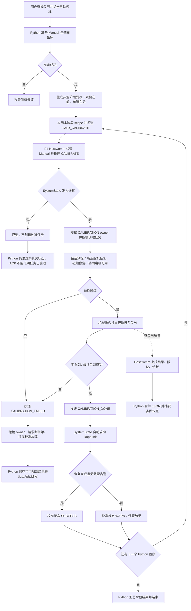
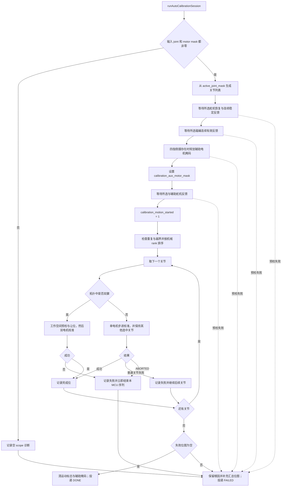
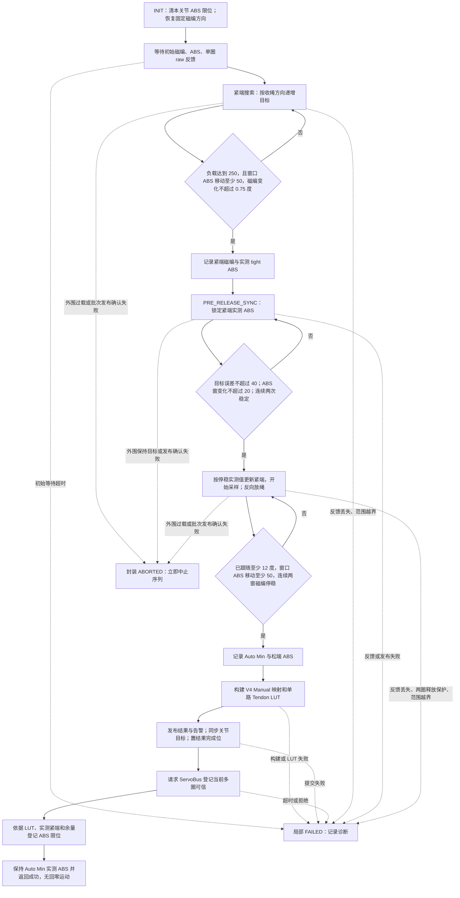
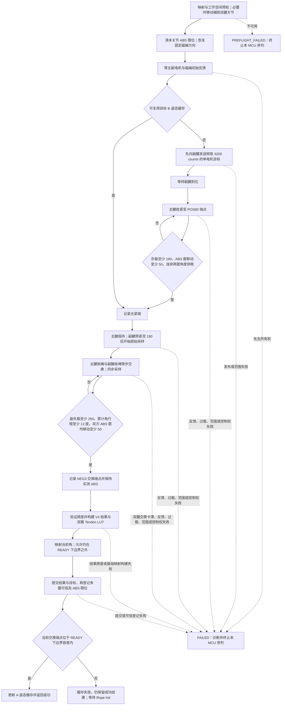
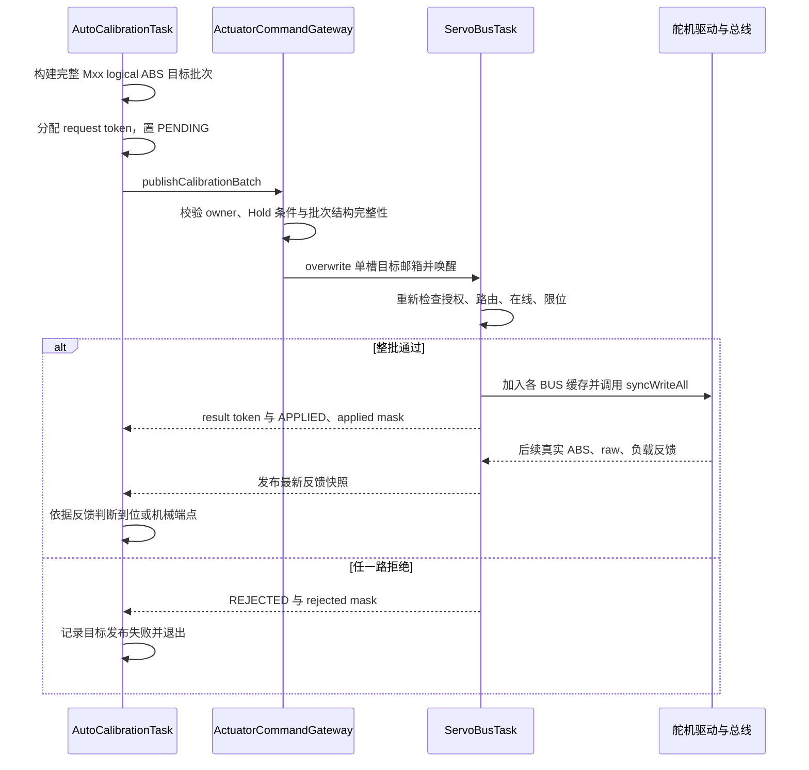

# 自动校准迁移上位机：现行流程、任务入口与接口梳理

核对日期：2026-10-08。机械算法分析基线：`3f52e5d`。本文保留迁移前 P4 自动校准流程和任务接口分析，供算法对照和后续功能剥离使用；下文的“当前”“现行”均指该分析基线，未连接硬件验证。

当前状态对照：机械搜索、工作空间处理和 LUT 计算已迁入 `desktop/core/host_calibration/`，原 UI 的 `begin_calibration()` core 入口已转向 Python；P4 原自动校准任务和 `begin_firmware_calibration()` 旧入口保留。新流程按原机械顺序逐关节运行，搜索前使用 0xF0 归零，成功后各发送一次 Manual 0xE8、LUT 0xDF 和 ABS 限位 0xE0。当前入口、对照表和执行桥见 [上位机自动校准实现与对照](上位机自动校准实现与对照.md)，归零协议见 [标定前 logical ABS 归零协议](标定前逻辑ABS归零协议.md)。

## 1. 功能边界与结论

当前自动校准的机械算法在 **ESP32-P4**，核心目录是 `ESP32-P4/ServoBoardMain/src/tasks/auto_calibration/`。ESP32-S3 负责磁编/触觉采集和 CAN 上报，是校准反馈的来源；没有发现 S3 执行这套自动校准算法的入口。

Python 上位机已经承担请求编排、双腱/单腱分阶段启动、Manual 参考和多圈准备、结果接收、诊断展示、JSON 合并保存及恢复。`CalibrationWorkflowService` 的存在不意味着机械校准已经在 Python：它仍调用 `request_firmware_calibration()`，由 P4 搜索机械端点和构建 LUT。

迁移应把“搜索与计算”从 P4 移到 Python，同时保留 P4 的舵机总线执行、反馈采集、输出所有权、急停、租约、限位和运行数据一致性校验。不能只删掉 `AutoCalibrationTask` 后通过普通电机直控代替它：现行校准有专用输出 owner、辅助电机范围、整批执行确认及多圈可信提交事务。

本文区分三个层次：

| 层次 | 当前实现 | 迁移时需要保留的语义 |
| --- | --- | --- |
| Python 一次用户操作 | `CalibrationWorkflowService.begin_calibration()`，最多拆成双腱、单腱两个阶段 | 阶段顺序、取消、局部结果保存、最终汇总 |
| P4 一次校准会话 | 一个按需创建的 `autoCalibrationTask`，串行执行本阶段的关节 | 会话授权、预检、辅助电机、完成/失败通知 |
| 单关节机械过程 | `SingleMotorCalibrationMachine` 或 `DualMotorCalibrationMachine` | 端点判据、同步保持、原始采样、LUT、结果与多圈提交 |

源码定位：[Python 工作流][py-workflow]、[P4 会话][session]、[总调度][coordinator]、[单电机][single]、[双电机][dual]。

状态转换与入口前置见 [交互 HTML：状态机转换与准入条件](状态机转换与准入条件.html)，包含普通直控、暂停恢复、校准状态入口与运动前预检两道门，以及校准后的 Rope Init 收尾。

## 2. 创建入口与调用链

### 2.1 启动装配与按需创建的区别

```text
ServoBoardMain.ino::setup()
  -> appBootstrapSetup()
    -> assembleAndStartSystem()
      -> 创建共享队列、commandStateMutex、初始化 RAM/Manual/Auto
      -> 创建 HostComm / SystemState / S3CanRx / ServoBus / MotionControl / RuntimeMonitor

收到校准请求后，另行创建：
p4::host::dispatchHostCommand(... CMD_CALIBRATE ...)
  -> postSystemEvent(SYSTEM_EVENT_CALIBRATE)
    -> systemStateTask() -> stepSystemStateCoordinator() 消费 stateEventQueue
      -> handleSystemEvent()                         // SystemEventDispatcher.cpp
        -> startAutoCalibrationTaskRuntime(sharedData)
          -> p4::platform::rtos::createTask(...)     // TaskFactory.cpp
            -> xTaskCreate(autoCalibrationTask, ...)
              -> configureCalibrationRuntimePort(...)
              -> captureCalibrationServiceInput(...)
              -> makeSystemServiceOutputPort(...)
              -> runAutoCalibrationSession(...)
                -> runAutoCalibrationSequence(...)
                  -> runSingleMotorCalibrationMachine(...)
                  或 runDualMotorCalibrationMachine(...)
              -> finishAutoCalibrationTaskRuntime()
              -> vTaskDelete(NULL)
```

`AutoCalibrationTask` **不在开机时常驻创建**。每次 MCU 会话结束后注销运行时监控并清空静态任务句柄，任务自行删除；下次校准请求重新创建。句柄非空时 `startAutoCalibrationTaskRuntime()` 直接返回 `true`，并不创建第二个任务。

| 入口/资源 | 精确位置 | 作用与参数 |
| --- | --- | --- |
| Arduino 启动 | [ServoBoardMain.ino][ino]，`setup` | 转交 `appBootstrapSetup` |
| 全局装配 | [SystemAssembly.cpp][assembly]，`assembleAndStartSystem` | 事件队列容量 8；目标/反馈邮箱主要为单槽快照；创建常驻任务 |
| 命令入口 | [HostCommandDispatcher.cpp][dispatcher]，`CMD_CALIBRATE` 分支，L211 | Manual 门禁后投递事件；返回 `QUEUED` ACK |
| 状态机创建入口 | [SystemEventDispatcher.cpp][events]，`SYSTEM_EVENT_CALIBRATE`，L850 | 检查急停、Host lease/Hold、Manual、可接受状态，授权后创建任务 |
| 生命周期 API | [AutoCalibrationTaskRuntime.cpp][task-runtime]，L18、L44 | `startAutoCalibrationTaskRuntime` / `finishAutoCalibrationTaskRuntime` |
| RTOS 创建 | [TaskFactory.cpp][factory]，`createTask` | 使用 `xTaskCreate`，未在该入口指定 CPU 核 |
| 创建配置 | [TaskConfig.h][task-config] | 名称 `autoCalibrationTask`，优先级 2，栈配置值 8192，参数为 `SystemRuntimeContext*`；8192 是传入 RTOS 的配置值，不在本文推算内存字节数 |
| 业务入口 | [AutoCalibrationTask.cpp][task]，L27 | 注入时钟/等待，执行一次会话，然后自行删除 |
| 会话/序列 | [CalibrationSessionController.cpp][session]，L67；[AutoCalibrationCoordinator.cpp][coordinator]，L37 | 预检、工作空间、逐关节执行、汇总结果 |

### 2.2 上位机触发入口

```text
UI 校准按钮
  -> CalibrationWorkflowController.calibrate()     // ui_control_calibration.py
    -> HandBackend.begin_calibration_workflow()
      -> CalibrationWorkflowService.begin_calibration()
        -> 生成 dual_mask / single_mask 阶段列表
        -> 单工作线程执行 HandController.prepare_calibration_turn_zero(reset_motor_mask)
        -> CalibrationSnapshotStore.invalidate_scope(...)
        -> _start_calibration_phase()
          -> HandController.set_control_mode(ControlMode.JOINT_ANGLE)
          -> HandController.set_active_scope(motor_mask, joint_mask, True)
          -> HandController.request_firmware_calibration()
            -> LowerComputerComm.send_command("calibrate")
            -> TX 线程 LowerComputerComm._encode_command("calibrate")
              -> protocol.build_calibrate_cmd()
            -> SerialTransport.write(...) 并等待新 ACK
            -> P4 HostCommTask -> 状态机准入与任务创建
```

`HandBackend` 构造时创建 `CalibrationWorkflowService`，后者持有 `ThreadPoolExecutor(max_workers=1, thread_name_prefix="mmhand-calibration")`。UI 的门禁包括 Joint Channels 模式、已连接、所选 Manual 有效、安全系统状态，以及辅助双腱不能仅一台在线。`prepare_calibration_turn_zero()` 先发维护 RESET、等 ACK 和 0.30 s，再发异步 SERVO_RESET_ZERO 并等新的结果 token；重置范围会使旧锚点及相关 Auto 快照失效。后台工作流通过执行器运行，UI 通过 Qt Signal、状态观察和工作流事件刷新显示，不直接执行机械搜索。

### 2.3 校准准入及状态所有权

P4 允许从 `UNCONTROLLABLE(0)`、`IDLE(1)`、`READY(5)`、`RECOVERY_REQUIRED(9)` 启动校准；允许从 `UNCONTROLLABLE` 启动是为首次尚无 Auto 结果的情况。`RUN_DIRECT`、`RUN_FEEDBACK`、`PAUSED`、正在校准或 Rope Init 时不在校准准入表中。

准入成功后，状态机清空旧目标邮箱和恢复事务，置：

```text
system_state = SYSTEM_STATE_CALIBRATION_RUNNING (4)
servo_target_owner = SERVO_TARGET_OWNER_CALIBRATION (2)
control_enabled = 0
control_mode = CONTROL_MODE_JOINT
g_calibrationStatus = CALIB_STATUS_RUNNING (1)
calibration_motion_started = 0       // 此时仍是预检
calibration_fault_latched = 0
```

校准 task 本身不直接切换顶层状态。它通过 `ServiceOutputPort.postEvent` 通知 `SystemStateTask`；输出所有权的授予、释放和最终状态由状态机裁决。见 [StateAdmissionPolicy.cpp][admission] L34、[SystemEventDispatcher.cpp][events] L850。

### 2.4 自动校准期间舵机如何受控：绕过 P4 PID，直接发送位置目标

**现行自动校准不经过 P4 的磁编关节 PID、单腱 PID 或双腱 PID。校准任务直接生成每台舵机的 logical ABS 位置目标，附带 speed/acc，经统一执行通道下发舵机位置命令。**

需要区分“直接控制电机位置”这一控制方式与上位机的普通直控协议入口：自动校准在 MCU 内部构造 `ServoTargetBatch_t`，使用 CALIBRATION owner 和专用批次确认；它没有通过发送 `CMD_MOTOR_POS_ABS/ONE` 进入普通 RUN_DIRECT 流程。

| 控制场景 | 目标由谁生成 | P4 PID 与输出路径 | 状态/owner |
| --- | --- | --- | --- |
| 正常关节反馈控制 | MotionControl 根据关节角目标、磁编反馈和 LUT 计算 | 使用关节/双腱 PID 输出生成舵机位置目标，再交 ServoBus 执行 | RUN_FEEDBACK、CONTROL owner、control_enabled=1 |
| 上位机普通电机直控 | PC 下发电机 logical ABS 目标，MotionControl 转为执行批次 | 直控目标不使用关节 PID 输出；由 RUN_DIRECT 路径下发 | RUN_DIRECT、CONTROL owner、DIRECT_MOTOR 模式 |
| 自动校准 | AutoCalibrationTask 内的单/双电机机械算法按阶段推进位置目标 | 跳过 MotionControl 的 PID 计算和目标发布分支，直接发布 CALIBRATION_CONFIRMED 位置批次 | CALIBRATION_RUNNING、CALIBRATION owner、control_enabled=0 |

虽然进入校准时 `control_mode` 仍设置为 JOINT，但这不代表校准走关节 PID。`MotionControlService.cpp` L1124–1136 要求同时满足 `control_enabled`、CONTROL owner 以及相应运行状态，才令 `controlEnabled=true`；L1463–1480 只在该条件为真时进入舵机目标构建/PID 分支。校准期间这些条件不满足，L1950–1958 的再次检查也禁止 MotionControl 发布目标。该任务仍继续刷新磁编映射角和遥测，供 UI/其他消费者读取。

实际执行链为：

```text
单/双电机校准算法生成 logical ABS 位置目标
  -> appendCalibrationServoTarget(... position, speed, acc ...)
  -> publishCalibrationBatch()
       source = CALIBRATION
       purpose = CALIBRATION_CONFIRMED
  -> p4::actuator::publishLatest()
  -> servoTargetQueue + servoBusWake
  -> ServoBus 执行端整批检查路由、状态、在线和可达范围
  -> FeetechServoDriver::setTarget(logicalPosition, speed, acc)
       logical ABS 转换为本次驱动会话 hardware ABS
  -> queueTarget() / syncWriteAll()
  -> SMS_STS::SyncWritePosEx(... Position[], Speed[], ACC[] ...)
  -> 各 BUS 向舵机发送位置目标
```

校准搜索通常按 `400 counts/s` 和实际 elapsed ms 推进位置，名义 20 ms 步长约为 8 counts；speed=400、acc=20 是随位置命令一起传给舵机的参数。主副腱交换时，两台电机的相反收绳增量被放入同一批次；保持姿态同样通过发送固定/当前实测位置目标实现。磁编、实测 ABS 和 load 用于阶段切换、端点判断与保护，没有通过角度误差 PID 生成这些校准目标。

这里“不经过 PID”指**绕过项目 P4 的外部 PID**。底层发送的仍是舵机位置指令；该校准路径没有显示关闭舵机内部位置控制或改为直接 PWM/力矩输出。因此不能把它解释为整个舵机系统无反馈开环，也不能以关闭舵机内部 PID 作为迁移前提。

对迁移的直接影响：Python 应生成同一 logical ABS/speed/acc 校准批次，由 MCU 保留 CALIBRATION owner、整批确认和执行保护；发送普通关节角目标会进入反馈控制路径，不能保持现行机械搜索语义。

源码定位：[MotionControlService.cpp][control-service] L1124、L1463、L1537、L1950；[CalibrationMotionSupport.cpp][motion-support] L605、L661；[ServoBusService.cpp][servo-service] L244；[FeetechServoDriver.h][servo-driver] L323、L333、L355；[SMS_STS.cpp][servo-sdk] L53。

## 3. 现行整体流程图

### 3.1 Python 一次操作与 P4 会话



上图的 Rope Init 是**每次成功的 P4 会话**的收尾，因而双腱阶段成功后会执行一次，然后 Python 才启动单腱阶段。Rope Init 无法启动或执行失败时，校准终态为 `WARN`，数据保留；成功时仍根据装配 warning 位图选择 `SUCCESS/WARN`。最终系统状态还需 `idleOrReadyState()` 判断，不能把收到 `SUCCESS/WARN` 等同于无条件 `READY`。

### 3.2 会话预检与串行调度



`SingleMotorCalibrationMachine` 返回的 `FAILED` 会让总调度继续下一个关节；`ABORTED` 会立即中止。双电机 `PREFLIGHT_FAILED/FAILED` 都立即终止本 MCU 序列。已成功的关节保留，既不整轮回滚，也不自动重新执行失败关节。单电机的具体 ABORT 条件见第 4 节。

### 3.3 实际关节顺序与硬件映射

MCU 的 `autoCalibrationSequenceRank()` 为 `J00..J15 → J20 → J16 → J17 → J18 → J19`，只对本次收到的关节集合排序。Python 不下发排序列表，而是下发 scope 位图。

当前 Python 全选时，先双腱再单腱，因此实际执行序列为：

```text
阶段 1：J00 → J04 → J08 → J12 → J20 → J16 → 自动 Rope Init
阶段 2：J01 → J02 → J03 → J05 → J06 → J07 → J09 → J10 → J11
        → J13 → J14 → J15 → J17 → J18 → J19 → 自动 Rope Init
```

这与根目录 README 中“全手从大拇指到小拇指”的文字不一致。迁移以实际代码为基线，若要调整顺序，应作为独立行为变更。来源：[SequencePlanner][planner] L11、[Python 工作流][py-workflow] L385、[UI scope][py-scope]。

| 关节 | 执行器 | 校准类型 |
| --- | --- | --- |
| J00 / J04 / J08 / J12 | M00/M01、M05/M06、M10/M11、M15/M16 | 四指侧摆双腱；涉及工作空间辅助电机 |
| J16 / J20 | M20/M21、M25/M26 | 拇指双腱；不走四指侧摆让位计划 |
| J01/J02/J03 | M02/M03/M04 | 单腱 |
| J05/J06/J07 | M07/M08/M09 | 单腱 |
| J09/J10/J11 | M12/M13/M14 | 单腱 |
| J13/J14/J15 | M17/M18/M19 | 单腱 |
| J17/J18/J19 | M22/M23/M24 | 单腱 |

物理 BUS 路由由 ServoBus 动态发现，算法用扁平 `Mxx`，不要把 BUS/ID 地址写死到 Python 校准机。腱绳收紧方向和关节角的对抗方向也是两个概念，应使用 [HardwareMap.cpp][hardware] 的统一拓扑与方向转换。

## 4. 单电机校准流程

源码 enum 为 `IDLE/INIT/TIGHTEN/PRE_RELEASE_SYNC/DONE/FAILED`。下图把同一个 `TIGHTEN` 内的 `startFound=false/true` 分支画成两个机械阶段；它们不是两个现存 enum。



每次调用 `stepAutoCalibrationJoint()` 前后的封装还负责检查所有权、追加其他所选关节的保持目标、发布整批目标并等待执行确认。搜索使用实测 `ABS` 和磁编判据；不能以命令 ABS 代替实测 ABS 判断机械端点。

关键行为：

- 收紧端要求“负载高、舵机仍动、磁编停稳”的联合条件，不是负载达到阈值就结束。
- 松绳先把命令目标同步回实测紧端，再反向推进，避免遗留超前命令继续拉绳。若同步时误差仍超过 40 counts，重新锁定实测 ABS 并清稳定计数。
- 释放时同时检查实际释放量与下一条命令释放量，最大 `8192 counts`，防止命令先越界。
- 磁编安装方向恢复为固定方向；实测端点和 V4 Manual/URDF 映射必须分开处理。
- 成功后保持 Auto Min 的实测 ABS，没有单关节回零运动；内部 `zeroServoAbs` 为松端再收绳 500 counts 的构建参考。
- 普通 `FAILED` 可继续其他单腱关节；失去控制权、保持其他关节失败、目标批次发布失败等封装级 `ABORTED` 会停止本 MCU 序列。过载/反馈等故障还可能由顶层状态机先撤销 owner，从而中止后续运动。

来源：[SingleMotorCalibrationMachine.cpp][single]，enum L35、`stepAutoCalibrationJoint` L226、`runSingleMotorCalibrationMachine`；[CalibrationMotionSupport][motion-support]、[CalibrationSafetyPolicy][calib-safety]。

## 5. 对抗双电机与工作空间流程

双电机实现主要是分阶段 `while` 搜索函数及统一运行封装，不能直接描述成与单电机相同的非阻塞 enum 状态机。



`POS80/NEG3` 是源码中的阶段/日志名称，不表示每个关节的最终 URDF 角固定为 `80°/-3°`。当前交换成功条件不要求磁编停稳；副负载达到 250、累计磁编行程不足 12° 且连续两窗角停稳时，走 `DUAL_EXCHANGE_STALLED` 失败路径。交换结束后**已没有额外“主腱补紧”阶段**，统一由会话结束后的 Rope Init 恢复工作空间。

### 5.1 四指侧摆辅助工作空间

`isWorkspaceDualJoint()` 只覆盖 `J00/J04/J08/J12`。辅助电机可能在用户 active scope 之外，通过 `calibration_aux_motor_mask` 扩大 ServoBus 轮询/执行范围，因此“只标一个关节”也可能移动其他侧摆双腱关节。

工作空间子流程由 `buildDynamicWorkspaceMotorMask`、`buildDualWorkspacePlan`、`preflightDualWorkspacePlan`、`prepareWorkspaceForDualCalibration`、`ensureWorkspaceDualPose` 等函数组成：

1. 检查四指侧摆电机对的映射、在线、反馈年龄、多圈状态。
2. 完全离线且非本轮所选的辅助电机对可跳过；半对在线、选中电机离线等不可按可用辅助处理。
3. 比目标编号小的辅助关节按升序进入 A，比目标编号大的按降序进入 B；A 为主腱释放/副腱紧，B 为主腱紧/副腱释放。目标不在辅助计划中；机械执行前先完成目标和整个辅助计划的预检，再依次执行。
4. 复用缓存前比较主副实测 ABS；误差超过 `60 counts` 会使缓存失效，重新从当前实测姿态建立。
5. 冷建立姿态先释放指定腱 `3200 counts`，再紧另一腱到负载 `190`；缓存有效时用已登记目标切换姿态。
6. 序列开始时 `resetDualWorkspaceCalibrationCache()` 清空会话缓存；这是 RAM 机械姿态缓存，不是桌面标定 JSON。

缓存失效后的重新建立属于正常规划分支；代码没有对已经返回失败的整个双腱校准流程自动重试，也没有在辅助动作失败后自动把已移动的关节机械回滚。A→B 先释放副腱 3200 再收主腱至 190，B→A 相反。双腱通用初始反馈等待没有 1200 ms 总超时，主要依靠失去 owner 退出；1200 ms 等待适用于单腱 INIT 和工作空间的相应反馈预检。

来源：[DualMotorCalibrationMachine.cpp][dual]，工作空间 L505 起、机械校准 L1879、运行封装 L2320 附近。具体 A/B 让位计划应按该文件中的 `buildDualWorkspacePlan` 一并迁移，不能只搬主副腱交换循环。

## 6. 与其他任务的全部接口

下表按本任务跨任务边界列出控制、数据、确认、故障和监控接口；纯数学函数不是跨任务接口。大数组数据通过最新快照邮箱共享，任务通知只负责唤醒，不携带业务载荷。

### 6.1 任务接口矩阵

| 对方任务/模块 | 方向与 API/通道 | 数据和当前语义 | 剥离要求 |
| --- | --- | --- | --- |
| HostCommTask → SystemStateTask | `postSystemEvent(CALIBRATE)` → `stateEventQueue` + `systemStateWake` | `SystemEvent_t{event,timestamp,token}`；队列容量 8；命令 ACK 与任务真正启动分离 | 远端会话必须有明确准入结果和会话 ID |
| SystemStateTask → 校准任务 | `startAutoCalibrationTaskRuntime(sharedData)` | 授予校准 owner、设置 RUNNING、清事务；任务参数为共享上下文 | 新 Python 会话仍由 MCU 授权；禁止绕过状态机 |
| 校准任务 → SystemStateTask | `servicePostEvent(output,DONE/FAILED)` → `postSystemEvent` | 完成事件不直接改顶层状态；当前校准调用未携带独立会话 token | 结束/失败必须对应当前会话，处理队列满与迟到事件 |
| SystemStateTask → 校准循环 | `system_state`、`servo_target_owner`、`control_enabled`；`autoCalibrationStillOwnsControl()` | 只有 CALIBRATION_RUNNING、CALIBRATION owner、控制任务关闭时可继续 | 撤销授权后，Python 旧命令必须由 MCU 拒绝 |
| S3CanRxTask → 校准任务 | `canRxQueue.peek()` → `readLatestEncoderSample/Oriented()` | `RemoteSensorData_t`：21 路 raw/error、errorBitmap、完整快照 timestamp/isValid；在线/故障位图来自共享状态；helper 检查快照年龄不超过 300 ms | 时间是 P4 完整帧接收时间，不是逐关节 S3 采样时刻；迁移应明确来源 |
| ESP32-S3 → S3CanRxTask | 磁编/错误 CAN 帧 | S3 是采集端；P4 归并快照与健康状态 | 现有 MCU 采集链保留，不必把传感器驱动移到 PC |
| ServoBusTask → 校准任务：位置 | `servoFeedbackQueue.peek()` → `readLatestMotorServoAbs()` | 27 路 P4 logical ABS、有效位、时间戳；不是舵机 hardware ABS | 必须保留同一 logical ABS 坐标契约 |
| ServoBusTask → 校准任务：单圈 | `servoFeedbackQueue.peek()` 的 `servoRawPositions` → `readLatestMotorServoRaw()` | 单圈 raw 归一化为 `0..4095`；标定 helper 实际不读 `servoRawQueue`；ABS/raw 在 MCU 同一位置快照中提供 | 避免把单圈 raw 当多圈 ABS |
| ServoBusTask → 校准任务：负载 | `servoTelemetryQueue.peek()` → `readLatestMotorServoLoad()` | 飞特有符号 load，算法使用 `loadMagnitude()`；helper 只查队列和在线，不查 timestamp | 保留编码和来源时间；迁移补齐年龄判断 |
| ServoBusTask → 校准任务：恢复/可达范围 | `servo_multiturn_configured_bitmap`、`servo_recovery_pending/failed_bitmap`、`servo_logical_range_valid_bitmap/min/max` | 预检检查在线、已配置、无恢复 pending/failed、新鲜且连续不同 timestamp；ABS 范围固定为硬件范围，恢复使用0x0B实际置数 | 将硬件可达范围与已标定 motor ABS 工作限位分开 |
| 校准任务 → ServoBusTask：机械目标 | `append*Target()` → `publishCalibrationBatch()` → `ActuatorCommandGateway` → `servoTargetQueue.overwrite()` + `servoBusWake` | 最多 27 台；source=CALIBRATION，purpose=CALIBRATION_CONFIRMED；整批原子校验，禁止半批发送 | 暴露专用带 token 的校准批次接口，不能只用普通直控 |
| ServoBusTask → 校准任务：目标 ACK | `calibration_target_*` 原子事务字段 | request/result token，requested/applied/rejected mask，apply status；等待 100 ms；APPLIED 表示整批接受且经过同步写执行路径，不代表每台舵机应答或机械到位 | Python 应等整批执行确认，再依赖反馈判断机械到位 |
| 校准任务 → ServoBusTask：轮询/维护节奏 | `setCalibrationWorkspaceReadMask()` → `calibration_aux_motor_mask`；`calibration_motion_started` | 扩大辅助电机轮询及 requiredMotorMask 对应故障/Hold 范围；运动时暂停后台恢复，结束恢复维护/freshness grace；aux mask 不是已实现的严格目标授权范围 | 新 MCU 会话需验证辅助目标授权及维护恢复时机 |
| 校准任务 ↔ ServoBusTask：多圈可信 | `commitJointServoMultiTurnTrust()` → `calibration_trust_*` | request mask/token；ServoBus 接受当前驱动会话为可信，回写 accepted mask/result token，清 unknown；等待 1000 ms | 多圈可信必须由驱动执行层最终登记，不应仅由 Python 改位图 |
| 校准任务 → MotionControlTask | `commitCalibrationResult()` → `targetAngles[j]`、`joint_command_token`、`motionControlWake` | 用 `commandStateMutex` 同步最终目标；完成映射后唤醒控制任务刷新 mapped angles | 保留 MCU 提交适配器，算法迁出不等于运行映射迁出 |
| 运行结果库 → MotionControlTask | `readAllJointCalibrationRuntimeSnapshots()` | 一致读取 Auto、Manual 和 encoderDirection；用于映射、单腱前馈和双腱 LUT/PID 控制 | 保留 RAM 结果结构和校验后的 LUT 消费接口 |
| 运行结果库 → SystemStateTask | `readJoint/AllCalibrationRuntimeSnapshots()`、ABS limits、warning/fault 位图 | READY/反馈准入和工作空间检查依赖 Auto、Manual、LUT、多圈及限位 | 移除算法时不能移除这些状态门禁 |
| 校准任务/ServoBus → HostCommTask | `calibration_completed_joint_bitmap`、诊断、limits、RAM 结果 | HostComm 增量上报单关节结果、状态、告警、诊断及限位；Python reducer 更新 HandModel | 上位机生成后仍需 MCU 可读回已接受的数据 |
| HostCommTask → RAM 校准数据 | Manual/Calib Load/清标定/Reset Zero/多圈恢复命令 | 修改相关 Manual 或坐标时可使 Auto/LUT 失效；不是只读通信路径 | 保留失效传播，明确新提交与既有加载的差异 |
| SystemStateTask ↔ RopeInitController | `CALIBRATION_DONE` → `beginRopeInitMotion()`；Rope Init DONE/FAILED | Rope Init 共用 CALIBRATION owner 和公共 actuator/calibration 模块；未引用 auto_calibration 专用 helper；SUCCESS/WARN 延后发布 | 先保留 MCU Rope Init，可由新远端会话结束触发现有收尾 |
| HostLeaseSupervisor → 校准/ServoBus | `host_rx_heartbeat_ms`、Hold 状态/token/范围、servo target 队列 | 失联后保持当前实测 ABS；Hold ACK 后取消运动，确认失败请求断扭矩 | 保留 MCU 独立租约；PC 退出/卡顿时也要完成取消 |
| STOP/E-STOP → 校准/ServoBus | `requestEmergencyStop()`、独立 stop token、状态/owner 撤销 | 急停绕过普通事件队列；task 在下次所有权检查退出；不靠跨任务强制删除 task | 保留急停独立通道和过期命令拒绝 |
| Safety/SystemFault → 校准任务 | 在线/故障/overload/Manual/多圈/限位门禁；`CalibrationSafetyPolicy` | 循环与顶层安全监督可同时终止运动；校准诊断映射稳定 SafetyRuleId | 硬件保护仍在 MCU 执行，Python 负责算法诊断补充 |
| 校准任务 → Safety/HostComm | `setCalibrationDiag/IfEmpty/ResultMasks()` | reason/phase/J/M/valueA/B/C/bitmap/timestamp/sequence；不覆盖内层真实根因 | 远端算法需结构化报告失败；禁止只发送一段 UI 文本 |
| 校准任务 ↔ RuntimeMonitor | `taskRuntimeRegister/Unregister(TASK_RUNTIME_AUTO_CALIB)` | 当前主要是任务生命周期/栈观测；未见标定循环调用 MarkLoopStart/End/Period | 删除 task 后更新监控定义，另记录 Python 周期与往返延迟 |
| task 平台 → 校准算法 | `CalibrationRuntimePort{nowMs,waitMs}` | 单调毫秒时钟；MCU 实现为 `monotonicMillis/vTaskDelay` | Python 注入单调时钟和可取消等待，支持离线回放 |

舵机 `ABS/raw/load` 的底层读取 helper **没有统一年龄校验**；500 ms 检查主要存在于恢复和相应双腱/工作空间检查。ServoBus 最终执行门禁使用驱动的 `servo_logical_range` 和转换后的 hardware range；已标定的 `motor_abs_limit` 主要供控制/READY/加载校验使用，不能描述为每条校准批次必由 ServoBus 再按该工作限位检查。

接口事实源：[InterTaskChannels.h][channels]、[CalibrationRuntimeState.h][calib-state]、[CalibrationFeedbackReader][feedback]、[CalibrationMotionSupport][motion-support]、[ActuatorCommandGateway][gateway]、[ServoBusService][servo-service]、[SystemEventDispatcher][events]。

### 6.2 目标发送与确认时序



一槽目标邮箱允许覆盖旧快照；现行机械校准通过 token ACK 等待，避免未确认目标被后续校准批次覆盖。跨串口迁移时，需要重新建立这一握手语义。

### 6.3 数据发布、锁和完成位图

| 数据 | 写方/读方 | 一致性边界 |
| --- | --- | --- |
| Auto + Manual + direction 的单关节快照 | 校准/Manual/Load 发布；Control、State、Host 读取 | `CalibrationRuntimeStore` 的统一短临界区；用 read/publish API，不应跨任务直接拼读全局数组 |
| `motor_abs_limit_min/max/valid_bitmap` | 校准或 Load 等写；MotionControl/State/Host 读 | `SharedSafetyGuard` 成组更新；单个 valid 位不能代表全事务完成 |
| `targetAngles` 和 command token | ResultCommitter 写；MotionControl 读 | `commandStateMutex`，获取等待 10 ms；推进 token 并通知控制任务 |
| `calibration_diag` | 校准/状态机写；Host 读 | `SharedSafetyGuard`，sequence 单调递增；兜底根因不覆盖已有具体根因 |
| target/trust 事务字段 | 校准发请求，ServoBus 回确认 | 原子访问和 token 匹配；状态和 mask 必须属于同一代次 |
| `g_calibrationStatus` | Host/State 等更新，Host 上报 | 持续状态独立于瞬时 ACK；MCU 数值 IDLE=0/RUNNING=1/SUCCESS=2/FAILED=3/WARN=4；Python 另有请求等待态 PENDING |

必须区分两类完成位：

- `calibration_completed_joint_bitmap`：`commitCalibrationResult()` 发布结果并同步目标成功后立即置位，供 Host 增量上报。
- `CalibrationDiagData_t.completedJointMask`：总调度确认该关节 machine 完整返回成功后形成的汇总；失败终态时通过 `setCalibrationDiagResultMasks()` 写入。

当前整条提交顺序为“发布 RAM 结果 → 更新告警 → 同步关节目标/置增量完成位 → 请求多圈可信 → 写 ABS 限位”，**不是涵盖所有步骤的一次原子提交**。某个后续步骤失败时，RAM 可能已有 `success=true` 结果，而总调度仍报告该关节失败。Python 保存还会检查限位、LUT 和映射契约，不能仅看 `success`。

### 6.4 停止、复位与故障接口

| 触发 | 当前处理与终态 | 定位 |
| --- | --- | --- |
| STOP / E-STOP | `requestEmergencyStop()` 先锁存执行门禁并递增 state/servo 两套 token、唤醒两任务；清旧事件/目标、撤 owner。机械搜索取消记 IDLE；校准收尾 Rope Init 被取消时保留结果并记 WARN；task 自行检测失权退出 | [SystemEventDispatcher][events] L85、L496 |
| RESET / Clear Fault | 清命令/队列、撤 owner、断扭矩、清可复位故障和急停锁存，进入 UNCONTROLLABLE；保留既有标定/多圈数据，不伪造可信状态；校准 task 失权退出 | [SystemEventDispatcher][events] L527 |
| PAUSE | 只接受 RUN_DIRECT/RUN_FEEDBACK；校准和 Rope Init 期间拒绝，不能暂停后恢复校准进度 | [SystemEventDispatcher][events] L835 |
| 算法或机械预检失败 | 会话发 FAILED；状态机撤 owner、锁存 calibration fault、断扭矩、UNCONTROLLABLE。新 CALIBRATE 入口会清该校准故障标记，未把先 RESET 设为硬门禁；其他锁存故障仍可能由监督阻断。普通单腱局部失败的序列继续策略见第 3/4 节 | [SystemEventDispatcher][events] L1172、L896 |
| 系统健康故障 | 预检期间豁免 CAN/servo offline 和 unknown 以等待恢复；真实运动阶段只豁免 unknown。其他阻断故障进入 fault hold，撤 owner、锁存故障并断扭矩 | [SystemFaultPolicy][fault-policy]、[SystemStateCoordinator][state-coordinator] |
| Host lease 失联 | 1 s 无有效帧先发当前位置 Hold，Hold ACK 后撤 owner；搜索取消记 FAILED/CONTROL_LOST，校准收尾取消为 WARN；Hold 失败/500 ms 超时升级 E-STOP | [HostLeaseSupervisor][lease]、[SafetyConfig][safety-config] |
| Python `CalibrationWorkflowService.cancel()` | 只递增 epoch 并清 PC 工作流追踪，本身不向 MCU 发 STOP；UI stop/reset 另调用控制器停止与取消工作流 | [Python 工作流][py-workflow] L124、[HandBackend][py-backend] |

普通完成事件在 Hold pending 或系统已离开对应运行态时被忽略。当前没有保存机械子状态供重启继续的接口，也没有外部强制删除校准 task 的常规入口。`CalibrationRuntimePort` 只抽象时钟/等待；算法仍依赖共享上下文、队列、锁和执行层，不是换一个时间回调即可直接在 PC 运行。

### 6.5 外部交接点逐项清单：以整个 auto_calibration 目录为边界

此处将 `tasks/auto_calibration/` 内的任务入口、会话、单/双腱机器、工作空间、采样、提交和诊断视为一个功能整体。以下 R01–R31 是实际调用或直接数据访问；I01–I08 是由公共适配器、状态机或其他任务衔接的外部链路。目录内部的机械阶段调用和 A/B 工作空间缓存不属于外部交接。

#### 6.5.1 直接调用与数据交接：R01–R31

表中 `→` 表示标定功能输出，`←` 表示外部输入，`↔` 表示请求/确认或生命周期交互。`Lxx` 是链接文件中的源码行号。

| 编号 | 交接对象与方向 | 实际入口、函数或字段 | 交接语义、确认及定位 |
| --- | --- | --- | --- |
| R01 | State/RTOS ↔ 任务生命周期 | `startAutoCalibrationTaskRuntime(SystemRuntimeContext*)`、`createTask()`、`finishAutoCalibrationTaskRuntime()`、`vTaskDelete(NULL)` | State 授权后按需创建；传入共享上下文，静态 task handle 防止重复创建；执行结束清 handle、自删除。[TaskRuntime][task-runtime] L18/L29/L44，[Task][task] L43，[State][events] L900 |
| R02 | → RuntimeMonitor | `taskRuntimeRegister/Unregister(TASK_RUNTIME_AUTO_CALIB)` | 登记/注销生命周期；目录内没有标定循环 MarkLoopStart/End/Period 的实际调用。[TaskRuntime][task-runtime] L37/L46 |
| R03 | ← 平台时钟/FreeRTOS 等待 | `CalibrationRuntimePort{nowMs,waitMs}`、`monotonicMillis()`、`vTaskDelay()` | 机械循环通过回调计时和让出 CPU；诊断 timestamp、目标接受时间仍直接调用平台时钟，并未全部经 RuntimePort。[Task][task] L17/L22/L35，[Diagnostics][diagnostics] L42，[Committer][committer] L27 |
| R04 | ← ServiceContextAdapter | `captureCalibrationServiceInput()`、`makeSystemServiceOutputPort()` | 入口快照包含 now、active joint/motor、servo/encoder online、unknown；输出端口连接系统事件。入口快照没有冻结整个会话后续的共享读取。[Task][task] L38/L40，[Adapter][adapter] L85/L130 |
| R05 | ← Host/State 的选择范围 | `active_joint_mask`、`active_motor_mask`、`calibrationSnapshotHasSelection()` | 初始快照要求两个 mask 非零；Planner 再直接读取实时 mask，构成之后固定的关节序列。[Session][session] L80，[Planner][planner] L68/L71，[ServiceCyclePolicy][cycle-policy] L26 |
| R06 | ← State 的运行授权/撤销 | `autoCalibrationStillOwnsControl()` 读 `system_state`、`servo_target_owner`、`control_enabled` | 必须同时满足 CALIBRATION_RUNNING、CALIBRATION owner、control_enabled=0；标定自身不写这三个授权字段，失权后循环协作退出。[MotionSupport][motion-support] L193 |
| R07 | ← S3CanRx/EncoderHealthMonitor 磁编反馈 | `canRxQueue.peek()`；`encoder_online_bitmap`、`encoder_fault_bitmap`、`can_link_online` | 21 路 encoder/error 快照；读 helper 检查有效、在线、无故障、年龄≤300 ms；恢复预检还检查 CAN link 和连续不同 timestamp。timestamp 为 P4 完整帧接收时间。[Feedback][feedback] L28/L36/L49，[MotionSupport][motion-support] L256 |
| R08 | ← ServoBus logical ABS | `servoFeedbackQueue.peek()` → `servoAngles`、online | 校准使用 P4 logical ABS；此基础 helper 不检查年龄。[Feedback][feedback] L72/L81 |
| R09 | ← ServoBus 单圈 raw | 同一 `servoFeedbackQueue.peek()` → `servoRawPositions` | 单圈值归一化到 0..4095；实际不读 `servoRawQueue`；此基础 helper 不检查年龄。[Feedback][feedback] L108/L116 |
| R10 | ← ServoBus 负载 | `servoTelemetryQueue.peek()` → signed `load`、online；`loadMagnitude()` | 此基础 helper 不检查年龄；算法负载幅值采用 `abs(raw)&0x03FF`。[Feedback][feedback] L89/L99，[ServoValue][servo-value] L47 |
| R11 | ← ServoBus 恢复/多圈状态 | `servo_online_bitmap`、`servo_multiturn_configured_bitmap`、`servo_recovery_pending_bitmap`、`servo_recovery_failed_bitmap`、`multi_turn_unknown_bitmap` | 恢复预检结合位置快照年龄≤500 ms、连续 3 个不同 timestamp；工作空间候选另检查 unknown/恢复状态。部分紧端校准路径可用于重新建立 unknown 通道的可信状态。[MotionSupport][motion-support] L237/L364，[Dual][dual] L527/L584 |
| R12 | ← ServoBus 当前会话可达范围 | `servo_logical_range_valid_bitmap/min/max`；`getServoLogicalCommandRange()` | Guard 内读取当前驱动 logical 坐标可达区间，校准目标据此预判；这与 R26/R27 的标定工作限位是两套数据。[MotionSupport][motion-support] L203/L224 |
| R13 | ← 公共标定库的 Manual/方向 | `g_manualEncoderReference`、`g_encoderDirection`、`manualEncoderReferenceEntryCrc()` | LUT、磁编定向和最终角映射直接读全局表；这些 direct reads 没有冻结为一份会话快照。Manual 条目及 CRC 是 Auto 结果身份输入。[Feedback][feedback] L59，[LutBuilder][lut-builder] L102/L108/L342/L349/L354，[Dual][dual] L2203/L2205 |
| R14 | → ServoBus/故障监督的运动阶段 | `calibration_motion_started` | 进入预检置 0，全部预检通过置 1，退出清 0；改变反馈轮询/后台维护节奏及 offline 故障豁免。[Session][session] L74/L131/L140，[ServoBus][servo-service] L996，[FaultPolicy][fault-policy] L94 |
| R15 | → ServoBus/Readiness/Lease 的辅助范围 | `setCalibrationWorkspaceReadMask()` → `calibration_aux_motor_mask` | 加入工作空间辅助电机，扩大反馈轮询、requiredMotorMask 和 Hold 覆盖；退出清零。现有 aux mask 不是最终执行层严格目标授权范围。[Dual][dual] L670，[Session][session] L121/L142，[ServoBus][servo-service] L1072 |
| R16 | → ActuatorGateway/ServoBus 机械目标请求 | `publishCalibrationBatch()` → `p4::actuator::publishLatest()`；写 `calibration_target_request_token/requested_mask`，清 applied/rejected、置 PENDING | 批次携带 Mxx、logical ABS、speed、acc、timestamp、source=CALIBRATION、purpose=CALIBRATION_CONFIRMED；Gateway 经 owner 仲裁后覆盖单槽目标邮箱并唤醒 ServoBus；最终执行层裁决整批。[MotionSupport][motion-support] L661/L678/L700，[Gateway][gateway] L17/L47/L50 |
| R17 | ← ServoBus 机械目标 ACK | `calibration_target_result_token/apply_status/applied_mask/rejected_mask` | 1 ms 轮询，100 ms 超时；token 匹配、APPLIED、applied=requested、rejected=0 才成功。ACK 是软件执行路径确认，不是舵机逐台应答或机械到位。[MotionSupport][motion-support] L708，[ServoBus][servo-service] L285 |
| R18 | → 故障监督的过载状态 | `overload_fault_bitmap`、`overload_fault_load[ch]` | 批次负载幅值≥800，在 Guard 内登记通道和原始 load、写诊断、拒绝整批；读取 load 失败时该通道跳过本次判断。[MotionSupport][motion-support] L558/L575/L582，[FaultPolicy][fault-policy] L65 |
| R19 | → ServoBus 多圈可信请求 | `commitJointServoMultiTurnTrust()`；`calibration_trust_request_mask/request_token`，清 accepted mask | 标定结果提交之后请求驱动接受当前多圈会话为可信；仅改 RAM 结果不完成这一步。[MotionSupport][motion-support] L493/L504/L509 |
| R20 | ← ServoBus 多圈可信确认 | `calibration_trust_result_token/accepted_mask` | 5 ms 轮询，1000 ms 超时；要求 token 匹配且 accepted 覆盖请求。ServoBus 调 `acceptCurrentSessionAsTrusted()` 并清 unknown 后发布结果。[MotionSupport][motion-support] L515，[ServoBus][servo-service] L513/L537/L542/L547 |
| R21 | → 公共标定库的运行期磁编方向 | `setRuntimeEncoderDirection(j,kDefaultEncoderDirection[j])` | 每关节 INIT 恢复固件默认方向；Store 在 Guard 内改 `g_encoderDirection[j]`，影响 Control/Host/Manual 映射，不是机器局部变量。[Single][single] L304，[Dual][dual] L1898，[Store][store] L269 |
| R22 | → 公共 RAM 结果库 | `commitCalibrationResult()` → `publishJointCalibrationResult(j,result)` | Store 在 Guard 内发布完整 Auto/LUT 快照；Control、State、Host、Rope Init 经公共读接口消费。标定目录没有直接访问 `g_jointCalibResult`。[Committer][committer] L39/L49，[Store][store] L65 |
| R23 | → 装配告警/安全事件 | `updateCalibrationAssemblyWarning()` | Store 更新 `calibration_auto_min_offset_counts[j]`、`calibration_warning_bitmap`，并按 warning bit 记录安全事件；Host 上报告警。[Committer][committer] L52，[Store][store] L179/L195/L198/L241 |
| R24 | → MotionControl 的最终关节目标 | `commandStateMutex`、`targetAngles[j]`、`joint_command_accepted_ms`、`joint_command_token` | 最多等待命令锁 10 ms；写最终角目标和 MCU 接受时间，推进 token；这是独立于完整 LUT 发布的另一同步边界。[Committer][committer] L15/L23/L26/L29 |
| R25 | → Host/Rope Init 的增量完成位及 Control 唤醒 | `calibration_completed_joint_bitmap`；`motionControlWake.notify(kMotionTarget)` | 会话开始清完成位；结果发布且目标同步成功才置该关节位；随后唤醒 Control 刷新映射，即使目标同步失败也会唤醒。[Session][session] L75，[Committer][committer] L58/L63，[HostComm][host-service] L532 |
| R26 | → 公共运行状态：撤销旧工作限位 | `clearCalibratedMotorAbsLimitsForJoint()` → `motor_abs_limit_valid_bitmap/min/max` | 每关节 INIT 清该关节执行器 valid 位，并将 min/max 归零；此处没有清旧 Auto 结果或旧装配告警的调用。[MotionSupport][motion-support] L143/L170，[Single][single] L306，[Dual][dual] L1899 |
| R27 | → Control/State/Host：发布新工作限位 | `setCalibratedMotorAbsLimit()`、`setSingleTendonLutAbsLimit()` → 同一 `motor_abs_limit_*` | 多圈可信成功后发布。双腱按实测紧端和搜索窗；单腱按 LUT 松端、实测 tightServoAbs 和余量，并覆盖完整 LUT 包络。[MotionSupport][motion-support] L59/L100，[Single][single] L982，[Dual][dual] L2291 |
| R28 | → State/Host 的最新结构化诊断 | `setCalibrationDiag/IfEmpty/ResultMasks()`、`clearCalibrationDiag()` → `calibration_diag` | Guard 内写 reason、phase、J/M、A/B/C、bitmap、timestamp、sequence、完成/失败 mask；State/Lease 也可写此快照。兜底诊断保留已有具体根因。[Diagnostics][diagnostics] L18/L63/L75/L119 |
| R29 | → SafetyRegistry/EventReporter | `ruleForCalibrationDiagReason()` → `reportSafetyRuleEvent()` | 诊断另映射稳定 SafetyRuleId，输出 rule/A/B/J/M；安全事件与最新 calibration_diag 是不同通道。[Diagnostics][diagnostics] L51/L55，[SafetyEventReporter][safety-reporter] |
| R30 | → SystemState 完成/失败事件 | `servicePostEvent(output,CALIBRATION_DONE/FAILED)` | Adapter 入 `stateEventQueue` 并通知 State；目录内没有直接改顶层状态/status。此调用未处理投递返回值，未绑定独立校准会话 token。[Session][session] L155，[Adapter][adapter]，[State][events] L105/L118/L120 |
| R31 | → Host 串口文本日志 | `FW_LOG_*` → `FirmwareLog` → `HostSerialPort` | 与二进制协议共用串口 mutex；取锁零等待，忙时丢日志；printf 缓冲 256 字节可能截断。日志不承担目标 ACK、可靠诊断或完整采样回传。[FirmwareLog][firmware-log] L73/L79/L83/L88/L99/L103 |

#### 6.5.2 间接交接及反向控制：I01–I08

| 编号 | 外部链路 | 实际交接关系与边界 |
| --- | --- | --- |
| I01 | Python/Host 发起校准 → State 准入 → R01/R06 | `CMD_CALIBRATE` → `postSystemEvent(CALIBRATE)`；Host 的 QUEUED ACK 只表示命令接收路径，State 另做 Manual/状态/租约/急停准入并授予 owner。[HostDispatcher][dispatcher] L211，[State][events] L850 |
| I02 | 持续 status 发布 → Host/Python | `g_calibrationStatus` 由 State/Host 管理；进入 RUNNING，搜索 DONE 转入 Rope Init，收尾才发布 SUCCESS/WARN，失败为 FAILED。标定目录不直接读写该 status。[State][events] L75/L898/L1014/L1194 |
| I03 | STOP/E-STOP/RESET → State/ServoBus → R06 | 独立锁存/token、清目标、撤 owner、断扭矩；校准靠授权检查退出，不直接读 stop token/急停 latch。RESET 清命令和可复位故障，保留标定/Manual/多圈数据。[State][events] L85/L496/L527 |
| I04 | PAUSE 请求 → State 拒绝 | 只允许普通 RUN_DIRECT/RUN_FEEDBACK；校准与 Rope Init 期间没有暂停/恢复进度接口。[State][events] L835 |
| I05 | Host lease → Hold 执行确认 → State 取消 | 无有效帧 1 s 发当前位置 Hold，确认后撤 owner，失败/500 ms 超时升级 E-STOP。标定自身不读 Hold status；Gateway 的 Hold-pending 拦截条件只覆盖 NORMAL purpose，校准用 CALIBRATION_CONFIRMED，现存覆盖窗口需迁移时处理。[Lease][lease] L73/L185/L238，[Gateway][gateway] L38 |
| I06 | SystemFaultPolicy/StateCoordinator → 故障收敛 | 结合 R07/R11/R18 等状态汇总故障；预检/运动阶段豁免不同。State 进入 fault hold、撤 owner、断扭矩，R06 使机械循环退出。[FaultPolicy][fault-policy]，[StateCoordinator][state-coordinator] L102，[State][events] L187 |
| I07 | R30 DONE → State → RopeInitController | `beginRopeInitMotion()` 使用公共结果、完成位及 CALIBRATION owner 完成收尾；Rope Init 没有直接引用 auto_calibration 专用 helper。最终 SUCCESS/WARN 属于这条后续链。[State][events] L1096/L1120，[RopeInit][rope] |
| I08 | R22/R23/R25/R27/R28 → HostComm → Python 模型/存档 | Host 检测完成位、诊断 sequence、限位/状态变化并组帧上报；Python reducer/工作流更新模型、保存 JSON。Manual/Auto Load/清标定/Reset Zero 命令还会改变结果身份或使旧 Auto 失效。标定任务不直接构造协议帧或写文件。[HostComm][host-service] L487/L532/L567，[HostCalibrationHandler][host-calib]，[PythonWorkflow][py-workflow] |

#### 6.5.3 直接共享字段全集与同步边界

对整个 `auto_calibration` 目录的 `sharedData->字段` 实际引用去重，共 **43 项**；按业务分组如下，可作为剥离后的依赖核对清单。

```text
选择范围（R05）：
  active_joint_mask, active_motor_mask
运行授权（R06）：
  system_state, servo_target_owner, control_enabled
反馈及健康/恢复（R07–R11）：
  canRxQueue, servoFeedbackQueue, servoTelemetryQueue
  encoder_online_bitmap, encoder_fault_bitmap, can_link_online
  servo_online_bitmap, servo_multiturn_configured_bitmap
  servo_recovery_pending_bitmap, servo_recovery_failed_bitmap
  multi_turn_unknown_bitmap
当前会话可达范围（R12）：
  servo_logical_range_valid_bitmap, servo_logical_range_min, servo_logical_range_max
运动与辅助范围（R14–R15）：
  calibration_motion_started, calibration_aux_motor_mask
机械目标请求/确认（R16–R17）：
  calibration_target_request_token, calibration_target_result_token
  calibration_target_requested_mask, calibration_target_applied_mask
  calibration_target_rejected_mask, calibration_target_apply_status
过载（R18）：
  overload_fault_bitmap, overload_fault_load
多圈可信请求/确认（R19–R20）：
  calibration_trust_request_mask, calibration_trust_request_token
  calibration_trust_result_token, calibration_trust_accepted_mask
关节命令同步（R24）：
  commandStateMutex, targetAngles, joint_command_accepted_ms, joint_command_token
完成位/唤醒（R25）：
  calibration_completed_joint_bitmap, motionControlWake
标定工作限位（R26–R27）：
  motor_abs_limit_valid_bitmap, motor_abs_limit_min, motor_abs_limit_max
最新诊断（R28）：
  calibration_diag
```

另有两个直接访问的目录外运行期全局：`g_encoderDirection`、`g_manualEncoderReference`。目录外只读表 `kDefaultEncoderDirection`、`kUrdfJointLimits` 分别由 R21、M03 覆盖。目录内的 `g_calibrationRuntimePort`、`g_dualWorkspaceCache` 是本功能内部状态。

`servoTargetQueue/servoBusWake` 经 Gateway 交接；`stateEventQueue/systemStateWake` 经输出 Adapter 交接；`calibration_warning_bitmap/calibration_auto_min_offset_counts` 经 Store 交接；`g_calibrationStatus`、急停 latch 和 Hold status 经 State/执行层交接，均不在上述 43 个直接字段内。

原子访问用于标量和事务 token；`SharedSafetyGuard` 用于限位、诊断、辅助 mask 及公共结果等短临界区；`commandStateMutex` 用于目标和命令时间/token；日志另用串口 mutex。公共结果消费者可用一致 snapshot API；R13 的算法 direct reads 本身未使用这个一致快照边界，移到 Python 时应明确冻结 Manual/方向/模型代次。

#### 6.5.4 目录外模型、纯计算及数据契约

这些依赖没有任务间消息，但剥离算法时同样要迁移或提供一致输入。

| 编号 | 目录外依赖 | 实际接口与迁移约束 |
| --- | --- | --- |
| M01 | HardwareMap 拓扑/坐标方向 | `getJointActuatorGroup/findPrimaryMotorChannelForJoint/isMotorChannelValid/validMotorChannelMask/getMotorTendonShortenAbsSign/motorRawAbsToTendonAbs/motorApplyTendonDelta`；关节-电机映射、拮抗 sign、收绳 sign、磁编安装方向分别定义，不可混用。[HardwareMap][hardware] |
| M02 | 固定维度、算法与任务参数 | Dimensions/Config、CalibrationConfig、TaskConfig；21J/27M、批次/LUT 容量、阈值、步长、等待时间、任务 stack/priority。具体数值见第 8 节。[CalibrationConfig][calib-config]、[TaskConfig][task-config] |
| M03 | URDF/Manual/CRC 映射身份 | `kUrdfJointLimits`、`mapManualScaledEncoderToUrdf/applyManualScaledUrdfMappingToCalibration/manualEncoderReferenceEntryCrc`；Auto V4、生成模型 CRC 和 Manual 条目 CRC 必须与 MCU 一致。Manual 表为 R13 运行期输入。[URDFGenerated][urdf-generated]、[CalibrationMath][calib-math]、[ManualStore][manual-store] |
| M04 | 环形磁编与舵机数值数学 | `calibrationOrientEncoderRaw/calibrationWrapEncoderCount/calibrationWrapEncoderDelta/calibrationForwardEncoderDelta/calibrationEncoderCountToDeg`；`normalizeRawSingleTurn/loadMagnitude`；16384 磁编模、4096 舵机单圈模及负载编码保持一致。[CalibrationMath][calib-math]、[ServoValue][servo-value] |
| M05 | LUT 包络/工作限位计算 | `tendonCalibrationMotorAbsRange/singleTendonCalibrationMotorAbsRange`；后者结合实测紧端，不能简化为只取 LUT min/max。[TendonCalibrationLut][tendon-lut] |
| M06 | 纯安全判据 | `validateCalibrationSequence/calibrationCommandInsideRange/calibrationLoadOverloaded/calibrationReleaseExceeded`；判断本身无状态副作用，写故障、诊断、退出由调用方完成。[CalibrationSafetyPolicy][calib-safety] |
| M07 | 数据结构、枚举与协议 ABI | CalibrationTypes/JointTypes/ServoTypes/ActuatorTypes、ServiceSnapshots、CalibrationRuntimeStore；结果/LUT 格式、reason/phase、owner/purpose、token 和 mask 宽度必须兼容现有二进制 V4 与 JSON V6 契约。[CalibrationTypes][calib-types]、[ActuatorTypes][actuator-types]，协议见第 7 节 |

剥离接口的最小业务闭环是：准入与范围 → 新鲜反馈 → logical ABS 批次与执行确认 → 结果/最终目标/方向/告警/限位/多圈可信提交 → 结束事件与 Rope Init；取消、租约和硬件故障监督贯穿整个会话。上述清单也包含生命周期、同步和日志依赖，便于实际删除 MCU task 时逐项处理。

## 7. 上下位机协议与 Python 可复用能力

### 7.1 当前调用与接收链

业务编排类为 `CalibrationWorkflowService`，公共入口为 `HandBackend.begin_calibration_workflow()`，低层控制器为 `HandController`，通信类为 `LowerComputerComm`。位置：[calibration_workflow.py][py-workflow]、[hand_backend.py][py-backend]、[core_logic.py][py-core]、[comm_layer.py][py-comm]。

```text
SerialTransport.read_available()
  -> LowerComputerComm._rx_loop() / FrameDecoder.feed()
    -> LowerComputerComm._process_packets()
      -> StateReducer.process_packets()
        -> P4PacketRouter 剥离公共 P4 时间并路由
        -> parse_joint_calib_snapshot_packet() / parse_calib_diag_packet()
        -> 更新 HandModel
    -> LowerComputerComm._push_rx_model()
      -> HandController._update_loop()
        -> HandBackend._on_controller_state_update()
          -> CalibrationWorkflowService.observe_state()
            -> 单工作线程 _save_observed_state()
              -> _snapshot_payload() / merge_calibration()
              -> request_multiturn_anchor_capture()
              -> wait_for_multiturn_anchor_capture()
              -> snapshot_saved / phase_complete / calibration_complete
              -> Qt Signal -> UI
```

本阶段 `_start_calibration_phase()` 只发起 MCU 算法；`observe_state()` / `_save_observed_state()` 依据新结果签名、校准状态、完成/失败位图决定局部保存。保存要求：

1. 所选关节有成功的 V4 结果和有效 Tendon LUT。
2. 所属电机 ABS 限位完整。
3. Manual 端点回读完整，所选位均有效。
4. `mappingVersion`、`urdfConfigCrc`、每关节 `manualReferenceCrc` 与当前 Manual/URDF 契约匹配。
5. `CalibrationSnapshotStore.merge_calibration()` 合并所选关节，保留其他关节。
6. 请求并等待对应多圈锚点捕获，保证后续掉电恢复有坐标依据。

`WARN` 仍可进入下一个阶段；`FAILED` 结束后续阶段。局部成功可在 RUNNING 期间增量保存；失败时也会保留满足上述校验的局部成功数据。

### 7.2 当前下行命令与限制

下行帧为 `FE | LEN:u8 | CMD:u8 | PAYLOAD | FF`，`LEN` 包含 CMD、PAYLOAD 和末尾 FF。下表校准相关整数字段和 row 浮点字段使用大端；这不表示其他命令的所有浮点数组都使用大端。

| 命令 | 编号 | payload 字节 | 字段/含义 |
| --- | --- | --- | --- |
| `CALIBRATE` | 0xCA / 202 | 0 | 按当前 scope 运行 MCU 校准；只返回请求 ACK |
| `RESET` / `STOP` / `PAUSE` | 0xCE / 206、0xCD / 205、0xD9 / 217 | 0 | 维护复位/停止/暂停；校准和 Rope Init 不接受 PAUSE |
| `ACTIVE_SCOPE` | 0xD7 / 215 | 9 | motorMask:u32、jointMask:u32、requireCan:u8 |
| `MOTOR_POS_ABS` / `MOTOR_POS_ABS_ONE` | 0xD3 / 211、0xDE / 222 | 108 / 5 | 27 个 logical ABS:i32；或 motor:u8 + ABS:i32；普通直控，不是专用校准批次 ACK 接口 |
| `RESTORE_MULTITURN` | 0xDA / 218 | 112 | motorMask:u32 + logicalAbs[27]:i32 |
| `CALIB_LOAD_JOINT` | 0xDF / 223 | 189 | 单关节 binary V4 row，包含 LUT 与模型/Manual 契约 |
| `CALIB_LOAD_LIMITS` | 0xE0 / 224 | 224 | updateMask:u32、validMask:u32、27 对 min/max:i32 |
| `CLEAR_CALIBRATION` | 0xE5 / 229 | 0 | 清 Auto/LUT/限位，保留 Manual |
| `MANUAL_ENCODER_REFERENCE` | 0xE6 / 230 | 85 | action:u8 + 21 对 minRaw/maxRaw:u16 |
| `MANUAL_ENCODER_QUERY` / `MANUAL_ENCODER_SINGLE` | 0xE7 / 231、0xE8 / 232 | 0 / 5 | 查询 Manual；或 joint:u8 + minRaw/maxRaw:u16 |
| `ROPE_INIT` | 0xE9 / 233 | 4 | jointMask:u32；需对应 active scope 和已有有效 Auto |
| `CLEAR_CALIBRATION_SCOPE` | 0xEB / 235 | 4 | motorMask:u32；只接受已在 restore restored mask 中的电机，并非通用范围清除 |
| `SERVO_RESET_ZERO` | 0xEC / 236 | 4 | motorMask:u32；异步 hardware 圈数归零，须等最终 result token |
| `STATE_SYNC_REQUEST` | 0xED / 237 | 4 | 静态状态请求 mask |
| `HOST_HEARTBEAT` | 0xDC / 220 | 0 | Python 默认每 0.5 s；MCU 1 s 无有效帧进入租约 Hold |

`ACTIVE_SCOPE` 要求 owner=NONE、control_enabled=0 且安全状态，取命令 mutex 后再次检查。Manual 修改还禁止运动/PAUSED，会失效对应关节 Auto、限位与告警。`CALIB_LOAD_JOINT/LIMITS` 禁止在 RUN_DIRECT、RUN_FEEDBACK、CALIBRATION_RUNNING、ROPE_INIT_RUNNING 使用，因此不能用现有 LOAD 命令在校准 owner 下实时提交新结果。

ACK payload 为 `cmd:u8, appliedMode:u8, status:u8, P4time:u32`，其中 appliedMode 在当前 dispatcher 中传的是 system_state。状态为 OK=0、UNSUPPORTED_MODE=1、QUEUED=2、MANUAL_REQUIRED=3、INVALID_DATA=4、MANUAL_CRC_MISMATCH=6、CALIBRATION_REQUIRED=7。Python `AckTracker` 匹配命令号与主机接收时间下界，没有设备 request ID。MCU ACK FIFO 容量 32，满时返回 false；HostComm 在旧 ACK 未发送完成时暂停读取后续命令。校准 dispatcher 未检查事件投递或 ACK enqueue 的返回值。

来源：[protocol.py][py-protocol] L216、L1038、L1109、L1132、[HostCommandDispatcher][dispatcher] L211、L459、L516、[HostCommandRouter][host-router]、[HostAckPublisher][host-ack]、[AckTracker][py-ack]。

### 7.3 上行消息与数据接收

| 消息 | 编号 | 校准依赖与语义 |
| --- | --- | --- |
| SENSOR / ENCODER_RAW | 0x01 / 0x0B | 映射角 / 磁编 raw 与有效状态；算法需要 raw 来源，不能仅采 UI 角度 |
| SERVO_ANGLE / SERVO_RAW / SERVO_TELEM | 0x03 / 0x09 / 0x05 | logical ABS / 单圈 raw / load、speed、current 等；三条独立最新值流 |
| PROTO_ACK | 0x06 | 命令级 ACK，不能替代逐批机械执行确认 |
| SYSTEM_STATUS | 0x0C | state/owner/enabled/mode/calib/fault/scope/在线/Manual/Auto/RopeInit/warning/ResetZero 等 |
| MOTOR_ABS_LIMIT / SERVO_LOGICAL_RANGE | 0x0D / 0x13 | 已标定工作限位 / 当前驱动会话可达范围，含 valid bitmap |
| JOINT_CALIB_SNAPSHOT | 0x0E | 189 字节 row + 13 字节装配告警 + 4 字节 P4 时间；payload 206 字节 |
| CALIB_DIAG | 0x10 | 固定 37 字节；自含 timestamp，没有通用包尾 timestamp |
| MANUAL_ENCODER_REFERENCE | 0x12 | Manual RAM 端点表及元数据 |
| SAFETY_EVENT | 0x16 | 稳定安全规则事件，与校准根因一起定位 |
| MULTITURN_RESTORE_RESULT | 0x17 | 多圈恢复异步结果 |

诊断 37 字节字段顺序为：5 个 u8 `valid/reason/phase/joint/motor`，3 个 i32 `valueA/B/C`，5 个 u32 `bitmap/timestamp/sequence/completedJointMask/failedJointMask`。reason 与 phase 编号和字段含义见 [CalibrationTypes.h][calib-types]。

HostComm 对新 completed 关节增量发送结果；诊断在 sequence 变化时发送；限位/logical range 在 hash 变化或 state sync 时发送。SYSTEM_STATUS 变化或 100 ms 心跳上报。state sync mask 为 Manual=1、ABS limits=2、logical range=4、Auto snapshots=8、route=16、fingerprint=32、多圈状态=64，ALL=127。

来源反馈流按各自源 timestamp 变化上报，**没有形成一次跨磁编/ABS/load 的关联采样事务**。现有 `HandModel` 是最新值合并，迁移算法应建立自己的带来源时间/序号的样本缓存。现有多圈锚点捕获虽然检查数据存在、在线、非 unknown，但没有比较 ABS/raw 两个源 timestamp；不能根据“同帧”注释认为跨包对齐已经保证。

来源：[HostCommService][host-service] L296、L487、L530、[HostTelemetryPublisher][telemetry] L147、L474、L603、[StateReducer][py-reducer] L544、[core_logic.py][py-core] L667、L793。

### 7.4 Binary V4、JSON V6 与加载恢复

`CALIB_LOAD_JOINT` 的 189 字节 payload 布局如下；偏移不含 CMD。LUT 在 JSON/RAM 中是 ABS 数组，在串口中是 anchor + i16 delta 压缩。

| payload 偏移 | 字段 |
| --- | --- |
| 0、1、2 | joint:u8、success:u8、angleMax:f32 |
| 6、10、14、18 | startEncoder、tightEncoder、zeroEncoder、encoderSpan:i32 |
| 22、26、30 | startServoAbs、tightServoAbs、zeroServoAbs:i32 |
| 34、38、42、46、47 | startDeg、tightDeg、totalDeg:f32；scaled:u8；encoderDirection:i8 |
| 48、49、50、51、52、56 | LUT valid/count/motor0/motor1:u8；angleStart/angleStep:f32 |
| 60、64..111 | motor0 anchor:i32、24 个 delta:i16 |
| 112、116..163 | motor1 anchor:i32、24 个 delta:i16 |
| 164、165、169 | mappingVersion:u8（当前 4）、angleMin:f32、urdfConfigCrc:u32 |
| 173、175、177、181、185 | autoMinRaw/autoMaxRaw:u16；manualReferenceCrc:u32；currentMinDeg/currentMaxDeg:f32 |

上行 snapshot 的附加告警从偏移 189 起，包括 reasonMask:u8、minOffset/maxShortfall:i16、Auto/Manual/URDF span 与差值:u16；P4 timestamp 在偏移 202。Python 压缩 delta 超过 i16 时拒绝发送，MCU 上报编码会 clamp；PC 新算法应保持现有包容量或显式升级版本。

MCU LOAD 核对当前 mapping/URDF/Manual 条目 CRC、raw 与方向化端点、电机归属、LUT 和有限数值，使用本地 Manual/URDF 重新计算映射，上传的 currentMin/Max 不会直接作为权威值。加载后状态为 IDLE，主动回传结果并重评 READY，**不会发布“本轮自动校准成功”**。

桌面当前保存为 `desktop/resources/config/calibration_bundle.mmcal.json`，JSON `schema_version=6`；binary row/映射版本 4 和上位协议 schema 版本 1 是不同契约。JSON 包括 hand_profile、URDF/Manual CRC、21 路 Manual/结果、27 路限位、scope、source、SHA256 integrity，以及可选多圈 logical ABS/raw 后备锚点。存储采用临时文件、fsync、复读校验、备份和 replace 合并保存。

启动恢复链先 query/恢复 Manual 并回读确认，等待多圈恢复，校验快照兼容性，再下发 limits，逐关节下发 row。手动导入在 activate 后直接调用 `load_calibration_snapshot()`，该入口本身不等待多圈恢复。现有加载主要依赖逐命令 ACK，没有等待全部 Auto/limit 回读做逐项等值核对；MCU 已主动上报不等于 Python 入口已验证回读。启动恢复无法兼容 Auto 时可只恢复 Manual。导入下装失败时本地选择已经改变。

来源：[protocol.py][py-protocol] L551、L1132、[HostCommandDispatcher][dispatcher] L510、[core_logic.py][py-core] L2001、[calibration_snapshot.py][py-snapshot]、[calibration_workflow.py][py-workflow] L724、L765。

### 7.5 迁移所需数据契约

| 数据 | 当前含义 | Python 算法/MCU 消费必须一致 |
| --- | --- | --- |
| 磁编 raw | 14 bit，`0..16383`，允许跨零 | 保留方向归一化、环形差分与 Manual 端点语义 |
| 舵机 raw | 单圈 `0..4095` | 仅作单圈值/锚点；与 logical ABS 区分 |
| logical ABS | P4 逻辑多圈 counts，1 圈 4096 counts | 硬件 ABS 和逻辑偏移由驱动处理，PC 不自行重写驱动偏移 |
| Manual | 人工松端 minRaw、紧端 maxRaw、valid、条目 CRC | Auto/LUT 绑定该关节 Manual；修改 Manual 必须使受影响 Auto 失效 |
| Auto 端点 | 自动搜索出的 autoMinRaw/autoMaxRaw、span | 表示机械搜索范围，不替代 Manual/URDF 映射参考 |
| V4 结果 | mappingVersion、URDF CRC、Manual 条目 CRC、当前控制角范围、内部轨迹 | LUT 横轴为 Manual 全行程映射的 URDF 角；内部 start/tight/zero 轨迹坐标仅用于诊断/拟合 |
| Tendon LUT | 最多两路执行器、每路最多 24 点、角起点/标称步长/ABS 数组 | 单腱只用第 0 路，第 1 路电机为 0xFF；最后一段可小于标称步长 |
| ABS 限位 | 27 路 valid/min/max，单位 logical ABS counts | 单腱由 LUT 松端、实测 tightServoAbs 和放绳/收紧余量生成，并覆盖完整 LUT 包络；双腱依赖紧端、搜索窗与两路方向 |
| 诊断 | reason/phase/J/M/valueA/B/C/bitmap/time/sequence/result masks | reason 编号及 value 字段意义是协议 ABI，不重新编号或混用 |
| 产品/坐标身份 | hand_profile、URDF 契约、Manual 条目 CRC、多圈锚点 | 新算法结果必须继续兼容当前快照身份校验 |

二进制协议以 [upper_protocol_schema.json][schema] 及生成的 [UpperProtocol.generated.h][generated] 为事实源；扩协议应修改 schema 并运行现有生成链，避免分别手写 Python/C++ 编号。

## 8. 当前关键参数

| 参数 | 默认值 | 使用处/意义 |
| --- | --- | --- |
| 校准循环、窗口、trace | 20 ms、200 ms、200 ms | 公共机械搜索参数 |
| 目标推进速度 / 舵机 speed / acc | 400 counts/s / 400 / 20 | 前者由实测 elapsed ms 积分并保存整数余数，后两者为舵机参数 |
| 窗口 ABS 最小位移 / 角停稳 | 50 counts / 0.75° | 机械端点联合判据 |
| 单腱紧端负载 | 250 | 与 ABS 窗移动、磁编停稳同时成立 |
| 双腱主紧端 / 副预紧 / 副最终负载 | 190 / 190 / 250 | 分阶段阈值，不可合并成一个 tightLoad |
| 过载阈值 | 800 | 校准机械保护；与紧端阈值分离 |
| 单腱最大释放量 | 8192 counts | 两圈；同时检查实测与下一命令 |
| 双腱初始/辅助释放量 | 3200 counts | 副腱准备与工作空间姿态冷建立 |
| 松端/交换最小跟随角 | 12° | 避免尚未实际运动便误判端点 |
| 初始反馈等待 | 1200 ms | 单腱 INIT 与相应工作空间反馈预检；双腱通用初始反馈等待没有该总时限 |
| 舵机预检快照最大年龄 / 磁编样本最大年龄 | 500 ms / 300 ms | 前者用于恢复和相应双腱/工作空间检查；ABS/raw/load helper 本身不统一查年龄 |
| 舵机预检恢复 / 磁编预检恢复 | 5000 ms / 2000 ms | 各自需连续 3 个稳定/有效样本 |
| 目标整批确认 / 多圈可信确认 | 100 ms / 1000 ms | 执行确认和坐标可信是两套事务 |
| 松绳前同步 | 目标误差 40、稳定窗变化 20 counts、连续 2 次 | 消除紧端遗留目标领先 |
| 工作空间缓存匹配 | 60 counts | 主副 ABS 都匹配后才复用 |
| 通用到位容差 | 200 counts | `zeroReachAbsTolerance`，用于相应到位等待 |
| LUT 等角采样 / 原始缓存 / 最终点数 | 5° / 72 条 / 每路最多 24 点 | 不应把 Python 较密采样直接塞入现有二进制布局 |
| 角行程检查 | 至少 10°、小于 359°；近整圈 15360 counts 拒绝 | 结果跨度和回绕有效性检查 |
| 内部 LUT 起点/零点 | -5° / 0° | 内部构建参考，不等于最终各关节 URDF 固定端点 |
| 内部 zero servo 收绳量 | 500 counts | 单腱松端的历史零点构建参考，独立于松端限位余量 500 |
| ABS 搜索窗 / 释放余量 / 收紧余量 | 20480 / 500 / 900 counts | 单腱结合 LUT 松端、实测紧端及完整包络，双腱用紧端搜索窗；不是所有关节同一固定 ABS 范围 |

来源：[defaultAutoCalibrationParams][coordinator] L16、[CalibrationConfig.h][calib-config]。这些是现行默认值；迁移后应先保持判据和单位，再根据串口采样节奏验证，不能假定 PC sleep 20 ms 与当前 RTOS 周期等价。

## 9. 功能剥离建议

以下为迁移建议，尚非当前已实现功能。

### 9.1 代码职责去向

| 文件/功能 | 建议去向 | 保留/替换方式 |
| --- | --- | --- |
| `AutoCalibrationTask`、`AutoCalibrationTaskRuntime` | 最终移除 MCU task | 先保留旧路径用于对照，再改远端校准会话入口 |
| `CalibrationSessionController` | Python 主编排 + MCU 准入适配 | PC 组织步骤，MCU 验证 scope、owner、硬件和租约 |
| `AutoCalibrationCoordinator`、`CalibrationSequencePlanner` | Python | 保持串行次序、失败策略和 J/M 拓扑单一来源 |
| 单/双电机机械搜索 | Python | 可取消状态机，使用时间戳反馈和有 ACK 的同步批次 |
| 双腱工作空间规划/姿态缓存 | Python 规划；MCU 授权辅助范围 | 保留 A/B 计划、离线跳过规则及缓存实测校验 |
| `CalibrationLutBuilder` 和仅用于校准的拟合数学 | Python | 用已有 Manual/URDF 映射；保留 C++/Python 取整与跨零语义对照 |
| `CalibrationFeedbackReader` | MCU 数据快照 + Python 读取适配器 | 串口暴露来源时间/序号/valid/health，不只暴露显示值 |
| `CalibrationMotionSupport` 的目标发布、限位、trust | MCU 原语服务 | 提取远端校准服务需要的逻辑再移除专用 helper；Rope Init 直接共用的是 modules/actuator 和 modules/calibration，不是该 helper 文件 |
| `CalibrationResultCommitter` | MCU 校验/发布适配 | Python 提交候选结果，由 MCU 成组验证、发布、回读 |
| `CalibrationRuntimeStore`、Manual、`TendonCalibrationLut` | MCU 运行消费部分保留 | MotionControl/State/Host/Rope Init 仍依赖；只有校准专用构建代码可拆 |
| `CalibrationDiagnostics` | 双端 | Python 生成算法诊断，MCU 保留执行/硬件诊断和稳定 SafetyRuleId |
| ServoBus/S3CanRx/Gateway/Arbiter/Safety/Lease | MCU | 保留执行和硬件安全边界 |
| RopeInitController | 首轮迁移保留 MCU | 新校准会话 FINISH 触发现行自动收尾，避免扩大本次迁移范围 |
| Python Workflow/Snapshot/Diagnostics/Logger/UI | 上位机复用 | 将固件校准请求替换为新算法 runner，继续复用存档与显示 |

### 9.2 需要设计的最小远端接口

建议定义下列能力，具体命令名称和编号待 schema 设计。它们**不是当前可调用的协议命令**。

| 新能力 | 输入 | MCU 返回/责任 |
| --- | --- | --- |
| BEGIN 校准会话 | session ID、所选 joint/motor scope、候选辅助 scope、模型/Manual 身份 | 准入结果、授权范围、会话代次；切到校准状态和 owner；暂不自动运行旧算法 |
| 校准反馈订阅/查询 | session、joint/motor mask、所需采样周期 | raw 磁编、logical ABS、单圈 raw、load、各来源时间/序号、valid/online/fault/recovery 位图 |
| 校准原子目标批次 | session、batch token、Mxx/ABS/speed/acc；包括动腱和保持腱 | 执行 APPLIED/REJECTED、applied/rejected mask、执行时间；执行层继续检查所有权/边界 |
| 辅助范围更新 | session、辅助 motor mask | 验证拓扑、在线、可信、范围后授权并扩大轮询 |
| 单关节结果提交 | session、joint ID、V4 结果/LUT/限位/身份、最终目标、提交 token | 完整校验、发布、目标同步、多圈可信登记及限位确认；成功后读回一致结果 |
| FAIL/CANCEL/FINISH | session、原因/诊断、已完成/失败/未执行 mask、结束 token | 取消拒绝旧目标；区分算法故障与取消；FINISH 可启动 Rope Init；回报终态 |
| 心跳与急停 | 继续复用现有独立通道 | 心跳无需依赖算法循环；急停不因目标队列拥塞而丢失 |

每条会改变运动的命令必须绑定会话代次，并区分“协议接收”“状态准入”“执行批次接受”“机械到位”“结果完整提交”五种确认。现有 `QUEUED` 或普通 ACK 不能同时承担这些含义。

### 9.3 建议实施顺序

1. 冻结当前单/双腱流程、输入记录和输出格式，先建立可复现回放样例。
2. 提取 Python 纯算法 runner 与数据适配器，保留现有 UI/Workflow 的阶段和保存行为。
3. 增加 MCU 远端会话、反馈订阅、校准批次 ACK 原语，保留旧校准 task 作对照。
4. 增加校验后单关节提交、trust/限位确认与结束接口，再连通 Python runner。
5. 对照两条路径的采样、端点、LUT、限位、告警、取消及 Rope Init 行为。
6. 达到验收条件后移除 MCU 机械算法与 task，收窄共享接口、监控槽位和旧命令；保留运行数据消费者。

## 10. 迁移前需要核对的现状差异

这些是静态代码分析发现的边界或可能风险，尚未实机复现；本次未修改它们。

| 项目 | 当前源码证据 | 对迁移的影响 |
| --- | --- | --- |
| 全手顺序与 README 不一致 | Python 先 dual 后 single；MCU `autoCalibrationSequenceRank` | 先确认保持当前行为还是另行改顺序 |
| 双腱注释与实际顺序不一致 | 双腱 L1876 注释写主紧端后副松且有“主补紧”；实现为副先松再主紧，L2125 明确取消补紧 | 移植实际分支，不能照旧注释补回机械动作 |
| 双腱 LUT 构建失败未直接终止 | 双腱 L2192 得到 `lutBuilt`，L2250 只打印，L2260 仍提交 | 与单腱/上位机“必须有效 LUT”契约不一致；决定迁移时的失败策略 |
| 单槽 Hold 可能被确认校准批次覆盖 | Gateway 防覆盖分支只判 NORMAL；校准批次为 CALIBRATION_CONFIRMED；所有权检查不含 Hold pending | 需要验证这段窗口，并使新协议明确禁止 Hold 后旧会话继续发布 |
| 结果、目标、trust、限位不是整组原子事务 | ResultCommitter L49 起先发布结果，状态机后续再 trust/limit | 新提交接口需明确提交完成点和失败时的数据有效性，不只返回 result.success |
| scope 推断回退在当前会话链不可达 | Planner 允许只由 motor mask 推断 joint；Session 先要求两个 mask 非零 | Python/MCU scope 契约要一致，不能认为空 joint mask 当前可校准 |
| workspace 对目标 TURN_UNKNOWN 的门禁存在差异 | 动态 mask 预检允许特定目标 unknown；机械预检 `waitWorkspaceFeedbackKnown` 仍拒绝 unknown | 要核实首次/重建校准的预期路径，避免 PC 复刻矛盾门禁 |
| `QUEUED` 未保证事件已入队，ACK 本身也可能未入 FIFO | Dispatcher L219 忽略 `postSystemEvent()` 返回值；发送 ACK 的返回值也未检查；ACK FIFO 容量 32 | 区分事件满与 ACK 满；新协议回报真实准入并有 request ID |
| 校准终态投递缺少错误处理/会话代次 | Session L155 未检查 `servicePostEvent()` 返回值；当前 DONE/FAILED 未用独立会话 token | 新结束事务应有 ACK、幂等和代次匹配 |
| 多个机械等待/搜索没有总时限 | 双腱到位/工作空间/搜索 while，单腱同步/搜索依赖 owner、反馈、边界等退出 | PC runner 应设计独立阶段/会话时限；引入时限属于行为变更需验证 |
| 舵机机械读取缺少统一年龄检查 | FeedbackReader 的 ABS/raw/load helper 只查 queue/online；磁编 helper 才有每次年龄门禁 | 新算法需处理旧值、重复值与跨流同步，不能只复用 HandModel 最新值 |
| raw 轨迹注释与环形实现不同 | LutBuilder.h 将 encoder 描述为连续坐标，但 cpp 的差分和缓存使用 16384 模运算 | Python 移植实际 wrap 规则，不按注释当作无限累计角 |
| trust 超时诊断值有调用点差异 | MotionSupport 的 trust 等待使用 SERVO_RECOVERY_TIMEOUT，实际 A/B/C 为 token/resultToken/acceptedMask | 与通用恢复 mask 注释不同；核对 reason、phase 和调用点 |
| runtime monitor 注释强于实际埋点 | auto_calibration 主要 register/unregister，未见循环 MarkLoopStart/End | 不应把现有周期指标当作完整算法时序测量 |

## 11. 剥离验收清单

本节是后续实施的验收建议，不表示本次已执行测试。

- [ ] 相同 raw 输入下，C++ 与 Python 的跨零方向、Manual/URDF 映射、整数取整、端点和 LUT 输出一致。
- [ ] 保持双腱→单腱阶段顺序、关节串行排序和辅助让位计划；普通单腱失败与封装级中止的差异有覆盖。
- [ ] 一个目标批次中任一路非法时整批拒绝；APPLIED 与机械到位分别检查；迟到/重复 ACK 与旧会话命令不影响新会话。
- [ ] 在初始等待、收紧、同步、释放、交换、提交、Rope Init 各阶段取消/E-STOP/断开串口，MCU 均能独立撤销运动授权。
- [ ] Host lease Hold 后旧校准目标不能覆盖保持目标；Hold 失败时断扭矩。
- [ ] 反馈延迟、乱序、重复、无新样本、磁编故障、舵机掉线、多圈未知、半对辅助电机在线均有确定结果。
- [ ] 保留单腱两圈释放保护、过载、ABS 窗和拓扑方向检查；Python 卡顿后不一次累积发送超大步长。
- [ ] 单关节提交中 target/trust/limit 任一失败，不会让 READY、JSON 或反馈控制误用不完整结果。
- [ ] Manual 改动、Reset Zero、Calib Load、多圈恢复仍正确使受影响的 Auto/LUT 失效或恢复。
- [ ] 双腱交换端点在 READY 窗外时可保留结果；Rope Init 成功/告警/失败与 SUCCESS/WARN 状态关系保持清晰。
- [ ] 失败时区分成功、失败、未执行关节；逐关节存档、多圈锚点及再次连接后的恢复链完整。
- [ ] 移除 MCU 校准 task 后，Control、State、Host、Rope Init 的编译依赖和运行结果消费接口仍完整。

后续可复用的现有测试包括：`tests/desktop/core/test_calibration_workflow.py`（阶段切换、WARN/FAILED）、`tests/desktop/core/test_calibration_snapshot.py`（局部合并）、`desktop/tests/test_calibration_snapshot_v4_protocol.py`（V4 row）、`tests/desktop/core/test_calibration_diag_protocol.py`（诊断与位图）、`desktop/tests/test_state_sync_protocol.py`（同步范围）。本次为文档分析，未运行这些测试。

## 12. 源码导航

以下链接指向此次核对的当前文件。文中行号为基线 `3f52e5d` 的定位提示，后续编辑以符号名为准。

| 范围 | 文件 |
| --- | --- |
| 启动/任务 | [ServoBoardMain.ino][ino]、[SystemAssembly.cpp][assembly]、[TaskFactory.cpp][factory]、[TaskConfig.h][task-config]、[AutoCalibrationTask.cpp][task]、[AutoCalibrationTaskRuntime.cpp][task-runtime] |
| 会话/序列 | [CalibrationSessionController.cpp][session]、[AutoCalibrationCoordinator.cpp][coordinator]、[CalibrationSequencePlanner.cpp][planner] |
| 单/双腱算法 | [SingleMotorCalibrationMachine.cpp][single]、[DualMotorCalibrationMachine.cpp][dual] |
| 算法端口/辅助 | [CalibrationFeedbackReader.cpp][feedback]、[CalibrationMotionSupport.cpp][motion-support]、[CalibrationLutBuilder.cpp][lut-builder]、[CalibrationResultCommitter.cpp][committer]、[CalibrationRuntimePort.h][runtime-port]、[CalibrationCoordinatorPort.h][coordinator-port] |
| 诊断/平台日志 | [CalibrationDiagnostics.cpp][diagnostics]、[SafetyEventReporter.cpp][safety-reporter]、[FirmwareLog.h][firmware-log] |
| 运行数据 | [CalibrationRuntimeStore.h][store-h]、[CalibrationRuntimeStore.cpp][store]、[ManualEncoderReferenceStore.cpp][manual-store]、[TendonCalibrationLut.cpp][tendon-lut]、[CalibrationRuntimeState.h][calib-state]、[CalibrationTypes.h][calib-types]、[ActuatorTypes.h][actuator-types] |
| 通道/适配 | [InterTaskChannels.h][channels]、[ServiceContextAdapter.cpp][adapter]、[SystemEventPort.h][event-port]、[ActuatorCommandGateway.cpp][gateway]、[ActuatorCommandArbiter.cpp][arbiter] |
| 对方任务 | [SystemEventDispatcher.cpp][events]、[SystemStateCoordinator.cpp][state-coordinator]、[RopeInitController.cpp][rope]、[HostLeaseSupervisor.cpp][lease]、[ServoBusService.cpp][servo-service]、[S3CanRxService.cpp][can-service]、[MotionControlService.cpp][control-service] |
| 舵机位置命令执行 | [FeetechServoDriver.h][servo-driver]、[SMS_STS.cpp][servo-sdk] |
| MCU 通信 | [HostCommandDispatcher.cpp][dispatcher]、[HostCalibrationCommandHandler.cpp][host-calib]、[HostTelemetryPublisher.cpp][telemetry]、[HostProtocolCodec.cpp][host-codec] |
| 通信队列/门禁 | [HostCommService.cpp][host-service]、[HostCommandRouter.cpp][host-router]、[HostAckPublisher.cpp][host-ack]、[AckTracker][py-ack] |
| 安全/配置 | [CalibrationSafetyPolicy.cpp][calib-safety]、[StateAdmissionPolicy.cpp][admission]、[CalibrationConfig.h][calib-config]、[HardwareMap.cpp][hardware] |
| 公共算法/模型 | [CalibrationMath.cpp][calib-math]、[ServoValue.h][servo-value]、[UrdfJointLimits.generated.h][urdf-generated]、[ServiceCyclePolicy.cpp][cycle-policy] |
| Python | [ui_control_calibration.py][py-ui]、[ui_control_scope.py][py-scope]、[core_logic.py][py-core]、[hand_backend.py][py-backend]、[calibration_workflow.py][py-workflow]、[comm_layer.py][py-comm]、[calibration_snapshot.py][py-snapshot]、[calibration_diagnostics.py][py-diag]、[auto_calib_logger.py][py-logger] |
| Python 通信/模型 | [protocol.py][py-protocol]、[data_models.py][py-model]、[packet_router.py][py-router]、[state_reducer.py][py-reducer] |
| 协议单一数据源 | [upper_protocol_schema.json][schema]、[UpperProtocol.generated.h][generated]、[generate_upper_protocol.py][generator] |

[ino]: ../ESP32-P4/ServoBoardMain/ServoBoardMain.ino
[assembly]: ../ESP32-P4/ServoBoardMain/src/app/SystemAssembly.cpp
[factory]: ../ESP32-P4/ServoBoardMain/src/platform/rtos/TaskFactory.cpp
[task-config]: ../ESP32-P4/ServoBoardMain/src/config/TaskConfig.h
[task]: ../ESP32-P4/ServoBoardMain/src/tasks/auto_calibration/AutoCalibrationTask.cpp
[task-runtime]: ../ESP32-P4/ServoBoardMain/src/tasks/auto_calibration/AutoCalibrationTaskRuntime.cpp
[session]: ../ESP32-P4/ServoBoardMain/src/tasks/auto_calibration/CalibrationSessionController.cpp
[coordinator]: ../ESP32-P4/ServoBoardMain/src/tasks/auto_calibration/AutoCalibrationCoordinator.cpp
[planner]: ../ESP32-P4/ServoBoardMain/src/tasks/auto_calibration/CalibrationSequencePlanner.cpp
[single]: ../ESP32-P4/ServoBoardMain/src/tasks/auto_calibration/single_motor/SingleMotorCalibrationMachine.cpp
[dual]: ../ESP32-P4/ServoBoardMain/src/tasks/auto_calibration/dual_motor/DualMotorCalibrationMachine.cpp
[feedback]: ../ESP32-P4/ServoBoardMain/src/tasks/auto_calibration/CalibrationFeedbackReader.cpp
[motion-support]: ../ESP32-P4/ServoBoardMain/src/tasks/auto_calibration/CalibrationMotionSupport.cpp
[lut-builder]: ../ESP32-P4/ServoBoardMain/src/tasks/auto_calibration/CalibrationLutBuilder.cpp
[committer]: ../ESP32-P4/ServoBoardMain/src/tasks/auto_calibration/CalibrationResultCommitter.cpp
[runtime-port]: ../ESP32-P4/ServoBoardMain/src/tasks/auto_calibration/CalibrationRuntimePort.h
[coordinator-port]: ../ESP32-P4/ServoBoardMain/src/tasks/auto_calibration/CalibrationCoordinatorPort.h
[store-h]: ../ESP32-P4/ServoBoardMain/src/modules/calibration/CalibrationRuntimeStore.h
[store]: ../ESP32-P4/ServoBoardMain/src/modules/calibration/CalibrationRuntimeStore.cpp
[manual-store]: ../ESP32-P4/ServoBoardMain/src/modules/calibration/ManualEncoderReferenceStore.cpp
[tendon-lut]: ../ESP32-P4/ServoBoardMain/src/modules/calibration/TendonCalibrationLut.cpp
[calib-state]: ../ESP32-P4/ServoBoardMain/src/runtime/state/CalibrationRuntimeState.h
[calib-types]: ../ESP32-P4/ServoBoardMain/src/data/CalibrationTypes.h
[actuator-types]: ../ESP32-P4/ServoBoardMain/src/data/ActuatorTypes.h
[channels]: ../ESP32-P4/ServoBoardMain/src/runtime/channels/InterTaskChannels.h
[adapter]: ../ESP32-P4/ServoBoardMain/src/runtime/adapters/ServiceContextAdapter.cpp
[event-port]: ../ESP32-P4/ServoBoardMain/src/runtime/ports/SystemEventPort.h
[gateway]: ../ESP32-P4/ServoBoardMain/src/modules/actuator/ActuatorCommandGateway.cpp
[arbiter]: ../ESP32-P4/ServoBoardMain/src/modules/actuator/ActuatorCommandArbiter.cpp
[events]: ../ESP32-P4/ServoBoardMain/src/tasks/system_state/SystemEventDispatcher.cpp
[state-coordinator]: ../ESP32-P4/ServoBoardMain/src/tasks/system_state/SystemStateCoordinator.cpp
[rope]: ../ESP32-P4/ServoBoardMain/src/tasks/system_state/RopeInitController.cpp
[lease]: ../ESP32-P4/ServoBoardMain/src/tasks/system_state/HostLeaseSupervisor.cpp
[servo-service]: ../ESP32-P4/ServoBoardMain/src/tasks/servo_bus/ServoBusService.cpp
[can-service]: ../ESP32-P4/ServoBoardMain/src/tasks/s3_can_rx/S3CanRxService.cpp
[control-service]: ../ESP32-P4/ServoBoardMain/src/tasks/motion_control/MotionControlService.cpp
[dispatcher]: ../ESP32-P4/ServoBoardMain/src/tasks/host_comm/HostCommandDispatcher.cpp
[host-calib]: ../ESP32-P4/ServoBoardMain/src/tasks/host_comm/HostCalibrationCommandHandler.cpp
[telemetry]: ../ESP32-P4/ServoBoardMain/src/tasks/host_comm/HostTelemetryPublisher.cpp
[host-codec]: ../ESP32-P4/ServoBoardMain/src/tasks/host_comm/HostProtocolCodec.cpp
[calib-safety]: ../ESP32-P4/ServoBoardMain/src/safety/policies/CalibrationSafetyPolicy.cpp
[admission]: ../ESP32-P4/ServoBoardMain/src/safety/policies/StateAdmissionPolicy.cpp
[calib-config]: ../ESP32-P4/ServoBoardMain/src/config/CalibrationConfig.h
[hardware]: ../ESP32-P4/ServoBoardMain/src/config/topology/HardwareMap.cpp
[py-ui]: ../desktop/ui/ui_control_calibration.py
[py-scope]: ../desktop/ui/ui_control_scope.py
[py-core]: ../desktop/core/core_logic.py
[py-backend]: ../desktop/core/hand_backend.py
[py-workflow]: ../desktop/core/calibration_workflow.py
[py-comm]: ../desktop/core/comm_layer.py
[py-snapshot]: ../desktop/core/calibration_snapshot.py
[py-diag]: ../desktop/core/calibration_diagnostics.py
[py-logger]: ../desktop/core/auto_calib_logger.py
[py-protocol]: ../desktop/core/protocol.py
[py-model]: ../desktop/core/data_models.py
[py-router]: ../desktop/core/communication/packet_router.py
[py-reducer]: ../desktop/core/communication/state_reducer.py
[schema]: ../desktop/resources/config/upper_protocol_schema.json
[generated]: ../ESP32-P4/ServoBoardMain/src/generated/UpperProtocol.generated.h
[generator]: ../tools/generate_upper_protocol.py
[host-service]: ../ESP32-P4/ServoBoardMain/src/tasks/host_comm/HostCommService.cpp
[host-router]: ../ESP32-P4/ServoBoardMain/src/tasks/host_comm/HostCommandRouter.cpp
[host-ack]: ../ESP32-P4/ServoBoardMain/src/tasks/host_comm/HostAckPublisher.cpp
[py-ack]: ../desktop/core/communication/ack_tracker.py
[fault-policy]: ../ESP32-P4/ServoBoardMain/src/safety/policies/SystemFaultPolicy.cpp
[safety-config]: ../ESP32-P4/ServoBoardMain/src/config/SafetyConfig.h
[servo-driver]: ../ESP32-P4/ServoBoardMain/src/hal/servo/FeetechServoDriver.h
[servo-sdk]: ../ESP32-P4/libraries/FTServo_Arduino/src/SMS_STS.cpp
[diagnostics]: ../ESP32-P4/ServoBoardMain/src/tasks/auto_calibration/CalibrationDiagnostics.cpp
[safety-reporter]: ../ESP32-P4/ServoBoardMain/src/safety/SafetyEventReporter.cpp
[firmware-log]: ../ESP32-P4/ServoBoardMain/src/platform/log/FirmwareLog.h
[cycle-policy]: ../ESP32-P4/ServoBoardMain/src/modules/runtime/ServiceCyclePolicy.cpp
[servo-value]: ../ESP32-P4/ServoBoardMain/src/hal/servo/ServoValue.h
[urdf-generated]: ../ESP32-P4/ServoBoardMain/src/generated/UrdfJointLimits.generated.h
[calib-math]: ../ESP32-P4/ServoBoardMain/src/modules/calibration/CalibrationMath.cpp
