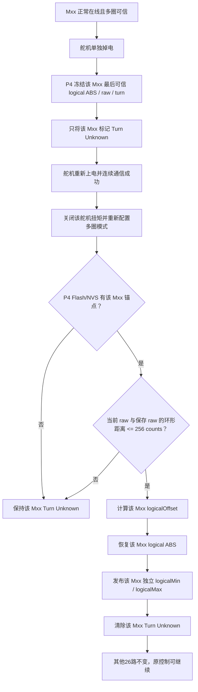
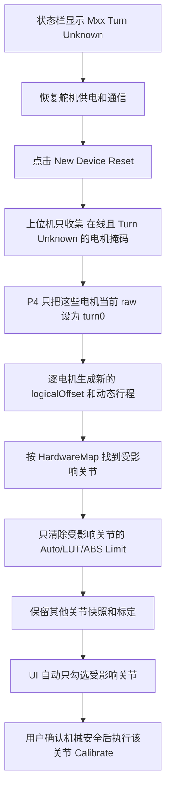

# 舵机单独掉电后的多圈坐标与动态行程恢复

> 当前专项文档，最后核对：2026-08-01。P4 持续供电时可利用最后可信 RAM 锚点恢复；P4 与舵机同时掉电时只能恢复最后已提交的 NVS 快照，不能保证断电瞬间零误差。完整边界见[持久化与掉电恢复](持久化与掉电恢复.md)。

## 1. 问题与目标

ST3215 单独掉电后，舵机内部的多圈位置会回到当前上电会话坐标；P4 若继续沿用掉电前的软件多圈值，二者就会失配。旧实现还把 P4 的逻辑位置固定限制为 `[-30719, 30719]`，即使通过 `logicalOffset` 恢复了当前位置，也会使一侧可用行程被无故截短。

当前实现的目标是：

1. 舵机硬件命令仍严格限制在本次上电会话的 `[-30719, 30719]`。
2. P4 对外使用 `int32 logical ABS`，不再把逻辑坐标固定为七圈。
3. 每台舵机根据自己的 `logicalOffset` 独立计算可达逻辑范围。
4. 只有一台舵机掉电时，只恢复这一台舵机；其他26路坐标和标定不变。
5. 无法证明旧圈数时进入 `Turn Unknown`，禁止直接负反馈，但允许局部 New Device 和单关节重标。

## 2. 三种坐标

### 2.1 单圈 raw

`raw` 是 ST3215 当前单圈位置，范围为 `0..4095`。它不能单独说明当前是第几圈。

### 2.2 当前上电会话 hardware ABS

P4 根据本次上电后的 raw 跨圈变化维护 `hardwareAbs`。ST3215 可接受的多圈命令范围仍为：

```text
hardwareMin = -30719
hardwareMax =  30719
```

这是舵机硬件安全边界，不应删除。

### 2.3 P4 logical ABS

控制、标定和上位机看到的是：

```text
logicalAbs = hardwareAbs + logicalOffset
```

下发命令时反向转换：

```text
hardwareTarget = logicalTarget - logicalOffset
```

因此每台舵机当前会话的逻辑可达范围为：

```text
logicalMin = logicalOffset - 30719
logicalMax = logicalOffset + 30719
```

例如掉电前逻辑位置为 `18000`，重新上电后硬件位置为 `1616`，则：

```text
logicalOffset = 18000 - 1616 = 16384
logicalRange  = [-14335, 47103]
```

当前位置保持为 `18000`，正向和负向可用行程均与舵机当前真实硬件行程一致，不再被旧的逻辑 `±30719` 截断。

## 3. 舵机热插拔自动恢复



`256 counts` 校验使用单圈环形距离，因此可以正确处理 `4090 -> 10` 这类跨零情况。它不能证明断电期间发生了一整圈或多圈转动；这种情况必须保持 `Turn Unknown`。

## 4. 自动恢复失败后的局部 New Device

当 raw 差值超过 256 counts、没有可信 Flash 锚点或恢复事务失败时，不猜测圈数。



### 单电机关节

如果 M04 只驱动 J03，则只重建 M04，并只要求 J03 重标。

### 双电机关节

如果双电机关节的一台舵机掉电，例如 J16 的副电机掉电：

- 多圈坐标只重建故障的那台舵机；
- 另一台舵机的 logical ABS、offset 和动态行程不变；
- J16 的两路 LUT 和 ABS Limit 整体失效；
- 只要求 J16 重新标定，不影响其他关节。

双电机 LUT 必须整体失效，因为它描述两台舵机在同一关节角轨迹上的配对关系，不能把一半新坐标与一半旧 LUT 混用。

## 5. 控制与标定的最终边界

控制目标需要同时满足两层限制：

```text
当前会话硬件可达范围：
[logicalOffset - 30719, logicalOffset + 30719]

标定/LUT/用户锁定范围：
[calibMin, calibMax]

最终允许范围：
两者的交集
```

上位机每 500 ms 接收27路动态 logical 范围，直控命令先按对应 Mxx 范围钳位；P4 在转换为硬件命令前再次校验。即使上位机状态滞后，P4 仍是最终安全门。

标定任务也使用同一动态范围。到达当前会话真实行程边界时会记录：

```text
[SERVO RANGE REJECT] Mxx logical=... hardware=...
logicalRange=[..., ...] hardwareRange=[-30719, 30719]
```

## 6. 标定快照 V4

掉电恢复后 logical ABS 可能超过 `int16`。旧快照若继续用 `int16` 保存，会发生静默截断。

V4 格式改为：

- `startServoAbs/tightServoAbs/zeroServoAbs`：`int32`
- 每路 Tendon LUT：一个 `int32` 锚点
- 每个 LUT 样本：相对锚点的 `int16 delta`

这样既支持完整 logical ABS，又能保持协议单字节 LEN 的帧长度限制。

## 7. 用户操作建议

### 自动恢复成功

1. 恢复舵机电源。
2. 等待状态栏重新显示 `TURN KNOWN`。
3. 检查 Motor Channels 的 `RawNow/HWNow/AbsNow`。
4. 将鼠标停在 `AbsNow`，确认 `Current-session logical range` 合理。
5. 低速、小角度测试后恢复正常控制。

### 自动恢复失败

1. 确保对应舵机在线且机械无干涉。
2. 点击 `New Device Reset`。
3. 阅读弹窗中的故障 Mxx 和待重标 Jxx。
4. 确认 UI 只勾选受影响关节。
5. 执行该关节自动标定。
6. 确认 `TURN KNOWN`、标定成功和负载状态正常后再控制。

## 8. 不能自动保证的情况

- 舵机断电期间被转动超过 256 counts。
- 舵机断电期间转过整圈后 raw 恰好接近原值。
- P4 与舵机同时掉电且 Flash 中没有有效快照。
- 更换新舵机、修改 ID、修改机械绳路或装配位置。
- 双电机关节只重建一台舵机后仍试图继续使用旧 LUT。

这些情况必须进入 `Turn Unknown`，通过局部 New Device 和单关节重标恢复，不能自动猜测圈数。

## 9. 主要代码位置

- `ESP32-P4/ServoBoardMain/src/communication/servo/ServoPositionRange.h`
  - 硬件范围、logical/hardware 转换和动态范围计算。
- `ESP32-P4/ServoBoardMain/src/communication/servo/ServoCommunicationTask.cpp`
  - 掉线冻结、热插拔重试、256 counts 校验、offset 恢复和逐电机范围发布。
- `ESP32-P4/ServoBoardMain/src/shared/TaskSharedData.h`
  - 27路动态范围和拒绝诊断共享状态。
- `ESP32-P4/ServoBoardMain/src/control/ControlOutputBuilder.cpp`
  - 标定限制与当前会话范围求交。
- `ESP32-P4/ServoBoardMain/src/calibration/AutoCalibrationTask.cpp`
  - 标定命令使用逐电机动态范围。
- `ESP32-P4/ServoBoardMain/src/communication/upper/UpperCommProtocol.h`
  - 动态范围包、int32 ABS 命令和 V4 标定快照长度。
- `ESP32-P4/ServoBoardMain/src/communication/upper/UpperCommTask.cpp`
  - 27路范围上报及 V4 快照收发。
- `desktop/core/protocol.py`
  - 上位机动态范围和 V4 快照编解码。
- `desktop/core/core_logic.py`
  - 逐电机动态范围钳位及局部 New Device 流程。
- `desktop/ui/ui_control_panels.py`
  - 局部恢复提示、快照局部失效、单关节重标引导和动态范围提示。
