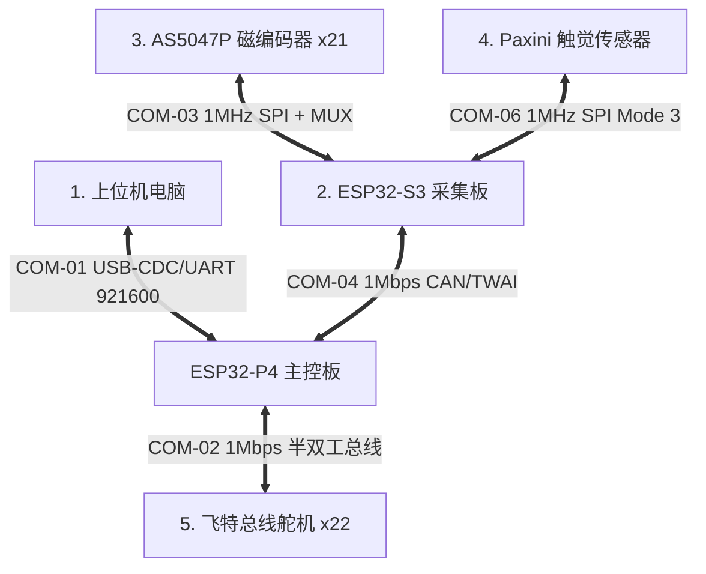

# 🤖 灵巧手项目嵌入式通信协议帧详解与面试通关指南

> 当前专项文档，最后核对：2026-08-01。正文中历史示例若出现“22 路舵机、收到 0x105 即完成、50/300 ms 固定超时”等表述，均以新版章节和当前 schema/源码为准：系统为 21 关节/27 电机；磁编需等待 `0x106` 并通过 CRC16，重组超时 20 ms；P4 控制侧 CAN offline 为 1000 ms。面试时应主动区分历史协议与当前实现。

本篇文档是针对灵巧手系统的**全链路通信协议帧**所编写的深度解析。文档将从通信接口、物理参数、各数据帧的具体字节定义、帧在控制系统中的作用以及面试连环追问等多个维度带你彻底入门，并在面试中展示出深厚的底层工程功底。

---

## 🗺️ 一、 系统通信链路全景图

在整个多维触觉灵巧手控制系统中，共有五大核心通信链路。我们使用双核芯片（**ESP32-S3** 用于高频传感器采集，**ESP32-P4** 用于电机伺服闭环与上位机连接）：



---

## 📡 二、 SPI 链路数据帧定义与寄存器作用

S3 芯片作为 SPI 主机，向下连接了两种关键传感器：AS5047P 磁绝对值编码器（21路）和 Paxini 三轴触觉传感器。

### 1. AS5047P 磁编码器 SPI 读写帧（COM_FRAME_AS5047P_SPI）

*   **物理层**：SPI Mode 1 (CPOL=0, CPHA=1)，当前 `HalSensorSpi.cpp` 配置时钟频率 10 MHz。
*   **通信方向**：ESP32-S3（主机） $\leftrightarrow$ AS5047P 磁编码器（从机）。
*   **帧长**：16 bits (2 字节)。
*   **硬件痛点（面试高频）**：21个编码器若各用一个片选（CS）引脚会耗尽 GPIO。S3 侧通过 **3路 GPIO 选择控制 CD74HC138 译码器**，实现分时复用片选信号。

#### 帧格式定义

```
+---------------+---------------+---------------------------------------+
|  Bit 15 (MSB) |    Bit 14     |            Bit 13 ~ 0 (LSB)           |
+---------------+---------------+---------------------------------------+
|    Parity     |   R/W (1:读)  |           Register Address            |
+---------------+---------------+---------------------------------------+
```

*   **`Parity`（Bit 15，偶校验位）**：用于保障极弱传感器信号在电机强电磁干扰下的正确性。0~14位中如果 1 的个数为奇数则该位置 1，以使 1 的总数为偶数。
*   **`R/W`（Bit 14，读写选择）**：0 表示写，1 表示读。灵巧手控制中 99% 的操作为读（置 1）。
*   **`Register Address`（Bit 13~0，寄存器地址）**：目标寄存器地址。系统使用的核心寄存器如下：
    1.  **`0x3FFF` (ANGLECOM)**：带动态十进制补偿的 14 位绝对角度值（取值范围：0 ~ 16383）。这是系统**最核心的反向关节控制闭环源**。
    2.  **`0x0001` (ERRFL)**：错误寄存器。记录帧错误、无效命令、奇偶校验错等状态。当读取角度帧发现异常时，状态机自动跳转读该寄存器以排查故障。
    3.  **`0x3FFC` (DIAAGC)**：诊断与自动增益控制。可获取磁铁距传感器表面的偏近/偏远状态，作为**传感器安装间隙诊断指标**。

#### 💡 流水线（Pipeline）读取特性与代码设计
> [!IMPORTANT]
> **面试杀手锏：流水线延迟**
> AS5047P 采用双帧流水线读取机制。当你在第 $N$ 帧写入读取 `ANGLECOM` 的指令时，当前帧内 `MISO` 返回的实际上是上一次读取的旧数据。为了在控制环路中拿到**当前时刻**的绝对角度，在 `HalEncoders.cpp` 中，我们通过双发 `transferOnce` 冲刷流水线，立刻捕获零延迟角度反馈。

---

### 2. Paxini 触觉传感器 SPI 读帧（COM_FRAME_PAXINI_SPI_READ）

*   **物理层**：SPI Mode 3 (CPOL=1, CPHA=1)，时钟 1 MHz。
*   **通信方向**：ESP32-S3（主机） $\rightarrow$ 帕西尼触觉传感器。
*   **帧长**：命令头 5 字节 + 传感器状态 1 字节 + 荷载 15 字节 + 校验 1 字节。

#### 帧格式定义

```
+------------+--------------------+-------------------+---------------+---------------+------------+
| CMD (0xFB) | ADDR_Low (0xF0)    | ADDR_High (0x03)  | LEN_Low (0x0F)| LEN_High(0x00)| STATUS (1B)|
+------------+--------------------+-------------------+---------------+---------------+------------+
|                     PAYLOAD (15 字节: 5 个触觉单元 × 3轴力 fx/fy/fz)                      |  CRC8 (1B) |
+-------------------------------------------------------------------------------------------+------------+
```

*   **`CMD_READ` (0xFB)**：启动读取传感器命令。
*   **地址 `1008` (小端序 `0xF0 0x03`)**：触觉寄存器物理首地址。
*   **长度 `15` (小端序 `0x0F 0x00`)**：读取 15 字节负载数据。
*   **`PAYLOAD` (15 字节)**：一共 5 个测量单元（Taxel），每个单元包含 3 轴力 ($f_x, f_y, f_z$ 等 3 字节)。
    *   $f_x$ ($1 \text{ Byte}$, `int8_t`，带正负，剪切力X)
    *   $f_y$ ($1 \text{ Byte}$, `int8_t`，带正负，剪切力Y)
    *   $f_z$ ($1 \text{ Byte}$, `uint8_t`，无符号，垂直压力Z)
*   **`CRC8`**：由传感器硬件生成，用于保障单手指多点触觉高密度采集的链路稳定性。

---

## 🚗 三、 CAN / TWAI 链路分片与重组协议帧

ESP32-S3 采集的绝对角度（21路共 42 字节）与触觉数据（45 字节）远超标准 CAN 2.0B 的单帧容量限制（**8 字节**），因此在软件上自主设计了**应用层分片重组协议（Fragmentation Protocol）**。

### 1. 21路编码器角度同步帧（COM_FRAME_CAN_ENCODER）

*   **作用**：将 21 个编码器的绝对角度值高频（100 Hz）从 S3 送往 P4。
*   **ID 规划**：连续 ID 段 `0x100` ~ `0x105`（共 6 帧）。每帧 DLC = 8 字节。

#### 数据包映射定义

| CAN ID | DLC | 数据字段定义 (大端序 `uint16_t` 编码器值，取值范围 $0 \sim 16383$) | 帧的作用描述 |
| :--- | :--- | :--- | :--- |
| **`0x100`** | 8 | `data[0..1]`=Enc0, `data[2..3]`=Enc1, `data[4..5]`=Enc2, `data[6..7]`=Enc3 | 传输第 1 组绝对角度分片 |
| **`0x101`** | 8 | `data[0..1]`=Enc4, `data[2..3]`=Enc5, `data[4..5]`=Enc6, `data[6..7]`=Enc7 | 传输第 2 组绝对角度分片 |
| **`0x102`** | 8 | `data[0..1]`=Enc8, `data[2..3]`=Enc9, `data[4..5]`=Enc10, `data[6..7]`=Enc11 | 传输第 3 组绝对角度分片 |
| **`0x103`** | 8 | `data[0..1]`=Enc12, `data[2..3]`=Enc13, `data[4..5]`=Enc14, `data[6..7]`=Enc15 | 传输第 4 组绝对角度分片 |
| **`0x104`** | 8 | `data[0..1]`=Enc16, `data[2..3]`=Enc17, `data[4..5]`=Enc18, `data[6..7]`=Enc19 | 传输第 5 组绝对角度分片 |
| **`0x105`** | 8 | `data[0..1]`=Enc20, `data[2..7]` 填充 0 | 第 6 个数据分片；不能单独触发发布，P4 还要等待 `0x106` metadata、检查 frameMask 和 CRC16。 |

---

### 2. 编码器硬件错误详情帧（COM_FRAME_CAN_ERROR_DETAIL）

*   **ID 范围**：`0x1F0` 至 `0x1F2` （共 3 帧）。DLC = 8。
*   **发送机制**：**事件触发**。当 S3 检测到 21 路中存在任何硬件错（如磁场过强、校验失败、断连）时，启动本组错误帧广播。
*   **重组状态机（`CanCommTask.cpp`）**：三个错误详情帧携带滚动 `seq`，P4 使用 frameMask 和 100 ms 重组超时；300 ms 没有完整错误批次时清空旧错误表。这两个阈值不要与磁编 20 ms、触觉摘要 80 ms 混用。

#### 各分帧数据布局与编码逻辑

*   **`Byte 0` (Rolling Seq)**：S3 发送端自增的包序号，重组校验依据。
*   **`Byte 1 ~ 7` (Error Code)**：代表各个关节点的诊断错误码。

| CAN ID | Byte 0 | Byte 1 | Byte 2 | Byte 3 | Byte 4 | Byte 5 | Byte 6 | Byte 7 |
| :--- | :--- | :--- | :--- | :--- | :--- | :--- | :--- | :--- |
| **`0x1F0`** | `seq` | Enc0错 | Enc1错 | Enc2错 | Enc3错 | Enc4错 | Enc5错 | Enc6错 |
| **`0x1F1`** | `seq` | Enc7错 | Enc8错 | Enc9错 | Enc10错 | Enc11错 | Enc12错 | Enc13错 |
| **`0x1F2`** | `seq` | Enc14错 | Enc15错 | Enc16错 | Enc17错 | Enc18错 | Enc19错 | Enc20错 | (其余 `0xFF`) |

#### 错误码解析表（`encodeFaultCode`）

S3 在将复杂的 SPI 物理状态转换成 CAN 上传时，进行了高压缩编码：
*   `0x00`：OK，完全正常。
*   `0x01`：连接丢失（`LINK_LOST`，SPI 物理线路短路/断开，无法读出寄存器）。
*   `0x10`：帧错误（`FRAME_ERR`）。
*   `0x11`：无效命令（`INV_CMD`）。
*   `0x12`：奇偶校验错（`PAR_ERR`）。
*   `0x20`：磁铁距离太远（`MAG_LOW`，极易造成角度偏差）。
*   `0x21`：磁铁距离太近（`MAG_HIGH`，增益过载导致精度下降）。

---

### 3. 历史系统标定帧（当前已禁用）

*   **历史用途**：曾计划让 P4/S3 通过 CAN 协同零位标定。当前 P4 独占编码器 Manual/Auto 标定语义，S3 收到 `0x200/0xCA` 只记录一次兼容告警并忽略，不发送当前控制链路使用的标定 ACK。

#### 协议帧格式与动作

1.  **历史标定启动帧**（不应再由 P4 发送）：
    *   **CAN ID**：`0x200`，DLC = 1。
    *   **Payload**：`data[0] = 0xCA`。
    *   **当前动作**：S3 忽略并打印兼容告警，磁编高频发送不应被该命令暂停。
2.  **历史标定 ACK**（当前 P4 主链路不消费）：
    *   **CAN ID**：`0x300`，DLC = 1。
    *   **Payload**：`0x01`（成功） / `0x00`（失败，存在传感器断线）。

---

## 💻 四、 上位机与 ESP32-P4 二进制串口帧定义（COM-01）

*   **物理层**：波特率 **921600**，采用固定帧头（`0xFE`）与帧尾（`0xFF`）的串口流对齐格式。

### 1. 上位机控制下发帧（COM_FRAME_PC_TO_P4_COMMAND）

```
+------------+------------+------------+--------------------------+------------+
| Header(0xFE| Length(1B) |  CMD (1B)  |     PAYLOAD (N 字节)     | Tail (0xFF)|
+------------+------------+------------+--------------------------+------------+
```

*   **`Length`**：`CMD` 字节至 `Tail` 字节的总数。

#### 命令字（CMD）与负载定义

| CMD 字节 | 命令名称 | Payload 大小 | 数据布局格式 (小端序) | 触发的硬件动作/状态切换 |
| :--- | :--- | :--- | :--- | :--- |
| **`0xCB`** | `CMD_ANGLE_CTRL` | 84 字节 | 21 个 little-endian `float32` 关节角 | 写目标快照并请求 `RUN_FEEDBACK`；只有状态机从 READY 准入后，Control 才驱动 27 个电机中的 active scope。 |
| **`0xD3`** | `CMD_MOTOR_POS_ABS` | 108 字节 | 27 个 big-endian `int32` logical ABS | 写 direct generation；状态机准入后仍经过 owner、在线、多圈和 logical/hardware range 裁决。 |
| **`0xCC`** | `CMD_START` | 0 字节 | 无 | 投递 START 事件。ACK queued 只表示入队，最终状态看 system status。 |
| **`0xCD`** | `CMD_STOP` | 0 字节 | 无 | 递增独立急停 token、撤销 owner/目标并由 ServoComm 关闭 torque；不依赖普通队列及时出队。 |

---

### 2. P4 向上位机反馈数据帧（PACKET_P4_TO_PC）

P4 会以 Packet Type 区分，向上位机高频汇报下述数据帧：

| Packet Type | 数据包名称 | Payload 大小 | 数据布局与详细作用说明 |
| :--- | :--- | :--- | :--- |
| **`0x01`** | `PACKET_SENSOR` | 42 字节 | **21 路关节映射后的真实输出角度** (`int16_t` x 21)。若某通道值为 `0x7FFF` 说明其处于断连故障状态。 |
| **`0x03`** | `PACKET_SERVO_ANGLE` | 变长由 27 路维度确定 | 27 路 logical ABS (`int32`)、27 路在线状态及 P4 timestamp。 |
| **`0x04`** | `PACKET_JOINT_DEBUG` | 17 字节 | **【高频调试专用帧】** 返回关节目标（`targetDeg`）、角度反馈（`magActualDeg`）、外环输出值和最终命令位置。用于 PID 闭环参数整定。 |
| **`0x05`** | `PACKET_SERVO_TELEM` | 每电机 9 字节 + timestamp | 27 路 speed/load/current (`int16`) 与 voltage/temperature/online (`uint8`)。 |
| **`0x07`** | `PACKET_FAULT_STATUS` | 4 字节 | **【关节故障状态位图】** 21 路磁绝对编码器的故障映射。一旦有对应的位被置 1，上位机界面对应的指关节呈红色报警状态。 |
| **`0x0A`** | `PACKET_TACTILE` | 46 字节 | **【多维触觉重组帧】** 包含 1 字节滚动序列号及重组集齐的 45 字节三轴触觉受力值，用于灵巧手抓握闭环。 |

---

## ⚙️ 五、 飞特总线舵机通信帧协议（COM-02）

*   **物理层**：TTL 单线异步半双工，波特率 **1 Mbps**。
*   **通信方向**：ESP32-P4（主机） $\leftrightarrow$ 27 个外置总线舵机，分布在 4 条 1 Mbps UART 总线上。

### 帧 9：飞特协议帧（COM_FRAME_FTSERVO_BUS）

```
+------------------+----------+------------+-----------------+---------------------+------------+
| Header(0xFF 0xFF)| ID (1B)  | Length (1B)| Instruction(1B) |   Parameters (NB)   |Checksum(1B)|
+------------------+----------+------------+-----------------+---------------------+------------+
```

*   **ID**：当前物理 servo ID 与 M00~M26 的通道号相同，实际 bus/id 组合由 HardwareMap 决定；广播写时使用 `0xFE`。
*   **`Length`**：`Instruction` 到 `Checksum` 的总字节长度。
*   **`Checksum`**：校验和。算法为：`~ (ID + Length + Instruction + Sum(Parameters)) & 0xFF`。

#### 核心指令字 (Instruction) 与多电机实时性解决设计

1.  **同步写 `INST_SYNC_WRITE` (0x83)**：
    *   **痛点**：如果对每个电机独立写入，会挤占半双工串口并增加同一总线内的相位差。
    *   **应对方案**：每条 bus 分别使用 `SyncWrite` 发送该总线目标，4 条 UART 并行调度。它显著减小而不是“完全消除”跨总线相位差。
2.  **同步读 `INST_SYNC_READ` (0x82)**：
    *   **应对方案**：主机按每条 bus 的 ID 列表进行同步读并缓存反馈，ServoComm 每个 10 ms 周期交替刷新两组总线，降低单周期阻塞。

---

## 🎯 六、 嵌入式面试实战 Q&A（带你完美应对面试官）

当你去面试嵌入式软件开发工程师（特别是涉及**工业机器人、电机控制、智能硬件**岗位）时，面试官极有可能就这套通信架构进行刨根问底。以下是为你准备的**教科书级别应答话术**：

### Q1：SPI 通信的几种模式你们用过哪些？AS5047P 这种高速传感器在使用 SPI 时有什么需要特别注意的设计？
> **回答话术**：
> SPI 有 4 种工作模式，由 `CPOL`（时钟极性）与 `CPHA`（时钟相位）的组合决定。在我们的磁编码器读取中，选用的是 **Mode 1 (CPOL=0, CPHA=1)**，因为 AS5047P 的时序要求数据在时钟信号的**下降沿采样**。
>
> 另外在开发中需要注意其**双帧流水线（Pipeline）读取限制**。当主机发送第 $N$ 帧读取指令时，当前周期接收到的其实是第 $N-1$ 次的数据。这就导致直接读取会引入一帧的数据延迟。
>
> 当前实现显式跟踪 AS5047P 的上一条命令/返回 word，对 ANGLE、ERRFL、DIAAGC 状态做流水线配对，并校验 parity/error flag。短帧使用轮询可以避免 DMA/中断管理开销，但仍有 SPI 传输、selector 建立和任务调度延迟，不能表述为“零延时”或“纳秒级端到端”。

---

### Q2：CAN 2.0 最大的荷载只有 8 个字节，但在机器手控制中，传感器数据（比如 21路编码器或多维触觉）往往非常庞大。你们如何解决这个矛盾？
> **回答话术**：
> 是的，这是标准 CAN 物理层的物理限制。我们在应用层软件自主设计了**分片与分级重组协议**：
>
> 1. 对于**高频磁编数据**，使用 `0x100~0x105` 承载 42 bytes，并用 `0x106` 携带 sequence、CRC16、frameCount 和 payloadBytes。P4 只有在 6 个数据帧全部进入 frameMask、metadata 合法且本地 CRC16 一致时才发布，重组超时 20 ms。
> 2. 对于**错误详情和触觉**，每帧携带 sequence 并使用独立超时：错误详情 100 ms、触觉摘要 80 ms、全量触觉 400 ms。触觉摘要/全量还使用应用层 CRC16。各类数据的实时性不同，所以不共用一个“50 ms 万能阈值”。

---

### Q3：你的项目中使用了双板（ESP32-S3 和 P4）通过 CAN 通信。如果在运行中 CAN总线因为外界电磁噪声引起了总线关闭（Bus-Off），或者其中一块板断电了，你们有什么安全保护和自我修复机制吗？
> **回答话术**：
> 这我们在工程落地中做了双重防错设计。
>
> **第一，CAN链路的自我修复（Bus-Off Recovery）**：我们在软件中开启了一个周期性的通信守护任务。通过 ESP-IDF 的 `twai_get_status_info()` 实时获取 CAN 控制器的内部报错计数与硬件状态。一旦检测到硬件因为外界噪声累积进入了 `TWAI_STATE_BUS_OFF`（总线关闭），任务会自动调用 `twai_initiate_recovery()` 发起总线重置与并网恢复，保证了链路在极短暂中断后可以自行恢复通信，而无需人工复位。
>
> **第二，控制状态的离线自锁（Failsafe）**：P4 对磁编/CAN 新鲜度和 active joint 在线位图做状态准入，控制侧 CAN offline 阈值当前为 1000 ms。失去可信反馈后状态机撤销闭环资格并进入不可控/恢复状态；ServoSafetyPolicy 和 driver 继续阻止不可信或越界目标。是否立即 torque off 取决于故障/STOP 路径，不能笼统描述为“300 ms 后 27 路全部 E-Stop”。

---

## 📡 七、 新版协议帧升级说明（mmhand-main 版本）

> 以下内容为当前版本（mmhand-main）相较于原版（mmhand-cl）的协议帧升级。原版协议帧定义保持不变，新版在其基础上进行了扩展和增强。

### 1. 编码器 CAN 帧升级：新增 CRC-16 元数据帧

原版使用 6 帧（`0x100`~`0x105`）传输 21 路编码器角度，P4 收到 `0x105` 即认为数据完整。**新版在此基础上增加了第 7 帧 CRC 元数据帧**，用于数据完整性校验。

#### 新增帧：CRC 元数据帧（CAN ID `0x106`）

| CAN ID | DLC | Byte 0 | Byte 1 | Byte 2 | Byte 3 | Byte 4 | Byte 5~7 |
| :--- | :--- | :--- | :--- | :--- | :--- | :--- | :--- |
| **`0x106`** | 8 | `seq`（滚动序号） | CRC-16 高字节 | CRC-16 低字节 | `frameCount`（数据帧数） | `payloadBytes`（荷载字节数） | 保留 0x00 |

*   **CRC-16-CCITT**：对 42 字节编码器荷载（`CAN_ENC_PAYLOAD_BYTES`）计算，与 P4 端的 `crc16Ccitt()` 校验函数一致。
*   **P4 重组逻辑变更**：不再以收到 `0x105` 作为完成标志，而是等待 `0x106` CRC 帧到达后：①用 `frameMask` 确认所有数据帧已集齐；②计算本地 CRC 并与帧内 CRC 对比；③通过 20ms 超时保护兜底。
*   **工程收益**：显著提高对丢帧、混批和 payload 误码的检出能力；CRC 不是绝对证明，且当前 `0x100~0x105` 数据帧未逐帧携带 sequence，仍应结合短重组窗和实机错误注入评估。

---

### 2. 新增触觉 CAN 摘要帧协议（CAN ID `0x240`~`0x246`）

原版无触觉 CAN 传输。**新版新增 7 帧触觉摘要中继协议**，将 S3 采集的 45 字节触觉摘要数据通过 CAN 转发给 P4。

#### 帧格式

```
每帧 8 字节:
  Byte 0:    seq（滚动序号，0~255 循环）
  Byte 1~7:  触觉摘要荷载分片（45 字节 + 2 字节 CRC-16 = 47 字节，分摊到 7 帧）

最后 2 字节为 CRC-16 CCITT 校验值（覆盖全部 45 字节摘要荷载）
```

| CAN ID | 用途 |
| :--- | :--- |
| `0x240` | 触觉摘要第 1 帧（荷载 byte 0~6） |
| `0x241` | 触觉摘要第 2 帧（荷载 byte 7~13） |
| `0x242` | 触觉摘要第 3 帧 |
| `0x243` | 触觉摘要第 4 帧 |
| `0x244` | 触觉摘要第 5 帧 |
| `0x245` | 触觉摘要第 6 帧 |
| `0x246` | 触觉摘要第 7 帧（含 CRC-16 尾部） |

*   **P4 重组**：使用 `frameMask` 位掩码跟踪已收帧，80ms 超时保护，CRC-16 校验。
*   **发送频率**：与触觉采样率同步，30 Hz。

---

### 3. 新增触觉 CAN 全量转储帧协议（CAN ID `0x400` 起）

**用于传输完整的 taxel 力分布矩阵**，当前 `TACTILE_FULL_BYTES=1530`，需要大量 CAN 分片。

#### 帧格式

```
每帧 8 字节:
  Byte 0:    seq（滚动序号）
  Byte 1~7:  taxel 分布数据（每帧 7 字节有效荷载）

帧数 = ceil(TACTILE_FULL_BYTES / 7)，CAN ID 从 0x400 递增
```

*   **P4 重组**：使用位图数组（`CAN_TAC_FULL_FRAME_MASK_BYTES`）跟踪所有帧的接收状态，400ms 超时保护。
*   **发送频率**：受 `ENABLE_TACTILE_CAN_FULL_DUMP` 宏控制，默认关闭（全量转储主要走 S3 串口直连上位机）。
*   **CAN 带宽评估**：全量一批约需 219 个 7-byte 分片，且还要计算帧开销、stuff bit、仲裁和重发。当前默认关闭；不能只按 1530×8 估算后断言“30% 且安全”，启用前必须测 bus load 和磁编 deadline。

---

### 4. 新增 S3 串口触觉数据包协议（S3 → 上位机直连）

原版仅通过 P4 主串口间接获取触觉数据。**新版新增 S3 USB 串口直连上位机的触觉数据包协议**，提供更低延迟的触觉数据传输通道。

#### 4a. 触觉摘要包（Packet Type `0x0A`）

```
+-----------+----------+----------+-----+--------------------------+-----------+
| Header    | Length   | Type     | Seq | Payload                  | Tail      |
| (0xFE)    | (1B)     | (0x0A)   | (1B)| (TACTILE_SUMMARY_BYTES)  | (0xFF)    |
+-----------+----------+----------+-----+--------------------------+-----------+
```

*   **发送频率**：每触觉周期（33ms，~30Hz）发送一次。
*   **Payload**：45 字节触觉摘要，按 [组][传感器][轴] 排列，已经过噪声门限滤波（`TACTILE_SUMMARY_NOISE_FLOOR`）。

#### 4b. 触觉全量转储包（Packet Type `0x0E`）

```
+-----------+----------+----------+------+----------+---------+----------+---------+------+-----------+
| Header    | Length   | Type     | "T2" | sumSeq   | fragIdx | fragTotal| CRC16   | Data | Tail      |
| (0xFE)    | (1B)     | (0x0E)   | (2B) | (1B)     | (1B)    | (1B)     | (2B)    | (≤240B)| (0xFF)   |
+-----------+----------+----------+------+----------+---------+----------+---------+------+-----------+
```

*   **分片传输**：全量数据（`TACTILE_FULL_BYTES` 字节）按 240 字节/片分片发送。
*   **魔数 `"T2"`**（0x54 0x32）：用于分片帧同步和格式识别。
*   **CRC-16 CCITT**：覆盖整包全量数据（非单片），上位机重组全部碎片后校验。
*   **`sumSeq`**：关联的摘要包序号，用于同步摘要和全量数据。
*   **`fragIdx / fragTotal`**：当前片索引和总片数。
*   **上位机重组超时**：500ms。

---

### 5. P4 串口新增帧类型

P4 通过 UpperComm 任务向上位机转发的数据类型新增：

| Packet Type | 数据包名称 | 来源 | 说明 |
| :--- | :--- | :--- | :--- |
| **`0x0A`** | `PACKET_TACTILE` | CAN 触觉摘要重组 | 45 字节三轴触觉摘要 + seq，P4 中转 |
| **`0x0B`** | `PACKET_ENCODER_RAW` | CAN 编码器原始帧 | 用于上位机直接分析 CAN 帧完整性 |
| **`0x0E`** | `PACKET_JOINT_CALIB_SNAPSHOT` | P4 标定模块 | 逐关节标定结果快照（编码器极值、偏移、角度范围） |
| **`0x0F`** | `PACKET_TACTILE_FULL` | CAN 触觉全量重组 | 完整 taxel 力分布矩阵 |

---

### 6. 新增上位机控制命令

| CMD 字节 | 命令名称 | Payload | 说明 |
| :--- | :--- | :--- | :--- |
| **`0xDE`** | `CMD_MOTOR_POS_ABS_ONE` | 5 字节 | 单电机 logical ABS（`index:uint8 + value:int32`） |
| **`0xDF`** | `CMD_CALIB_LOAD_JOINT` | 209 字节 | 上传单关节标定/LUT 快照 |
| **`0xE0`** | `CMD_CALIB_LOAD_LIMITS` | 228 字节 | 上传 27 路 ABS limit 数据 |

---

## 🎯 八、 新版架构面试补充 Q&A

### Q4：你们的编码器数据通过 CAN 传输，CAN 总线在工业环境中很容易受到电磁干扰，你们如何确保 21 路编码器角度在传输过程中不会被篡改或错位？

> **回答话术**：
> 我们在应用层分片重组协议的基础上，引入了**三重完整性保护机制**：
>
> **第一，CRC-16-CCITT 校验**。S3 发送端在 6 帧角度数据之后，额外发送一帧 CRC 元数据帧（CAN ID `0x106`），其中包含对 42 字节编码器荷载计算的 CRC-16 值。P4 接收端独立计算并对比，不匹配则丢弃整批。它能高概率检出应用 payload 错误，但不能说“100% 检出所有错误”；单个 CAN frame 还另有控制器硬件 CRC。
>
> **第二，位掩码集齐检查**。P4 使用 `frameMask` 位图记录每个分片是否到达。只有当所有位都被置 1（即 6 帧数据全部到齐）且 CRC 帧到达后，才发布数据。避免了"部分帧到达就使用"导致的数据不完整。
>
> **第三，20ms 超时保护**。如果首帧到达后 20ms 内未能集齐所有分片（可能因为总线严重拥塞或 S3 掉电），自动清空缓冲区重新接收，防止陈旧数据被误用。

---

### Q5：你们的触觉传感器数据量比编码器大得多（每个手指有 52 个 taxel × 3 轴），如何在有限的 CAN 带宽和串口带宽下同时传输编码器和触觉数据？

> **回答话术**：
> 我们采用了**双通道分流架构**来解决这个问题。
>
> **触觉摘要走 CAN 中继**：每周期将 45 字节的三轴合力摘要压缩为 7 帧 CAN 帧（`0x240`~`0x246`），附带 CRC-16 校验，通过 P4 中转后上报上位机。这部分在 1Mbps CAN 总线上仅占用约 23 kbps（7 帧 × 108 位 × 30Hz），负载非常轻。
>
> **触觉全量转储优先走 S3 串口直连**：当前完整 payload 为 1530 字节；若映射到经典 CAN，需要约 219 个分片帧，因此 P4 侧默认关闭 CAN 全量转储。S3 可通过独立 USB 串口（921600 baud）将全量数据发送给上位机，绕过 P4 中转；上位机的 `TactileSerialComm` 独立管理该通道并重组完整矩阵。
>
> 设计取舍是让 CAN 承担固定长度、低延迟的编码器与触觉摘要，让高吞吐全量数据走独立串口，避免 219 帧全量包阻塞控制相关 CAN 帧。具体总线占用率必须用当前周期、实际位填充和丢帧统计实测，不能沿用旧文档中的固定百分比。

---

### Q6：你们的 ESP32-S3 上同时跑编码器任务和触觉任务，它们是怎么共享 SPI 硬件资源的？如何避免冲突？

> **回答话术**：
> 我们采用了**物理隔离 + 软件互斥**的双层方案。
>
> **物理层**：编码器和触觉传感器使用两条独立的 SPI 总线——编码器独占 `SPI3_HOST`（GPIO 47/38/9），触觉独占 `SPI2_HOST`（GPIO 21/10/8）。SPI 数据通道本身不存在冲突，每条总线只注册一个 SPI 设备，`spi_device_transmit()` 内部即可保证独占。两条总线都使用了 `SPI_DMA_CH_AUTO` 自动 DMA 通道分配，大块触觉数据传输不需要 CPU 介入。
>
> **软件层**：虽然 SPI 总线独立，但两个子系统**共享同一块 PCB 上的模拟 MUX 路由 GPIO 引脚**。编码器的 MUX 选择引脚（A/B/C）和触觉的选择引脚（CS_A/B、GRP_A/B/C）共用同一组 GPIO bank。如果两个任务同时写这些引脚，会产生电气竞争。因此我们引入了一个全局的 FreeRTOS 互斥锁 `g_sensorSelectMutex`。编码器的 `transferOnce()` 和触觉的 `readRegisters()` 都在操作 MUX 引脚之前获取这把锁，完成 SPI 传输后释放。超时设为 20ms，拿不到锁就放弃本次传输。
>
> 调度层面，编码器在 Core 1 以 500Hz/优先级 10 运行，单次 SPI 传输约 13μs（16 字节 @10MHz），锁持有时间极短。触觉在 Core 0 以 30Hz/优先级 5 运行，虽然单次全量扫描耗时约 30-50ms，但优先级低不会阻塞编码器。双核并行执行加互斥锁的组合，在保证数据正确性的同时最大化了吞吐量。

---

### Q7：你们触觉传感器 SPI 读取中如何处理通信错误？如果传感器偶尔读取失败，控制环路会怎样？

> **回答话术**：
> 我们实现了**三级容错机制**：
>
> **第一级，CRC-8 硬件校验**。Paxini 触觉传感器在每帧响应数据末尾附带 CRC-8 校验码。S3 在收到数据后用本地 `crc8()` 函数计算并对比，不一致则判定为通信错误。
>
> **第二级，单次重试**。CRC 校验失败后，驱动不会立即放弃，而是等待 2ms 后重新发起一次相同的读取请求。这可以恢复因偶发性电磁脉冲导致的单次传输错误。
>
> **第三级，零值保持（Hold-Last-Value）策略**。如果重试后仍然失败，驱动不会将传感器数据清零——清零会导致控制环路看到突然的力值跳变。相反，系统保持上一次成功读取的数据不变。在 `TactileReadDiag` 诊断结构体中，`failedReads` 计数器会递增，上位机可以通过诊断帧观察到哪些传感器出现了读取失败，从而触发维护告警。
>
> 同时，`prepareBootSelectPins()` 函数在系统启动最早期（甚至在 20 秒 boot delay 之前）就将所有 MUX 选择引脚拉高到 deselect 状态，防止 ESP32-S3 复位期间 GPIO 浮空导致的传感器误选通。
