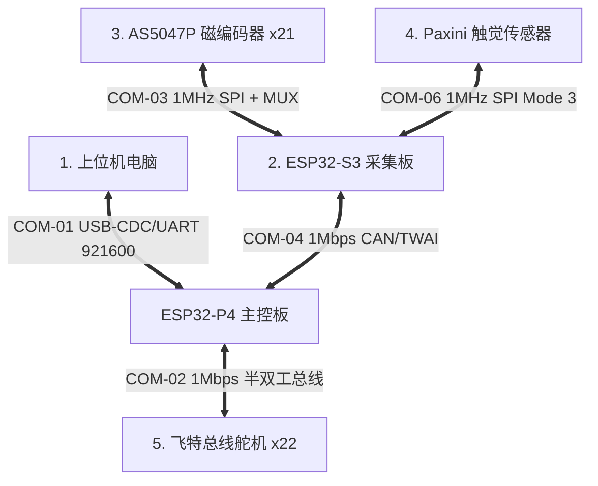

# 🤖 灵巧手项目嵌入式通信协议帧详解与面试通关指南

本篇文档是针对灵巧手系统的**全链路通信协议帧**所编写的深度解析。文档将从通信接口、物理参数、各数据帧的具体字节定义、帧在控制系统中的作用以及面试连环追问等多个维度带你彻底入门，并在面试中展示出深厚的底层工程功底。

---

## 🗺️ 一、 系统通信链路全景图

在整个多维触觉灵巧手控制系统中，共有五大核心通信链路。我们使用双核芯片（**ESP32-S3** 用于高频传感器采集，**ESP32-P4** 用于电机伺服闭环与上位机连接）：



---

## 📡 二、 SPI 链路数据帧定义与寄存器作用

S3 芯片作为 SPI 主机，向下连接了两种关键传感器：AS5047P 磁绝对值编码器（21路）和 Paxini 三轴触觉传感器。

### 1. AS5047P 磁编码器 SPI 读写帧（COM_FRAME_AS5047P_SPI）

*   **物理层**：SPI Mode 1 (CPOL=0, CPHA=1)，时钟频率 1 MHz。
*   **通信方向**：ESP32-S3（主机） $\leftrightarrow$ AS5047P 磁编码器（从机）。
*   **帧长**：16 bits (2 字节)。
*   **硬件痛点（面试高频）**：21个编码器若各用一个片选（CS）引脚会耗尽 GPIO。S3 侧通过 **3路 GPIO 选择控制 CD74HC138 译码器**，实现分时复用片选信号。

#### 帧格式定义

```
+---------------+---------------+---------------------------------------+
|  Bit 15 (MSB) |    Bit 14     |            Bit 13 ~ 0 (LSB)           |
+---------------+---------------+---------------------------------------+
|    Parity     |   R/W (1:读)  |           Register Address            |
+---------------+---------------+---------------------------------------+
```

*   **`Parity`（Bit 15，偶校验位）**：用于保障极弱传感器信号在电机强电磁干扰下的正确性。0~14位中如果 1 的个数为奇数则该位置 1，以使 1 的总数为偶数。
*   **`R/W`（Bit 14，读写选择）**：0 表示写，1 表示读。灵巧手控制中 99% 的操作为读（置 1）。
*   **`Register Address`（Bit 13~0，寄存器地址）**：目标寄存器地址。系统使用的核心寄存器如下：
    1.  **`0x3FFF` (ANGLECOM)**：带动态十进制补偿的 14 位绝对角度值（取值范围：0 ~ 16383）。这是系统**最核心的反向关节控制闭环源**。
    2.  **`0x0001` (ERRFL)**：错误寄存器。记录帧错误、无效命令、奇偶校验错等状态。当读取角度帧发现异常时，状态机自动跳转读该寄存器以排查故障。
    3.  **`0x3FFC` (DIAAGC)**：诊断与自动增益控制。可获取磁铁距传感器表面的偏近/偏远状态，作为**传感器安装间隙诊断指标**。

#### 💡 流水线（Pipeline）读取特性与代码设计
> [!IMPORTANT]
> **面试杀手锏：流水线延迟**
> AS5047P 采用双帧流水线读取机制。当你在第 $N$ 帧写入读取 `ANGLECOM` 的指令时，当前帧内 `MISO` 返回的实际上是上一次读取的旧数据。为了在控制环路中拿到**当前时刻**的绝对角度，在 `HalEncoders.cpp` 中，我们通过双发 `transferOnce` 冲刷流水线，立刻捕获零延迟角度反馈。

---

### 2. Paxini 触觉传感器 SPI 读帧（COM_FRAME_PAXINI_SPI_READ）

*   **物理层**：SPI Mode 3 (CPOL=1, CPHA=1)，时钟 1 MHz。
*   **通信方向**：ESP32-S3（主机） $\rightarrow$ 帕西尼触觉传感器。
*   **帧长**：命令头 5 字节 + 传感器状态 1 字节 + 荷载 15 字节 + 校验 1 字节。

#### 帧格式定义

```
+------------+--------------------+-------------------+---------------+---------------+------------+
| CMD (0xFB) | ADDR_Low (0xF0)    | ADDR_High (0x03)  | LEN_Low (0x0F)| LEN_High(0x00)| STATUS (1B)|
+------------+--------------------+-------------------+---------------+---------------+------------+
|                     PAYLOAD (15 字节: 5 个触觉单元 × 3轴力 fx/fy/fz)                      |  CRC8 (1B) |
+-------------------------------------------------------------------------------------------+------------+
```

*   **`CMD_READ` (0xFB)**：启动读取传感器命令。
*   **地址 `1008` (小端序 `0xF0 0x03`)**：触觉寄存器物理首地址。
*   **长度 `15` (小端序 `0x0F 0x00`)**：读取 15 字节负载数据。
*   **`PAYLOAD` (15 字节)**：一共 5 个测量单元（Taxel），每个单元包含 3 轴力 ($f_x, f_y, f_z$ 等 3 字节)。
    *   $f_x$ ($1 \text{ Byte}$, `int8_t`，带正负，剪切力X)
    *   $f_y$ ($1 \text{ Byte}$, `int8_t`，带正负，剪切力Y)
    *   $f_z$ ($1 \text{ Byte}$, `uint8_t`，无符号，垂直压力Z)
*   **`CRC8`**：由传感器硬件生成，用于保障单手指多点触觉高密度采集的链路稳定性。

---

## 🚗 三、 CAN / TWAI 链路分片与重组协议帧

ESP32-S3 采集的绝对角度（21路共 42 字节）与触觉数据（45 字节）远超标准 CAN 2.0B 的单帧容量限制（**8 字节**），因此在软件上自主设计了**应用层分片重组协议（Fragmentation Protocol）**。

### 1. 21路编码器角度同步帧（COM_FRAME_CAN_ENCODER）

*   **作用**：将 21 个编码器的绝对角度值高频（100 Hz）从 S3 送往 P4。
*   **ID 规划**：连续 ID 段 `0x100` ~ `0x105`（共 6 帧）。每帧 DLC = 8 字节。

#### 数据包映射定义

| CAN ID | DLC | 数据字段定义 (大端序 `uint16_t` 编码器值，取值范围 $0 \sim 16383$) | 帧的作用描述 |
| :--- | :--- | :--- | :--- |
| **`0x100`** | 8 | `data[0..1]`=Enc0, `data[2..3]`=Enc1, `data[4..5]`=Enc2, `data[6..7]`=Enc3 | 传输第 1 组绝对角度分片 |
| **`0x101`** | 8 | `data[0..1]`=Enc4, `data[2..3]`=Enc5, `data[4..5]`=Enc6, `data[6..7]`=Enc7 | 传输第 2 组绝对角度分片 |
| **`0x102`** | 8 | `data[0..1]`=Enc8, `data[2..3]`=Enc9, `data[4..5]`=Enc10, `data[6..7]`=Enc11 | 传输第 3 组绝对角度分片 |
| **`0x103`** | 8 | `data[0..1]`=Enc12, `data[2..3]`=Enc13, `data[4..5]`=Enc14, `data[6..7]`=Enc15 | 传输第 4 组绝对角度分片 |
| **`0x104`** | 8 | `data[0..1]`=Enc16, `data[2..3]`=Enc17, `data[4..5]`=Enc18, `data[6..7]`=Enc19 | 传输第 5 组绝对角度分片 |
| **`0x105`** | 8 | `data[0..1]`=Enc20, `data[2..7]` 填充 0 | **【触发关键帧】** P4 接收端一旦收到该帧，立即将 21 路重组好的快照同步更新进关节控制队列中。 |

---

### 2. 编码器硬件错误详情帧（COM_FRAME_CAN_ERROR_DETAIL）

*   **ID 范围**：`0x1F0` 至 `0x1F2` （共 3 帧）。DLC = 8。
*   **发送机制**：**事件触发**。当 S3 检测到 21 路中存在任何硬件错（如磁场过强、校验失败、断连）时，启动本组错误帧广播。
*   **重组状态机（`CanCommTask.cpp`）**：利用滚动序列号 `seq` 绑定。如果在重组时发现 `seq` 改变或时间间隔超过 50ms，自动清空缓冲区并丢包，确保数据的一致性。

#### 各分帧数据布局与编码逻辑

*   **`Byte 0` (Rolling Seq)**：S3 发送端自增的包序号，重组校验依据。
*   **`Byte 1 ~ 7` (Error Code)**：代表各个关节点的诊断错误码。

| CAN ID | Byte 0 | Byte 1 | Byte 2 | Byte 3 | Byte 4 | Byte 5 | Byte 6 | Byte 7 |
| :--- | :--- | :--- | :--- | :--- | :--- | :--- | :--- | :--- |
| **`0x1F0`** | `seq` | Enc0错 | Enc1错 | Enc2错 | Enc3错 | Enc4错 | Enc5错 | Enc6错 |
| **`0x1F1`** | `seq` | Enc7错 | Enc8错 | Enc9错 | Enc10错 | Enc11错 | Enc12错 | Enc13错 |
| **`0x1F2`** | `seq` | Enc14错 | Enc15错 | Enc16错 | Enc17错 | Enc18错 | Enc19错 | Enc20错 | (其余 `0xFF`) |

#### 错误码解析表（`encodeFaultCode`）

S3 在将复杂的 SPI 物理状态转换成 CAN 上传时，进行了高压缩编码：
*   `0x00`：OK，完全正常。
*   `0x01`：连接丢失（`LINK_LOST`，SPI 物理线路短路/断开，无法读出寄存器）。
*   `0x10`：帧错误（`FRAME_ERR`）。
*   `0x11`：无效命令（`INV_CMD`）。
*   `0x12`：奇偶校验错（`PAR_ERR`）。
*   `0x20`：磁铁距离太远（`MAG_LOW`，极易造成角度偏差）。
*   `0x21`：磁铁距离太近（`MAG_HIGH`，增益过载导致精度下降）。

---

### 3. 系统标定同步同步帧（COM_FRAME_CAN_CALIBRATION）

*   **用途**：实现双板在进行手部绝对零位标定状态机的握手通信。

#### 协议帧格式与动作

1.  **标定启动帧**（P4 发送 $\rightarrow$ S3 接收）：
    *   **CAN ID**：`0x200`，DLC = 1。
    *   **Payload**：`data[0] = 0xCA`。
    *   **动作**：S3 接报后，挂起高频数据发送，进入专用的零点存储和极性自检状态。
2.  **标定应答 ACK**（S3 发送 $\rightarrow$ P4 接收）：
    *   **CAN ID**：`0x300`，DLC = 1。
    *   **Payload**：`0x01`（成功） / `0x00`（失败，存在传感器断线）。

---

## 💻 四、 上位机与 ESP32-P4 二进制串口帧定义（COM-01）

*   **物理层**：波特率 **921600**，采用固定帧头（`0xFE`）与帧尾（`0xFF`）的串口流对齐格式。

### 1. 上位机控制下发帧（COM_FRAME_PC_TO_P4_COMMAND）

```
+------------+------------+------------+--------------------------+------------+
| Header(0xFE| Length(1B) |  CMD (1B)  |     PAYLOAD (N 字节)     | Tail (0xFF)|
+------------+------------+------------+--------------------------+------------+
```

*   **`Length`**：`CMD` 字节至 `Tail` 字节的总数。

#### 命令字（CMD）与负载定义

| CMD 字节 | 命令名称 | Payload 大小 | 数据布局格式 (小端序) | 触发的硬件动作/状态切换 |
| :--- | :--- | :--- | :--- | :--- |
| **`0xCB`** | `CMD_ANGLE_CTRL` | 84 字节 | 21 个 `float32` 关节角度值 | **角度伺服模式**。主控板切换成多级关节外环控制，驱动 22 个电机追踪关节角目标。 |
| **`0xD3`** | `CMD_MOTOR_POS_ABS` | 44 字节 | 22 个 `int16` 单圈绝对位置目标 | **直接电机控制**。直接将电机目标写入舵机内环，绕过逆运动学解算。 |
| **`0xD4`** | `CMD_TENDON_GUARD` | 84 字节 | 21 组腱保护阈值配置 | **肌腱拉断防范机制**。配置各腱的最大拉力阈值，一旦超出自动停机。 |
| **`0xCC`** | `CMD_START` | 0 字节 | 无 | **解除自锁**。P4 设置控制使能，清空累计故障状态，为总线舵机重新供电。 |
| **`0xCD`** | `CMD_STOP` | 0 字节 | 无 | **紧急停机（E-Stop）**。P4 立刻切断舵机输出力矩，进入自由悬挂状态。 |
| **`0xD1`** | `CMD_SENSOR_STREAM_MODE` | 1 字节 | `uint8` 选项（0: 关闭, 1: 全速） | **传感器流控**。配置 P4 上报遥测数据的模式。 |

---

### 2. P4 向上位机反馈数据帧（PACKET_P4_TO_PC）

P4 会以 Packet Type 区分，向上位机高频汇报下述数据帧：

| Packet Type | 数据包名称 | Payload 大小 | 数据布局与详细作用说明 |
| :--- | :--- | :--- | :--- |
| **`0x01`** | `PACKET_SENSOR` | 42 字节 | **21 路关节映射后的真实输出角度** (`int16_t` x 21)。若某通道值为 `0x7FFF` 说明其处于断连故障状态。 |
| **`0x03`** | `PACKET_SERVO_ANGLE` | 110 字节 | **22 路舵机的多圈累积绝对角度** (`int32` x 22) 与**电机在线状态表** (`uint8` x 22)。用于手掌腱排排布力矩的监控。 |
| **`0x04`** | `PACKET_JOINT_DEBUG` | 25 字节 | **【高频调试专用帧】** 返回关节目标（`targetDeg`）、角度反馈（`magActualDeg`）、外环输出值、内环反馈及内环输出。用于 PID 闭环参数整定。 |
| **`0x05`** | `PACKET_SERVO_TELEM` | 154 字节 | **【电机健康遥测】** 22 路舵机的实时转速 (`int16`)、内部电驱负载 (`int16`)、总线电压 (`uint8`)、工作温度 (`uint8`)。若有温度超限触发报警。 |
| **`0x07`** | `PACKET_FAULT_STATUS` | 4 字节 | **【关节故障状态位图】** 21 路磁绝对编码器的故障映射。一旦有对应的位被置 1，上位机界面对应的指关节呈红色报警状态。 |
| **`0x0A`** | `PACKET_TACTILE` | 46 字节 | **【多维触觉重组帧】** 包含 1 字节滚动序列号及重组集齐的 45 字节三轴触觉受力值，用于灵巧手抓握闭环。 |

---

## ⚙️ 五、 飞特总线舵机通信帧协议（COM-02）

*   **物理层**：TTL 单线异步半双工，波特率 **1 Mbps**。
*   **通信方向**：ESP32-P4（主机） $\leftrightarrow$ 22 个外置总线舵机。

### 帧 9：飞特协议帧（COM_FRAME_FTSERVO_BUS）

```
+------------------+----------+------------+-----------------+---------------------+------------+
| Header(0xFF 0xFF)| ID (1B)  | Length (1B)| Instruction(1B) |   Parameters (NB)   |Checksum(1B)|
+------------------+----------+------------+-----------------+---------------------+------------+
```

*   **ID**：设备物理地址（1 ~ 22）。广播写时填 `0xFE`。
*   **`Length`**：`Instruction` 到 `Checksum` 的总字节长度。
*   **`Checksum`**：校验和。算法为：`~ (ID + Length + Instruction + Sum(Parameters)) & 0xFF`。

#### 核心指令字 (Instruction) 与多电机实时性解决设计

1.  **同步写 `INST_SYNC_WRITE` (0x83)**：
    *   **痛点**：如果对 22 个电机独立下发目标角度帧，会极大地挤占半双工串口总线的空闲时间，产生可察觉的数据不同步现象。
    *   **应对方案**：主控板使用广播 ID `0xFE` 配合 `SyncWrite` 指令。主控板一次性发送包含 22 个电机的总命令大帧，包含每个电机的【ID、目标位置、运行速度、启动加速度】，所有电机接收后同步响应，**消除指关节间的相位滞后**。
2.  **同步读 `INST_SYNC_READ` (0x82)**：
    *   **应对方案**：主机下发一次读指令，指定需要读取的首地址寄存器 56（负载、速度、电压、温度、在线状态，长度为 8 字节）以及 22 个电机的 ID 排布表。总线上的电机根据包内的顺序**分时主动发送应答状态包**，避免了多次发起请求读报文的开销。

---

## 🎯 六、 嵌入式面试实战 Q&A（带你完美应对面试官）

当你去面试嵌入式软件开发工程师（特别是涉及**工业机器人、电机控制、智能硬件**岗位）时，面试官极有可能就这套通信架构进行刨根问底。以下是为你准备的**教科书级别应答话术**：

### Q1：SPI 通信的几种模式你们用过哪些？AS5047P 这种高速传感器在使用 SPI 时有什么需要特别注意的设计？
> **回答话术**：
> SPI 有 4 种工作模式，由 `CPOL`（时钟极性）与 `CPHA`（时钟相位）的组合决定。在我们的磁编码器读取中，选用的是 **Mode 1 (CPOL=0, CPHA=1)**，因为 AS5047P 的时序要求数据在时钟信号的**下降沿采样**。
>
> 另外在开发中需要注意其**双帧流水线（Pipeline）读取限制**。当主机发送第 $N$ 帧读取指令时，当前周期接收到的其实是第 $N-1$ 次的数据。这就导致直接读取会引入一帧的数据延迟。
>
> 我们的解决方法是：在实时控制环路中，如果需要最新的物理角度，我们会在片选选通后**连续发起两次 SPI 事务传输**。第一帧用于写入目标指令冲刷寄存器管线，第二帧专门用于捕获当前瞬间的真实现场角度值，实现零控制时延。同时我们在短帧传输中使用了**轮询发送（Polling Transmit）**而非 DMA 或频繁硬件中断，因为短帧数据下，中断的上下文切换开销往往远超轮询等待的几个微秒，这样把整体延迟做到了纳秒级。

---

### Q2：CAN 2.0 最大的荷载只有 8 个字节，但在机器手控制中，传感器数据（比如 21路编码器或多维触觉）往往非常庞大。你们如何解决这个矛盾？
> **回答话术**：
> 是的，这是标准 CAN 物理层的物理限制。我们在应用层软件自主设计了**分片与分级重组协议**：
>
> 1. 对于**高频关节角度数据**，我们定义了连续的 ID 段 `0x100` ~ `0x105`。S3 端按 4 个角度一组大端拆分，在 6 帧中连续喷射。P4 接收端周期接收，当检测到**最后一帧 ID `0x105`** 到达时，说明此时 21 路绝对角度完整拼装完毕，立即激活发布流程送往电机伺服控制任务。
> 2. 对于**故障自诊断与触觉大包数据**，我们引入了**基于 Sequence 包序号与超时保护的重组机制**。S3 在发送时将数据分片，首字节 `byte[0]` 填充滚动序列号 `seq`。P4 接收端利用 `frameMask` 记录集齐的帧。在重组期间，若检测到新帧的 `seq` 发生变化或者分片间的到达间隔超过 50ms 阈值，则判定当前拼装包失效，直接丢弃缓存并重新接收。这样避免了由于物理丢帧导致的数据错位拼接，保证了机器人关节状态监测的一致性。

---

### Q3：你的项目中使用了双板（ESP32-S3 和 P4）通过 CAN 通信。如果在运行中 CAN总线因为外界电磁噪声引起了总线关闭（Bus-Off），或者其中一块板断电了，你们有什么安全保护和自我修复机制吗？
> **回答话术**：
> 这我们在工程落地中做了双重防错设计。
>
> **第一，CAN链路的自我修复（Bus-Off Recovery）**：我们在软件中开启了一个周期性的通信守护任务。通过 ESP-IDF 的 `twai_get_status_info()` 实时获取 CAN 控制器的内部报错计数与硬件状态。一旦检测到硬件因为外界噪声累积进入了 `TWAI_STATE_BUS_OFF`（总线关闭），任务会自动调用 `twai_initiate_recovery()` 发起总线重置与并网恢复，保证了链路在极短暂中断后可以自行恢复通信，而无需人工复位。
>
> **第二，控制状态的离线自锁（Failsafe）**：在 P4 闭环主控端，我们设计了心跳超时机制。一旦 CAN 接收中断在超过 300ms 的时间内没有成功重组并更新编码器数据（可能 S3 掉电或总线硬断开），系统会自动将 21 路关节的 `errorFlags` 置位，切断伺服控制使能（E-Stop），使 22 路舵机完全力矩释放或进入阻尼保护，防止因失去传感器反馈导致手部指节失控快速旋转拉断内部肌腱。
