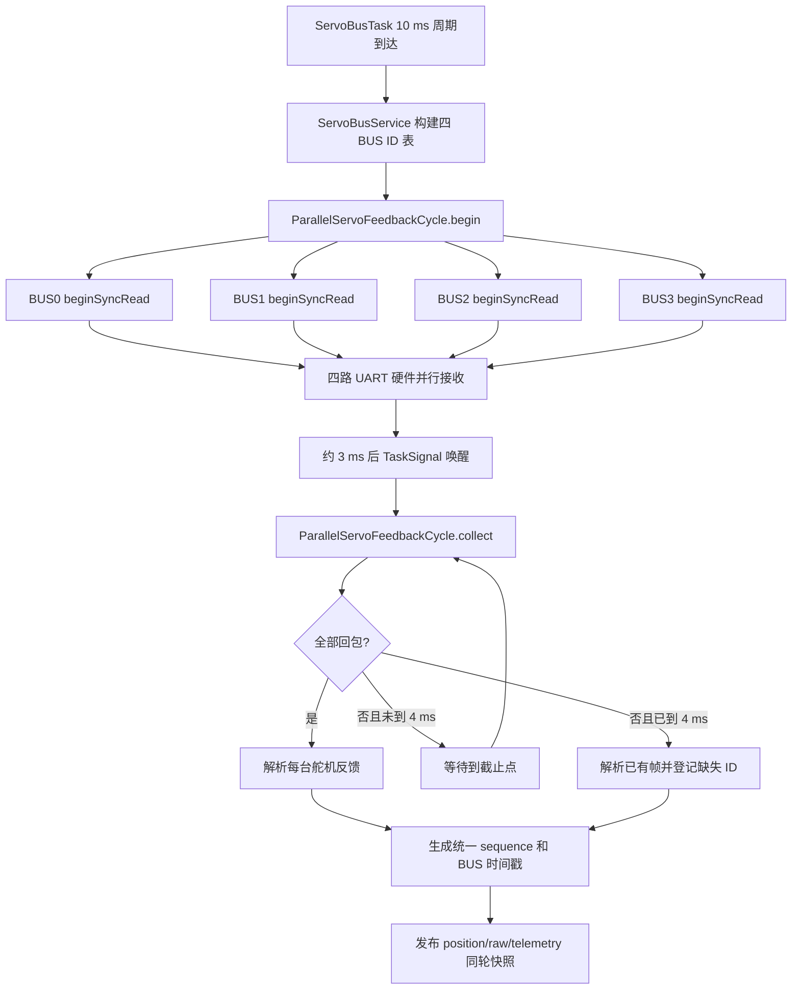
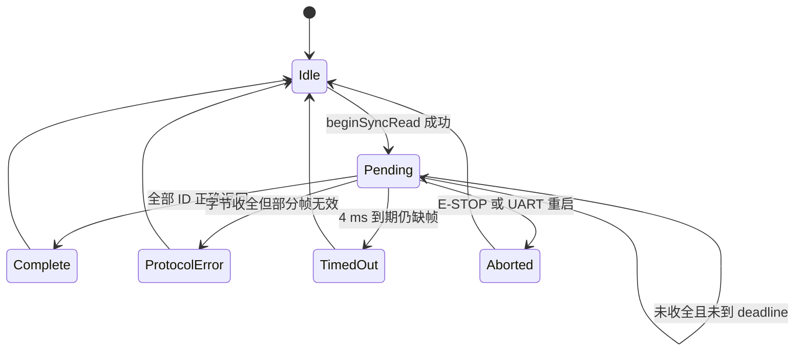

# 飞特舵机四 BUS 10 ms 并行同步读改造说明

最后核对：2026-08-22

## 1. 文档目的

本文结合当前 P4 固件源码，说明飞特 SDK 如何从原来的阻塞式同步读改造成四条独立 UART BUS 的两阶段并行同步读，并回答以下问题：

- 为什么原来的双 BUS 轮询只能让单条 BUS 约 50 Hz 更新；
- 四条 BUS 如何在每个 10 ms 周期内共同发起读取；
- 为什么 SDK 必须拆成 `Begin` 和 `Collect` 两个阶段；
- 12 台舵机/BUS 时，3 ms 收集点和 4 ms 截止时间是否够用；
- 目标同步写、反馈同步读、热插拔和在线判定如何避免互相干扰；
- Task Runtime 实测是否证明改造已经生效，以及当前还存在哪些余量风险。

本文只描述当前源码。参数以 `ServoConfig.h`、`BoardConfig.h` 和 `DimensionsConfig.h` 为最终事实源。

## 2. 改造目标与边界

当前硬件有四条彼此独立的 1 Mbps UART 舵机总线：

| BUS | RX | TX | 最大控制舵机数 |
| --- | ---: | ---: | ---: |
| BUS0 | GPIO21 | GPIO20 | 12 |
| BUS1 | GPIO23 | GPIO22 | 12 |
| BUS2 | GPIO27 | GPIO26 | 12 |
| BUS3 | GPIO33 | GPIO32 | 12 |

改造目标是每 10 ms 发起一轮四 BUS 反馈采样：

1. CPU 依次向 BUS0～BUS3 写入同步读请求；
2. 四个 UART 外设随后同时接收各自总线上的舵机回包；
3. 任务不在任何一条 BUS 上阻塞等待，而是休眠到约 3 ms 收集点；
4. 收集四条 UART 已经到达的字节；
5. 未完整的 BUS 最晚等到 4 ms 截止点；
6. 四条 BUS 都进入完成或超时终态后，发布同一 `sequence` 的反馈快照。

这里的“并行”是四个 UART 接收窗口重叠。四个请求仍由同一个 CPU 依次调用发送函数，不是同一个时钟周期同时写出，但请求帧很短，其发送时间相对于多台舵机回包窗口较小。

## 3. 改造前的问题

厂商 SDK 的传统同步读接口是阻塞式调用：

```text
发送 BUS0 请求 -> 等 BUS0 全部回包/超时
发送 BUS1 请求 -> 等 BUS1 全部回包/超时
发送 BUS2 请求 -> 等 BUS2 全部回包/超时
发送 BUS3 请求 -> 等 BUS3 全部回包/超时
```

若每条 BUS 都可能等待约 3 ms，四条串行执行会占用约 12 ms，已经超过 10 ms 控制周期。因此旧实现只能每轮读取部分 BUS，例如两条两条交替：

```text
第 0 个 10 ms：BUS0 + BUS1
第 1 个 10 ms：BUS2 + BUS3
第 2 个 10 ms：BUS0 + BUS1
```

这会使单条 BUS 的反馈周期变成约 20 ms，即约 50 Hz。控制任务即使以 100 Hz 运算，也会连续两次使用同一份舵机反馈，增加反馈年龄并削弱掉电检测速度。

## 4. 改造后的整体框图



不支持 Mermaid 的查看器可直接看下面的纯文本版本：

```text
ServoBusTask(10 ms)
  -> ServoBusService
     -> 为每条 BUS 整理在线舵机 ID
     -> ParallelServoFeedbackCycle.begin()
        -> BUS0.beginSyncRead() 只发送
        -> BUS1.beginSyncRead() 只发送
        -> BUS2.beginSyncRead() 只发送
        -> BUS3.beginSyncRead() 只发送
     -> 任务休眠，四个 UART 独立接收
  -> 约 3 ms 后唤醒
     -> ParallelServoFeedbackCycle.collect()
        -> 每条 BUS.collectSyncRead() 只搬运现有字节
        -> 完整则解析；不完整则最晚等到 4 ms
     -> publishFeedback()
        -> position/raw/telemetry 共用 sequence 和时间戳
```

## 5. 第一层：改造飞特 SDK

### 5.1 原接口为什么不能直接用于四 BUS

原 `SCS::syncReadPacketTx()` 将“发请求”和“等待回包”绑定在同一个调用中。调用 BUS0 时，CPU 会停在 `readSCS()`，无法及时向 BUS1～BUS3 发请求。

当前实现保留原阻塞接口供厂商示例兼容，同时新增正式链路使用的两阶段接口。

### 5.2 只发送请求：`syncReadPacketTxOnly()`

位置：

- `ESP32-P4/libraries/FTServo_Arduino/src/SCS.h`
- `ESP32-P4/libraries/FTServo_Arduino/src/SCS.cpp`

`syncReadPacketTxOnly()` 完成以下工作：

1. 检查 ID 数量和接收缓存容量；
2. 清空 UART 旧 RX 数据；
3. 记录本轮单台反馈长度；
4. 发送广播 ID `0xFE`、同步读指令、寄存器地址、长度和 ID 列表；
5. 刷出 TX 数据后立即返回，不等待任何舵机回包。

现有阻塞接口被改为复用它：

```cpp
const int txResult = syncReadPacketTxOnly(ID, IDN, MemAddr, nLen);
syncReadRxBuffLen = readSCS(syncReadRxBuff, syncReadRxBuffMax, syncTimeOut);
```

这样厂商示例行为不变，而 P4 正式链路可以只调用第一行。

### 5.3 非阻塞搬运：`syncReadCollectAvailable()`

位置：

- `ESP32-P4/libraries/FTServo_Arduino/src/SCS.cpp`
- `ESP32-P4/libraries/FTServo_Arduino/src/SCSerial.h`
- `ESP32-P4/libraries/FTServo_Arduino/src/SCSerial.cpp`

`SCSerial::readSCSAvailable()` 只循环读取 `HardwareSerial::available()` 已经报告的字节。当前没有字节时立即返回，不执行超时等待。

`SCS::syncReadCollectAvailable()` 再把这些字节追加到 SDK 自己的同步读接收缓存，并通过以下接口暴露进度：

- `syncReadBufferedBytes()`：当前已经收到的字节数；
- `syncReadExpectedBytes()`：本轮期望收到的总字节数。

这一步是四 BUS 并行的关键。如果 Collect 内仍调用阻塞式 `readSCS()`，四条 BUS 又会退化成顺序等待。

### 5.4 SDK 缓存容量

飞特状态帧除数据字段外还有 6 字节协议开销。当前最大反馈长度为 15 字节，因此 12 台舵机的期望回包为：

```text
12 * (15 + 6) = 252 bytes
```

`ServoConfig.h` 和 `FeetechServoDriver.h` 都有编译期断言，保证单 BUS 最大回包不超过 SDK 的 256 字节同步读缓存。

## 6. 第二层：`FeetechServoDriver` 事务状态机

位置：`ESP32-P4/ServoBoardMain/src/hal/servo/FeetechServoDriver.h`

驱动层把 SDK 的字节接口封装成一条 BUS 的事务状态机：



### 6.1 `beginSyncRead()`

该函数：

- 拒绝空 ID、超过 12 台或已有事务未完成的请求；
- 保存 ID 列表、`sequence`、开始时间和截止时间；
- 以 10 分频决定本轮读取 8 字节还是 15 字节反馈；
- 调用 SDK `syncReadBegin()` 配置期望长度；
- 调用 `syncReadPacketTxOnly()` 发出请求；
- 成功后进入 `Pending`。

普通轮次读取 8 字节：位置、速度、负载、电压和温度。每 10 轮读取一次 15 字节数据，并补充电流字段。这样位置约 100 Hz、电流约 10 Hz，避免所有周期都承担最大回包长度。

### 6.2 `collectSyncRead()`

该函数每次只做有限工作：

1. 调用 `syncReadCollectAvailable()` 搬运当前字节；
2. 若尚未收全且未到截止时间，返回 `Pending`；
3. 收全或到期后，按请求 ID 调用 `syncReadPacketRx()` 解包；
4. 正确帧调用 `recordFeedbackSuccess()`；
5. 缺失或错误帧调用 `markReadFailure()`；
6. 返回成功数、期望数、耗时和事务终态。

因此某一条 BUS 超时不会阻塞另外三条 BUS，也不会让任务无限等待。

### 6.3 事务取消

`abortSyncRead()` 用于 E-STOP 和 UART 维护。主动取消默认不计为舵机通信失败，防止维护操作错误触发离线；UART 重启前会先终止尚未完成的同步读并清空待发目标批次。

## 7. 第三层：四 BUS 轮次协调器

位置：

- `ESP32-P4/ServoBoardMain/src/tasks/servo_bus/ParallelServoFeedbackCycle.h`
- `ESP32-P4/ServoBoardMain/src/tasks/servo_bus/ParallelServoFeedbackCycle.cpp`

`ParallelServoFeedbackCycle` 不负责路由、在线恢复和多圈逻辑，只负责一轮四 BUS 事务的一致性。

### 7.1 Begin 阶段

`begin()` 递增统一 `sequence`，记录：

- `startedUs_`：本轮第一条请求开始时间；
- `nextCollectUs_`：约 3 ms 后的首次收集时刻；
- `deadlineUs_`：4 ms 硬截止时间；
- `requestedBusMask_`：实际发起请求的 BUS；
- 每条 BUS 的请求舵机数。

随后依次调用四个 `FeetechServoDriver::beginSyncRead()`。某条 BUS 发起失败时，只将该 BUS 记入超时掩码，不阻止其他 BUS 开始。

### 7.2 Collect 阶段

`collect()` 遍历尚未终结的 BUS：

- `Pending`：继续等待；
- `Complete` 且成功数等于请求数：写入 `freshBusMask_`；
- 超时或协议错误：写入 `timeoutBusMask_`；
- 每条 BUS 都记录自己的完成时间和 Task Runtime I/O 样本。

只有所有请求 BUS 都进入终态后，才生成完整的 `ServoFeedbackCycleMeta_t` 并结束本轮。

## 8. 第四层：任务调度与目标写仲裁

位置：

- `ESP32-P4/ServoBoardMain/src/tasks/servo_bus/ServoBusTask.cpp`
- `ESP32-P4/ServoBoardMain/src/tasks/servo_bus/ServoBusService.cpp`

### 8.1 10 ms 周期和 3 ms 收集点

`ServoBusTask` 使用绝对周期 `PeriodicDeadline` 保留 10 ms 兜底节奏，同时把下一次等待时间取为以下两者的较小值：

- 距离下一个 10 ms 周期点的时间；
- 距离当前反馈事务收集点的时间。

等待通过 `TaskSignal` 完成，不进行忙轮询。典型时序如下：

```text
t = 0.0 ms   周期到达，四条 BUS 依次发同步读请求
t = 0~3 ms   ServoBusTask 休眠，四路 UART 硬件接收
t = 3.0 ms   首次 collect
t = 3~4 ms   仅不完整 BUS 继续等待
t = 4.0 ms   硬截止，解析已有帧并登记缺失 ID
t < 10 ms    发布快照、做在线维护和后台扫描
t = 10 ms    开始下一轮
```

### 8.2 读事务期间不发送目标

飞特总线是半双工链路。若同步读回包期间插入同步写，可能破坏正在接收的状态帧。因此 `ServoBusService` 使用 `deferredTargetWake`：

- 新目标在读事务期间到达时，只记录待处理唤醒；
- `feedbackCycle.active()` 为 false 后才取最新目标并同步写；
- 目标邮箱仍采用最新值语义，不补发已经过时的中间目标。

这保证反馈事务完整，也避免为了等反馈永久丢失控制目标。

### 8.3 标定期间的读范围

正常运行读取所有可控路由。自动标定期间只读取：

```text
active_motor_mask | calibration_aux_motor_mask
```

这样仍保持四 BUS 两阶段机制，但减少无关舵机回包，不让未参与标定的通道影响标定反馈新鲜度。

## 9. 同轮反馈快照

位置：

- `ESP32-P4/ServoBoardMain/src/data/ServoTypes.h`
- `ESP32-P4/ServoBoardMain/src/tasks/servo_bus/ServoFeedbackPublisher.cpp`

每轮生成以下元数据：

| 字段 | 含义 |
| --- | --- |
| `sequence` | 四 BUS 统一轮次号 |
| `cycleStartedUs` | 第一条 BUS 请求发起时间 |
| `cycleCompletedUs` | 全部请求 BUS 进入终态的时间 |
| `busSampleTimestampUs[4]` | 每条 BUS 完成或超时的时刻 |
| `requestedBusMask` | 本轮请求了哪些 BUS |
| `freshBusMask` | 哪些 BUS 的全部目标舵机成功返回 |
| `timeoutBusMask` | 哪些 BUS 存在发起失败、缺帧或超时 |

`publishFeedback()` 把同一份元数据复制到以下三类快照：

- logical ABS/单圈 raw 位置快照；
- raw 位置视图；
- speed/load/current/voltage/temperature 遥测快照。

消费者由此可以判断不同字段是否来自同一轮采样，而不是仅比较各自的发布时间。

注意：四条 BUS 的物理采样时刻仍有数百微秒级差异，所以系统保存每 BUS 时间戳，而没有伪装成严格同时采样。

## 10. 时间与缓存预算

舵机总线波特率为 1 Mbps。UART 通常按 1 个起始位、8 个数据位和 1 个停止位计算，即每字节约 10 bit。

### 10.1 普通 8 字节反馈

单台状态帧约为：

```text
8 byte 数据 + 6 byte 协议开销 = 14 byte
```

12 台总回包：

```text
12 * 14 = 168 byte
168 * 10 / 1,000,000 = 1.68 ms
```

同步读请求对 12 个 ID 约 20 byte，发送约 0.20 ms。加上舵机换向、逐台应答间隔和任务抖动后，3 ms 首次收集点合理。

### 10.2 带电流的 15 字节反馈

```text
12 * (15 + 6) = 252 byte
252 * 10 / 1,000,000 = 2.52 ms
```

再加约 0.20 ms 请求和换向间隔，已经接近 3 ms，因此代码允许未完整 BUS 继续等到 4 ms。电流只每 10 轮读取一次，避免持续占用这一最坏时序。

### 10.3 UART 环形缓冲

每条舵机 UART 的 RX 环形缓冲为 512 byte：

```text
最大一轮回包 252 byte
两轮最大回包 504 byte
512 byte >= 504 byte
```

该容量能覆盖一次调度抖动造成的短暂积压，但不意味着允许长期不收集。4 ms 截止和 10 ms 周期仍必须正常运行。

## 11. 在线、掉线与恢复判定

同步读结果直接进入每台舵机的反馈可信状态：

- 连续读失败达到 3 次时撤销在线信任；
- 即使失败计数没有增加，80 ms 没有新反馈也强制判离线；
- 重新发现后必须连续成功 3 次才恢复在线，正常约 30 ms；
- BUS 重启或 E-STOP 会取消当前事务，不把主动取消误记成硬件掉线；
- 一条 BUS 超时只污染自己的 `timeoutBusMask`，其他 BUS 的新鲜反馈仍可发布。

这比旧 20 ms/BUS 的轮询更快发现舵机掉电，也减少 P4 继续沿用陈旧 hardware ABS 的时间。

## 12. Task Runtime 实测结果

数据来源：

`run_data/运行日志/task_runtime/task_runtime_20260822_184601.csv`

稳定窗口中观察到：

| 指标 | 实测 |
| --- | ---: |
| ServoBus 周期触发 | 约 99～101 次/s |
| 单 BUS 完整读取轮次 | 约 95 次/s |
| BUS 事务平均时间 | 约 3.42 ms |
| BUS P95/P99 | 4.0 ms / 4.0 ms |
| ServoBus 稳态单核占比 | 约 73% |
| BUS0 | 570/570 个舵机响应成功 |
| BUS1 | 570/570 个舵机响应成功 |
| BUS2 | 757/760 个舵机响应成功 |
| BUS3 | 665/665 个舵机响应成功 |

四个 `busX_read_count` 同时增长到约 95，证明当前不是两组 BUS 交替轮询，而是每轮四 BUS 都参与。实际完整反馈约 95 Hz，而不是严格 100 Hz，主要受 4 ms 截止、任务调度、目标事件和后台维护影响。

BUS2 在该统计窗口出现 3 个单舵机响应缺失，说明并行机制已工作，但 4 ms 余量偏紧，仍需长时间实机压力测试。Task Runtime 的历史 `overrun_count` 为累计值，不能仅凭一个非零值判断当前持续超限，应观察它是否在稳定运行中继续增长。

## 13. 同步写与同步读的区别

同步写没有舵机回包。P4 可以在每条 BUS 上发送一帧目标后立即处理下一条 BUS，因此原本就容易实现四路快速下发。

同步读不同：

1. P4 发送一帧包含多个 ID 的请求；
2. 多台舵机按协议依次返回状态帧；
3. 必须区分“请求已发出”和“所有回包已收集”；
4. 任意一台缺帧不能永久阻塞整条 BUS；
5. 四条 UART 的接收缓冲和事务状态必须彼此独立。

因此同步读需要本次新增的 Begin/Collect 状态机，而同步写不需要等待阶段。

## 14. 关键文件与职责

| 文件 | 本次职责 |
| --- | --- |
| `ESP32-P4/libraries/FTServo_Arduino/src/SCS.h/.cpp` | 拆分同步读发送、非阻塞收集和接收进度 |
| `ESP32-P4/libraries/FTServo_Arduino/src/SCSerial.h/.cpp` | 提供只读当前 UART 可用字节的接口 |
| `ESP32-P4/ServoBoardMain/src/hal/servo/FeetechServoDriver.h` | 单 BUS 同步读事务、解包、失败计数和取消 |
| `ESP32-P4/ServoBoardMain/src/tasks/servo_bus/ParallelServoFeedbackCycle.*` | 四 BUS 同轮 Begin/Collect、掩码和统一 sequence |
| `ESP32-P4/ServoBoardMain/src/tasks/servo_bus/ServoBusTask.cpp` | 10 ms 周期、3/4 ms 收集唤醒和超限统计 |
| `ESP32-P4/ServoBoardMain/src/tasks/servo_bus/ServoBusService.cpp` | 路由组包、读写仲裁、在线维护和反馈发布 |
| `ESP32-P4/ServoBoardMain/src/tasks/servo_bus/ServoFeedbackPublisher.*` | 发布带同轮元数据的三类反馈快照 |
| `ESP32-P4/ServoBoardMain/src/data/ServoTypes.h` | 定义反馈轮次元数据 |
| `ESP32-P4/ServoBoardMain/src/config/ServoConfig.h` | 10 ms、3 ms、4 ms、10 分频和在线阈值 |
| `ESP32-P4/ServoBoardMain/src/config/BoardConfig.h` | 1 Mbps、四 BUS 引脚和 512 byte RX 缓冲 |
| `ESP32-P4/ServoBoardMain/src/config/DimensionsConfig.h` | 12 台/BUS 的唯一容量上限 |

## 15. 当前收益

1. 单 BUS 反馈由旧方案约 50 Hz 提升到实测约 95 Hz。
2. 四条 BUS 在同一 10 ms 轮次中采样，跨手指反馈年龄更一致。
3. 某条 BUS 缺帧不会顺序阻塞其他 BUS。
4. 舵机掉电可更快通过连续失败或 80 ms 新鲜度门限被识别。
5. 目标事件仍能立即唤醒任务，但不会插入半双工反馈回包窗口。
6. position、raw 和 telemetry 带有统一 sequence，便于日志、控制和故障分析对齐。

## 16. 当前不足与后续验收

当前实现已证明架构生效，但还不能把“10 ms 周期”直接等同于“任何工况都稳定 100 Hz”。应继续完成以下验收：

1. 四条 BUS 均挂满 12 台舵机，持续运行至少 30 分钟；
2. 同时执行高频目标下发、自动标定和 Task Runtime 订阅；
3. 记录每 BUS 成功率、P95/P99、`timeoutBusMask` 和 overrun 增量；
4. 分别测试单台掉电、整条 BUS 掉电、重新上电和 UART 重启；
5. 检查控制过程中是否出现连续两个以上反馈轮次缺失；
6. 确认 ServoBus 稳态 CPU 占比不会挤压 Control、CAN 和 StateMachine；
7. 只有在 4 ms 超时持续出现时，才根据实测考虑把截止放宽，而不是先降低控制频率。

当前最值得关注的是：BUS P95/P99 已触及 4 ms，ServoBus 稳态约占单核 73%。后续优化应优先减少解析和后台扫描开销，并把“普通位置轮”和“带电流轮”的统计分开，而不是盲目把周期继续缩短到 5 ms。

## 17. 本地回退点

本次并行同步读实验开始前已创建本地回退点，未上传远端：

```text
commit: 5f386f0 checkpoint: before parallel servo sync read
tag:    local-before-parallel-sync-read-20260822
```

该回退点仅用于定位本次实验前后的差异。工作区还包含其他未提交修改，回退前必须先检查 `git status`，不能直接覆盖用户数据。
